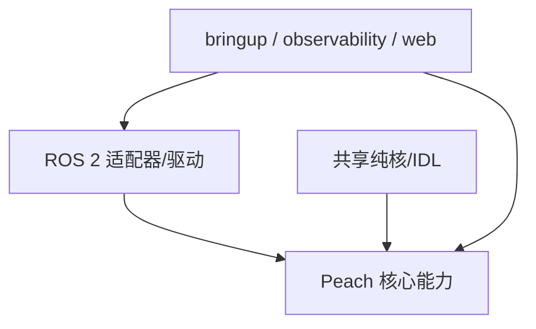

# 总体架构

## 范围与原则

Peach 是固定式采摘应用栈。硬件通过 ROS 2 话题/服务/动作/TF 接入，核心能力不 import 驱动/适配器。

- 核心能力：`peach_scene_perception`、`peach_target_reconstruction`、`peach_supervisor`、`peach_scene_obstacles`。
- 共享：`peach_interfaces`、`peach_common`、`peach_vision_core`。
- 技能/驱动边界：`peach_arm`、相机适配器、`serial_force`。
- 组合/观测：`peach_bringup`、`peach_observability`、`peach_web`。
- `peach_harvester`：无代码 metapackage，仅兼容安装名。

## 分层

## 稳定性约束

- 能力包之间只走 `peach_interfaces`，禁止互相 import 业务模块。
- 核心不 import 相机/臂/力适配器。
- 节点名、话题/服务/动作、QoS 和采摘语义在结构迁移中不改。
- `peach_sim` 不在本设计范围。
