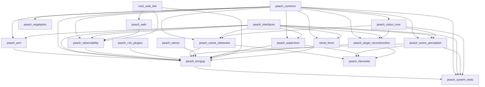

# 包依赖

本图按当前 `package.xml` 的工作区应用依赖绘制，箭头 `A → B` 表示 B 声明依赖 A；仅画 Peach 应用、共享 SDK 与五点力包之间的直接依赖，省略 apt/驱动依赖和 `test_depend`。它不是进程或 ROS 话题图。

## 边界与完整依赖

- 能力包之间通过 `peach_interfaces` 通信；共享函数来自 `peach_common` / `peach_vision_core`。声明依赖不允许跨业务模块导入。
- `peach_arm` 在 Peach 包内依赖 common/interfaces；其 AUBO 消息、MoveIt、MTC、Ruckig 等依赖仍以本包 package.xml/CMakeLists.txt 为准。
- `peach_stereo` 的厂商头文件/SDK 来自只读 `percipio_camera`；common 通过工具档案读取 `aubo_description`。
- `peach_harvester` 仅为四能力包的兼容 metapackage；system_tests 与 vegetation 不属于生产整栈运行节点集。
- `peach_web` 是静态资源包，依赖 SDK 发行资源；observability 与 bringup 也显式依赖 `ros2_web_link`，不能把浏览器 SDK 当成未接入的示例。
- 完整构建依赖读各包 `package.xml` 和构建清单，实际进程与数据流见 [整栈架构](../../src/peach/peach_bringup/doc/architecture.md)。
