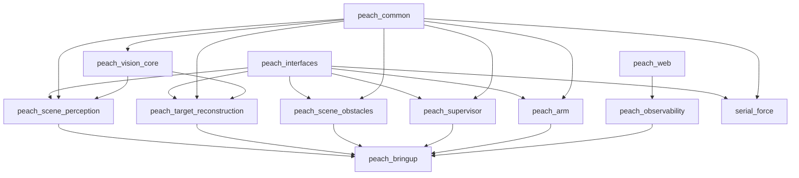

# 包依赖

## 允许/禁止

- 允许：能力包 → `peach_interfaces` / `peach_common` / `peach_vision_core`；组合/应用层 → 能力包。
- 禁止：能力包之间互相 import；核心 import `serial_force`/相机/臂驱动；`peach_web` import ROS。
- `peach_arm` 只依赖 `peach_common` + `peach_interfaces`，不再依赖视觉包。
