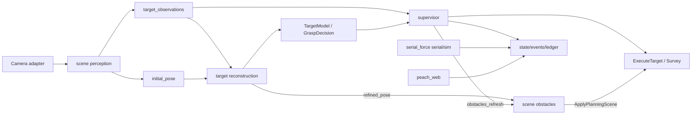

# 运行数据流

## 单向约束

- 感知只产生事实；重建产生模型与许可；调度只选果/编排；臂只执行。
- `grasp_decision` 是许可缓存，不是选果输入。
- 力只进显示/记录/离线分析，不参与运动许可。
- `peach_sim` 不在此图内。

## lifecycle

- scene/reconstruction/supervisor/arm：`LifecycleNode`，configure 建资源，activate 才处理/接单。
- scene_obstacles：普通 Node + worker，只写 PlanningScene world objects。
- serial_force：普通 Node，`source:=serial|sim` 选源。
- `peach_web` 无节点；`peach_observability` 托管。
