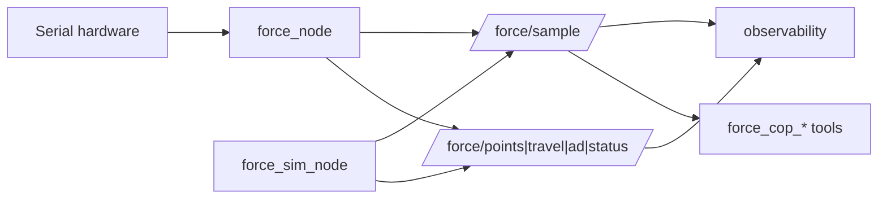

# 力传感与仿真源

`serial_force` 是五点力适配器；不参与运动许可。

## 入口

| 入口 | 作用 |
|---|---|
| `serial_force_node` | 真实串口 100 Hz |
| `force_sim_node` | 虚拟平面/五点弹簧，不打开串口 |
| `force_cop_control` | 单次 CoP→IK→JTC |
| `force_cop_trials` | 多场景试验 JSONL |
| `force_cop_analyze` | CSV/统计/图 |

## 契约

- `source:=serial|sim` 由 launch 选择；两种源发布同一组 `/force/*`。
- `force_sim_node` 发布完整 `ForceSample`（header/UUID/sequence/channel_ids/force_n/travel_mm/ad/status）。
- `serial_force_sim` 独立包已删除；文档/结果在 `serial_force/doc/sim/`。
- 力页面已统一到 `peach_web /force.html`，由 observability `/api/force` 提供实时帧；第二套 `force_web` 服务已删除。
