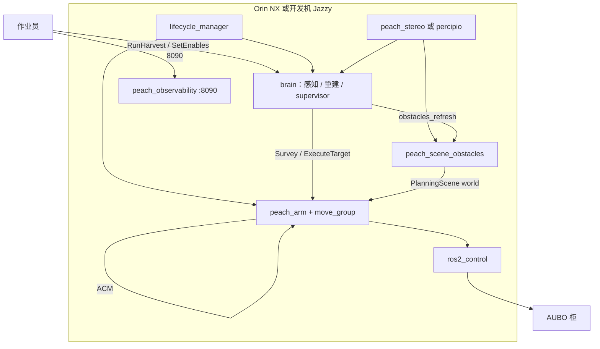

# Peach v1：室外套袋桃三末端剪切采摘 · 现行终版方案

日期：2026-10-08。性质：本文件是现行采摘核（`src/peach/peach_*`）的完整方案说明，与 [`peach_v2_重构终版方案.md`](peach_v2_重构终版方案.md) 成对；不是部署快照，不新增第四份活文档。

**阅读顺序：** 先看 §1 建成范围与成功口径，再看 §3–§13 专题；结构性缺口集中在 §14。运行中的参数、图名、QoS 以源码和三份活文档为准：[`architecture.md`](architecture.md)、[`io.md`](io.md)、[`testing.md`](testing.md)。概要设计书在 [`plans/peach_v1_套袋桃采摘机器人项目设计书.md`](../plans/peach_v1_套袋桃采摘机器人项目设计书.md)。大方向仍以 [`design.md`](design.md) 为准。本文与活文档打架时，以活文档和源码为准，并同轮改本文。

生产入口是 `peach_bringup` 的 `harvest_system.launch.py`。`src/peach2/` 不进该入口。

四条物理与法规事实与 v2 相同，不随代次改变：

1. 急停走柜体/示教器硬件回路，ROS 只做应用护栏。
2. 未经人授权不动真机、不 SetIO。
3. 带刀单元按工业应用隔离作业区（ISO 10218），不宣称协作。
4. Jazzy 的 `cv_bridge` 按 numpy 1.x 编译，锁 numpy 1.26.4。

---

## 目录

1. [建成范围与成功口径](#1-建成范围与成功口径)
2. [设计原则](#2-设计原则)
3. [总体架构](#3-总体架构)
4. [感知：检测、分割、身份、深度](#4-感知检测分割身份深度)
5. [重建与许可预算](#5-重建与许可预算)
6. [运动：接近、套入、避障](#6-运动接近套入避障)
7. [三种末端](#7-三种末端)
8. [任务编排：表驱动 FSM](#8-任务编排表驱动-fsm)
9. [室外环境：现行能做的](#9-室外环境现行能做的)
10. [安全架构](#10-安全架构)
11. [接口](#11-接口)
12. [参数单源](#12-参数单源)
13. [测试与验收](#13-测试与验收)
14. [结构性缺口（方案内如实记录）](#14-结构性缺口方案内如实记录)
15. [与 v2 的边界](#15-与-v2-的边界)
16. [参考](#16-参考)

---

## 1. 建成范围与成功口径

**一句话：** 固定座 AUBO E5 + 腕载 RGB-D，对室外套袋桃走完「开批 → 拍照锁定 → 选果 → 近距重建 → staging 接近 → 预抓取停靠 →（授权后）沿轴套入 → 剪切 → 原路撤出 → 记账」。三种剪切手整栈切换，作业中不热切换。底盘导航已归档，到位一步直通。

| 末端 | 原理 | D_inner | L_insert | L_blade | 套入路径 |
|------|------|---------|----------|---------|----------|
| `shear_v1` 连杆剪 | 刀组在法兰 +Y，连杆对切 | 0.080 | 0.030 | 0.030 | MTC 沿轴 LIN |
| `bite_shear_v1` 咬合剪 | 双刃对夹，约 220 mm 喉道 | 0.104 | 0.030 | 0.037 | MTC 沿轴 LIN |
| `adaptive_shear_v1` 自适应剪（launch 默认） | Ø136 圆盘 + 拉钩弹簧 + MPU6050 | 0.120 | 0.090 | 0.079 | 预抓取后 imu_follow 接触窗 |

档案单一事实源：`aubo_description/config/<profile>.yaml`。TCP 为设计/CAD 基准，张口与包络为 CAD 推导，真机标定未闭环。

### 1.1 现行验收门（已在跑的）

| 门 | 口径 | 状态 |
|----|------|------|
| 干跑默认 | `execute_pregrasp_only=true`：到预抓取停住，不套入、不 SetIO、不回 `harvest_stow` | 产品默认 |
| 方向与定位 | 停在预抓取时目视/测量；动态预算和 RMSE 不代替实测 | 真机多轮已做；代表记录 `field_pregrasp_20260901_1757:target_1` |
| 采摘成功记账 | 切断确认且撤退确认才记成功；`harvest.grasped` 仅此条件 | 满程剪切待授权 |
| HIL | 真相机在环 + mock 臂，一次 `ExecuteTarget` FULL 干跑墙钟 ≤ 120 s（不含栈启动） | 2026-09-30 三档墙钟均过；套入闭合仅 `bite_shear_v1` |
| mock 冒烟 | 控制器 active、六关节名、TF、四托管节点 Active | 启动后、发 `RunHarvest` 之前 |

120 s 是 HIL 上限，不是田间节拍。产品方向是可达果观察+接触约 20–25 s。

### 1.2 产品分项目标（方向，不是现行已验收数）

与 v2 方案同一组方向数，供对照，不表示 v1 已达标：检测召回 ≥95%；袋轴横向 ≤8 mm、轴角 ≤4°；套入 ≥85%；一次剪断 ≥80%；整体 60–75%；每果 ≤25 s；损伤 ≤5%。这些数要在真机满程和田间统计里取，mock 不评损伤、不评套袋方向真值。

### 1.3 明确不做

launch 默认不发 `RunHarvest`（`autostart` 默认关；打开时授权语义是操作员在 real 上发起该 launch）。感知不发运动、不选下一颗、不写 `ledger.json`。技能不写账本、不调重建 Trigger。不改驱动九包。不把 ROS 话题或 8090 按钮称为急停。不自动 `power_on`、不 resume 保护停止后的原轨迹。

---

## 2. 设计原则

1. **契约先于实现。** 跨包只走 `peach_interfaces`；名字与 QoS 以 `interface_manifest.yaml` 为准。
2. **调度是唯一批次客户端。** 感知出事实，重建出模型与许可，臂执行动作。
3. **停走式感知。** 节拍按实测前端（percipio 整链约 2.5 FPS，stereo 整链约 7.5 FPS，stereo 深度约 13.7 FPS），不是 5 Hz 连续积分。
4. **重建积分用图像时刻的精确 TF。** 查不到就丢帧。感知身份允许 stamp 失败后退 latest，并打 `tf_stale`。
5. **套入/剪切看 `GraspDecision`。** 感知单帧 ACCEPT/REOBSERVE/REJECT 只做初值和画面。`PREGRASP_ONLY` 只要求融合几何，不要求 `allowed`。
6. **运动与 IO 进同一授权矩阵。** `ExecutionAuthority.authorizeStage`：TRANSIT / CONTACT / TOOL。使能默认关。
7. **失败可定位、可跳过。** 稳定 `failure_code`。规划失败不执行残缺轨迹。观察失败不接触。
8. **一次开批一份账本。** `runs/<request_id>/ledger.json`。过程证据是会话 bag `runs/session_*/bag/`。
9. **纯核零 ROS。** FSM、几何、预算、选果资格在纯核；节点只做接线。
10. **硬件急停不经 ROS。** 软件停轨是取消轨迹 + `RobotMoveStop`（失败再 `robotMoveFastStop`）。

---

## 3. 总体架构

### 3.1 分层

```
契约   peach_interfaces + manifest
L0     相机前端 / ros2_control / TF（驱动只读）
L1     检测 → 身份 → 重建 → 融合 → GraspDecision
L2     选果 → FSM → 派发 → 账本
L3     授权矩阵 → MoveIt/MTC → JTC 或透传 → 工具 IO
L4     RViz + HTTP 8090（只读横切；调试运动另须 debug.motion_enabled）
L5     会话 bag + ledger.json
```

数据单向：RGB-D → 感知观测 → 重建模型与许可 → 调度选果并派 `SurveyScene` / `ExecuteTarget` → 臂。唯一反向是调度在选果时调用臂的 `CheckReachability`。

### 3.2 包

| 包 | 职责 | 不做什么 |
|----|------|----------|
| `peach_interfaces` | 唯一 IDL + manifest 双向核对（57 现行名 + 5 预留名） | 不跑节点 |
| `peach_common` | yaml 直读、规则表、QoS、路径 | 不跑节点、不进 launch |
| `peach_harvester` | 大脑一进程三节点：场景感知、目标重建、supervisor | 不发关节命令、不做 IK |
| `peach_arm` | `MoveTo` / `ExecuteTarget` / `CheckReachability`；命令门 | 不写账本、不选目标 |
| `peach_bringup` | 整栈入口、预检、lifecycle 托管、autostart 客户端 | 不含业务；不起 dashboard |
| `peach_observability` | 8090、会话 bag、启动自检 | 不发运动 |
| `peach_scene_obstacles` | 挂在 harvester 内的独立进程：Survey 后场景障碍快照 | 不进 lifecycle；不写 ACM |
| `peach_vegetation` | GPU 枝/叶 2D 掩膜 | 不写 PlanningScene；不进整栈 |
| `peach_stereo` | 主机 SGBM 深度前端；话题与 percipio 同构 | 不做感知业务 |
| `peach_system_tests` | isolated mock launch_testing + 回放塔 | 不进运行 launch |
| `peach_sim` | Gazebo 场景与外观重建 | 不进整栈；`gz_ros2_control` 未接 |

驱动九包（`aubo_e5_hardware`、控制器、dashboard、xacro、bringup、`controllers.yaml` 等）只读。`aubo_dashboard` 不起，不远程上电。IVG 三包与 `imu_follow` 不是 peach 业务核；仅 `adaptive_shear_v1` 时整栈 Include `imu_follow_servo`，且 `motion.enabled` 默认 false。

### 3.3 进程与启动顺序

`harvest_system.launch.py`：

1. 预检：磁盘余量、拒旧实例、打印 `ROS_DOMAIN_ID`。
2. `peach_stereo`（`camera_enabled` 且 `camera_frontend:=stereo`；须在 aubo include 之前）。
3. `peach_scene_obstacles`（`camera_enabled` 才起）。
4. `aubo_e5_bringup`（mock=`GenericSystem`+标准 JTC；real=厂商透传；stereo 时压掉 percipio）。
5. `serial_imu`（默认开，不进 lifecycle）。
6. `imu_follow_servo`（仅 adaptive）。
7. `peach_harvester` brain：场景感知、目标重建、supervisor 同进程，图名不变。
8. `peach_arm`（MoveIt 伴随节点同 executor）。
9. `peach_observability`。
10. `nav2_lifecycle_manager`，节点名 `peach_lifecycle_manager`。名单：场景 → 重建 → 技能 → 调度。`bond_timeout` 默认 0。
11. `peach_lifecycle_flag_bridge` → `/peach/lifecycle/managed_nodes_activated`。
12. `peach_autostart_client`（仅 `autostart:=true`）。

生命周期：ROS 实体在 `on_configure` 创建，`on_activate` 才进运动 / 积分 / `BeginScene`。四托管节点已接 bond 心跳（C++ bondcpp 生效；Python 为 `from bondpy.bondpy import Bond`）。默认超时 0，进程死检在未开启期间由 supervisor 的 HeartbeatWatchdog 承担。



### 3.4 硬件与计算

与 v2 方案 §3.4 同一套盒子：Orin NX 16GB 为现场主控；RK3588 只作加压时的采集/SGBM/ROI 预案，禁止在分流板上做运动决策；开发与 HIL 在 Ubuntu 24.04 + Jazzy + RTX 3090，不随车。Percipio PS800-E1（彩色 640×480，IR 1280×960，基线 62.2 mm）可直连 NX，或经 RK3588。柜 `169.254.10.98`，相机 `169.254.10.110`。急停回路不经过 NX。

NX 上 Jazzy 与 JetPack 用户空间不一致，部署走容器或源编，numpy 锁同样生效。节拍数字是开发机锚点，上车后须重标。

关节序冻结：`shoulder_joint, upperArm_joint, foreArm_joint, wrist1_joint, wrist2_joint, wrist3_joint`。`/joint_states` 的 name 数组常见字母序，消费者按名字对齐。

### 3.5 合法 TF

动态：`base → shoulder → upperArm → foreArm → wrist1/2/3`（`robot_state_publisher`）。

静态：`world→base/table`；`wrist3→{camera_body, camera_link, tool_axis}`；`tool_axis→{tcp, sleeve_mouth, cutting_plane, tool_body}`；相机 optical 链。`extrinsics_publisher` 只发 `wrist3→camera_link`，其余在 URDF。多一个 child frame 视为旧实例污染，预检拒启。

手眼事实源：`src/aubo_hand_eye_calibration/hand_eye/active.yaml`。彩色内参：`src/percipio_camera/config/color_camera_info.yaml`（两前端共用）。

---

## 4. 感知：检测、分割、身份、深度

### 4.1 深度前端

默认 `camera_frontend:=stereo`。percipio 显式备用。

| 项 | 现行 |
|----|------|
| percipio | 设备端约 18 图案；现场约 2.4–2.5 FPS。launch 请求 5.0 不是已测节拍。深度 uint16，边界 `raw × 0.25 mm` |
| stereo | 主机 SGBM，hh4 档约 13.5–13.7 FPS。配准后 `temporal_k=3` 逐像素有效中值，每帧照发。点云比 percipio 多一个 `confidence` FLOAT32（point_step 24） |
| 同步 | `message_filters` ApproximateTime，slop 0.05 s；订户 RELIABLE depth 10 |
| 有效深度 | 非 0、非 65535；管线窗 0.3–1.5 m。禁止网络补深度 |
| 时间 | stereo `TIME_SYNC` 失败目前只警告。重建仍要求图像 stamp 的精确 TF，对不上就丢帧 |

### 4.2 单帧 2D / 3D

权重：`peach_harvester` 的 `best.pt`（YOLO detect，`peach_bag` / `peach_nobag`，只出框）+ MobileSAM（框提示分割）。检测与分割直接构造，不走 pluginlib。

每帧：检测 → SAM 掩膜 → 掩膜 ∩ 有效深度 → 袋几何。袋/果位姿管线是仅有的感知 dict 缝：`pipeline.bag_impl` / `fruit_impl`，默认 `robust_bag` / `robust_fruit`（果线默认不装配）。未知实现名启动失败并列出可用名。

袋颈/袋底由几何推出（点云主轴 + 沿轴半径剖面），没有关键点网络。`peach_nobag` 与裸果只显示，不进采摘候选。

单帧状态 ACCEPT / REOBSERVE / REJECT 只进画面和初值，不发运动。

### 4.3 身份

`TargetRegistry` 发 `target_{N}`。归属：χ² 门 + 匈牙利一对一 + 类别一致 + 歧义比 1.2。`BeginScene` 换场 `clear()` 不清计数器，避免新 ID 撞上已下发的旧号。贴边帧不计确认，并打 `bbox_edge`，锁定与选果两侧都滤。

tentative 同时按帧 TTL 和 `max_age_s` 淘汰。歧义目标用 `ambiguous_*`，不入表。

`BeginScene` 使 `scene_epoch` 加一。同 `scene_key` 保留身份表；换场才清表。调度只有在观测世代对齐且 `target_set_locked` 之后才选果。

### 4.4 话题语义

- 稳定流（confirmed-only，进 RViz）：`markers`、`single_cloud`、`debug_image`。
- 真相流（含未确认，进记录和选果）：`detections`、`masks`、`observations`、`initial_pose`、`debug_image_raw`。
- 模型流：`grasp_decision`、`refined_*`、`tsdf_cloud`。

`initial_pose` 只进重建。选果只订 `target_observations`。

---

## 5. 重建与许可预算

### 5.1 一颗怎么建成

调度对选中目标发 `BuildTargetModel`，并与观察并行。积分用精确 stamp TF，禁止 latest。体积实现是 `LocalTsdf`。柱/球 refit（`refitter.cylinder_impl` / `sphere_impl`）只做可视化，不授权接触。

观察两档（`view_policy`）：

- `VIEW_FAST`（默认）：supervisor 在拍照位算 1 视，补视最多 2，总视 ≤3。
- `VIEW_CONSERVATIVE`：发臂 `ExecuteTarget` `OBSERVE_ONLY`。

停稳后有效机位常见 4–6。`capture.max_views=24` 是帧栈上限，不是节拍目标。`skip_reconstruction:=true` 时不 Build、不观察，用未精化几何进接触；该路径适配 mock 注入器，真感知下未精化候选直径为 0，臂侧判无有效场景几何。

模型身份七元组：`run_id / scene_epoch / target_id / model_revision / tool_profile_id / calibration_revision / config_revision`。`model_revision` 含单调 finalize 计数，同目标重 Build 不沿用旧令牌。

### 5.2 预算公式（现行，线性相加）

实现：`peach_harvester/vision/common/tool_budget.py`。常数默认值可被 `target_reconstruction.yaml` 的 `tool.budget.*` 覆盖；`d_inner` 等由工具档案在 launch 注入。

径向可用：

\[
a_r = \tfrac12 D_\mathrm{inner} - \tfrac12 d_{95} - c_\mathrm{wall}
\]

径向误差（各项直接相加）：

\[
e_r = \sigma_\mathrm{lat} + L\sin\theta + e_\mathrm{runout} + e_\mathrm{tcp} + e_\mathrm{handeye} + e_\mathrm{deform}
\]

径向余量 \(m_r = a_r - e_r\)。`sleeve_ok` 要求袋子不宽于工具内壁且 \(m_r>0\)。

轴向误差：

\[
e_a = \sigma_\mathrm{neck} + e_\mathrm{blade} + e_\mathrm{robot} + e_\mathrm{motion}
\]

轴向余量：

\[
m_a = w_\mathrm{capture} - c_\mathrm{axial} - e_a
\]

默认：\(w_\mathrm{capture}=8\,\mathrm{mm}\)，\(c_\mathrm{axial}=0\)，刃面 2 mm，机器人 2 mm，目标运动 3 mm，颈轴向下限 3 mm（`axial_neck_floor_m`，由调用方并入 \(\sigma_\mathrm{neck}\)）。零感知噪声、只取下限时 \(e_a\ge 10\,\mathrm{mm}\)，\(m_a\le -2\,\mathrm{mm}\)，`cut_ok` 为假。

`cut_ok` 还要求剪切点到果顶距离大于 `fruit_safety_clearance`（默认 12 mm）。`allowed` 由几何有效、`sleeve_ok`、`cut_ok` 共同派生；pregrasp 能力不进 `allowed`，避免挡住干跑。

结构性旗标只看固定项（刃面+机器人+运动+轴向安全余量）是否已经吞掉捕获半宽。颈下限不计入该旗标，因此默认组合余量为负时，原因码是 `axial_budget_negative`（记在这颗袋上），而不是 `axial_budget_structurally_unsatisfiable`。固定 35° 只诊断完全错轴，不单独授权接触。

这组默认常数下，精化链的剪切许可通不过。方案选择是把标定留给台架 `w_capture` 与真实颈误差，不在热路径上删安全项凑正数。未精化链的轴向校验更弱，见 §14。

### 5.3 许可怎么交到臂上

重建发布 `GraspDecision`（transient_local）。`valid_until` 按 `decision.validity_s`（默认 120 s）冻结，心跳不得续签。

调度把当前目标的决策装进 `ExecuteTarget.goal.clearance`（`Clearance`：`target_id`、`valid_until`、径向/轴向余量）。目标对不上就不装，臂侧回退到话题快照。

臂侧 CONTACT 查径向余量，TOOL 查轴向余量、预抓取残差和 `tool_enabled`。令牌过期与复检不通过同记 `SKIPPED_QUALITY`（可换新令牌重派）。其余拒绝记 `FAILED`。

新鲜度还有第二窗：令牌路径上的 `model_stamp` 对照 `effectiveTargetMaxAgeS()`（约 3–10 s）。FULL 链墙钟常到 30–60 s，这一窗与 120 s 的 `valid_until` 不是同一个时钟。快照回退路径不查这道新鲜度。

---

## 6. 运动：接近、套入、避障

### 6.1 一次 ExecuteTarget

`stages.cpp` 的 `executeCycle` 显式分档，一个目标一个周期，不并发。

```
Prepare
 → execution_enabled=false → 只规划预览
 → 否则：未 skip 则补视（最多两次短移）→ 质量收口
 → OBSERVE_ONLY：报告后结束
 → grasp 关：报到可抓即停
 → 再确认目标
 → 预抓取：先回拍照位，再接近主路径
 → 预抓取残差修正（最多两次）
 → PREGRASP_ONLY（默认）：停住，等 ACK
 → FULL：沿轴套入 → SetIO → 切断确认 → 原路撤退 → 回拍照位 → PTP harvest_stow
```

撤离（倒放、回 stow）走 TRANSIT，不再复检感知许可。接触或预抓取真动过之后置 `recovery_required`，未 ACK 不再 Survey、不再派下一颗。

### 6.2 接近主路径（2026-09-23 定型）

唯一主档，无候选扫描、无 OMPL 兜底贴球面：

1. Pilz PTP 到中段点正下方（冠外）。滚转梯子 {0, ±30°, ±60°}，先在 roll 0 试 IK。
2. 世界垂直 LIN 入冠（`approach_canopy_entry_m` 0.05）。
3. 沿轴 LIN 进入预抓取（`approach_final_axial_m` 0.05；相对目标 20° 姿态约束）。

冠内两段优先 Pilz sequence blend 0.02；sequence 失败则降级为单段 MTC LIN，形状相同。执行 `plan(1)` 只下发第一条。已在目标附近的短修正走直连 LIN，先对齐工具 Z 再平移。

预抓取停位相对入口沿 −axis 后撤 `mtc_approach_along_axis_m`（`grasp_standoffs.yaml` 单源，现行 0.03 m）。姿态 `alignFrameZ`，不抄感知滚转。

行程护栏：接触累计 12 rad、单轴 6.1 rad（URDF 满行程量级）；笛卡尔绕行比 2.6、弦偏离 0.32 m、回退 0.12 m；TCP 姿态行程绝对 110°。观察短移看 4 rad / 单轴 1.5 rad。拍照位 PTP 时限 0.5 s，失败才 OMPL 3 s，行程门 6 rad / 2.5 rad。时长门默认关。任一段失败记 `skipped_unreachable`。

速度：接近 0.10；套入/撤退 `approach_near_velocity_scaling` 0.05。`moveit.execute_timeout_s` 默认 90 s，`boundedExecute` 超时即 `stop()`。`trajectory_execution.execution_duration_monitoring` 关闭，避免与透传控制器互打。

真机透传：`FollowJointTrajectory` → `AuboPassthroughTrajectoryController` → 硬件 `write()`，约 4 ms 线程把点重采样到 5 ms。mock 用标准 `joint_trajectory_controller`。

### 6.3 四层接近约束

| 层 | 保护对象 | 现行做法 |
|----|----------|----------|
| ① 果实胶囊 | 果实 | 工具有限圆柱（TCP 向后 0.2 m，半径 0.06，半径只径向）对感知胶囊。套入/撤退豁免 |
| ② 反爬 | 果实 | TCP 沿轴参数不得超过本段起点（锚在果底一侧）+2 cm。PTP 转移段只查筒体，不把关节弧的自然拱起判成绕行 |
| ③ 场景障碍 | 相机 | Survey 成功后快照一帧点云 → 体素 0.06 m → 滤自身（余量 + 体素半对角）→ 滤已精化目标袋膨胀胶囊 → 最多 3000 个 BOX，对象名 `peach_scene_obstacles`。ACM 豁免除 `camera_body_link` 以外的连杆。`obstacle_guard_enabled` 默认 true |
| ④ 近果降速 | 硬件 | 套入/撤退 0.05；`ContactMonitor` 看腕轴电流，默认关 |

快照节点只写 PlanningScene 的 world；`peach_arm` 只写 ACM diff。不用 octomap updater（`sensors_3d.yaml` 的 `sensors` 为空）。作业期快照冻结，下一次 Survey 重建。点云、TF、关节不保证同一 stamp。

`CheckReachability` 与执行共用停位族：预抓取 IK（滚转扫描）；FULL 再查套入终点 IK 和沿轴笛卡尔。不装配 MTC、不动臂、不查场景碰撞。服务不可用时调度退回半径窗。

### 6.4 倒放与收纳

shear/bite 的撤退是接近轨迹的时间反转再执行。adaptive 在接触窗内 `insert_retract` 回预抓取，关窗后再倒放回拍照位，然后 PTP `harvest_stow`。倒放实现里加速度符号与速度一起取反；时间反转时速度应反号、加速度不应反号，这是已知实现问题（§14）。

---

## 7. 三种末端

### 7.1 切换方式

`tool_profile` 由 bringup 透传进 xacro，整栈重启生效。冻结帧名：`tool_axis` / `tcp` / `sleeve_mouth` / `cutting_plane` / `tool_body`。`wrist3_Link→tcp` 必须等于档案 ±2 mm，启动自检会查。

`tool_profiles.py` 在 launch 期把 `D_inner`、`L_insert`、`L_blade`、`body_length`、`body_radius`、`profile_id` 注入感知、重建和臂。预算和①层包络随档案走，不在 C++ 里再抄一套尺寸。

| 档案 | TCP（法兰系，m） | 包络长 × 半径 | IMU |
|------|------------------|----------------|-----|
| shear_v1 | (0, 0.0479, 0.15107) | 0.120 × 0.100 | 否 |
| bite_shear_v1 | (0, 0.03024, 0.1655) | 0.260 × 0.090 | 否 |
| adaptive_shear_v1 | (0, 0.047, 0.16866) | 0.140 × 0.110 | 是 |

URDF 里 `cutting_plane` 与 TCP 零偏移。档案里的 `L_blade` 注入感知行程，臂侧回退距离没有按刃面相对开口的偏移来下目标。开口被当成刃面。

### 7.2 套入与剪切

公共前段：授权通过后到预抓取，残差验证，`PREGRASP_ONLY` 在此结束。

| | shear / bite | adaptive |
|--|--------------|----------|
| 套入 | Pilz LIN 沿袋轴，近果 0.05 速度档 | 预抓取验证后：enable → `insert_start` → 剪切 → `insert_retract` → disable |
| 与 MTC | 本路径就是 MTC | 窗打开期间禁止 MTC 同时写控制器 |
| 行程 | 名义 `approach_along_axis_m + insertion`；已对轴时与真实间隙最多差一个分类窗 | `insert.max_travel_m` 0.09，对齐本档案 `L_insert` |
| 真机控制器 | 透传 | Servo 配置写的是 JTC 话题；real 栈起的是透传。launch 把 `motion.enabled` 写成 false |

剪切：`stageActuateCutter` 在 TOOL 级授权通过后 SetIO。SetIO 的 ACK 只表示命令被接受（`CUT_COMMAND_ACCEPTED`），不是剪断。`stageVerifyCut` 等待刀具 DI 在本命令之后的上升沿；超时 `CUT_FEEDBACK_TIMEOUT` / `CUT_UNCONFIRMED`。`tool.enabled=true` 且确认失败则终局 FAILED。默认 `tool.enabled=false`，HIL FULL 干跑不走到 SetIO。

IO 通道：下刀与反馈若落在同一 pin，确认会读回自己的 DO。上线前要做断电反证（命令置位、执行器断电，反馈必须保持未闭合）。这一项尚未当作已通过的硬件门。

### 7.3 imu_follow 的位置

只在 `adaptive_shear_v1` 出现在图上。peach 接触窗调用 Trigger；跟随节点默认关门。它不经过 `authorizeStage`。真机要开跟随，须单独授权，不能靠整栈 launch 默认值。

---

## 8. 任务编排：表驱动 FSM

批次纯核是 `harvest_fsm.react(state, event) → Reaction`。节点禁止手写 `batch_state`。外围还有 reducer（世代号，迟到事件丢弃）和暂停时的命令暂存（EventHold）。暂停只改 `operation_mode`，不覆盖作业态。

人发 `/peach_supervisor/run_harvest`。空 `request_id` 变成 `auto_<时间戳>`，账本目录不复用。

| 命令 | 行为 |
|------|------|
| NAVIGATE | 固定座直通 `NAV_OK`，不发 `NavigateToWorksite` |
| SURVEY | `SurveyScene` 到拍照位并复核关节；成功后发 `/peach/scene/obstacles_refresh` |
| BEGIN_SCENE | 仅首巡一次。回访禁止再 Begin |
| WAIT_LOCK | 观测 `scene_epoch` 对齐且锁定。`SURVEY_ONLY` 直接收批；执行使能关则记账后完成 |
| SELECT | 资格门 ∩ 深度窗 ∩ `CheckReachability` ∩ 框面积。点名 `target_ids` 过同一资格，但不进 IK 预检名单 |
| DISPATCH | 并行 Build 与观察；过门后 `READY_FULL` |
| EXECUTE_FULL | 节点再按 `execute_pregrasp_only` 选 PREGRASP_ONLY 或 FULL。goal 带 `skip_observation` 与 clearance |
| NONE | 一颗结束，回到发现态再 Survey |

选果资格：锁定集内、已确认、未入账、非裸果、非贴边、非工具净空失败。次序：`priority` 升序，同级框面积降序。跳过进 `rework_list.json`，不把跳过记成成功。

`execution_enabled` 关时，发现阶段锁定后直接完成并记账，不派接触。使能意图来自操作台 `SetEnables`，supervisor 在 Active 且有覆盖值时 1 Hz 广播 `/peach/batch/enables`。臂侧超过 `enables_heartbeat_timeout_s`（默认 5 s）未收到广播，回落本地参数。广播在权时，本地参数改写不覆盖使能。

控制：`ControlTask` 的 PAUSE / RESUME / CANCEL_NOW / SKIP_TARGET / ACKNOWLEDGE_RECOVERY，带 `expected_state_seq`。`FireStep` 给操作台单步。8090 能发这些调试调用；运动类还要 `debug.motion_enabled`（默认 false，否则 HTTP 423）。

账本：`runs/<request_id>/ledger.json`，结束时与 `rework_list.json` 一起落盘。`HarvestState.batch_state` 只由 FSM 推导。

---

## 9. 室外环境：现行能做的

| 干扰 | 现行对策 | 边界 |
|------|----------|------|
| 主动光深度在室外不稳 | 停走；stereo 静止窗中值；有效深度窗；低置信不进几何 | stereo 曝光仍偏固定；confidence 字段主要在点云里，预算不按它加权 |
| 风摆 | 重建有目标运动项（默认 3 mm 常数）；身份有年龄淘汰 | 没有实测摆幅进预算；漂移门与邻袋距离门可能把合法帧关在外面 |
| 枝叶 | `peach_vegetation` 出 2D 枝/叶掩膜 | 不进 PlanningScene，不参与避障 |
| 邻袋与粗枝 | Survey 快照成盒子，滤掉当前目标袋邻域 | 只查相机与障碍；臂身和刀豁免 |
| 强光与白袋 | 数据集统计过纸袋颜色；仿真贴图按此校准 | 检测漏检/粘连没有按光照分层的验收数 |
| 节拍 | 设计用实测 FPS，不用 launch 请求的 5.0 | NX 上未重标 |

仿真场景 `peach_sim`：参数化果园 SDF、采摘工位（履带外观 + E5，关节钉在拍照位）、目标清单几何真值、Blender 外观网格。工位被 URDF 锚死，相机深度桥和 `gz_ros2_control` 未接。它用于外观和几何对照，不代替真机方向验收。

---

## 10. 安全架构

三层分开：

| 层 | 现行 |
|----|------|
| 功能安全 | 示教器急停与柜回路（ISO 13850，Category 0 或 1）。保护停止后由人在示教器确认，软件不 unlock、不接着跑旧 goal |
| 应用护栏 | 授权矩阵、使能默认关、使能心跳、`boundedExecute`、场景快照、可选 ContactMonitor |
| 网络安全 | SROS2 不是本代强制项 |

命令门（每一级都要 Active、机械臂就绪、未取消）：

| 级 | 额外条件 | 用于 |
|----|----------|------|
| TRANSIT / PREGRASP | `execution_enabled` | 拍照、staging、预抓取、撤离、回 stow |
| CONTACT | 再加 `grasp_enabled` 与许可复检（目标对齐、径向余量） | 沿轴套入 |
| TOOL | 再加 `tool_enabled`、轴向余量、预抓取残差 | SetIO |

`robotReady` 看柜状态里的抱闸、`motion_possible`、急停状态（观测，不是急停通道）。mock 可关 `require_robot_status`。关门靠取消 action 和 `RobotMoveStop`，不切断驱动电源。

8090 无登录令牌。它不能绕过授权矩阵。调试页不得被当成第二控制面。刀具与动臂同级：默认 `tool.enabled=false`。

人在工作空间另做风险评估。套袋刀按工业单元隔离，协作臂出厂认证不覆盖带刀工艺。

---

## 11. 接口

权威清单：`src/peach/peach_interfaces/config/interface_manifest.yaml`。改字段的顺序：IDL → 接口 README → manifest → `src/peach/peach_interfaces/doc/io.md` → 各端；先编 `peach_interfaces`。

| 名字 | 种类 | 作用 |
|------|------|------|
| `/peach_supervisor/run_harvest` | action `RunHarvest` | 开批。goal：`request_id`、`scene_key`、`intent`、可选 `target_ids` |
| `/peach_arm/survey_scene` | action `SurveyScene` | 去拍照位并确认关节静止 |
| `/peach_scene_perception_node/begin_scene` | srv `BeginScene` | 推进世代，重启收齐窗 |
| `/peach_arm/execute_target` | action `ExecuteTarget` | 一颗一周期。模式：PREVIEW / OBSERVE_ONLY / PREGRASP_ONLY / FULL |
| `/peach_target_reconstruction_node/build_target_model` | action `BuildTargetModel` | 绑目标、收机位、finalize |
| `/peach_arm/check_reachability` | srv | 选果 IK；FULL 再查套入终点 |
| `/peach_supervisor/control` | srv `ControlTask` | 暂停、跳过、取消、ACK |
| `/peach_supervisor/set_enables` | srv | 操作台使能，并广播 |
| `/peach/batch/enables` | topic | 1 Hz 心跳，transient_local |
| `/peach/perception/target_observations` | topic | 选果输入 |
| `/peach/reconstruction/grasp_decision` | topic | 许可，transient_local |
| `/peach/scene/obstacles_refresh` | topic `Empty` | Survey 成功后触发快照 |
| `/peach/lifecycle/managed_nodes_activated` | topic | 四节点都 Active 的闩锁 |
| `/diagnostics` | topic | 各节点 `diagnostic_updater`；8090 聚合 |

QoS：图像与点云传感档；命令、动作、生命周期 RELIABLE；`HarvestState` 与 `GraspDecision` transient_local。`/tf` volatile，`/tf_static` transient_local。

身份四层：`target_id`（感知）→ `request_id / run_id / cycle_id`（批次）→ `plan_id` + 模型七元组 → `clearance`（复用 `target_id`，不新铸 ID）。`valid_until` 冻结不续签。

失败码 `FailureCode` 0–23。21–23 为 `TRANSIT_FAILED` / `START_NOT_READY` / `CANCELED`。预留、无生产方：`NavigateToWorksite`、`HarvestTargetReport`、`VehicleState`、`HarvestOperationStatus`。

深度在 IDL 新字段用米。管线内部仍把 Percipio uint16 按 0.25 mm 换算，换算放在边界。

---

## 12. 参数单源

| 域 | 事实源 | 装载 |
|----|--------|------|
| Python 节点 | `config/<节点>.yaml` 全量清单 | `peach_common.yaml_params.attach` + 规则表；越界拒启，运行期非法 set 拒绝 |
| `peach_arm` | GPL `arm_parameters.yaml`，部署覆盖 `config/peach_arm.yaml` | 类型化 Params；运动中拒改技能参数 |
| 停位几何 | `grasp_standoffs.yaml` | launch 注入场景与重建 |
| 工具尺寸 | `aubo_description/config/<profile>.yaml` | `tool_profiles.py` |
| 手眼 / 彩色内参 | §3.5 两个 yaml | 重启 extrinsics / 相机后生效 |

话题名用相对名加 launch remap，不用 `declare_parameter("image_topic")` 当主接线。键名带单位后缀（`_m`、`_s`、`_deg`、`_rad`）。同一几何量在多节点同名时，yaml 注释互相指向。

`autostart`、`execute_pregrasp_only`、`execution_enabled`、`tool.enabled`、`camera_frontend`、`hardware_mode`、`tool_profile` 是部署/运行开关，不是安全功能的替代。

---

## 13. 测试与验收

| 层 | 载体 | 证明什么 |
|----|------|----------|
| Lint | `ament_lint_auto`；C++ 以 uncrustify 为准 | 风格 |
| 纯核 | pytest（不 `import rclpy`）；`peach_arm` gtest | FSM、预算、几何、ACM 条目 |
| 集成 | `peach_system_tests`：mock `harvest_system`，域 89；三末端冒烟域 91/92/93；场景障碍域 94 | 能起来、TF 对档案、lifecycle、合成障碍进场景。不发生产意义的 `RunHarvest` 当门 |
| 手工系统 | `scripts/sim_field_targets.py` | 夹具上的 FULL 干跑 |
| HIL | `plans/v1_三末端混合测试/` | 真相机 + mock 臂，墙钟 ≤120 s |
| 田间 | `testing.md` 的 `field_pregrasp_*` / `field_full_*`；`request_id` 不复用 | 方向、接触、IO。最终权威 |

CI：`.github/workflows/jazzy.yaml` 的 `r0_gate` 与 industrial_ci（忽略 IVG、`imu_follow`、`percipio_camera`、`camera_calibration`）。PR 门不是田间验收。

2026-09-30 HIL（夹具 1757，刀具关，真 stereo）墙钟：shear 16.20 s、bite 21.46 s、adaptive 17.30 s，均 ≤120 s。FULL 干跑闭合只有 bite（outcome 0，`grasped=false`）。shear 径向余量约 −6.6 mm；adaptive 筒体相对果胶囊间隙约 −5.4 mm。这是该夹具、该常数下的记录，不是三末端都已能剪的结论。

测完即停：结束复核 `pgrep`，挂死按 PID 终止。残留订户会占 Fast DDS 共享内存，使下一次大图订阅得到 0 帧。

观测四层：节点日志；`CanonicalEvent` / `HarvestState` / 账本；`/diagnostics`；`runs/session_*`（bag、`selfcheck.json`、`startup.json`、`bag_report`）。会话 bag 按族限速（控制流 20 Hz、PlanningScene 1 Hz、感知派生 2 Hz），`/tf_static` 不限速。自检软门覆盖生命周期、控制器、关节名集合、TCP 对档案、相机、动作服务端、磁盘和权重；`autostart` 硬等自检通过，人手 `RunHarvest` 不受这一条限制。

---

## 14. 结构性缺口（方案内如实记录）

这些是现行方案的已知边界。v1 继续作为生产入口时要带着它们操作；重写放在 v2，不在热路径上把缺口涂成已解决。

| ID | 事实 | 操作含义 |
|----|------|----------|
| 预算 | 默认轴向项线性相加后余量 ≤ −2 mm，`cut_ok` 为假；结构性旗标不含颈下限 | 精化链默认不放刀。要剪须先有台架捕获带和真实颈误差，或显式改预算并留下标定版本 |
| 未精化链 | `skip_reconstruction` 的 TOOL 条件比精化链少轴向预算 | 不要用这条路径在真机上证明「可以剪」 |
| 刃面 | `cutting_plane` 与 TCP 重合；`L_blade` 未变成 TCP 目标偏移 | 刀口相对袋颈的轴向落点不等于「TCP 到了预抓取」 |
| 令牌窗 | 120 s 冻结有效期之外，还有 3–10 s 的 `model_stamp` 窗；快照回退不查该窗 | FULL 链后半可能 EXPIRED；排障时要看走的是令牌还是快照 |
| 避障 | 受查对是相机 × 场景盒子；臂和刀豁免。快照三者时间不对齐 | 保护相机，不是全臂现场避障。规划场景里没有的枝、人、桌子，规划器看不见 |
| adaptive | 跟随默认关；Servo 话题与真机透传控制器不一致 | 默认档的套入接触窗在真机上没有一条已证明的通路 |
| 刀反馈 | 确认 DI 与命令 DO 必须分脚；反证测试未作为上线门完成 | SetIO ACK ≠ 剪断 |
| 采帧门 | 邻目标距离与视角无关；漂移门可能小于现场摆幅 | 近距双袋或风摆时重建可能等不到合格帧 |
| 倒放 | 加速度与速度一同取反 | 倒放轨迹的时间参数化与标准时间反转不一致 |
| bond | 心跳代码已接上，`bond_timeout` 默认 0 | 进程死检目前靠 HeartbeatWatchdog，不是 Nav2 默认 bond 超时（Nav2 `bond_timeout` 默认 4.0 s，2026-10-08 官方配置页核验） |
| 身份软点 | 批流不发 PREVIEW，plan 契约在批流上不起作用；臂的 Survey 结果世代恒 0；部分快照只查新鲜度不绑 `target_id` | 安全主链仍是使能门和令牌门。这些软点不单独放行 SetIO |
| 关停 | 在途 `ExecuteTarget` 遇上 SIGINT 时，超时 detach 的线程仍可能在 context 失效后碰到执行器 | 测完按 PID 清；不要把「Ctrl+C 后进程表已空」当成该竞态已消失 |

另：CheckReachability 不查场景碰撞；ContactMonitor 默认关且没有动力学补偿；关闭使能不会停掉已经在途的轨迹；周期开始不先确认刀已张开。

---

## 15. 与 v2 的边界

v1 是现在的生产入口：固定座采摘核完整，真机预抓取有记录，满程剪切未授权。v2（`src/peach2/`）是隔离重写，M1 的 mock 预抓取与 launch_testing 已过，台架标定、三末端实机和果园闭环未过。

v2 要换掉的，就是 §14 里那些靠继续叠令牌和豁免解决不了的部分：许可改成同步 `GetDecision` 和 RSS、刃面相对 TCP 的真实偏移、刀反馈独立 DI、末端 pluginlib、全臂受查、行为树编排。两边硬件、红线和作业链相同。

在 v2 成为生产入口之前：改现行行为改 `src/peach/peach_*` 与包级活文档；不要把 v2 方案里的「拟」写进 v1 的运行描述。

---

## 16. 参考

- 运行权威：`src/peach/peach_bringup/doc/architecture.md`、`src/peach/peach_bringup/doc/io.md`（系统级）+ 各能力包 doc/ + 两测试包 doc/testing.md；图名 `src/peach/peach_interfaces/config/interface_manifest.yaml`
- 怎么改：`AGENTS.md`（MUST / DEFAULT / KEEP / SNAPSHOT / UNWIND）
- 重构对照：`docs/peach_v2_重构终版方案.md`
- 概要设计：`plans/peach_v1_套袋桃采摘机器人项目设计书.md`、`docs/design.md`
- 预算实现：`src/peach/peach_harvester/peach_harvester/vision/common/tool_budget.py`
- 阶段序列：`peach_arm` 的 `stages.cpp` / `cycle.cpp`；接近以 `grasp_task.cpp` 现行函数为准
- 批次：`harvest_fsm` 纯核
- 标准与官方资料（2026-10-08 核验）：ISO 10218-1/-2:2025、ISO 13850:2015、IEC 60204-1（现行 6.1 版 2016+A1:2021）；[ROS 2 Jazzy Developer Guide](https://docs.ros.org/en/jazzy/The-ROS2-Project/Contributing/Developer-Guide.html)（C++17 口径见 [Code Style 页](https://docs.ros.org/en/jazzy/The-ROS2-Project/Contributing/Code-Style-Language-Versions.html)："Jazzy targets C++17"）；[REP-103](https://www.ros.org/reps/rep-0103.html)
- 运动规划语义：[Pilz PTP/LIN/sequence](https://moveit.picknik.ai/main/doc/how_to_guides/pilz_industrial_motion_planner/pilz_industrial_motion_planner.html)（确定性轨迹 + 碰撞检查过/拒门，不绕障）；[MTC 教程](https://moveit.picknik.ai/main/doc/tutorials/pick_and_place_with_moveit_task_constructor/pick_and_place_with_moveit_task_constructor.html)（stage 分类与 ModifyPlanningScene）
- 托管与心跳：[Nav2 lifecycle manager 配置页（Jazzy 版）](https://docs.nav2.org/jazzy/configuration_and_development/configuration_guide/core_servers/configuring_lifecycle_manager/)（`bond_timeout` 默认 4.0 s、0 禁用、托管节点失联整栈降级）；[lifecycle 设计文](https://design.ros2.org/articles/node_lifecycle.html)（onConfigure 建生命周期资源、onActivate 才进运行路径）
- HIL 记录：`plans/v1_三末端混合测试/`；官方资料核验明细（证据分级 A–D、引文、逻辑链与未核项关闭条件）见 [peach_v2_重构终版方案.md](peach_v2_重构终版方案.md) 补充评审 R18
