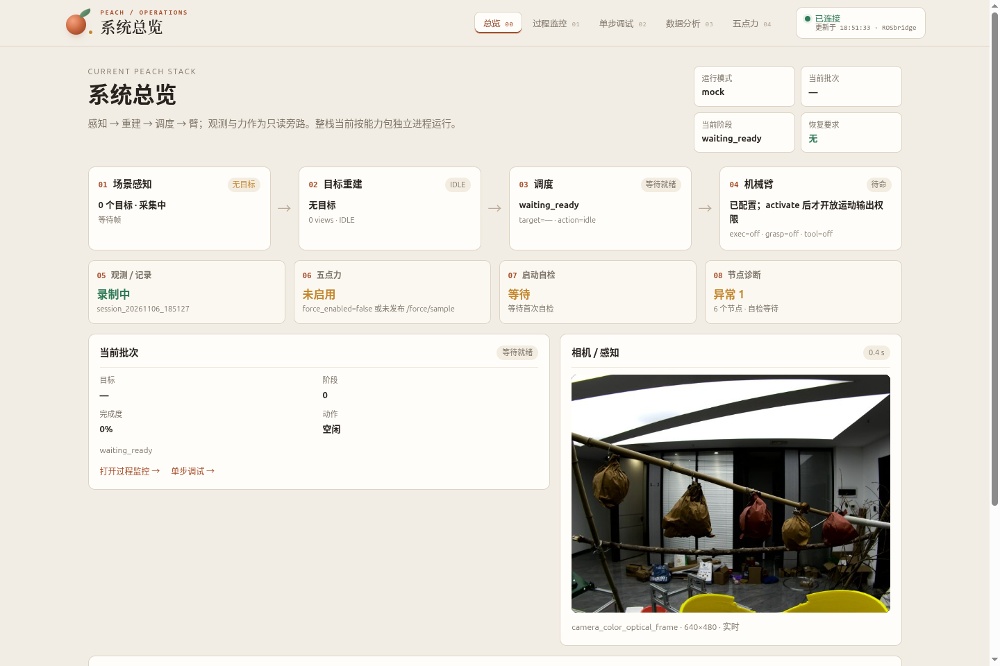
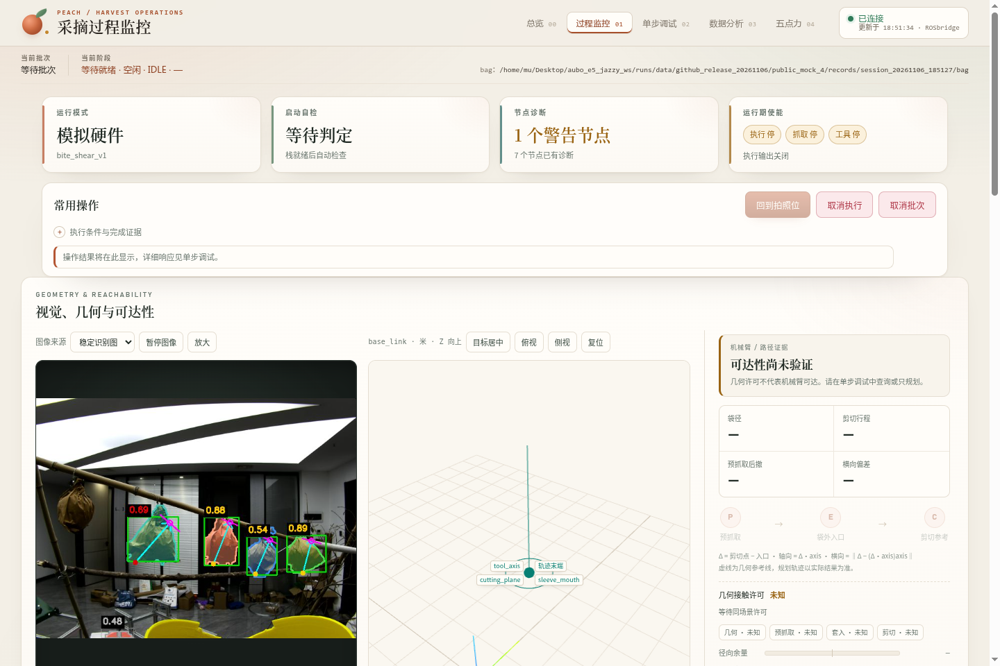

# Peach 发布验收 · 2026-11-06

本次交付范围为 Peach、Web SDK、相机前端、重建、调度、机械臂执行、力传感及必要 AUBO 资源。IVG 按用户要求暂不处理。

## 交付入口

- [完整部署](../deployment.md)：Ubuntu24.04 / Jazzy / Python3.12 / Node22。
- `bash scripts/build_workspace.sh` 编译 Peach 完整25包依赖闭包及两套 Web 资源。
- `requirements-peach.txt` 为独立 Peach 部署档，33个固定版本与本次运行环境逐项一致。
- `ros2 run peach_system_tests run_frozen_grasp.py --rviz` 自动读取随仓真实 RGB-D 样例，无需本机 runs。
- 样例 `src/peach/peach_system_tests/data/rgbd_mock_v1` 包含5路原始消息、内参、注册点云、来源和 SHA-256，MCAP为5,709,550字节。

## 实际结果

隔离工作树完成源码构建，另从实际生成、解压的迁移包重新构建 Peach25包。官方应用检查、接口清单（62 active＋5 reserved）、SDK类型与离线组件探针均保存日志。迁移包解压后样例三个SHA检查通过。

公开回放使用 GenericSystem、重建开启、tool=false。第3/4轮 wrapper均退出0；第4轮目标 target_1 达到L6，单果周期 18.015s。批次受理至首果结算约24.3s，包含 target_2 的质量拒绝及重新选果。target_2 按 `bag_axis_envelope_ill_conditioned` 拒绝，未绕过质量门。

视觉预抓取位姿和两段去程实现保持原样。第4轮阶段耗时见[原始摘要](2026-11-06-evidence.json)：定稿、接近套入、复核、工具、撤退分别为 0.446, 8.819, 0.2, 0.0, 8.475s。

Web五页HTTP200、无pageerror，总览实际图像640×480。RViz监测25个存活采样，关停后无本轮进程残留，录包已封口。

## 修复与边界

修复默认历史录包缺失、样例未安装、默认迁移包丢MCAP、Python安装/运行用户site策略不一致，以及有限驱动退出0被误报为长驻栈异常退出。有限退出修复通过真实子进程三例验证，长驻提前退出及非零退出仍报失败。

本结果是固定机位单视L6干跑。驱动按设计在第一果结算后取消批次，因此 action为CANCELED、result.success=false；单果成功不代表整批自然完成或真实剪切。未验收真实运动/工具IO、现场标定、多视覆盖或Gazebo。只读驱动保留既有版权/格式lint失败，不把它们写成全绿。

全量联网pip重装受当前网络索引截断影响，运行使用已安装第三方依赖的隔离快照；不发布venv。关闭阶段偶有上游rclpy Destroyable/context警告，进程退出和录包封口已核验；不宣称所有日志绝对无警告。

详细命令日志、失败原件和原始录包保留本机 runs/analysis_reports/github_release_20261106 与 runs/data/github_release_20261106；本页提供可公开复现的精选数据与验收摘要。
