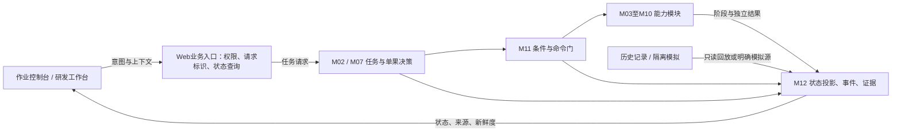

# 08 Web界面与功能设计

## 设计目标与范围

将完整项目框架落到能评审的产品屏幕、操作可用条件、反馈状态与调试闭环。不是把10个页面做成相同的说明卡片，也不接入现行机器人API。本阶段不展开算法、设备参数、ROS通信字段与代码实现；原型只用明确标注的演示数据。

## 全局布局与交互

顶部：数据来源/部署意图、任务/工作点/目标上下文、模式、操作者、主要阻挡和在途状态。左侧：10个产品页分组。中央：对应任务队列、工作点拓扑、图像/模型、执行、物流或回放。右侧：当前对象检查、下一步条件、允许操作与关联模块。底部：事件/命令反馈与独立取消位置。

角色视图：访客只读；作业员作业操作；研发选择模拟试验与故障场景；维护受控配置。实际生产权限在业务服务和执行侧强制，原型角色切换只演示界面规则。真机操作不因网页按钮产生授权。

数据来源：演示、仿真、回放、真机（连接后）必须可辨。本原型所有数值、任务、目标和结果都标演示；历史相机图仅作成像布局背景，不与示例目标绑定。回放关闭运动写入口；真机未连接时所有执行入口不可用。

## 操作反馈设计

每次操作有对象/作用域、影响范围、当前条件、操作者与确认摘要。确认期间目标、工作点或状态变化，发送前重新核对；不沿用旧点击。回读分别表达已受理、执行中、明确拒绝、结果未知与终态。浏览器超时不当ROS取消，POST不自动重发。取消任务/动作不被普通提交锁覆盖。阅读确认告警、恢复ACK、取消是不同操作。

原型动作只修改本页演示状态和事件，不发网络/ROS请求。不能把“演示步骤已运行”写成“真实模块验收通过”。任务创建、页面钻取、条件拦截、确认框、故障情境、模拟试验、回放游标和证据导出是本轮可交互的设计演示。

## 页面与功能清单

### P01 任务总览

核心问题：这项果园作业做到哪里，还剩什么，为什么停下？

- **UI001 任务创建与审核**。显示：区域、工艺、作业点、资源策略、版本摘要。操作：建草稿/审核/发起。条件：允许角色、任务空闲、准备条件完整。反馈：草稿→已审核→已受理→运行/失败；不直接显示采摘成功。责任：M01/M02。
- **UI002 任务层级与队列**。显示：任务/分区/工作点/单果当前上下文。操作：钻取/重排待办。条件：查看自由；重排限待办，不改在途工作点。反馈：待办顺序回读；执行目标保持明确。责任：M02。
- **UI003 全局运行操作**。显示：当前任务阶段、主要阻挡。操作：暂停/取消/请求恢复。条件：权限及可用命令；取消与普通提交锁分开。反馈：待暂停、已暂停、取消请求与终态分别显示。责任：M02/M11。
- **UI004 结果计数与遗漏**。显示：发现/尝试/确认采摘/确认入箱/补采。操作：查看差异清单。条件：来源和统计范围明确。反馈：采摘数与入箱数不一致进入差异详情。责任：M07/M10/M12。
- **UI005 下一步行动摘要**。显示：主要阻挡、责任模块、当前允许动作。操作：跳转对应页面。条件：状态新鲜；未知不能标可运行。反馈：点击携带同任务上下文。责任：M02/M11。

### P02 果园与路线

核心问题：去哪里、怎么去、哪些区域不能进入？

- **UI006 地图与路线图层**。显示：真实/仿真地图、定位、目标路线、障碍、禁行区。操作：图层/聚焦/工作点选择。条件：地图源与定位有效；原型只用拓扑示意。反馈：隐藏图层不改变控制约束。责任：M01/M03。
- **UI007 工作点与站点列表**。显示：待办/到达/就绪/已作业与服务站。操作：选择查看/安排目的地。条件：操作走任务入口，禁止旁路抢导航。反馈：导航到达与稳定就绪分开。责任：M02/M03/M04。
- **UI008 路线预览与调整**。显示：候选路线、工作点顺序与资源站。操作：预览/调整待办。条件：任务空闲或允许修改；状态复核。反馈：保存后展示版本与重新规划需要。责任：M01/M02。
- **UI009 导航故障处置**。显示：定位丢失、路阻、导航取消/失败。操作：有限重规划/跳点/人工处理。条件：故障分类与业务权限。反馈：不能从失败导航直接启动采摘。责任：M03/M11。
- **UI010 移动—采摘交接**。显示：臂工具可移动、底盘稳定、工作点场景。操作：查看交接/请求重新定位。条件：首版互斥，旧模型失效。反馈：未就绪列出是哪项未满足。责任：M04/M11。

### P03 现场作业

核心问题：当前工作点与目标正在做什么，下一步是什么？

- **UI011 图像/空间/阶段同屏**。显示：任务链、选中目标、图像、模型、计划/实走。操作：目标查看/视角/图层。条件：来源/时间/目标绑定一致。反馈：视图选中与执行绑定分别显示。责任：M05/M06/M08。
- **UI012 当前单果工作票**。显示：观察→评估→接近→剪切→收集→终局。操作：查看详情/跳过/补观察。条件：业务权限与目标上下文。反馈：已验证证据保留，跳过不伪装采摘。责任：M07。
- **UI013 下一步与条件清单**。显示：当前可做动作、主要拒因、权限/资源。操作：按条件请求下一步。条件：确认后再次检查目标/场景/状态。反馈：受理/执行中/拒绝/未知/终态可区分。责任：M04/M07/M11。
- **UI014 独立取消与人工处置**。显示：任务和动作在途、恢复要求。操作：取消动作/取消任务/现场处理。条件：取消优先可见，恢复另需条件。反馈：软件取消不称硬件急停。责任：M02/M08/M11。
- **UI015 事件联动**。显示：阶段事件、拒因、最高完成证据。操作：跳转目标/故障/报告。条件：同任务和单果作用域。反馈：跨页面不丢上下文。责任：M12。

### P04 感知与目标

核心问题：看到了什么，哪些可采，哪些还需要观察？

- **UI016 目标目录与筛选**。显示：稳定身份、候选/可操作/补采/已处理。操作：筛选/圈选查看。条件：筛选只影响视图。反馈：执行候选仍以业务权威为准。责任：M05/M07。
- **UI017 感知图像与来源**。显示：原图、叠加、有效深度、曝光与帧龄。操作：切换/放大/冻结画面。条件：无帧/陈旧/不同曝光明确标注。反馈：冻结画面不暂停机器人。责任：M05。
- **UI018 模型与工艺推断图层**。显示：实测、融合、外袋/果梗参考与不确定区。操作：显隐/对照/来源检查。条件：无模型不补默认轴。反馈：推断不冒充实测剪切证据。责任：M06。
- **UI019 观察质量与可操作条件**。显示：覆盖、独立机位、模型/工具版本、拒因。操作：查看/申请重观察。条件：不在前端生成新的许可。反馈：过期或作用域变化撤旧展示。责任：M05/M06。
- **UI020 候选排序与补采原因**。显示：筛除条件、已尝试、补采清单。操作：查看/请求调整。条件：人工点名不能绕过资格和命令门。反馈：结果记录到目标账本。责任：M07。

### P05 机械臂与工具

核心问题：规划、执行和采摘结果各到哪一步？

- **UI021 计划与执行分开**。显示：规划方案、实走轨迹、当前臂阶段。操作：只规划/查看/取消执行。条件：规划不运动；执行需任务与权限。反馈：规划成功不表示已到位。责任：M08。
- **UI022 动作阶段检查点**。显示：观察、预抓取、套入、工具、撤离。操作：在实验模式请求单步。条件：当前模式允许，且输入有效。反馈：跳过/未开始/已验证分别显示。责任：M08/M11。
- **UI023 工具与物理结果阶梯**。显示：指令受理、设备反馈、剪断、承接。操作：查看证据/请求现场处理。条件：结果未知时不自动正常撤离或重发。反馈：软件ACK与产品成功分开。责任：M09。
- **UI024 硬件与工具档案**。显示：姿态、关节、工具状态、标定档。操作：查看/维护入口。条件：缺失量为未知；不放直接SetIO。反馈：维护模式与自主作业互斥。责任：M08/M09/M11。
- **UI025 撤离与移动许可**。显示：载荷/工具可移动、周期收口。操作：查看离场条件。条件：安全收口后交M04。反馈：臂阶段终态与可移动状态分开。责任：M04/M08/M09。

### P06 收集物流

核心问题：果实去了哪里，容器与电量能否支撑继续作业？

- **UI026 果实去向链**。显示：确认脱离→承接→带离→释放→入箱。操作：查看差异/注记。条件：证据来自设备或明确人工验证。反馈：每层证据来源可追溯。责任：M09/M10。
- **UI027 容器与资源总览**。显示：容量、容器ID、负载、电量、站点。操作：查看/申请资源处置。条件：未接传感器不估计满箱/电量。反馈：资源请求等待全局调度确认。责任：M10。
- **UI028 卸载与补能工作票**。显示：请求、离场、导航、站点对接、服务确认。操作：请求卸载/补能。条件：先收口当前周期并通过离场。反馈：到站不等于卸载或充电完成。责任：M02/M03/M10。
- **UI029 人工换箱/补给**。显示：容器/资源更换记录与责任。操作：确认更换。条件：人工身份、现场确认、业务校验。反馈：记录来源，不冒充传感器自动确认。责任：M10/M11。
- **UI030 物流差异与恢复**。显示：采摘和收集数量/证据差异。操作：查看/追溯/报告。条件：任务、目标、容器作用域一致。反馈：差异单独保留，不改采摘账本事实。责任：M10/M12。

### P07 故障恢复

核心问题：问题在哪个模块，影响哪些任务，需要谁处理？

- **UI031 告警按原因聚合**。显示：级别、模块、对象、首次/最近、次数。操作：过滤/查看/阅读确认。条件：阅读确认不解除恢复锁。反馈：原始事件保留，去重不删除证据。责任：M11/M12。
- **UI032 根因与影响链**。显示：触发→受影响模块→暂停任务→下一步。操作：钻取关联上下文。条件：区分事实与建议。反馈：一键定位相关记录和作业票。责任：M11。
- **UI033 恢复步骤清单**。显示：现场处理、旧动作终止、权限与新输入。操作：逐步确认/重新请求。条件：硬件恢复在人/示教器侧完成。反馈：不能一键全部通过或resume旧危险动作。责任：M11/M02。
- **UI034 断线与未知结果**。显示：数据陈旧、HTTP超时、后端仍在途。操作：查询/取消/等待终态。条件：普通操作受限；POST不重试。反馈：未知保留，不误报失败或成功。责任：M12/M11。
- **UI035 故障复现入口**。显示：关联证据包、模块与情境。操作：进入调试/回放。条件：回放只读；注入只在模拟测试域。反馈：不能把复现输入注入真机。责任：M12。

### P08 记录报告

核心问题：能否还原这次作业，失败与效率主要受什么影响？

- **UI036 任务/工作点/单果/容器账本**。显示：层级结果、原因、来源。操作：筛选/钻取。条件：统计分母和部署模式明确。反馈：采摘、入箱、跳过、遗漏分别统计。责任：M02/M07/M10/M12。
- **UI037 统一回放工作区**。显示：图像、场景、阶段、事件游标。操作：拖动/逐事件/暂停/倍速。条件：回放只读、时间跳转清旧绑定。反馈：回放不回发录制命令。责任：M12。
- **UI038 工况与配置对照**。显示：两会话/工况/版本/阶段结果。操作：对齐/比较。条件：时间对齐不等于相同目标。反馈：差异基准、样本条件可读。责任：M12。
- **UI039 证据与报告导出**。显示：任务摘要、上下文、事件、缺失、注记。操作：导出JSON/报告/复现包。条件：只导出现有记录，标演示/真实。反馈：缺失和限速不隐藏。责任：M12。
- **UI040 数据完整性与留存**。显示：记录范围、漏帧/缺图、预算与索引。操作：查看/申请整理。条件：清理二进制不删报告和审计。反馈：离线不宣称覆盖全部运行事实。责任：M12。

### P09 配置维护

核心问题：哪套机器人、地图、工具与工艺正在服务这项任务？

- **UI041 配置版本与能力清单**。显示：地图、机器人、工具、相机、工艺。操作：查看/选择草稿。条件：未接能力标计划或未接。反馈：版本差异与影响清楚。责任：M01/M11。
- **UI042 受控修改与生效范围**。显示：当前值、草稿、空闲应用/重建/重启。操作：草稿/审核/应用。条件：维护角色、允许状态和白名单。反馈：应用后回读与审计，不前端假成功。责任：M11。
- **UI043 模式与操作者**。显示：只读/操作/研发/维护角色、控制权。操作：申请操作权/交接。条件：实际权威在后端，不靠角色菜单授权。反馈：断线或关闭页不自动续权限。责任：M11/M12。
- **UI044 设备健康与维护**。显示：生命周期、心跳、设备/工具状态。操作：维护检查/退出检查。条件：整任务和危险动作先收口。反馈：Active不等于健康持续有效。责任：M11。
- **UI045 交班与退出**。显示：任务在途、恢复锁、工具载荷、记录收尾。操作：导出交班/确认退出。条件：页面退出与机器人结束分开。反馈：未知终态需明确交接。责任：M02/M11/M12。

### P10 研发实验台

核心问题：哪个模块或交接边界尚未通过验收？

- **UI046 试验工作区**。显示：模块/交接场景、部署来源、配置与上下文。操作：选模块/模板。条件：与生产页共享身份，不共享自动控制权。反馈：测试源和替身能力显式标注。责任：全部模块。
- **UI047 输入—预览—执行—核对—收口**。显示：必需输入、输出契约、过程与证据。操作：只读检查/模拟运行/核对。条件：每步结果明确，不自动推进危险动作。反馈：原型演示不等于真实模块验收通过。责任：全部模块。
- **UI048 模拟故障注入**。显示：定位、数据、模型、工具、资源、失联。操作：选择故障/恢复基线。条件：只在演示/隔离测试，真机不提供注入。反馈：显示受影响任务与预计处置。责任：M11/M12。
- **UI049 原始状态与模块链**。显示：输入/输出、事件、依赖与失败节点。操作：检查对象/过滤事件。条件：未知字段不补零，不复制控制FSM。反馈：可追到责任模块与契约。责任：M12。
- **UI050 证据包与场景保存**。显示：试验配置、输入来源、步骤、结果与局限。操作：导出复现包/报告。条件：包括来源和未验证项。反馈：可复现界面场景，不声称物理验收。责任：M12。

## 主要用户流程

1. 作业员：任务总览建草稿→审核条件→查看工作点与路线→发起任务→现场工作票→资源处置/异常恢复→报告与交班。
2. 感知工程师：目标选择→图像与来源→模型/条件→关联单果事件→进入同上下文的模拟或回放验证。
3. 运动/工具工程师：只规划→阶段检查→工具反馈与独立结果→未知结果恢复路径→保存证据。
4. 系统调试：选择跨模块模板→检查输入→预览→隔离模拟执行→核对结果/异常分支→导出复现包并收口。
5. 维护：退出自主作业→检查任务/工具/载荷→受控配置草稿与版本影响→回读确认→重新审核任务。

## 页面验收门

10个页面内容与操作有区别；跨页身份不丢；角色/来源/陈旧/故障导致正确可用状态；确认后上下文变化能拦截；未知结果不自动重发；取消独立；回放不发机器人请求；模拟试验不冒充验收；导出包含来源与局限；小屏可用且焦点/键盘明确。实际模块与真机验收在建设路线对应阶段执行。

## 界面接入架构与推进顺序

Web保留视图选择、草稿和操作反馈；任务阶段和执行许可由业务模块权威回读。入口承担权限、请求关联和未知结果查询，不另造采摘FSM，不让界面直写执行器。图像、空间模型、时序曲线和原始事件按所选任务上下文组织；数据量大时优先接成熟可视化工具，保持同一业务控制入口。

推进顺序：离线原型评审 → 假API与明确状态契约 → 只读ROS数据接入 → 隔离模拟业务操作 → 完整任务联调 → 现场授权后的真机验收。当前成果处于第一步，50项功能是完整设计范围，原型交互不表示全部生产功能已经实现。

## 从v1历史资料补充的界面信息

P04需同时可查原始观察/稳定目标/融合模型，显示时间、来源、缺输入和工艺推断；P05把预览、实际阶段、指令受理、工具反馈与物理剪断分开；P07显示当前阻挡与恢复作用域；P08区分干跑/预抓取/物理采摘及入箱统计，并标出录制缺失；P09显示工具、手眼/内参、地图与配置的实际生效版本及变更影响。P10把日志、任务事件、诊断和会话证据关联到同一上下文，禁止用旧默认值代替当前回读。

这些是既有50项功能的信息完善，不新增第二套控制面，也不把历史8090开关作为产品权限。原型仍只显示示例；数据接入后才展示真实反馈。来源与整理见[docs合并](10_docs_merge_and_baseline.md)。
