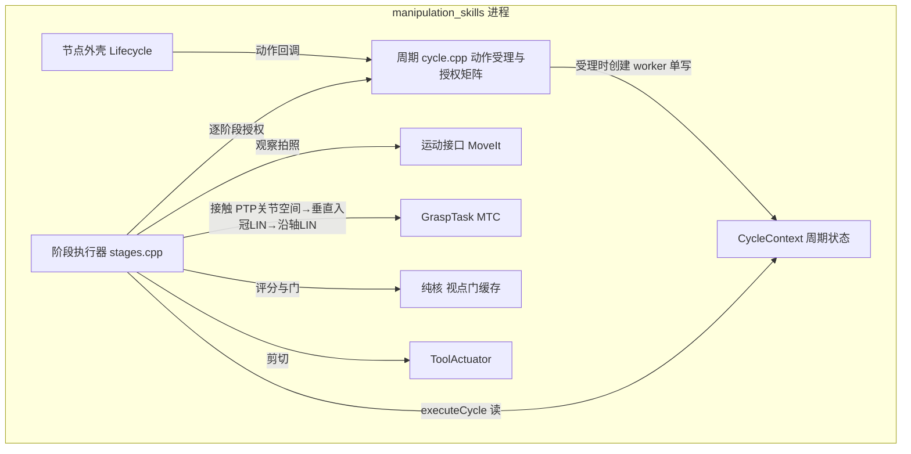
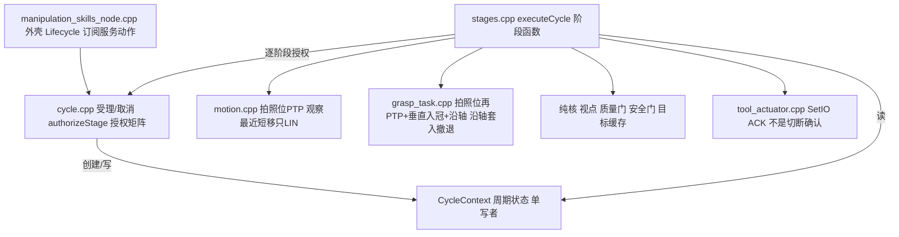
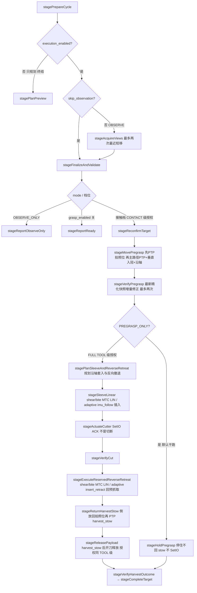
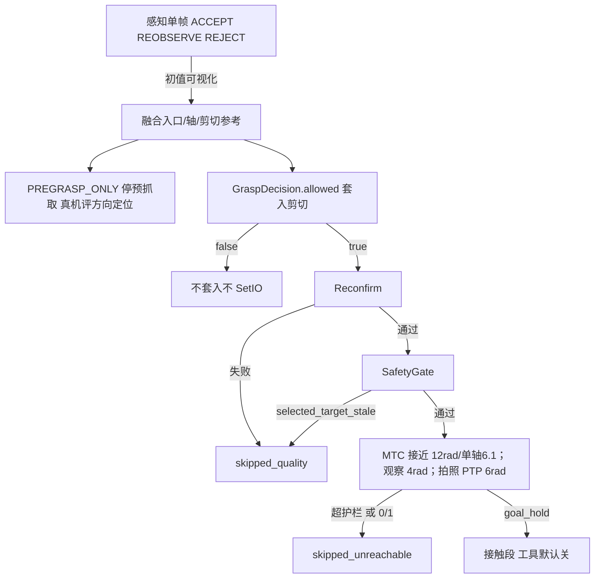

# `peach_arm` 架构（v1 活文档）

> 2026-10-10 用户裁定自仓库级 `docs/architecture.md` 拆写入包：技能节点组件图（图 3）、ExecuteTarget 阶段序列（图 D）、决策栈与接近约束四层。系统级架构在 [peach_bringup/doc/architecture.md](../../peach_bringup/doc/architecture.md)；批次时序（图 C）在 [peach_harvester/doc/architecture.md](../../peach_harvester/doc/architecture.md)。本文是 SNAPSHOT：**源码与本文互相更新，改一边须同一轮改另一边**；如何演化以 [AGENTS.md](../../../../AGENTS.md) 为准。

### 图 3 — 组件（C4 Component）· 技能节点

再打开图 2 里的 `manipulation_skills`。盒子是该进程内的主要模块，不是每一个 `.cpp` 文件。

**读图：** 一个进程、八个组件（`ExecutionAuthority` 授权矩阵编在 `cycle.cpp`，`CycleContext` 在 `cycle_context.hpp`）。外壳不规划；`cycle.cpp` 受理动作并按 `authorizeStage` 判定执行权；阶段执行器读上下文跑固定阶段序列；接近主路径 = PTP 关节空间到中段点正下方（树冠外，滚转梯子 {0,±30°,±60°}+随机重启 IK）+ 世界垂直 LIN 入冠（伸进果树里）+ 沿轴 LIN 对轴进入预抓取；无候选扫描/多级兜底（2026-09-23 定型 v4）；PTP 亦用于命名关节赶路（拍照位 / stow）；刀具不在 MTC 里。感知两容器的同缩放运行时图（图 3b 看一帧 / 图 3c 建一颗）在 [peach_harvester/doc/architecture.md](../../peach_harvester/doc/architecture.md)；调度组件图按同样缩放另画，不要把那些模块塞进这一张。

---

### `peach_arm` — 机械臂执行

**作用：** 把「去拍照」「围着这一颗看」「按许可插入/撤退」做成动作服务端。规划与执行走 MoveIt / MTC；工具 IO 走柜侧 `SetIO`。不拥有批次、不拥有目标集合。

**含什么：** 单节点 `peach_arm`（Lifecycle；类声明 `manipulation_skills_node.hpp`，参数经 GPL 生成的 `arm_parameters.hpp` `ParamListener` 快照，`params_bridge.hpp` 的 `to*Config` 单点转换族（`toMotionConfig` / `toGraspTaskConfig` / `toFrameRateTimeoutConfig` / `toViewPlannerConfig` / `toQualityGateConfig` / `toSafetyGateConfig` / `toContactDetectConfig`；`ScanBudgetConfig` 在 `stages.cpp` 装配）——W5 起节点不再镜像 ~28 个参数成员）。周期状态全部入 `CycleContext`（`cycle_context.hpp`：action 受理时创建、worker 单写者、周期消亡即整体丢弃，`cycle_*` 成员已删）；动作受理/取消与授权矩阵在 `cycle.cpp`（`ExecutionAuthority`：TRANSIT/PREGRASP=Active∧robotReady∧!cancel∧execution_enabled，CONTACT 再加 grasp_enabled∧许可复检（批次4 档位门：令牌路径另查径向余量 >0，快照路径另查 sleeve 能力 VALID，unrefined 路径由袋径×D_inner 门兜），TOOL 再加 tool_enabled∧（令牌轴向余量 >0 或快照 cut 能力 VALID）∧预备位残差过门；终局分级（M3c，`stage_denial.hpp` `StageDenial`）：令牌/许可**过期**（valid_until/model_stamp 超窗，重建换新令牌即可重派）与 GraspDecision 复检不过→SKIPPED_QUALITY，其余拒因（权限/安全/取消/使能/许可明确不允许）→FAILED）；阶段执行器 `stages.cpp`（`executeCycle(ctx)` 显式模式 switch，序列与旧主树遍历严格同构）；接触在 `grasp_task.cpp`（帧超时/预抓取残差/角度几何/v4 三路点构造为 header-only 纯核：`frame_timeouts.hpp` / `pregrasp_residual.hpp` / `angles.hpp` / `grasp_geometry.hpp::stagingWaypoints`，ACM 豁免合一在 `acm_policy.hpp`；staging_selector 已删）；纯核 `quality_gate` / `safety_gate` / `view_planner` / `target_cache`（直接构造唯一实现，缝位 0）；扫描预算/阶段墙钟/回调计时在 `cycle_support.hpp`。健康双轨：`~/status` JSON（作业票）+ `diagnostic_updater` → `/diagnostics`（九任务 1Hz，见 io.md）。on_deactivate 收口四 worker 线程（worker/action/survey/move_to）2 s 有界（`pthread_timedjoin_np` 超时 detach + WARN，批次7——TEM 风暴等挂死不再卡 lifecycle 拆栈；2026-10-08 勘定：abstime 须 `clock_gettime(CLOCK_REALTIME)` 现算绝对时刻，此前传相对 `{2,0}` 有界 join 从未真正生效）。运行参数（部署事实源）`config/peach_arm.yaml`；声明/兜底默认/校验单源 GPL `src/arm_parameters.yaml`（清洁重写轮 2c 回迁，生成 `include/peach_arm/arm_parameters.hpp`）。

**线程与旗标纪律（2026-09-20 审查修复轮）：** ① 周期 worker / survey / move_to 三执行线程同 W13-B 纪律（M2）：`packaged_task` future 有界回收——旧线程 2s 内未退场则 WARN 后 detach 放行新动作（放弃回收≠放弃取消，线程仍受取消标志约束；本回调在默认互斥组，裸 join 卡死会吊死 ACK/取消/订阅）。② 取消旗标收口（M1）：三动作终局各自 `clearCancelFlagIfIdle`——周期 worker 已落终态（`running_=false`）才清全局取消旗标，一次单果取消/skip 后 sticky 旗标不再把后续 MoveTo/观察拒之门外（在途取消经 `requestCancelAll` 已即时停运动，清旗不复活任何被停的运动）。③ 计划绑定（G2，`plan_contract.hpp` `executePlanGate`）：绑定只由 PREVIEW 模式 goal 写入——OBSERVE_ONLY/执行类模式一律不写（观察是采数据不是计划预览）；FULL/PREGRASP_ONLY 周期终局清复位（防陈旧 preview 跨目标误拒），受理即拒（plan mismatch）不清。④ 受理期拒单（M3a）：plan mismatch 发生在 ctx 创建前，经 `pending_accept_failure_code_` 把 PLAN_MISMATCH(20) 带进 Result（纯核常量与 IDL static_assert 双向锁定）；`onStart` 的 recovery / 锚点失效拒绝落 RECOVERY_REQUIRED / OBSERVE_FAILED 码（M3b；MoveIt 未初始化/未 arm 三支无对应词表码，保持 0 由 reason 传达）。

**关停期取消防御（2026-09-30 整包首跑实锤，决策 0038）：** SIGINT 收栈时 signal_handler 已调 `rcl_shutdown`，`on_deactivate` 收口路径里 `requestCancelAll` 的 `move_group_->stop()` / `grasp_task_->cancel()` 内部经 rclcpp 异步口创建 guard condition，context 已 invalid 时抛 `RCLError` 直达 `std::terminate`（exit -6，三档 tool_profile_smoke 全挂）。现两调用包 try/catch：清理期失败仅 DEBUG 留痕（`cancel_requested_` 先置，实际停运动不受影响），**收口/清理路径的失败不得终止进程**。同族存量未修（挂账）：2s 有界 join 超时 detach 后，detached 线程在 rcl_shutdown 后世界继续跑/入口线程成员赋值竞态——e1 在「SIGINT 时有在途 ExecuteTarget」下仍 `terminate called without an active exception`（testing-log 09-30；AGENTS 审计 F3 同源），修复需重构线程入口赋值守卫。

**执行有界等待（2026-09-23 TEM stop 事件风暴防线；2026-10-08 收口改 `execution_guard.hpp`）：** move_group TEM 异常（`transit_max` 触发的 stop 事件风暴，8.2 万行日志不停）会让同步 `execute` 永久阻塞且不理取消，一次即永久卡死动作通道（M1 tilt_1639_1 300 s hang 根因，见 testing-log 09-23）。新 GPL 参数 `moveit.execute_timeout_s`（默认 90 s，校验 >1；部署值 `config/peach_arm.yaml`）：`motion.cpp` 全部 execute 调用点（`planOrMoveTip` / `goToPhotoPose` / `reverseLastApproachToPhoto`）与 `grasp_task.cpp` 两处（MTC `Task::execute` 同步阻塞且不暴露 stop）收口私有头 `execution_guard.hpp` 的 `runBoundedExecute`——执行放独立 `std::thread`、等待环先到先收（完成/取消探针命中/超时三者谁先到按谁收口），取消命中或超时即 `move_group_->stop()`；**弃等时线程所有权移交 `RetireBucket`**（闭包只持共享资源拷贝，不引用调用方栈或 this）——不能再用 `std::async` 表达「弃等」（[futures.async]/7：其 future 析构阻塞到任务结束，2026-09-23 审查 P0-1）。**并发拒绝（2026-10-08）**：滞留 worker 未回收时（MGI::execute 非线程安全，2026-09-23 M1r SIGSEGV 根因）与另一执行在途时（CAS 抢执行权；MoveTo 与周期动作不共享 running_）直接返回 FAILURE 并 WARN_THROTTLE 10 s；10 s 宽限仍不返回则放弃等待（线程滞留一次，换通道可用）。新公有 `stopExecution()` = MGI::stop（打 move_group 节点级停止服务，与哪个接口实例发起执行无关）。MTC 侧超时判失败（reason `MTC execution timeout (stop issued; task handed off)`）。附带归因修复：`TargetCache::updateRefinedPose` / `updateRefinedFitting` 增 `reject_reason` 出参（`unrefined_hold` / `target_mismatch`），臂侧 `RCLCPP_WARN_THROTTLE` 10 s——unrefined_hold 是 skip_reconstruction 批的常态（latched 发布 0.5 s 心跳），原无节流 WARN 单轮刷 8 万行淹没真信号。**2026-09-24 起 TEM 直接关闭（决策 0029）**：`aubo_e5_moveit_config` 双 `controllers*.yaml` 声明 `trajectory_execution.execution_duration_monitoring: false`（UR Driver 主流做法：TEM 与透传/scaled 控制器打架）；`runBoundedExecute` 仍是超时防线，TEM 风暴根因另行跟（A-P3-1）。

### 技能包内部

**读图：** 一个 Lifecycle 节点拆成几份源文件，不是多个进程。外壳接 ROS；`cycle.cpp` 受理动作目标并实现授权矩阵（`cycle_support.hpp` 的 `MotionStage` 是其单一事实源）；`CycleContext` 承载一次周期的全部可变状态；真正「观察 / 预抓取 / 套入」是 `stages.cpp` 的阶段函数。观察移位走最近短步（只 LIN，失败换候选）；预抓取先回拍照位（有记录的「拍照位→预抓取」则原路返程，否则 PTP，时限 `photo_ptp_planning_time_s` 0.5 s，失败再 OMPL `photo_planning_time_s` 3.0 s），再走接近主路径：**PTP 关节空间到中段点正下方（树冠外，滚转梯子 {0,±30°,±60°}+随机重启 IK）+ 世界垂直 LIN 入冠（伸进果树里）+ 沿轴 LIN 对轴进入预抓取**（`approach_canopy_entry_m` 0.05 / `approach_final_axial_m` 0.05；不满足即失败收口带码，2026-09-23 定型 v4；冠内两段 LIN 优先 Pilz sequence blend(0.02，硬编码非参数) 速度连续，sequence 失败降级单任务 LIN（形状同、不平滑，v4d））；已在袋底侧且直连不穿囊的短修正（预抓取残差修正等）走直连 LIN 几何分档（已齐挂 tip 姿态 OrientationConstraint，容差 `mtc_approach_max_align_deg` 20°；未齐先 LIN 原地对齐再平移）。护栏拦绕腕、口侧穿囊（staging 首段 PTP 弧查圆柱穿越；其后 LIN 段另查反爬，锚定各段自身起点）。刀具 IO 只在阶段执行器里打，ACK 只表示柜侧收下命令。

**对外提供：**

| 入口 | 行为 |
|------|------|
| `SurveyScene` | `goToPhotoPose`（默认 SRDF `global_photo_pose`）：有「拍照位→预抓取」记录且当前关节在其终点则原路返程（不过 `transit_max_*`）；否则 PTP（`photo_ptp_planning_time_s` 0.5 s），失败回退 OMPL（`photo_planning_time_s` 3.0 s），超 `transit_max_*` 拒绝。成功出口 `atNamedTarget`（`execute=false` 仍核） |
| `ExecuteTarget` PREVIEW | 只规划不执行（MTC 凑 `mtc_max_solutions` 5 解） |
| `ExecuteTarget` OBSERVE_ONLY | 当前位采帧；基线未过最多两次最近短移（只 LIN，失败换候选），沿当前相机直线截到 `max_camera_step_m`（默认 0.15 m，~0.7 m 处一跨过 8°），评分以行程最短为主；朝检测框内分割更满的方向微偏。禁止对侧兜圈、OMPL、贴球面环绕、PTP 兜底。覆盖门 8°。**停准则：** 覆盖达标或 `maximum_moves` 用尽（Open3D TSDF / NBV：做完位姿序列，不用移动+等帧 EMA 预测收口）。到位后等**新机位**（`view_directions` 增加），同机位连帧不算覆盖 |
| `ExecuteTarget` PREGRASP_ONLY | 再确认 → 回拍照位（有记录的接近则原路返程，否则 PTP 0.5 s / 失败 OMPL 3.0 s；观察 look-at 直接规划常无 IK）→ 接近主路径：**PTP 关节空间到中段点正下方（树冠外，滚转梯子 {0,±30°,±60°}+随机重启 IK）+ 世界垂直 LIN 入冠（伸进果树里）+ 沿轴 LIN 对轴进入预抓取**（`staging.*` 参数族已删，2026-09-23 定型 v4；冠内双 LIN sequence blend(0.02，硬编码非参数)，v4d）（已齐 LIN 挂相对目标 20° 姿态约束）。执行路径 MTC `plan(1)`，不凑满 5 解。起点已在袋底侧、直连不穿囊时走直连 LIN 几何分档（非兜底链；未齐先 LIN 原地对齐工具 Z；滚转梯子换档）。不走 CIRC/STOMP/OMPL。失败 `skipped_unreachable`。拍照位失败则从当前位规划，仍失败再试拍照位 → 工具 TF 残差按最新精化快照重算 entry/pregrasp 增量修正（最多两次）→ 停在预抓取（`HoldPregrasp`，不回 `harvest_stow`）。残差未过门也停住，便于目视方向/定位。任何路径不 SetIO。不要求 `GraspDecision.allowed`。到位终局 `SUCCEEDED` + `recovery_required`（不是接触失败撤离）；ACK 前调度不 Survey / 不派下一颗 |
| `ExecuteTarget` FULL | `skip_observation`；再确认 → 预抓取验证 → `PlanSleeve`。**非 IMU 剪切手**（`shear_v1`/`bite_shear_v1`）：MTC 规划套入与反向撤退 → 沿轴一段 LIN 套入 → `ToolActuator` → `VerifyCut` → 原路 LIN 撤到预抓取 → **先倒放回拍照位再短 PTP `harvest_stow`**（stow 与 `global_photo_pose` 已分叉，直达会跳过原路返程撞 `transit_max`）。**自适应** `adaptive_shear_v1`：跳过 MTC 套入/撤退；VerifyPregrasp 后 imu_follow `enable`→`insert_start`→剪切→`insert_retract`→`disable`（回到预抓取才关窗；套入/撤退实测行程判据，批次5：FK 沿轴投影为主、`/imu_follow/insert_progress` 回退，时间仅截止，停滞窗 3 s 增益 <1 mm 收口 UNKNOWN），再同样经拍照位到 `harvest_stow`。禁止与 MTC 同时写控制器。切断**且**撤退确认才 `harvest.grasped`。`tool.enabled=true` 未确认终局 `FAILED`/`CUT_FEEDBACK_TIMEOUT`。`tool.enabled=false` 时跳过 SetIO，周期可 SUCCEEDED 但不宣称采摘成功 |
| `CheckReachability` | 选果预检：预抓取 IK；`require_sleeve`（FULL）再套入终点 IK **和**沿轴 `CartesianInterpolator`（步长/完成比与接触 LIN 同参，阈值 `mtc_cartesian_min_fraction` 0.95）。失败码 `no_ik` / `sleeve_no_ik` / `sleeve_no_cartesian`。不装配 MTC、不动臂。超臂展在 SELECT 跳过，不再派进接触再 Cartesian 0/1 |
| 预览/使能/ACK 服务 | `preview_*`、`set_execution_armed`、`acknowledge_recovery` |
| 诊断双轨 | `/diagnostics`（W5-10 + 2026-09-29 观测性 P1，diagnostic_updater 1Hz 九任务：观测流/TF 新鲜度、目标缓存 data_age、回调耗时 TopN（复用 CallbackTimingRegistry）、接触电流特征、使能心跳、robot_status 断流、工具链、move_group 在场、最近拒因锁存；`~/status` JSON 不动） |

**plan 契约与失败码（2026-09-20 E2E 审查修复轮）：** preview 绑定**只对 PREVIEW 模式 goal 生效**（受理分流）——OBSERVE_ONLY 是采数据不是计划预览、且模型建好前带不了三修订，旧实现把它记成 preview 是 conservative 档 FULL 必拒的根因；FULL/PREGRASP_ONLY 周期终局清绑定，受理即拒（plan mismatch → `failure_code=PLAN_MISMATCH(20)`，经 pending 受理失败码带入 Result）不清绑定以保留全字段约束。取消旗标 `cancel_requested_` 改为各动作终局 `!running_` 守卫下自动清（一次单果取消不再拖死后续 MoveTo/补视）；Survey/MoveTo/预览 worker 三处 join 统一为 2s 有界（packaged_task 模式，与 ExecuteTarget 同纪律）。授权拒绝分级抽纯核 `stage_denial`：**许可过期（valid_until 超时 / model_stamp 超窗）→ SKIPPED_QUALITY（可重派）**，许可明确不允许 → FAILED。

**订阅：** 感知观测；重建 `grasp_decision` / `refined_*` / `diagnostics`；操作台使能广播 `/peach/batch/enables`（`move_to.cpp` `onEnables`：收到过即覆盖本地使能参数，`enables_heartbeat_timeout_s` 心跳超时回落本地参数权威）。`pregrasp_verification` 由重建发布作观测，技能 `VerifyPregrasp` 用工具 TF 残差，未订该话题。作业目标以 **goal.target_id** 为准。规划 tip 为 URDF `tcp`。工具标定帧 `wrist3_Link → tool_axis / sleeve_mouth / cutting_plane / tcp`（`aubo_description` 按 `tool_profile` 选档案，现行默认 `adaptive_shear_v1`：`calibration_status` shear/adaptive=`design_reference`、bite=`cad_reference_point`（总装测量核定，1aa50d0），TCP 姿态 Z=开口、XY=刀口；帧名三把共用冻结）。

**档位：** 默认 `execution.enabled` / `grasp.enabled` / `tool.enabled` 全 false。真运动须与调度 `execution_enabled` 同时开。`tool.enabled=false` 时 `ActuateCutter` 阶段跳过 SetIO。`GraspDecision.allowed=false` 禁止套入/剪切（TOOL/CONTACT 级授权前复检，目标 ID 须对齐）；`PREGRASP_ONLY` 有融合几何即可去预抓取。`quality.allow_unrefined_geometry`（默认 false；`skip_reconstruction:=true` 时打开）把锁定集场景观测提升为精化入口并钉住重建门与 `grasp_allowed`，同时拷贝 `bag_diameter_upper_m`（观测侧进 `CachedTarget`；无效 -1 时果实胶囊仍回退 0.12 m），忽略随后 IDLE 诊断和未融合 GraspDecision。实验室档（mock 臂 + 真相机、物理臂示教器停拍照位）：锁定/Reconfirm 只用对齐瞬间的 3D，mock 离位后接触走钉住几何；真机 KEEP `skip_reconstruction=false`。不放松 `min_views` / `max_target_drift_m`。接触失败后的 recovery 是撤离未确认；`PREGRASP_ONLY` 到位是 `SUCCEEDED` 带 recovery，须 ACK 后调度才 Survey / 派下一颗。

**禁止：** 写 `ledger.json`；当 `BeginScene` / `RunHarvest` / `BuildTargetModel` 客户端；调重建 Trigger；自己选下一颗。

---

PAUSE 不覆盖作业 `batch_state`：`operation_mode=MODE_PAUSED` 禁止新派发，动作终局在恢复后对原 phase 只 settle 一次。Survey 暂停仍可取消当前动作。接触或 PREGRASP_ONLY 到位未 ACK 时 `recovery_required`，调度不 Survey、不派下一颗。

### 图 D — ExecuteTarget 阶段序列

`stages.cpp` 的 `executeCycle(ctx)` 显式模式 switch：阶段序列与旧主树遍历严格同构。OBSERVE 周期在 Finalize 后短路，不进预抓取。

---

能力包 Lifecycle：ROS 实体（发布/订阅/服务/动作/TF/心跳）统一在 `on_configure` 创建、`on_cleanup` 释放（官方 LifecycleNode 写法：Unconfigured 期零 ROS 接口，配置失败返回 ERROR 停在 Unconfigured 并报错）；**非 Active** 拒绝运动 / 积分 / `BeginScene`。

### 决策栈

**读图：** 从上往下权限越来越硬。单帧 ACCEPT 只配画面，不能动臂。融合几何足够去预抓取评方向。`allowed=false` 到此为止，禁止套入和 SetIO。再确认和安全门失败记 `skipped_quality`；超行程护栏或规划失败记 `skipped_unreachable`。最右「接触段」默认刀具仍关。

接近约束四层（2026-09-14，与姿态双门 / 绕行三门 / 关节行程门正交）：

| 层 | 保护 | 检查 | 生效期 |
|---|---|---|---|
| ① 果实胶囊 | 果实 | 工具有限圆柱（尺寸=工具档案注入 `tool.body_length_m`/`body_radius_m`，现行 adaptive_shear_v1 0.140 m / r 0.110 m；半径只径向不含端球）vs 感知果实胶囊（bottom→neck，r=`max(直径/2, 0.025)+fruit_inflation_m` 0.01）。轴向投影不重叠则不判侧撞（筒口对果是接近语义）。感知直径无效回退 `mtc_approach_keepout_radius_m` 0.12 并 WARN | 仅接近段；套入/撤退豁免 |
| ② 从下方 | 果实 | 反爬：TCP s ≤ max(本段起点 s, 0)+2 cm（锚果底） |
| ③ 场景障碍（快照对象，2026-09-29 起现行） | 仅相机（避障目的=保护相机；臂/末端轻微碰撞用户已接受） | **不用 octomap updater**（`sensors_3d.yaml` 保持 `sensors: []`，两轮翻车教训见该文件注释）。`peach_harvester` 的 `peach_scene_obstacles` 节点（独立进程、不进 lifecycle 名单）：Survey 完成触发（supervisor 发 `/peach/scene/obstacles_refresh`）后取最近一帧点云 `/camera/depth_registered/points`（订阅 RELIABLE——两前端发布端均 RELIABLE，BE 订户大帧假性丢包），经「**体素化 0.06 m 先行**→滤自身（体素中心距 collision mesh+FK 余量=`self_filter_margin_m`+体素半对角 √3/2·voxel——半对角保证方块含角点不切机器人表面；点级滤除再体素化会留切进工具 ~2mm 的方块致 FCL 起点接触、CheckStartStateCollision 全拒，09-29 真相机轮实锤）→滤已精化目标袋邻域膨胀胶囊（R=袋径/2+0.10+半对角、轴向两端+0.10+半对角；套袋必经区；未精化目标不滤）→上限 3000 box」转 BOX 对象 `peach_scene_obstacles`，经 `/apply_planning_scene` 原子写入（首写 ADD、此后同请求 REMOVE+ADD）；新目标精化后同帧重写（源帧不变=快照稳定）；作业期图冻结，新批次 Survey 自动重建。ACM：`tool.links` 部署值=全机器人连杆−`camera_body_link`（豁免×`{<octomap>, peach_scene_obstacles}`），唯一受查对=**相机×障碍**；peach_arm **激活即后台应用（3 次幂等重试+成功 INFO 日志**，Survey/观察/接近全程生效；09-29 勘定：激活早期服务竞态会静默落空，观察视点裸 plan() 起点即撞）；开关 `moveit.obstacle_guard_enabled`（默认 true，运行时 `ros2 param set`、运动中拒改、空闲经 rebuildGraspTask 生效）=false 时相机一并豁免（障碍拦路到不了位时恢复可达性；对象保留场景，重开即恢复保护）。写域分域：本节点只写 world、peach_arm 只写 ACM diff；接触段另按目标×阶段预置 per-target ACM（`grasp_task.cpp setContactAcm`：套入前置 `Sleeve`、撤退前置 `Retreat`、Transit 兜底——目标袋对象 × `tool.contact_links` 仅在 Sleeve/Cut 阶段放行，纯核 `acm_policy::acmAllows`，2026-10-08 起） | 全程规划期；mock 无点云=无快照；`camera_enabled:=false` 时节点不起 |
| ④ 近果降速+接触 | 果/硬件 | 套入 / 撤退 `approach_near_velocity_scaling` 0.05（接近主路径 PTP/LIN 段走 `velocity_scaling` 0.10）；`ContactMonitor` 腕轴电流斜率/尖峰（`grasp.contact_detect.*`，默认关，阈值 0=不判） | 执行期 |
