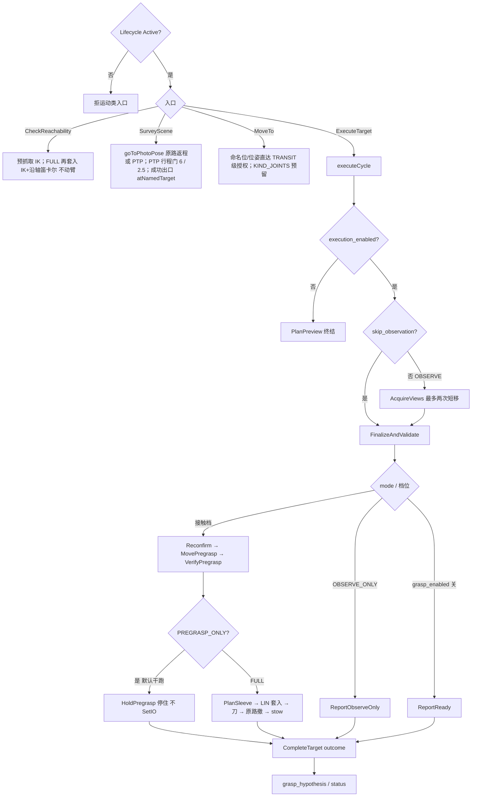

# `peach_arm` io（活文档）

> 2026-10-10 用户裁定自仓库级 `docs/io.md` 拆写入包：技能节点动作/服务/话题与参数。跨包边界在 [peach_bringup/doc/io.md](../../peach_bringup/doc/io.md)；场景障碍快照节点（`peach_scene_obstacles`，属 `peach_harvester`）在 [peach_harvester/doc/io.md](../../peach_harvester/doc/io.md)。**源码与本文互相更新，改接口须同一轮改另一边**。

单节点。不写 `ledger.json`、不调重建 Trigger、不当 `BeginScene` / `RunHarvest` 客户端。规划 tip 为 URDF `tcp`。作业目标以 **goal.target_id** 为准。

**读图：** 四个对外入口（三动作 + 可达性预检服务；明细见下表）。可达性预检不动臂。拍照是 Survey；补视/拍照位直达走 MoveTo。一颗桃的接触/观察全在 `executeCycle`（与 [architecture.md](architecture.md) 阶段表同构）：关执行只规划；`OBSERVE_ONLY` 看完就停；干跑默认 `PREGRASP_ONLY` 停预抓取；FULL 才套入打刀。套入/剪切前复检 `GraspDecision.allowed`。

| 名字 | 种类 | 含义 | 生产 | 消费 |
|------|------|------|------|------|
| `/peach_arm/survey_scene` | action | 去 SRDF 拍照位并复核当前关节；不重启收齐窗 | peach_arm | peach_supervisor |
| `/peach_arm/execute_target` | action | 对一颗桃：观察 / 预抓取 / 套入剪切，按 `mode` 短路 | peach_arm | peach_supervisor |
| `/peach_arm/move_to` | action | 命名位 / 位姿直达（TRANSIT 级授权；`KIND_JOINTS` 预留未实现）：fast 档观察补视与 FireStep PHOTO 拍照位；stow 仍走接触周期内 PTP | peach_arm | peach_supervisor |
| `/peach_arm/check_reachability` | service | 批量 TCP IK：预抓取停位；FULL 再套入沿轴笛卡尔，取第一档能走满插入的刀口滚转；不动臂 | peach_arm | peach_supervisor |
| `/peach_arm/acknowledge_recovery` | service | 技能确认停驻已看过；调度 ACK 会调它，成功才消耗 `state_seq` | peach_arm | peach_supervisor |
| `/peach/manipulation/grasp_hypothesis` | topic | 本周期抓取假说（监控三维；未当批次门） | peach_arm | peach_observability |
| `/peach_arm/status` | topic | 技能短状态 JSON，作业票「靠近/工具」用 | peach_arm | peach_observability |
| `/peach_arm/tool_state` | topic | 工具三轴状态 `ToolState`（刀/保持/载荷；latched，on-change，证据=io_states 新上升沿，详见下「工具三轴状态」） | peach_arm | 无显式订户（会话 bag catch-all 落证据） |
| `~/planned_views`（`/peach_arm/planned_views`） | topic | 已走到的观察视点 MarkerArray（latched；清单可视化豁免，不进 RViz 默认面板） | peach_arm | （可视化） |
| `/diagnostics` | topic | 节点诊断标准面（diagnostic_updater 周期任务；2026-09-29 观测性轮起全覆盖）：`peach_arm`（9 任务：观测流/TF、目标缓存、回调耗时、接触电流、使能、**robot_status 断流、工具链、move_group 在场、最近拒因锁存**）、`peach_scene_perception_node` / `peach_target_reconstruction_node` / `peach_supervisor`/ `peach_scene_obstacles`（快照结局）/ `peach_observability`（bag 队列、摄入活度、**selfcheck 裁决**）/ `peach_vegetation` / `peach_stereo`（帧率/丢弃/激光配置）/ `serial_force`。不进接口清单：核对器只扫 `/peach` 前缀绝对名字面量，`/diagnostics` 属 ROS 标准诊断面（同 `serial_force` 先例，W5 验证不登记也绿）。**消费端**：`peach_observability` 订阅聚合进 `/api/state` `diagnostics` 分区与 8090 面板（此前全栈无消费方）+ 会话 bag | peach_arm 等 | peach_observability（聚合）+ 通用诊断工具 |

另有 Trigger（已进清单；8090 调试面调用，调度主路径走动作 cancel）：

| 名字 | 含义 |
|------|------|
| `cancel_cycle` | 手动停一周期（调度走动作 cancel，不走此口；调试面在用） |
| `go_to_photo_pose` | 只回拍照位（有接近记录则原路返程，否则 PTP），不采锁定集 |
| `preview_approach_insert` / `preview_full_contact` | 只规划接触预览 |

`set_execution_armed`（`std_srvs/SetBool`，已进清单；**不是 Trigger**）：data=true 武装本周期 / false 解除；`execution.enabled` 后每个周期还须调一次。

订阅：感知观测；重建 `grasp_decision` / `refined_*` / `diagnostics`；操作台 `/peach/batch/enables`（收到过即覆盖本地使能参数，`enables_heartbeat_timeout_s` 心跳超时回落本地权威）。柜侧：`RobotStatus` 做安全门；`/aubo_io_controller/joint_status` 电流环形缓存给 ④层接触检测（默认关，只缓存不判定）；工具闭合调 `/aubo_io_controller/set_io`。TF：`tf2::TimePointZero`（规划下一视点，不是积分旧深度）。

`stages.cpp` 的 `executeCycle(ctx)` 显式模式 switch，周期状态全在 `CycleContext`（action 受理时创建、worker 单写者）：PrepareCycle →（`execution_enabled` 关则 PlanPreview 终结）→（未 `skip_observation` 则 AcquireViews）→ FinalizeAndValidate →（OBSERVE_ONLY → Report / `grasp_enabled` 关 → ReportReady / Reconfirm → MovePregrasp → VerifyPregrasp →（PREGRASP_ONLY 则 `HoldPregrasp` 停住 | PlanSleeve → SleeveLinear → ActuateCutter → VerifyCut → ReverseRetreat → ReturnStow → **ReleasePayload（harvest_stow 后开刀释放，授权同 TOOL 级）** → VerifyHarvestOutcome））→ CompleteTarget。FULL 套入/撤退：三档统一走 MTC LIN；**先倒放回拍照位再短 PTP `harvest_stow`**。IMU 跟随接触窗（`imu_follow`）已删除（2026-10-19，历史在 git），不再有 Servo 与 MTC 双写面。运动/IO 入口逐阶段过 `ExecutionAuthority`（套入/剪切前复检 `GraspDecision.allowed`；撤离 TRANSIT 级不做决策复检）。

- OBSERVE_ONLY：当前位先采帧；基线未过最多两次最近短移（只 LIN，失败换候选），沿当前相机直线截到 `max_camera_step_m`（默认 0.15 m），评分以行程最短为主；朝当前目标检测框内分割更满的方向微偏。禁止 OMPL、对侧兜圈、贴 `observation_radius_m` 0.45 m 球面环绕、PTP 兜底。覆盖门部署 `quality.minimum_baseline_deg: 0`（单视可通过，不为张角再补短移）。停准则：覆盖达标或 `maximum_moves` 用尽；不做墙钟预算/移动+等帧 EMA 预测收口（`time_budget_s` 键已随死分支删除，2026-09-20 W5）。到位后等新机位（`view_directions` 增加），同机位连帧不加覆盖。成功：重建已绑定、独立机位已满 `min_views`（默认 1）、TSDF/精化已发布。观察成功但 Build `view_count`（机位数）`< min_views` → `observe_build_view_race`。`captured_views` 仍是积分帧数。
**入冠 IK 诊断：** `staging_ik` 采用 7 个滚转候选和每候选 4 个种子策略；较小绝对滚转候选的完整轨迹通过后才停止；完整PTP轨迹守卫失败且尚未运动时可继续下一候选。INFO 同时记录 target/model_revision、基座系落点与轴、group/tip，以及 `attempts` / `ik_failed` / `bounds_failed` / `self_collision` / `valid_candidates`；每次尝试只计首个失败门，后四项之和等于 attempts。Reachability 初筛不等于实际入冠规划可行，末次融合几何与当前状态仍须重新规划。

- PREGRASP_ONLY：有融合几何即去预抓取（入口在拟合袋底，预抓取相对入口后撤 0.03 m）；先回拍照位（有记录的接近则原路返程，否则 PTP 0.5 s / 失败 OMPL 3.0 s），随后几何允许时先验证完整直连LIN（含必要对轴）；完整LIN不可用且未运动、未取消、未因授权拒绝时，才走树冠外路径：**PTP 关节空间到中段点正下方（树冠外，滚转梯子 {0,±15°,±30°,±45°}+随机重启 IK）+ 世界垂直 LIN 入冠（伸进果树里）+ 沿轴 LIN 对轴进入预抓取**（`staging.*` 已删；不满足即失败收口）（已齐 LIN 挂相对目标 20° 姿态路径约束）。执行路径 MTC `plan(1)`。起点已在袋底侧、直连不穿囊的短修正走直连 LIN（未齐先 LIN 原地对齐工具 Z；keep-roll 自碰则换滚转）。不走 CIRC/STOMP/OMPL。拍照位失败则从当前位规划。不要求 `allowed`。工具 TF 残差超门则按**最新精化快照**重算 entry/pregrasp 做增量修正（最多两次）；残差未过门也停在预抓取（不回 `harvest_stow`），`pregrasp.passed=false` 且 `completion_level=LEVEL_PREGRASP_REACHED`（不得抬到 `LEVEL_PREGRASP_VERIFIED`；`passed` 与 `completion_level` 不得互相抬级）。任何路径不 SetIO。到位终局 `SUCCEEDED` 且 `recovery_required`，ACK 前调度不 Survey。现行不是两帧精确 TF RGB-D 重估。
- FULL：`skip_observation`。三档沿轴 MTC LIN 套入/原路撤退；**先倒放回拍照位再短 PTP `harvest_stow`**（stow 与 photo 已分叉，直达会跳过原路返程撞 `transit_max`）。结果填 `HarvestResult` / `Verification` / `PregraspVerification` / `outcome_record`；W7 起顶层 bool 镜像与 `DepositResult` 字段已删（cut/retreat/harvest 证据单源 harvest/verification 块；`DepositResult` 消息保留卸果站预留，不随 Result 携带）。`harvest.grasped` 仅切断证据∧撤退证据。SetIO 超时 → 工具 UNKNOWN，不自动重发、不自动撤退。SetIO ACK 只产生 `CUT_COMMAND_ACCEPTED`；切断确认已接 `/aubo_io_controller/io_states`（批次3：`tool_io_states[pin0]` **本命令后新上升沿**，早已卡高不算），`stageVerifyCut` 有界等沿 2 s（`tool.feedback_timeout_s`）超时 `CUT_UNCONFIRMED` 保守收口——不撤退不重发，终局 `FAILED`/`CUT_FEEDBACK_TIMEOUT` 待人工（详见下「工具三轴状态」行）。
- 接触 ACM：只对指定目标对象 × 指定工具链接 × 套入/剪切阶段放行（场景障碍豁免见下条，0035 起为独立面）。
- 场景障碍 ACM（0035，2026-09-29 起现行）：避障目的=**保护相机**（臂/末端轻微碰撞用户已接受）。`tool.links` 部署值=全机器人连杆−`camera_body_link`，豁免×`{<octomap>, peach_scene_obstacles}`；唯一受查对=相机×障碍。开关 `moveit.obstacle_guard_enabled`（部署 yaml **false**：树冠太密，叶墙不当碰撞体；GPL 声明默认 true。false=相机一并豁免恢复可达性，对象保留场景，空闲 `ros2 param set` 生效，运动中拒改，下个规划前重写 ACM）。豁免条目组装纯核=`acm_policy::obstacleExemptionEntries`。**PlanningScene 写域分域**：`peach_scene_obstacles` 节点只写 world.collision_objects（快照对象）、`peach_arm` 只写 ACM diff，双写者互不覆盖。
- MoveIt 标准口（非本包 IDL，不进清单）：冠内两段 LIN 的 Pilz sequence blend 走 `/plan_sequence_path`（GetMotionSequence）规划、`/execute_trajectory` 下发；ACM 整表合并与 move_group 在场诊断探针走 `/get_planning_scene`。环境盒 `scan.protected_zones` / `scan.min_camera_height_m` 双路生效（视点剔除 + MTC planning scene 碰撞盒）。on_activate 另建 bondcpp `/bond` 心跳（nav2_lm `bond_timeout`>0 才启用进程死检，现行默认 0 关）。
- ExecuteTarget FULL/PREGRASP_ONLY 要求完整模型身份元组；空版本拒执行（PREVIEW / OBSERVE_ONLY 除外）。`plan_id` 绑定（2026-09-20 修复轮收紧口径）：**只有 PREVIEW 档 goal 记 preview 绑定**，FULL **在自身携带 plan_id 时**与其全字段比对（mismatch → `failure_code=PLAN_MISMATCH(20)`）；绑定存在而 FULL 缺 plan_id 时比对不生效、直接放行（此时不应用preview绑定约束；绑定写入先于预览成败）。OBSERVE_ONLY 只携带 plan_id+身份（观察会动臂、不构成计划预览，模型建好前本就带不了三修订）；FULL/PREGRASP_ONLY 周期终局清绑定。授权拒绝分级：许可过期（valid_until / model_stamp 超窗）→ SKIPPED_QUALITY（可重派），明确不允许 → FAILED。
- 新鲜度门：`SafetyGate` 比较 `clock - freshnessStamp`。OBSERVED 且 `updated_s` 更新时用 `updated_s`，否则末次有效观测 `received_s`。门限 `effectiveTargetMaxAgeS()`：未测得 EMA 用 yaml 3.0 s，测得后只放宽。`assumed_frame_interval_s: 0.4` 只估等待窗口，不预填 EMA。
- 工具三轴状态（批次3，2026-09-23）：`/peach_arm/tool_state`（ToolState.msg，latched，on-change）——刀/保持/载荷三轴各自 UNKNOWN 优先；刀闭合证据=`/aubo_io_controller/io_states` 的 `tool_io_states[pin0]` **本命令后新上升沿**（早已卡高不算，§12.2 新事件门在 ToolActuator 内强制）；闭合≠分离（M0 台架后升级组合判别）。`stageVerifyCut` 有界等沿（`tool.feedback_timeout_s` 2.0s），超时=`CUT_UNCONFIRMED` 保守收口：**不撤退、不重发、不 resume**，FAILED+CUT_FEEDBACK_TIMEOUT 待人工；`stageReleasePayload` 在 harvest_stow 后开刀释放（授权矩阵同 TOOL 级）。SetIO ACK 仍≠任何确认。
- 接触护栏（yaml）：绕腕看累计 12 rad、单轴 6.1 rad（URDF ±3.05 满行程）；段间接缝计入 `|Δq|`。口侧/上方看①②层果实胶囊，**逐段审查**（工具有限圆柱 vs 感知胶囊；反爬 s 不得超过本段起点 max(s,0)+2 cm——v4 两段 LIN 逐跳都查；PTP 首段只查筒体接触，不查反爬；套入/撤退不审）。笛卡尔绕行比 1.5 / 偏离 0.12 m / 回退 0.08 m（2026-10-16：好簇 path/chord 1.06–1.08，差簇 2.40；接近与转移段同值，逐段审；0=不查；超门拒发并试下一 IK 候选）；TCP 姿态行程绝对 110°（相对起止余量 20°，0=不查）。09-11 mock typical 打开默认门后，从拍照位成功接近绕行比 ≤1.70、姿态 ≤71°；超门拒发（历史数字在 git，原 testing-log 已删）。不按时长（`mtc_approach_max_duration_s` 默认 0）。预抓取先回拍照位（有记录的接近则原路返程，否则 PTP 0.5 s / 失败 OMPL 3.0 s），几何允许时先直连 LIN（含对轴），否则 PTP+垂直入冠+沿轴到预抓取，再一段沿轴 LIN 套入；反向同轨迹（含入冠/沿轴段）回预抓取。已齐 LIN 加 tip 姿态 OrientationConstraint（对目标姿态，容差 `mtc_approach_max_align_deg` 20°）。直连未齐先 LIN 原地对齐再平移（对齐跳不挂门）。直连 LIN 弦长/弧长上限 0.80 m（v4 两段 LIN 同限；PTP 不受此限）。观察短移：只 LIN；行程 `observe_max_*` 4.0 rad / 1.5 rad（09-01 现场把 2.5 会拒的合法短移固化进 yaml）。`goToPhotoPose`：原路返程缓存包含本次**实际执行成功**的完整接近（PTP、混合/未混合 LIN 走廊及预抓取增量修正）；逐段核对关节名、维度、有限数、递增时间和接缝（0.05 rad，与拍照位匹配容差一致）。拒绝候选和仅规划结果不得加入；任一运动失败、坏接缝、返程端点不符或返程失败即清除缓存。倒放保持位置与加速度，速度取反，时间戳归零，重新经过执行授权与最终命名位到达验证。原路返程不过 `transit_max_*`（接近轨迹仍受既有接近护栏）；新规划先 PTP（`photo_ptp_planning_time_s` 0.5 s）失败再 OMPL（`photo_planning_time_s` 3.0 s），行程门 6 rad / 2.5 rad。成功出口核当前关节（`photo_pose_joint_tolerance_rad` / `photo_pose_max_joint_vel_rad_s`，`execute=false` 仍核）。超行程或不在拍照位不报成功。③层场景障碍=Survey 快照对象（0035）：`sensors_3d.yaml` 保持 `sensors: []`（不用 octomap updater，两轮翻车教训见该文件注释）；障碍由 `peach_scene_obstacles` 节点写入（见下节），受查面与开关见上「场景障碍 ACM」。④层近果速度档只套入/撤退 0.05（直连/冠内接近走 `velocity_scaling` 0.10）；接触检测订 `joint_status`，默认关。

默认 `execution/grasp/tool=false`：只规划、不接触、不 SetIO。

---

作业参数（部署值 `config/peach_arm.yaml`；默认/校验/描述权威 = GPL `peach_arm/src/arm_parameters.yaml` 单源生成 `include/peach_arm/arm_parameters.hpp`，清洁重写轮 2c 回迁）：

| 参数 | 含义 |
|------|------|
| `execution.enabled` | 开了才真动；每个周期还须 `set_execution_armed`。须与调度 `execution_enabled` 同时开 |
| `grasp.enabled` | 关则停在 READY、不到预抓取。开要求 execution 已开 |
| `tool.enabled` | 关则跳过 SetIO，不得宣称采摘成功 |
| `mtc_approach_along_axis_m` | 预抓取相对入口后撤。由 `grasp_standoffs.yaml` 注入，现行 0.03 m |
| `mtc_approach_max_total_joint_travel_rad` / `max_single_joint_travel_rad` | 接近绕腕护栏 12 / 6.1；超则不执行 |
| `mtc_approach_keepout_radius_m` / `keepout_axial_m` | ①层：axial>0 启用果实胶囊/反爬审查；radius 是感知直径无效时的回退半径（0.12 m），不再当半无限圆柱 |
| `approach_near_velocity_scaling` | ④层近果速度档，默认 0.05；仅套入/撤退 LIN（PREVIEW 接近+插入预览同档）。staging PTP、冠内两段 LIN（sequence 混合与降级 LIN）及直连短修正 LIN 走 `velocity_scaling` 0.10 |
| `grasp.fruit_inflation_m` | ①层果实胶囊固定膨胀，默认 0.01 m |
| `grasp.contact_detect.*` | ④层电流特征止损（enabled 默认 false；斜率/尖峰阈值默认 0=不判）；订 `/aubo_io_controller/joint_status` |
| `mtc_approach_max_detour_ratio` / `max_chord_deviation_m` / `max_recede_m` | 接近笛卡尔绕行比三项，默认 1.5 / 0.12 m / 0.08 m（2026-10-16：拒 2.4 族大弧；0=不查） |
| `mtc_approach_transit_max_detour_ratio` / `max_chord_deviation_m` / `max_recede_m` | 转移段（树冠外 PTP 弧+两 LIN、回拍照位返程）绕行比三项，默认同接近段 1.5 / 0.12 / 0.08 |
| `approach_final_axial_m` / `approach_canopy_entry_m` | v4 接近两段长：末段沿轴（中段点→预抓取）默认 0.05；世界垂直入冠段（PTP 落点在中段点正下方）默认 0.05 |
| `mtc_approach_max_tcp_rotation_deg` | 接近段相对起点 TCP 姿态测地线绝对上限，默认 110°（0=不查）。这是倾斜与滚转共同产生的整体姿态门；工具Z轴滚转另外限定在±45°内，不能把45°当作整体姿态上限 |
| `mtc_approach_tcp_rotation_slack_deg` | 相对本段起止测地线的路径余量，默认 20°（0=只看绝对上限） |
| `mtc_approach_cartesian_max_distance_m` | 接触笛卡尔弦长/弧长上限 0.80 m；超过不改无约束 PTP |
| `observe_max_total_joint_travel_rad` / `max_single_joint_travel_rad` | 观察短移护栏 4.0 / 1.5 |
| `transit_max_total_joint_travel_rad` / `max_single_joint_travel_rad` | 回拍照位新规划 PTP/OMPL 护栏 6 / 2.5；原路返程不过此门 |
| `max_camera_step_m` | 下一视点沿当前相机直线截步（默认 0.15 m） |
| `maximum_moves` | 观察移动次数封顶；覆盖达标即停 |
| `quality.minimum_baseline_deg` | 覆盖门，部署 0°（单视可通过）；纯核未注入 yaml 时结构默认 8° 仅单测 |
| `quality.allow_unrefined_geometry` | 默认 false；true 时用场景观测当精化入口并钉住 `grasp_allowed`。钉扎期间，滞后的选中帧和重建 `GraspDecision(allowed=false)` 不撤套入许可（`skip_reconstruction` 打开）。promote 把 `suggested_travel_m` 置 0，`insertionTravel` 走 `(neck-entry)-neck_margin_m` 回退（2026-10-21 实测 0.05–0.10 m），不再采信旧 `L_insert=0.03` 封顶；全重建仍用融合 cut travel |
| `photo_pose_named_target` | Survey / 回拍照位的 SRDF 名（`global_photo_pose`） |
| `photo_pose_joint_tolerance_rad` / `photo_pose_max_joint_vel_rad_s` | `goToPhotoPose` 成功出口每轴 \|Δq\| / \|qdot\| 上限（默认 0.05） |
| `execution_contract.robot_status_timeout_s` | robot_status 断流判据（安全门 stale + 诊断阈值；GPL 默认 0.5 s，config 未部署） |
| `execution_contract.model_max_age_s` | 精化模型最大龄（GPL 默认 5.0 s，config 未部署） |
| `scan.protected_zones` / `scan.min_camera_height_m` | 环境禁入盒 / 相机最低高度：视点剔除与 MTC 碰撞盒双路生效 |

剪切参考行程：CheckReachability 对明确行程越界返回 `cut_travel_out_of_range`；执行端以 DECISION_REJECTED / SKIPPED_QUALITY 拒绝同类几何。PREGRASP_ONLY 只验证入口与轴及重建身份；CONTACT 前再次验证精确行程。FULL `require_sleeve` 时 CheckReachability 与接近共用「第一档沿轴笛卡尔走满」的刀口滚转，不把 keep-roll 两端 IK 当成插入可行。rqt_console / `$ROS_HOME/log` 过滤 logger `peach_arm.contact`：`caller=FINALIZE` 是精化后预检，`CheckReachability` 是服务端逐档分数，`接近筛滚转` 标明 FULL 插入行程，`跳过接近/入冠滚转` 是执行时丢掉走不满的档。SELECT 在 `peach_supervisor.contact`。失败打 `failure_code=`。阶段名在 `peach_arm.cycle`。

## 决策提交、READY与许可边界

`target_observers.cpp::onDecision`将同一GraspDecision的身份、entry/cut/axis、质量和四能力一次提交TargetCache，`status.cpp`承接状态/诊断。FULL在精化到达后有界等待同目标已提交且未过期的决策快照（`timeouts.refined_s`，重建仍在 COLLECTING 时用满该上限，现行 5s），失败为`decision_snapshot_unavailable`。单条轨迹执行等待 `moveit.execute_timeout_s` 现行 5s，超时后停轨宽限 5s，不是用单独refined_pose或READY心跳补许可。提交完整且geometry有效的Snapshot可READY；sleeve/cut无效时仍可有可预抓取几何，CONTACT/TOOL各自复检能力与运行门。模型年龄按generated_at计算，心跳不刷新生成时间，同revision不能续签有效期。Web allowed与臂侧最终授权分别记录。

接近候选排序：IK候选列表先按工具Z轴绝对滚转、再按腕轴加权关节代价排序，随后逐候选验证完整PTP走廊与轨迹门。候选范围为0、±15°、±30°、±45°；较小绝对滚转候选的完整轨迹通过后才停止；完整PTP轨迹守卫失败且尚未运动时可继续下一候选。FULL 另跳过套入直线未走满的滚转档，与 CheckReachability 同形。±45°是工具Z轴滚转限制，110°仍是整体TCP姿态测地线门。排序不改变授权、碰撞及完整走廊判据。

接近轨迹优先完整直线，必要时仅使用原有冠内两段LIN之间2cm blend平滑连接；没有新增CIRC或OMPL接触兜底。PTP是关节空间路径，不能声称TCP走精确圆弧。fallback只允许在尚未运动、未取消且未因授权拒绝时继续。

MTC接触任务从构造时禁用introspection（`Task(task_name, false)`），不采用默认构造后再关闭。候选开始/create、plan、reset计时用于区分IK/规划、任务释放和执行停滞；每个滚转候选检查取消generation，取消不会进入下一档。此处不新增动作接口或放宽有效期/几何门，轨迹展示仍以实际TCP及状态为证。
