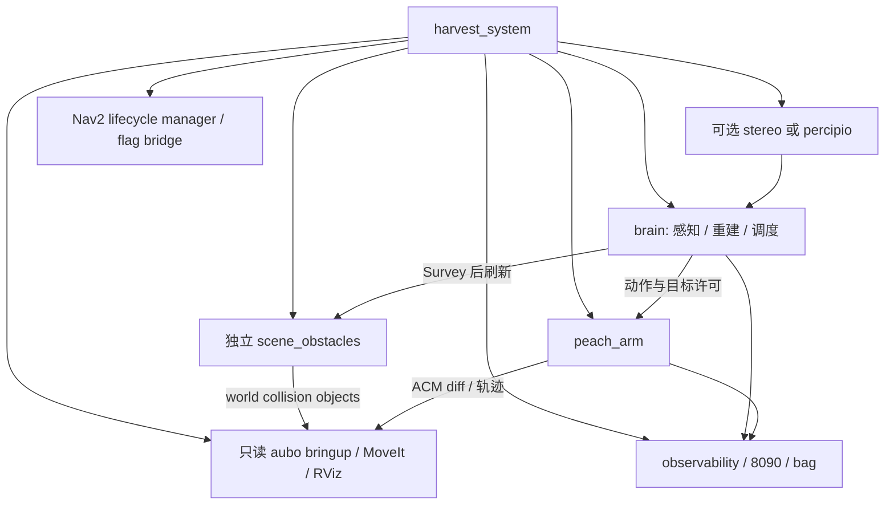

# Peach 系统架构

本文记录当前运行结构。如何修改以根 AGENTS.md 为准；字段与图名以源码及 `peach_interfaces/config/interface_manifest.yaml` 为准。各能力内部实现放在各包文档，系统不重复参数表和历史决策。

## 职责与边界

固定座 AUBO E5 的套袋桃采摘链：相机输出 RGB-D，感知生成事实，重建生成目标模型与许可，调度选择目标并编排动作，臂侧规划并执行。跨能力通过 ROS IDL 通信；共享基础函数属于 `peach_common`，不能用于跨包传递业务状态。

- `peach_interfaces`：消息、服务、动作和接口清单；无节点。
- `peach_common`：参数、QoS、路径、日志与生命周期辅助库；无节点。
- `peach_harvester`：一进程三个节点（感知、重建、调度）；场景障碍另进程。
- `peach_arm`：运动、许可复检、预抓取、套入、工具与撤退。
- `peach_bringup`：预检、组合、生命周期管理与可选 autostart。
- `peach_observability`：诊断聚合、8090 调试桥、会话录制与报告。
- `peach_stereo`：PS800-E1 主机立体相机前端。
- `peach_vegetation`：独立枝叶二维分割，不进入采摘整栈。
- `peach_system_tests`：纯核、isolated-domain mock 与冻结数据回放，不进入生产 launch。
- 顶层 `peach_web`：8090 静态资源，由 observability 托管。

## 运行入口与进程

```bash
ros2 launch peach_bringup harvest_system.launch.py hardware_mode:=mock camera_enabled:=false
```

默认工具 `bite_shear_v1`；默认 `autostart=false`、执行/接触/工具使能关闭、`execute_pregrasp_only=true`。相机默认关闭；开启时默认 stereo，percipio 显式选择，replay 不占设备。完整部署参数读 launch 的 `--show-args`。环境、分层测试和停栈见 [测试指导](../../peach_system_tests/doc/testing.md)。



stereo include 位于 aubo include 之前，保持 launch 参数作用域。`serial_imu` 按开关启动；只有 adaptive 工具档 Include `imu_follow`，其运动默认关闭，真机启用须另授权。IVG、仿真场景、枝叶分割不属于本业务核。peach2 已归档，不作为活动入口。

## 生命周期与并发

Nav2 管理顺序：`peach_scene_perception_node` → `peach_target_reconstruction_node` → `peach_arm` → `peach_supervisor`，停止按反向处理。brain 的三个节点共享 MultiThreadedExecutor；默认回调组节点内互斥、节点间可并行，重活另有工作线程。进程合并意味着共享故障域，不等于 rclcpp composition。

四托管节点接 bond；`bond_timeout=0.0` 默认关闭管理器进程死检。启用非零超时必须先验证本机 bondpy/bondcpp 及 mock 故障链；不能把“已接线”称为“默认已保护”。flag bridge 查询管理器 `is_active` 并发布闩锁就绪标志，调度据此允许开批。桥使用独立单线程 executor；正常中断或外部上下文关闭时先停 executor 再销毁节点，不打印预期中断异常栈，其他错误仍传播。observability、scene_obstacles 和可选外设不在该名单。

## 作业与安全

RunHarvest → Survey 到拍照位 → BeginScene → 等锁定集 → 从 target_observations 选果 → Build 与观察并行 → 模型/执行门 → PREGRASP_ONLY 或 FULL → 结算/回访。`grasp_decision` 缓存许可，不用于选果；initial_pose 只给重建。PREGRASP_ONLY 到位后停住，等待恢复 ACK；它不等于完整采摘。

最后运动/工具写入前由臂侧 ExecutionAuthority 复检运行期使能、机器人就绪、取消和目标许可身份/时效。PlanningScene world 对象由 scene_obstacles 写，ACM diff 由 arm 写。规划碰撞是应用护栏，不是现场功能安全。

未授权不得真机运动或 SetIO；驱动栈只读、不起 dashboard、不远程上电，示教器负责上电及抱闸。硬件急停在柜/示教器，不经 ROS。保护停止后丢弃旧 goal、现场确认、复位后重新授权，不恢复旧轨迹。软件取消/RobotMoveStop 是应用停轨。

## 配置、证据与限制

Python 参数源为各包 config YAML + `peach_common.yaml_params.attach`，规则留在能力包；arm 声明/校验由 GPL `src/arm_parameters.yaml` 生成，部署值在 config。停位几何单源为 harvester `grasp_standoffs.yaml`，工具几何来自只读 aubo_description 档案。话题接线使用 remap。

诊断走 `/diagnostics`，事件/账本保留作业身份，observability 会话落 `runs/session_*`。每批 request_id 唯一。网页 allowed、重建 ACCEPT、执行完成级别与真实剪切结果分别核对；level 6 不等于 level 7。当前联合验收已记录30组模型，但10轮中仅6轮level6、4轮质量跳过；253条soak采样约21分钟且RViz退出，不能宣称10轮/30分钟可视化验收通过。监控RViz profile只保留一份RobotModel并移除MotionPlanning重复机器人显示，是GL异常排障候选，尚未证实Ogre根因或修复效果。

本栈不具有功能安全认证；mock 不证明真机安全或接触精度。相机物理固定而 mock 腕移动时必须使用经核对的固定采集位锚定，不能把模拟腕 TF 当新视点。测试与程序结束必须停栈、等 bag 封口并核对本轮 PID 无残留。

## 源码与文档导航

- `launch/harvest_system.launch.py`：唯一整栈组合与启动事实注入。
- `peach_bringup/preflight.py`：旧实例与磁盘预检。
- `peach_bringup/lifecycle_flag_bridge.py`、`autostart_client.py`：就绪桥与可选开批客户端（以 setup.py console_scripts 为准）。
- [系统 IO](io.md)、[harvester](../../peach_harvester/doc/architecture.md)、[arm](../../peach_arm/doc/architecture.md)、[observability](../../peach_observability/doc/architecture.md)、[接口](../../peach_interfaces/doc/architecture.md)。

测试先执行 `colcon test --packages-select peach_bringup --return-code-on-test-failure`，系统接线再按测试包 isolated-domain 入口验证；预检失败不得通过删除检查来绕过。

当前调度在on_stack_ready就绪值改变时立即广播状态，使界面与客户端及时看到转换。reconstruct_in_trajectory默认true走已有并行路径：Build先绑定，臂侧等待Finalize及同目标精化/许可，再开始规划；execute_pregrasp_only默认true，TTL和安全门不放宽。联合runner通过原子阶段检查点保留中间证据，soak检测RViz退出或相机/关节断流立即失败清理。自动报告为继承本轮进程组的subprocess，默认30秒等待、TERM后2秒、KILL后2秒回收；报告失败保留封口bag供离线重算。主机网络SDK能发现相机；隔离网络probe的0设备不能外推为相机故障，新主机网络probe完成3组模型及15秒RViz存活观察，但抓取180秒FAILED；bag封口且无残留，只证明该次短时显示与收尾，不构成抓取或完整验收通过。
