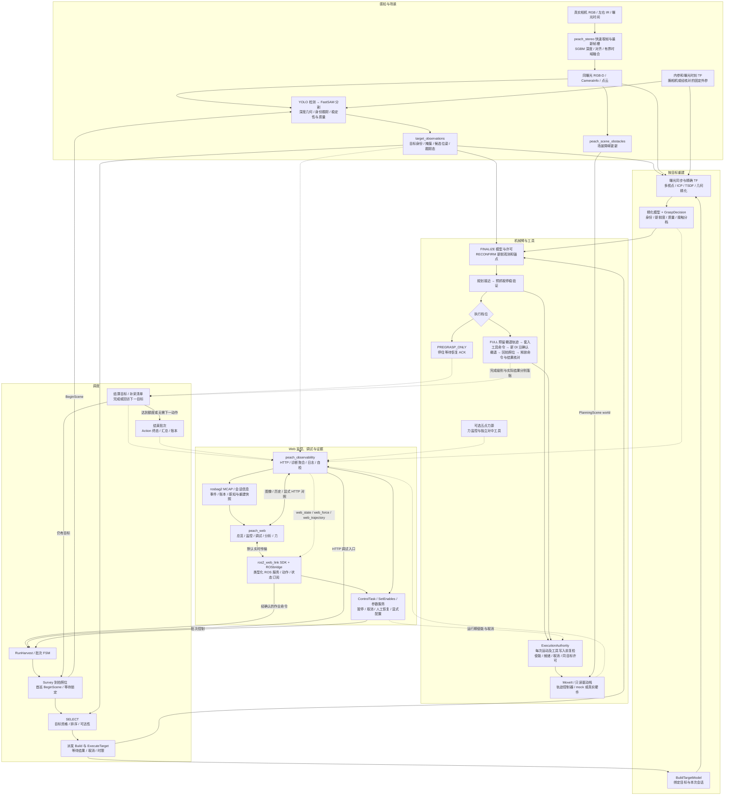
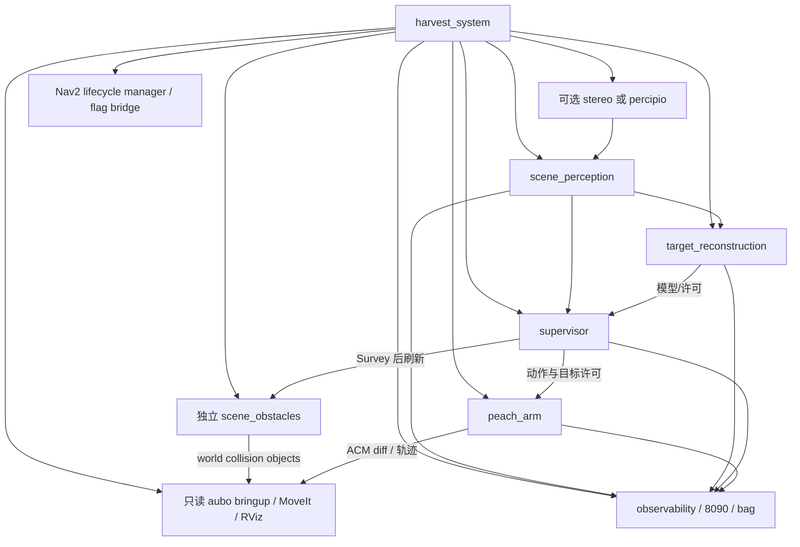
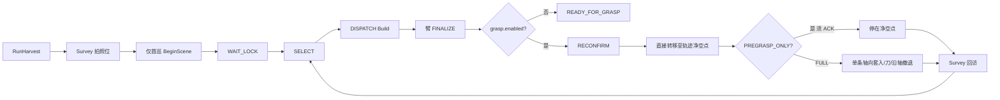

# Peach 系统架构

本文记录当前运行结构。如何修改以根 AGENTS.md 为准；字段与图名以源码及 `peach_interfaces/config/interface_manifest.yaml` 为准。实现级流程、FSM、几何与授权门见 [design.md](design.md)。各能力内部接口表放在各包文档，系统不重复参数清单和历史决策。

自动启动辅助节点的整数验证在声明期启用，运行期按 rclpy 的前插顺序置于 GPL 缓存更新之前。被拒绝的 `intent` 写入不会改变实际发批读取的值。启动事实的 Git 分支保留 `test/…` 等完整名称，提交号同时读取 loose refs 与 `packed-refs`，避免仓库压缩引用后把已知版本标成 unknown。

## 职责与边界

固定座 AUBO E5 的套袋桃采摘链：相机输出 RGB-D，感知生成事实，重建生成目标模型与许可，调度选择目标并编排动作，臂侧规划并执行。跨能力通过 ROS IDL 通信；共享基础函数属于 `peach_common`，不能用于跨包传递业务状态。

- `peach_interfaces`：消息、服务、动作和接口清单；无节点。
- `peach_common`：参数、QoS、路径、日志与生命周期辅助库；无节点。
- `peach_scene_perception`、`peach_target_reconstruction`、`peach_supervisor`、`peach_scene_obstacles`：四个独立能力包；`peach_harvester` 仅兼容 metapackage。
- `peach_arm`：运动、许可复检、预抓取、套入、工具与撤退。
- `peach_bringup`：预检、组合、生命周期管理与可选 autostart。
- `peach_observability`：诊断聚合、8090 调试桥、会话录制与报告。
- `peach_stereo`：PS800-E1 主机立体相机前端。
- `peach_vegetation`：独立枝叶二维分割，不进入采摘整栈；启动事实明确 `vegetation_enabled=false`，自检按未部署 SKIP。
- `peach_system_tests`：手工探针、隔离域 mock runner、冻结回放与官方 ament lint，不进入生产 launch；没有旧版自动 launch_testing 套件。
- `peach_web`：8090 静态资源，由 observability 托管。

## 完整数据与作业流程

实线表示数据或命令，虚线表示监控、记录或反馈。感知持续运行；重建按目标启动；调度与臂侧通过动作并行等待，不能把模型就绪、动作完成和物理切断混为同一成功信号。



`skip_reconstruction` 是显式策略分支：臂侧在允许未精化几何时使用感知候选，仍受最终执行授权与对应质量门约束。默认执行、接触、工具使能关闭。`peach_vegetation` 是可独立运行的二维分割能力，当前整栈没有部署，不能画成已接入的障碍来源。真实相机加 mock 验证接线和软件流程；mock 刀具反馈不能证明物理切断，L6 也不能替代完整 L7 结果。

## 运行入口与进程

```bash
ros2 launch peach_bringup harvest_system.launch.py hardware_mode:=mock camera_enabled:=false
# 真机 + 8090 调试页（含五点力页；不自动开批）：
ros2 launch peach_bringup real_web.launch.py
```

默认工具 `bite_shear_v1`；默认 `autostart=false`、执行/接触/工具使能关闭、`execute_pregrasp_only=true`。相机默认关闭；开启时默认 stereo，`camera_frontend:=percipio` 切官方 18 图案驱动（launch 期互斥，感知年龄门 2.5 s），replay 不占设备。两个前端的候选轴均保留当帧几何；身份 EMA 仅用于跨帧关联，不证明轴或入口已稳定。完整部署参数读 launch 的 `--show-args`。环境、分层测试和停栈见 [测试指导](../../peach_system_tests/doc/testing.md)。



stereo 与驱动内的 percipio 互斥；每个 include 使用独立 scoped GroupAction，子参数 `params_file`、`autostart` 等不外泄，后续节点各读所属包配置，父级自动开批开关保留。作用域转发父级配置，保留全局 `use_sim_time` 与传给 observability 的启动事实。`serial_force` 按开关启动（5 点力传感器；IMU / `imu_follow` 已于 2026-10-19 删除，历史在 git）。IVG、仿真场景、枝叶分割不属于本业务核。peach2 已归档，不作为活动入口。

应用在上述作用域内加载 `config/joint_state_broadcasters.yaml`，不修改驱动文件。
原 `joint_state_broadcaster` 显式选择冻结六轴的 position/velocity，保证 `/joint_states`
排列与控制器关节序一致；额外的官方 `dynamic_joint_state_broadcaster` 不过滤接口，
保留 `/dynamic_joint_states` 的完整关节、GPIO 与 speed-scaling 数据。后者的关节话题
仅在该实例内重映射到 `/dynamic_joint_state_broadcaster/joint_states`，两条公共话题各有
一个发布者。两个广播器均不申请命令接口。Jazzy JSB 的 joints/interfaces 同时决定排列和
接口筛选，单纯关闭 URDF 筛选不能保证资源管理器遍历顺序；采用两个标准实例避免丢失状态或自研转发。
启动自检检查六轴的名称、数量和顺序，并要求两个广播器均 active。

## 只读驱动文档的现状差异

以下只记录当前源码事实；对应驱动、描述、MoveIt 配置和 AUBO IDL 按工作区约束只读，保留其原文。阅读旧注释时应结合本页和所属能力包的当前实现。

- 驱动 [README](../../../aubo_e5_bringup/README.md) 仍写 `peach_harvester/harvest_system.launch.py` 转发；当前 harvester 是无代码 metapackage，整栈实体入口为本包 `harvest_system.launch.py`，没有该旧转发文件。
- MoveIt [_moveit_configs 注释](../../../aubo_e5_moveit_config/launch/moveit.launch.py) 仍称 octomap 保护；实际 [sensors_3d.yaml](../../../aubo_e5_moveit_config/config/sensors_3d.yaml) 的 `sensors: []` 不启动 updater。场景 world 写者是独立 peach_scene_obstacles，部署体素为 0.12 m 且 enabled 默认 false，不能沿用驱动注释中的旧包归属和 0.06 m。
- 驱动 launch / 主 [xacro](../../../aubo_description/urdf/aubo_e5.urdf.xacro) 的工具缺省仍为 adaptive_shear_v1；Peach 组合入口显式传入 bite_shear_v1，两者不应混写。主 xacro 的“自适应剪切手+IMU”是旧说明；对应 component 与工具档案已记载 MPU6050/imu_follow 删除。档案的实际 loader 在 peach_common/tool_profiles.py，旧 peach_harvester/vision 路径已退役。
- [RunHandEyeCalibration IDL](../../../aubo_msgs/action/RunHandEyeCalibration.action) 的结果注释称非 joint 内参为单位阵；[标定服务](../../../aubo_hand_eye_calibration/aubo_hand_eye_calibration/server.py) 只在 joint 分支填写内参，其他分支保留消息默认的九个零、空畸变和 0 RMS。消费方不能将默认数组当作已标定内参，详见 [标定接口](../../../aubo_hand_eye_calibration/doc/io.md)。

## 生命周期与并发

`move_group_shutdown_workaround=true` 默认对 `move_group` 单独使用 Jazzy launch 的 `launch-prefix`/`launch-prefix-filter`，以 `env LD_PRELOAD` 保留官方默认 capability 库至进程退出，规避本机 MoveIt 2.12.4 在 Executor 析构时的段错误（[上游 #3680](https://github.com/moveit/moveit2/issues/3680)）。配置放在 scoped include 内，不预加载到控制器、相机、Python 或 RViz，不改驱动与 `/opt/ros`；保留原退出码检查。库由 ament 包前缀定位，缺失明确拒启；自定义 `launch-prefix` 时须关闭此兼容参数以免互相覆盖。上游修复后可显式置 false 对照复验。启动事实记录该参数；这项兼容措施不改变规划和运动授权。

Nav2 管理顺序：`peach_scene_perception_node` → `peach_target_reconstruction_node` → `peach_arm` → `peach_supervisor`，停止按反向处理。`reconstruction_enabled:=false` 时重建不启动、不进入 lifecycle 名单，supervisor 强制 `skip_reconstruction=true`，arm 允许未精化几何；感知仍独立运行。能力包 launch 分别启动感知、重建与调度，节点名和参数分节保持。感知用 SingleThreadedExecutor 配有界推理 worker，重建与调度用各自 MultiThreadedExecutor；进程隔离 Python GIL。`peach_harvester` 不再提供 brain.py 组合入口；整栈只走能力包 launch。

四托管节点接 bond；`bond_timeout=0.0` 默认关闭管理器进程死检。启用非零超时必须先验证本机 bondpy/bondcpp 及 mock 故障链；不能把“已接线”称为“默认已保护”。flag bridge 查询管理器 `is_active` 并发布闩锁就绪标志，调度据此允许开批。桥使用独立单线程 executor；正常中断或外部上下文关闭时先停 executor 再销毁节点，不打印预期中断异常栈，其他错误仍传播。observability、scene_obstacles 和可选外设不在该名单。

supervisor 去激活或 shutdown 时先关派发门、置批次取消并取消在途子动作；批次回调继续等待终态和落账。旧批次或受理中的动作未收口时，cleanup/重新 activate 返回 FAILURE，等待收口后再重试，避免销毁回调仍需的实体或恢复旧批。诊断 Updater 在同一节点只建一次，cleanup 取消 timer，重新 configure 复用并 reset；清理包含可达性客户端和障碍刷新发布器。

单果时限从 SELECT、扇区时限从 RunHarvest 起算，等待和暂停期间不续期。运行期改当前预算仍使用原起算点；超时先取消并保留远端终态追踪，再只记一次 TIMEOUT 补采。扇区统一由 FSM `sector_timeout` 事件进入 INTERRUPTED，结果原因保持 `sector_timeout`。取消终态窗口仍为 10 秒，未收口不派下一动作；时限不是硬件急停或严格的动作返回耗时上限。完整语义见 [supervisor](../../peach_supervisor/README.md)。

## 作业与安全

RunHarvest → Survey 到拍照位 → BeginScene → 等锁定集 → 从 target_observations 选果 → Build 与观察并行 → 模型/执行门 → PREGRASP_ONLY 或 FULL → 结算/回访。`grasp_decision` 缓存许可，不用于选果；initial_pose 只给重建。PREGRASP_ONLY 到位后停住，等待恢复 ACK；它不等于完整采摘。

最后运动/工具写入前由臂侧 ExecutionAuthority 复检运行期使能、机器人就绪、取消和目标许可身份/时效。PlanningScene world 对象由 scene_obstacles 写，ACM diff 由 arm 写。规划碰撞是应用护栏，不是现场功能安全。

未授权不得真机运动或 SetIO；驱动栈只读、不起 dashboard、不远程上电，示教器负责上电及抱闸。硬件急停在柜/示教器，不经 ROS。保护停止后丢弃旧 goal、现场确认、复位后重新授权，不恢复旧轨迹。软件取消/RobotMoveStop 是应用停轨。

## 一批怎么走、日志怎么读

开批之后调度只执行 `harvest_fsm` 给出的下一条命令，节点不手写批次态。默认 `execute_pregrasp_only=true` 只到预抓取；`false` 才套入。默认 `reconstruct_in_trajectory=true`：Build 绑上目标后立刻派臂，臂在 Finalize 等精化/许可到齐才规划。下一颗先 Survey 回访拍照位（不再 BeginScene），再 SELECT。



视觉/重建预抓取保持原值；实际轨迹净空点为该位置沿反套入方向后移 `moveit.approach_clearance_m`。这是臂侧距离参数，不改共享预抓取后撤、视觉入口或剪切参考。去程直接转移后沿轴套入，不再经过固定世界垂直入冠段。FULL 在首次回拍照位前以命名拍照关节局部预检转移、套入与撤退，候选下发前再预检；执行时继续检查原授权和碰撞门；参数与几何详见 [design.md §11](design.md#11-接近几何plantopregrasp)。

这些记录走 ROS 2 节点 logger（`/rosout`、rqt_console、`$ROS_HOME/log`）。rqt 按 **logger 名** 过滤，不要只搜消息前缀。

| logger | 谁 | 消息里看 |
|--------|----|----------|
| `peach_supervisor.batch` | 调度每条 FSM 命令 | `command=` 为 survey / select / dispatch / execute_full / none |
| `peach_supervisor.contact` | SELECT 可达性 | `caller=SELECT travel=… code=` |
| `peach_arm.cycle` | ExecuteTarget 阶段 | `[FINALIZE]` `[RECONFIRM]` `[MTC_APPROACH_INSERT]` `[READY_FOR_GRASP]` `[FAILED]` |
| `peach_arm.contact` | 精化预检、滚转、失败码 | `caller=FINALIZE` `CheckReachability` `failure_code=` `跳过接近/入冠滚转` |

联测产物在 `runs/<本轮>/ros_home/log/`；整栈默认 `~/.ros/log/`。8090 日志环同样订 `/rosout`，`name` 列即上表。

SELECT 用感知 `suggested_travel_m`（现行 `(neck-entry)-margin_neck`，实测约 0.05–0.10 m；**不再按 `L_insert=0.03` 封顶**，2026-10-21 改正）；Finalize 用重建融合 cut travel（实测约 0.07–0.09 m）或 skip 档的同一几何回退。同一颗桃两次行程不同是预期，但差约 0.01 m 量级来自融合修剪，不是旧 0.03 vs 0.09 的封顶差。FULL 套入要求沿轴笛卡尔完成比 ≥ `mtc_cartesian_min_fraction`（0.95）；刀口滚转 0、±15°、±30°、±45°，取**第一档能走满插入**的滚转。两端有 IK 但直线走不满记 `sleeve_no_cartesian`。

约束分层（不要把参考量当门）：

- **选果门**：锁定集资格、深度窗 0.3–1.6 m、CheckReachability。果距/径向余量只记录。
- **接触门**：使能 `execution`→`grasp`→`tool`（默认全关）× 机器人就绪 × 未取消 × 模型身份/时效；套入/剪切另查 GraspDecision 分档。`allowed` 是汇总位。
- **几何门**：行程夹在 0.02–0.20 m；插入完成比 0.95；工具 Z 滚转 ≤45°。

卡点先对最后一条日志，不要从末端规划倒推：

| 最后看到 | 停在哪 |
|----------|--------|
| `peach_supervisor.batch` `command=wait_lock` 之后没有 `select` | 感知锁定集未齐 |
| `peach_supervisor.contact` `code=sleeve_no_cartesian` | 仅 `execute_pregrasp_only=false` 时 SELECT 才检套入；被直线完成比刷掉 |
| `command=dispatch` 后没有 `peach_arm.cycle` `[FINALIZE]` | Build 未绑定或臂周期未起 |
| `[FINALIZE]` 后 `peach_arm.contact` `caller=FINALIZE` 失败 | 精化行程/滚转过不了；对比 SELECT 的 travel |
| `[READY_FOR_GRASP]` | `grasp.enabled=false`，几何已过但未接近 |
| `[RECONFIRM]` 后 `failure_code=` | 锚点漂移或观测陈旧 |
| `[MTC_APPROACH_INSERT]` 与 `跳过接近/入冠滚转` | 接近时该档插入走不满 |
| `peach_arm.contact` `failure_code=` | 数值对照 `FailureCode.msg`（5=`SLEEVE_PLAN_FAILED`） |

完整检索式见 [测试指导 §10](../../peach_system_tests/doc/testing.md)。

## 配置、证据与限制

Python 参数源为各包 config YAML + GPL schema/`ParamListener`；arm 声明/校验由 GPL `src/arm_parameters.yaml` 生成，部署值在 config。模块是否启动属于 composition：`reconstruction_enabled` 只控制重建进程/托管名单，不写成重建节点参数。`skip_reconstruction` 属于 supervisor 作业策略，省略时 mock 默认 true（不重建）、real 默认 false（完整重建）；显式传参覆盖模式默认，重建节点仍默认部署以便运行期切换。组合 launch 和 Web 显式联动其 `capture.auto_mode=!skip` 与臂 `quality.allow_unrefined_geometry=skip` 并读回；supervisor 内部不跨节点改参数。停位几何单源为 `peach_common/config/grasp_standoffs.yaml`，工具几何来自只读 aubo_description 档案。话题接线使用 remap。

诊断走 `/diagnostics`，事件/账本保留作业身份，observability 会话落 `runs/session_*`；runner 跑完把本轮 `session_*`/`harvest_*`/`round_*` 收进 `output/records/`（一跑一文件夹，分析页一跑一个顶层选项）。每批 request_id 唯一。网页 allowed、重建 ACCEPT、执行完成级别与真实剪切结果分别核对；level 6 不等于 level 7。当前联合验收已记录30组模型，但10轮中仅6轮level6、4轮质量跳过；253条soak采样约21分钟且RViz退出，不能宣称10轮/30分钟可视化验收通过。2026-10-21 行程修正后统一 skip 3/3、A/B（A 全重建目标级 33.3%、B skip 100%）见 testing.md，不替代上述 10×30×1800。2026-10-22 按抓取顺序 4-slot 4/4 ×2（两次合计 8/8 level6；第二次 slot 4 camera 证据 false，非抓取失败）。监控RViz profile只保留一份RobotModel并移除MotionPlanning重复机器人显示，是GL异常排障候选，尚未证实Ogre根因或修复效果。

本栈不具有功能安全认证；mock 不证明真机安全或接触精度。相机物理固定而 mock 腕移动时必须关闭腕外参，由 `harvest_system` 发布经核对的 `base_link→camera_link`（`config/fixed_camera_mount.yaml`），不能把模拟腕 TF 当新视点。测试与程序结束必须停栈、等 bag 封口并核对本轮 PID 无残留。

## 源码与文档导航

- [design.md](design.md)：现行源码实现设计（一批 FSM、感知/重建、ExecuteTarget、接近与授权）。
- `launch/harvest_system.launch.py`：唯一整栈组合与启动事实注入。
- `peach_bringup/preflight.py`：旧实例与磁盘预检。
- `peach_bringup/lifecycle_flag_bridge.py`、`autostart_client.py`：就绪桥与可选开批客户端（以 setup.py console_scripts 为准）。
- [系统 IO](io.md)、[scene](../../peach_scene_perception/README.md)、[reconstruction](../../peach_target_reconstruction/README.md)、[supervisor](../../peach_supervisor/README.md)、[arm](../../peach_arm/doc/architecture.md)、[observability](../../peach_observability/doc/architecture.md)、[接口](../../peach_interfaces/doc/architecture.md)。

测试先执行 `colcon test --packages-select peach_bringup --return-code-on-test-failure`，系统接线再按测试包 isolated-domain 入口验证；预检失败不得通过删除检查来绕过。

当前调度在on_stack_ready就绪值改变时立即广播状态，使界面与客户端及时看到转换。reconstruct_in_trajectory默认true走已有并行路径：Build先绑定，臂侧等待Finalize及同目标精化/许可，再开始规划；execute_pregrasp_only默认true，TTL和安全门不放宽。联合runner通过原子阶段检查点保留中间证据，soak检测RViz退出或相机/关节断流立即失败清理。自动报告为继承本轮进程组的subprocess，默认30秒等待、TERM后2秒、KILL后2秒回收；报告失败保留封口bag供离线重算。主机网络SDK能发现相机；隔离网络probe的0设备不能外推为相机故障，新主机网络probe完成3组模型及15秒RViz存活观察，但抓取180秒FAILED；bag封口且无残留，只证明该次短时显示与收尾，不构成抓取或完整验收通过。

应用参数与显示：`task_params_file` 是按节点名分节的标准ROS参数YAML，同一份文件装到 scene/reconstruction/supervisor、arm 与 observability，mock/real原样共用；空串使用各包产品默认。supervisor/arm 的显式 launch policy（`skip_reconstruction`、`allow_unrefined_geometry`）最后生效；`task_params_file` 含这些键会启动期硬拒绝，避免 last-wins 假动态。`capture.auto_mode` 属于 reconstruction 本地采集参数，可运行期修改；整栈与操作台切换重建时显式联动，三项不一致不得开始。应用RViz使用本包 `config/harvest_app.rviz`，驱动Include在scoped GroupAction内关闭原RViz，应用单独按同一工具档案展开模型，默认显示彩色/深度 raw、独立实时debug_image_raw，以及 RELIABLE depth1 的 `/camera/depth_registered/points`。深度面板关闭逐帧 Normalize：16UC1 固定 0–28000（0–7 m，单位 0.25 mm）；SGBM 偶发 11–16 m 野点若按帧最大拉伸会把整幅灰度打成亮暗闪。（与发布端同档；BEST_EFFORT 订户会把分片大帧假性丢成稀点云，见 [design.md](design.md)）。彩色/深度仍用与发布端兼容的可靠订阅；两路图像插件是 `peach_rviz_plugins/Image`，继承官方 ImageDisplay，仅使取消订阅幂等以兼容 Jazzy 14.1.24 的重复 disconnect 析构问题；不改系统 RViz 库、驱动或原 aubo 配置。

本机2026-10-23同进程配对探针中，相机raw的BE/RELIABLE订阅分别8.80/13.15Hz，debug_image_raw分别10.37/13.21Hz；推理两档均0.958Hz。应用RViz两路2D实时图据此使用RELIABLE、depth1匹配现有发布端；这只改变显示订阅，不改生产传感QoS、驱动或推理节拍。证据为本轮 `/tmp/peach-repair-mock-qos-20261023-1438/evidence.json`，其他主机须重新测量。

## Web 与 ROS 2 传输

整栈默认运行 `ros2_web_link/bridge_node.py` 作为 `/peach_rosbridge`，绑定 `127.0.0.1:9090`。通过 `rosbridge_enabled` 和 `rosbridge_port` 控制部署。8090 从同一依赖包的安装目录提供 `/vendor/ros2-web-link.js`。Peach 页面使用已知 ROS 类型，桥单独运行，不启动 rosapi、通用工作台或 demo。依赖包装本机 Jazzy 的 rosbridge 2.7.1，包含参数字节数组的 JSON 转换修复。

桥允许订阅三个 `web_state/web_force/web_trajectory` 投影，禁止浏览器发布话题。应用服务清单含五个面板节点的 List/Get/Set 参数服务和 15 个业务服务，动作另列四个完整名称。Jazzy rosbridge 会在服务规则中追加 `/rosapi/*`，本入口不提供该节点。原生参数服务的权限粒度是节点上的服务，直接 WS 调用仍由目标节点校验。运动的最终强制点是臂侧 ExecutionAuthority。HTTP 的调试门和审计覆盖其自身入口。WS 断线后只恢复订阅，历史数据、图像、静态资源及显式 `?transport=http` 由 8090 提供。
