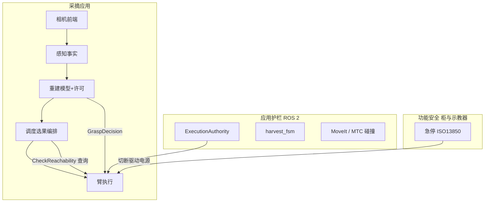

# Peach 源码设计（实现级）

本文按 **2026-10-16 工作区源码** 写现行实现：框架、进程、数据流、一批作业逐步逻辑、几何与授权门。权威是源码与 `peach_interfaces/config/interface_manifest.yaml`。系统摘要仍以 [architecture.md](architecture.md) 为准；图名/QoS 以 [io.md](io.md) 与接口包为准。改行为时同轮改对应包 `doc/`，不要只改本文。

作业身份字段（`target_id` / `request_id` / `run_id` / `cycle_id` / `plan_id` / 模型七元组 / `scene_epoch`）见 **§3.2**；失败码 0–23 见 **§15**。

怎么演化（MUST / KEEP / UNWIND）见仓库根 `AGENTS.md`。驱动九包只读。未授权不得真机运动或 SetIO。硬件急停不经 ROS。

---

## 1. 产品与分层

固定座 AUBO E5 + RGB-D，套袋桃。干跑默认到预抓取停住（`execute_pregrasp_only=true`），不套入、不 SetIO、不回 `harvest_stow`。套入/剪切分档权威是重建发布的 `GraspDecision` 令牌；`allowed` 只是 geometry∧sleeve∧cut 汇总，不授权预抓取。



四层软件职责：

| 层 | 做什么 | 不做什么 |
|----|--------|----------|
| 相机前端 | RGB-D 话题，与 Percipio 同构 | 不选果、不规划 |
| 感知 | 检测/分割/袋位姿/身份/锁定集 | 不发运动、不写 ledger |
| 重建 | TSDF+refit、GraspDecision | 不选下一颗 |
| 调度 | FSM、选果、账本、派动作 | 不写关节、不调重建 Trigger 以外的内部函数 |
| 臂 | Survey / ExecuteTarget / MoveTo / CheckReachability | 不写 ledger、不选果 |

跨包只走 IDL。共享库 `peach_common` 只提供 yaml/QoS/路径/lifecycle 辅助，不传业务状态。

---

## 2. 包、进程与启动

### 2.1 包

| 包 | 职责 | 节点 |
|----|------|------|
| `peach_interfaces` | 唯一 IDL + manifest | 无 |
| `peach_common` | yaml_params / param_rules / qos / paths / lifecycle | 无 |
| `peach_harvester` | brain 三节点 + 独立 scene_obstacles | `peach_scene_perception_node`、`peach_target_reconstruction_node`、`peach_supervisor`、`peach_scene_obstacles` |
| `peach_arm` | 运动与接触 | `peach_arm`（Lifecycle；MoveIt 伴随节点同 executor） |
| `peach_bringup` | 整栈入口、预检、lifecycle 桥、autostart | `peach_lifecycle_flag_bridge`、`peach_autostart_client` |
| `peach_observability` | 8090、会话 bag、自检、诊断聚合 | `peach_observability` |
| `peach_stereo` | 默认相机前端 | `stereo_camera_node` |
| `peach_vegetation` | 枝叶 2D 分割 | 独立 launch，不进 harvest_system |
| `peach_system_tests` | isolated mock / 回放 | 不进生产 launch |
| 顶层 `peach_web` | 8090 静态页 | 由 observability 托管 |

驱动（`aubo_e5_hardware` 等）MUST 只读。IVG / `src/peach_sim` 不进 harvest 业务核。

### 2.2 整栈入口

`peach_bringup/launch/harvest_system.launch.py`：预检 → Include，不含业务。

展开期预检（`preflight.py`）：磁盘余量；已有 `ros2 launch` / RSP / extrinsics 则拒启（防叠 TF child frame）；打印 `ROS_DOMAIN_ID`。

Include 顺序（源码）：

1. `peach_stereo`（`camera_enabled ∧ camera_frontend=stereo`；须在 aubo **之前**）
2. `peach_scene_obstacles`（`camera_enabled`）
3. `aubo_e5_bringup`（mock=`GenericSystem`+标准 JTC；stereo 时压掉 percipio）
4. `serial_force`（`force_enabled`）
5. `peach_harvester/brain.launch.py`（`require_managed_stack:=true`，透传 `tool_profile`）
6. `peach_arm.launch.py`（mock 时 `require_robot_status:=false`）
7. `peach_observability`
8. Nav2 `lifecycle_manager` 名 `peach_lifecycle_manager`
9. `peach_lifecycle_flag_bridge`
10. 可选 `peach_autostart_client`（默认关）

默认 launch 参数（`harvest_system.launch.py` 声明）：`hardware_mode:=mock`、`robot_ip:=169.254.10.98`、`camera_enabled:=false`、`camera_frontend:=stereo`（另 `percipio` / `replay`）、`tool_profile:=bite_shear_v1`、`autostart:=false`、`bond_timeout:=0.0`、`force_enabled:=true`、`extrinsics_enabled:=true`、`hand_eye_enabled:=false`、`use_sim_time:=false`、`skip_reconstruction:=false`（同时注入臂 `allow_unrefined_geometry`）、`observability_port:=0`（0=yaml 8090）。`execute_pregrasp_only` 不在 launch 声明，由 `peach_supervisor.yaml` 默认 `true`。

覆盖易混：`peach_supervisor.yaml` 里 `require_managed_stack: false`、`tool.profile_id: adaptive_shear_v1`；**整栈** `harvest_system` 给 brain `require_managed_stack:=true` 并把 `tool_profile` 注入 bite。独立 `peach_arm.launch.py` / `brain.launch.py` 声明默认仍 adaptive；`peach_executor.launch.py` 的 `require_managed_stack` 默认 false。以入口 launch 实传为准。

mock 初值是 xacro `harvest_stow` 关节（launch `mock_initial_positions` 逗号串），不是拍照位。第一次 Survey 才 PTP 到 SRDF `global_photo_pose`。stereo Include **必须**在 aubo 之前：Jazzy `IncludeLaunchDescription` 会把 `camera_enabled` 落成全局且不回滚，放后面则 stereo 永不启动。

### 2.3 Lifecycle

托管名单顺序：感知 → 重建 → `peach_arm` → 调度。拆栈反向。四节点接 bond；`bond_timeout=0` 关闭管理器进程死检。flag bridge 把管理器 `is_active` 闩锁成 `/peach/lifecycle/managed_nodes_activated`。整栈 `require_managed_stack:=true`，未就绪拒开批。

brain 三节点同一进程、`MultiThreadedExecutor`：节点内默认互斥组，节点间可并行。这不是 rclcpp composition。scene_obstacles / observability / 相机不进名单。

---

## 3. 数据流、身份、QoS

### 3.1 单向数据

```
RGB-D ──► 感知(事实) ──► target_observations / initial_pose
                │                    │
                │                    ▼
                │              重建(TSDF+GraspDecision)
                │                    │
                ▼                    ▼
          调度选果 ◄──── GraspDecision 仅作令牌缓存
                │
                ├── SurveyScene / ExecuteTarget / MoveTo ──► 臂
                └── CheckReachability ◄────────────────── 臂（唯一反向 IK）
Survey 成功 ──obstacles_refresh──► scene_obstacles ──world objects──► PlanningScene
peach_arm ──ACM diff──► PlanningScene（不覆盖 world 对象）
```

禁止：感知发运动；臂写 `ledger.json`；臂调重建 Trigger；用 `grasp_decision` / `initial_pose` 选果。

### 3.2 身份字段（日志/账本里要找的 ID）

能力包作业目标只认调度 `/peach_supervisor/state` 上的 `target_id`。FULL / PREGRASP 受理还要模型七元组非空（`identityComplete`：六个字符串非空；`scene_epoch` 参与 `identitiesMatch`，但 complete 检查不要求 epoch≠0）。

- **`target_id`**：感知 `TargetRegistry` 铸造，形如 `target_0`、`target_1`（`tid = f'target_{self._next_index}'`）。无锚点检测标 `untracked_{i}`，歧义标 `ambiguous_*`，表满溢出标 `overflow_{n}`，三者**不入**注册表。`clear()` 清表但不复位 `_next_index`（换 `scene_key` 才清）。选果、ExecuteTarget、GraspDecision、ledger 都绑这个字符串。

- **`scene_epoch`**：调度 `BeginScene` 成功后 +1（仅 `scene_epoch==0` 后做一次）。选果要求观测世代 == 调度值且 >0。臂 `SurveyScene` result **恒填 0**（巡航不改世代）。换世代立即清重建帧，不得把上一世代 READY 几何贴到新身份。

- **`request_id` / 调度 `run_id`**：`RunHarvest` 带来；空则 `auto_<YYYYMMDDTHHMMSS>`。等于账本目录名 `runs/<request_id>/`，不复用。`HarvestState.run_id` 与此相同。

- **`cycle_id`**：`{run_id}:{target_id}`。RUNNING 时写进 `HarvestState`；单颗周期身份。

- **`plan_id`**：`{request_id}:{target_id}:{generation}`。批流默认不发 PREVIEW；PREVIEW 与随后 FULL 对不上 → `PLAN_MISMATCH`（20）。

- **模型七元组**（`ModelIdentity` / `GraspDecision` 头字段）：`run_id`、`scene_epoch`、`target_id`、`model_revision`、`tool_profile_id`、`calibration_revision`、`config_revision`。并行 Build 时调度先写 `model_revision=pending:{epoch}:{target_id}` 占位（空 revision 会被臂以身份不完整 REJECT）。Finalize 换成精化修订后才能接触。

- **`clearance`**：调度缓存的那条 `GraspDecision`，绑当前 `target_id`。`generated_at` / `valid_until` 在同 `model_revision` 首次产生时冻结，约 1 Hz 心跳**不得续签**。

- **感知 `harvest_run_id`**：锁定瞬间另铸，`harvest_<时间_µs>_s{snapshot_id}`。落 `runs/<request_id>/perception_data/<该ID>/`。与调度 `run_id` **不是**同一字符串；重建心跳用感知这条对齐目录，不要拿它当 ledger 目录名。

日志检索：`rqt_console` / `$ROS_HOME/log` 搜 `target_id=`、`request_id=`、`cycle_id=`、`failure_code=`。调度 `peach_supervisor.batch` / `.contact`，臂 `peach_arm.cycle` / `.contact`。

### 3.3 关键通道

调度订：`target_observations`（选果）、`grasp_decision`（令牌）、`managed_nodes_activated`。

- `/peach_supervisor/run_harvest` — action，RELIABLE。人 / autostart → 调度。
- `/peach_supervisor/state` — `HarvestState`，RELIABLE+transient_local depth 1。调度 → 感知 / 重建 / 观测。带 `run_id`、`cycle_id`、`target_id`、`scene_epoch`。
- `/peach/perception/target_observations` — 观测数组，RELIABLE volatile depth 10。感知 → 调度 / 重建 / 臂。每项带 `target_id`。
- `/peach/perception/initial_pose` — 袋候选，transient_local depth 1。感知 → **仅重建**（调度不订、不选果）。
- `/peach/reconstruction/grasp_decision` — `GraspDecision`，transient_local depth 1。重建 → 臂 + 调度令牌缓存。头字段即七元组。
- `/peach/scene/obstacles_refresh` — Empty，transient_local depth 1。调度 Survey 成功 → 障碍节点。
- `/peach/batch/enables` — Enables，transient_local depth 1。调度 SetEnables → 臂。
- `/peach_arm/execute_target` — ExecuteTarget action。调度 → 臂。goal 带 `run_id` / `cycle_id` / `target_id` / `scene_epoch` / `plan_id`。
- `/peach_arm/survey_scene` — SurveyScene action。调度 → 臂。
- `/peach_arm/check_reachability` — CheckReachability service。调度 → 臂。
- `/peach_scene_perception_node/begin_scene` — BeginScene service。调度 → 感知。
- `/peach_target_reconstruction_node/build_target_model` — BuildTargetModel action。调度 → 重建。

传感图像 BEST_EFFORT；命令/lifecycle RELIABLE。`/tf` volatile，`/tf_static` transient_local。点云 `/camera/depth_registered/points` 两端 RELIABLE（BEST_EFFORT 订户会假性丢大帧）。

IDL 文件头若仍写 `peach_executor`，以清单与现行图名为准：节点是 `peach_supervisor`。

---

## 4. 一批作业：FSM 与命令循环

源：`harvest_fsm.py`（纯核表 + 暂停/恢复纯函数）+ `domain/reducer.py`（三维状态、世代去重）+ `executor_node.py`（ROS I/O）。节点禁止 `self._batch_state = …`，只执行 Reaction 的 `command`。表外迁移（暂停确认、恢复 ACK、终局）只经 `enter_pause` / `apply_pause_pending` / `apply_resume` / `enter_recovery` / `apply_recovery_ack` / `settle_terminal`。

开批：人发 `/peach_supervisor/run_harvest`（launch 默认不发）。`autostart:=true` 时 `peach_autostart_client` 硬等 `/peach/observability/selfcheck_passed` 再发。空 `request_id` → `auto_<YYYYMMDDTHHMMSS>`（禁止再落固定名 `harvest`，避免重启后 target 重铸误跳过）。`finally`：`ledger.json` 再 `rework_list.json`（有条目才写）。

### 4.0 一颗桃逐步（默认 yaml）

`execute_pregrasp_only=true`、`reconstruct_in_trajectory=true`、`execution_enabled` 操作台已开：

1. `RUN_REQUESTED` → DISCOVERY / NAVIGATE。固定座 `_cmd_navigate` 立刻 `NAV_OK`。
2. SURVEY：`SurveyScene` 到拍照位。成功发 `obstacles_refresh`。`scene_epoch==0` → `SURVEY_AT_POSE`。
3. BEGIN_SCENE：调感知；读回 `scene_epoch`；清调度观测缓存。失败 → INTERRUPTED / ABORT，`termination_reason=begin_scene_failed`。
4. WAIT_LOCK：等到 `_lock_set_ready`（观测 `scene_epoch`==调度值且>0 且 `target_set_locked`）或 `survey_wait_s=15` 超时（仍继续，快照 `degraded`）。然后三路：`INTENT_SURVEY_ONLY`→SETTLE；有效 `execution_enabled` 关→RECORD_DISABLED；否则 LOCK_READY→SELECT。
5. SELECT：采收率门（达标发 `EMPTY_LIMIT` 结算，不是失败）→ `_query_reachability(reach_queries)` → `next_target` → claim、`cycle_id={run_id}:{target_id}` → TARGET_SELECTED → DISPATCH。
6. DISPATCH：目标须在锁定集（等 2.5 s）→ 发 Build → 等 COLLECTING（`build_start_timeout_s=8`）→ `model_revision=pending:{epoch}:{target_id}` → READY_FULL。不装未 finalize 的 GraspDecision。
7. EXECUTE_FULL：goal mode=`PREGRASP_ONLY`、`skip_observation=true`、profile=`PROFILE_PREGRASP_HOLD`。臂 Finalize 等精化/许可 → 回拍照位 → 接近 → 预抓取验证 → Hold。`recovery_required` 置位。
8. 周期收口：取消并等 Build 结束 → `event_for_outcome` → command NONE → `_cmd_cycle_done`：`goal.target_ids` 已全部入账则 `EMPTY_LIMIT` 结算；否则 CYCLE_DONE → 再 Survey（**禁止再 Begin**）。回访 Survey 成功走 `SURVEY_DONE`（跳过 Begin），并 `survey_dwell_s=2` 后再出快照。

无候选：`NO_TARGET` 再 Survey；连续 `empty_survey_limit=2` → `EMPTY_LIMIT` 结算。

### 4.1 状态、命令、handler

批次态与 `HarvestState.msg` 同值：`WAITING_READY=0` … `INTERRUPTED=8`，IDL 另有 `NAVIGATING=9`（固定座不进入）。`PAUSE_PENDING=3` 留 IDL；**reducer 永不写入**该批次态，暂停走 `operation_mode=PAUSED`。

目标阶段：`TARGET_IDLE=0` … `TARGET_FAILED=11`。臂 `CycleState` 经 `targetPhase()` 投影到这些常量（`static_assert` 钉死）。

`_COMMAND_HANDLERS`（未知命令 `handler is None` → 跳出循环）：

| Command | handler | 源码行为 |
|---------|---------|----------|
| NAVIGATE | `_cmd_navigate` | 立刻 `NAV_OK`，不发导航动作 |
| SURVEY | `_cmd_survey` | `_survey_body`；**首次**成功后才 `_restore_ledger`（claimed/outcomes；`discovered` 不恢复）；成功发 `Empty` 到 `obstacles_refresh`；`scene_epoch==0`→`SURVEY_AT_POSE` 否则 `SURVEY_DONE` |
| BEGIN_SCENE | `_cmd_begin` | 调 BeginScene；失败 `BEGIN_FAILED`；成功写 `_scene_epoch`、`_observations=None`、`BEGIN_OK`。表只在首巡 `SURVEY_AT_POSE` 后发此命令 |
| WAIT_LOCK | `_cmd_wait_lock` | `_wait_lock` 后 `_publish_scene_snapshot`；三路 SURVEY_ONLY / EXECUTION_DISABLED / LOCK_READY |
| SELECT | `_cmd_select` | 见第 8 节 |
| DISPATCH | `_cmd_dispatch` | 见第 7 节 |
| EXECUTE_FULL | `_cmd_full` | 见第 7 节末 |
| NONE | `_cmd_cycle_done` | 点名已摘完 `EMPTY_LIMIT` 结算；否则 `CYCLE_DONE` 再 Survey |
| SETTLE / ABORT / INTERRUPT | 无 handler | `command in terminal` 结束 while |
| RECORD_DISABLED | 无 handler | 不在 terminal、不在表 → `handler is None` 跳出；随后 `succeed`+`settle_terminal`。若 `succeeded==0` 则 `success=false`、`termination_reason=no_targets_succeeded` |

`_execution_enabled_effective`：操作台 `SetEnables` override 的 `execution` 优先，未覆盖回落 yaml `execution_enabled`。使能链 `execution→grasp→tool`（`check_enable_deps` 拒越级）。

### 4.2 命令循环（`_run_harvest_body`）

```
reaction = react(WAITING_READY, RUN_REQUESTED)   # 已在 _run_harvest 落地 DISCOVERY/NAVIGATE
while command ∉ {SETTLE, ABORT, INTERRUPT}:
    若 action 取消或 _cancel → CANCEL → 发 INTERRUPT、取消在途、break
    _wait_pause()                                # 只改 operation_mode
    若 command ∈ {SELECT, DISPATCH, EXECUTE_FULL, NONE}:
        _wait_recovery()                         # 接触锁未 ACK 则卡住
    peach_supervisor.batch: command= batch= target= message=
    handler(goal, reaction) → (reaction, persist)
    persist 则 _persist_ledger(claimed)
```

`BatchPolicy.from_goal`：`target_harvest_ratio` / `per_target_timeout_s` / `sector_timeout_s` / `view_policy`。`SetBatchPolicy(apply_to_current=false)` 攒到 `_next_policy_default`，下一批覆盖。`view_policy` 默认 `VIEW_FAST=0`（只在 `reconstruct_in_trajectory=false` 时走补视）。

### 4.3 `_TABLE`（逐行，含 target_phase / event_code）

`react(batch, event)`：`CANCEL` 不查表，直接 INTERRUPTED / TARGET_IDLE / INTERRUPT。未命中：**保持原 batch_state**，但 `target_phase` 被写成 `TARGET_IDLE`，`command=NONE`。

| 态 | 事件 | 新态 | phase | command | event_code |
|----|------|------|-------|---------|------------|
| WAITING_READY | RUN_REQUESTED | DISCOVERY | IDLE | NAVIGATE | |
| DISCOVERY | NAV_OK | DISCOVERY | IDLE | SURVEY | |
| DISCOVERY | NAV_FAILED | INTERRUPTED | IDLE | ABORT | navigate_failed |
| DISCOVERY | SURVEY_AT_POSE | DISCOVERY | IDLE | BEGIN_SCENE | |
| DISCOVERY | SURVEY_FAILED | INTERRUPTED | IDLE | ABORT | survey_failed |
| DISCOVERY | BEGIN_OK | DISCOVERY | IDLE | WAIT_LOCK | |
| DISCOVERY | BEGIN_FAILED | INTERRUPTED | IDLE | ABORT | begin_scene_failed |
| DISCOVERY | LOCK_READY / SURVEY_DONE | DISCOVERY | SELECTING | SELECT | round_locked |
| DISCOVERY | SURVEY_ONLY / EMPTY_LIMIT | COMPLETED | IDLE | SETTLE | |
| DISCOVERY | NO_TARGET | DISCOVERY | IDLE | SURVEY | |
| DISCOVERY | TARGET_SELECTED | RUNNING | OBSERVING | DISPATCH | target_dispatched |
| DISCOVERY | EXECUTION_DISABLED | COMPLETED | SKIPPED | RECORD_DISABLED | |
| RUNNING | READY_FULL | RUNNING | VALIDATING | EXECUTE_FULL | |
| RUNNING | SKIP | RUNNING | SKIPPED | NONE | target_operator_skipped |
| RUNNING | OBSERVE_FAILED / BUILD_FAILED / FULL_SKIPPED | RUNNING | SKIPPED | NONE | target_skipped |
| RUNNING | FULL_SUCCEEDED | RUNNING | SUCCEEDED | NONE | target_succeeded |
| RUNNING | FULL_FAILED | RUNNING | FAILED | NONE | target_failed |
| RUNNING | FULL_CANCELED | RUNNING | IDLE | NONE | target_canceled |
| RUNNING | CYCLE_DONE | DISCOVERY | IDLE | SURVEY | 隐式选果 / 点名未摘完 |
| RUNNING | EMPTY_LIMIT | COMPLETED | IDLE | SETTLE | 点名 `target_ids` 全部入账 |

`event_for_outcome(outcome, operator_skip)`：人工 skip→SKIP；0→FULL_SUCCEEDED；1 与 2→FULL_SKIPPED；3→FULL_FAILED；4→FULL_CANCELED；其它→FULL_FAILED。`canonical_code_for_outcome` 同步词表。

### 4.4 reducer、暂停、恢复、ControlTask

`reduce_event`：三维 `batch_state × operation_mode × recovery_latch`。`_stale` 丢弃：跨 `session_id`、`generation` 落后、或 `transaction_id==settled_transaction`。丢弃可观测（`dropped_stale_events++`）。事务 id 约定 `{action_generation}:{event}`，禁止用节点级常驻 txn（否则首个终局钉死 settled，CYCLE_DONE 活锁）。

终局 `command=NONE` 但仍带 `event_code` 时仍发 Effect，供账本结案一次。`PAUSE_PENDING` 若从表里冒出，reducer 压回原 batch_state + MODE_PAUSED。

暂停：`_wait_pause` 把 `operation_mode` 置 PAUSED，**不覆盖** `batch_state`。`EventHold` 暂存第一条非 NONE 命令；RESUME `take_after_pause` 只释放一次，`generation+=1`。CANCEL 丢弃 hold。

恢复：SELECT/DISPATCH/EXECUTE_FULL/NONE 前 `_wait_recovery`。`enter_recovery` 把作业态投影为 `RECOVERY_REQUIRED`（终局/WAITING_READY 除外）。PREGRASP 成功也置 `recovery_required`（ACK 前不 Survey）。技能接触锁与批次态无关：`permissions_for` 在 `recovery_required` 时**任何非终局**都追加 `CMD_ACKNOWLEDGE_RECOVERY`。

ControlTask（`apply_control`）：PAUSE=0 RESUME=1 ENTER_MAINTENANCE=2 EXIT_MAINTENANCE=3 CANCEL_NOW=4 SKIP_TARGET=5 ACK=6。`expected_state_seq==0` 不校验。`permissions_for`：暂停中允许 RESUME/CANCEL/ENTER_MAINTENANCE；DISCOVERY/RUNNING 允许 PAUSE/CANCEL/ENTER_MAINTENANCE，RUNNING 另加 SKIP；MAINTENANCE 预留 EXIT（未接线）。

`blockers_for` 词表：`stack_not_ready` / `recovery_required` / `mode_paused` / `mode_maintenance` / `ledger_write_failed`。

### 4.5 RunHarvest.Result

循环结束后：`summary=build_summary(run_id, outcomes, discovered, elapsed)`。

- `aborted` = command ABORT → `goal_handle.abort()`，`termination_reason` 为 `navigate_failed` / `survey_failed` / `begin_scene_failed`（其它 ABORT 也填 begin_scene_failed）
- `interrupted` = INTERRUPT 或 `_cancel`。若客户端发了 action cancel → `canceled()`，否则 Jazzy 禁止 EXECUTING 直接 canceled，走 `abort()`，reason=`canceled`
- 否则 `succeed()` + `settle_terminal()`→COMPLETED
- `no_product` = 非 abort/interrupt、非 SURVEY_ONLY、且 `succeeded==0` → `success=false`、reason=`no_targets_succeeded`
- `success` = 非 abort 且非 interrupt 且非 no_product

调度逐步日志：`peach_supervisor.batch`（`command=`）。选果可达性：`peach_supervisor.contact`（`caller=SELECT`）。

---

## 5. 感知（一帧事实）

节点：`ScenePerceptionNode`。纯核：`PerceptionPipeline.process(SyncedRgbd) → PerceptionResult | None`。节点只 decode、查 TF、发布。Active 后才处理帧并受理 BeginScene。YOLO 异常返回 None（跳帧）。

一帧顺序（`pipeline.py`）：

1. `message_filters` 同步 RGB+深度，slop 0.05 s。深度 uint16 **毫米**，有效窗 `min_depth_m`…`max_depth_m`。
2. YOLO `engine.detect` → `filter_detections`（`enable_fruit` 控制裸果是否保留显示）。
3. `segmentation_bboxes` → SAM `engine.segment`；批量失败则逐框回退。掩膜裁进 bbox。
4. 每个检测：`estimator.estimate_modes(..., hybrid_dilated)`。`bag` 缝=`RobustBagPosePipeline`（圆柱 RANSAC 定轴）；`fruit`=`RobustFruitPosePipeline`。产品执行范围是套袋。
5. `tf_status!='ok'` 则打 `tf_stale` / `tf_unavailable`，`may_commit_identity` 为假，**本帧不进身份链**（`untracked_*`）。
6. `TargetRegistry.begin_frame` 淘汰未确认超时项，同步清 `bbox_at_edge`。然后 `match_or_register_frame`：世界系 χ²≤9（`CHI2_GATE`）+ 匈牙利 1-1 + 同类 + 次优/最优比 1.2（`AMBIGUOUS_RATIO`）。新 ID `target_{_next_index}`。无 position → `untracked_{i}`；歧义 → `ambiguous_*`（不入表）；表满且无非保护项可逐出 → `overflow_{n}`。`clear()` 清表不复位计数。
7. 贴边 `bbox_touches_image_edge`：不攒 `obs_count`（P1-A），旗标 `bbox_edge`。`untracked_`/`ambiguous_` 强制 `confirmed=false`。
8. `CollectLockPolicy.update`：只累积 `confirmed`。关窗二选一——静止：帧数≥`min_collect_frames=4` 且连续 `lock_settle_frames=2` 无新增确认 ID **且本帧无未确认在攒**；或超时 `max_collect_s=12`（运行期按帧间隔 EMA 自适应，下限为本值×0.4；**空集也关**）。关闭发一次 `LockEvent`。`GlobalHarvestPlan` 锁定后按优先级推进；超 `anchor_max_age` 打 `anchor_stale` 不可选，超 `anchor_drop` 从计划移除。单果墙钟预算 40 s（相对人工偏保守）。
9. 发布 `target_observations`、`initial_pose`（只进重建）、diagnostics、debug_image。单帧 ACCEPT / REOBSERVE / REJECT **不得据此接触**。

`BeginScene`：`scene_epoch++`；换 `scene_key` 才清身份表。调度 `HarvestState.target_id` 反哺覆盖感知 selected。感知 `harvest_run_id` 锁定瞬间重铸。可写 `perception_data` 事件，不写 `ledger.json`。

缝位 `pipeline.*_impl` → `PIPELINES_BY_IMPL`（UNWIND dict，新缝走 pluginlib）。

---

## 6. 重建与 GraspDecision

节点：`TargetReconstructionNode`。宿主 `ReconstructionCore`。编排 `_collect_and_finalize_build`。融合 `RefitOrchestrator`。许可组装 `publish.py`。

### 6.1 Build

调度 `BuildTargetModel`（或 `capture.auto_mode` 跟 `initial_pose`）。重建单槽：上一颗 Build 未结束会拒下一颗。

每唯一 RGB-D stamp：

1. 锁外查 **base←camera 精确时刻 TF**（失败跳帧，禁止运动中 latest）。
2. `StrictMaskGate`（`require_target_mask` 关则直通）：容差内掩膜（`mask_stamp_tolerance_s` 0.45 s 最近邻 stamp；帧环按 `max_frame_age_s=12` 保留同戳深度）→ 像素≥300 → 掩膜内有效深度占比≥0.35 → 中心相对绑定锚漂移≤0.04 m → 邻锁定锚间距≥0.15 m（小框面积 < 绑定框/`neighbor_gap_area_ratio=2` 豁免，防近距双检互锁）。TSDF 无单帧撤销，串扰宁可停采。
3. FK 变到 base → 有界 ICP → 在线 TSDF。
4. finalize：抽网格 + 柱/球 refit（`refine.py` 的 `REFITTERS_BY_IMPL`）。
5. `tool_budget.py` 动态径向/轴向预算（内径随 `tool.budget.d_inner` 档案注入）→ `GraspDecision`。

`generated_at` / `valid_until` 在同 `model_revision` 首次产生时冻结。约 1 Hz 心跳 **不得续签**。`header.stamp` 用该冻结生成时间。换世代立即清帧、掩膜、模型，不得把上一世代 READY 几何贴到新身份。

单视 `min_views=1` 时，轴包络/轮廓不可观测最多换 3 次新曝光，共用原 `build_timeout_s`。独立机位 1 个质量最多 MEDIUM，≥2 才 HIGH；连帧数不代替机位数。

`model_revision` 精化后格式 `{target_id}:{views_count}:{finalize_counter}`（G3：同目标同机位数重 Build 字符串仍变；`reset_reconstruction` 不清零计数）。并行占位是 `pending:{epoch}:{target_id}`，unrefined 是 `unrefined:{epoch}:{target_id}`。融合失败早退 revision 归空。可靠 refit 与融合轴夹角超过 `max_axis_angle_deg` 时清许可并 REOBSERVE。

并行路径：调度在 COLLECTING 后即派臂；臂 Finalize 有界等**同目标**精化与许可到齐。不允许用粗几何提前接触。

### 6.2 GraspDecision

话题 `/peach/reconstruction/grasp_decision`。能力三态：`VALID=0` `INVALID=1` `UNKNOWN=2`。

- `allowed` = geometry∧sleeve∧cut（**pregrasp 不进**）。false 时仍可有几何，预抓取可以走。
- 臂 CONTACT：令牌优先，查 `radial_margin_m>0`（现行余量只记录、批次 4 分档以能力位为准；实现以 `authorizeStage` 为准）。
- 臂 TOOL：`axial_margin_m` + `pregrasp_verified` + `tool.enabled`。
- 果距与径向余量是数据参考，接触时弹性会动，不单独当硬门。
- 禁止单帧/unrefined 降级接触，除非 `skip_reconstruction` 且臂 `allow_unrefined_geometry`。

onDecision：臂从同一条 GraspDecision **原子**提交身份、entry/cut/axis、质量、四项能力到 `TargetCache`，避免分离话题把新许可配到旧几何。

---

## 7. DISPATCH（默认并行重建）

源：`executor_node.py::_cmd_dispatch`。部署 `peach_supervisor.yaml`：`reconstruct_in_trajectory: true`。

时限门 / `execution_enabled` / skip / 目标须在锁定集之后：

1. `skip_reconstruction=true`：不 Build、不观察，unrefined 七元组进接触（须臂 `allow_unrefined_geometry`）。身份 revision=`unrefined:*`。不把未融合 `allowed=false` 的 GraspDecision 装成 CONTACT 令牌。臂侧 promote 把 `suggested_travel_m` 置 0，走 `(neck-entry)-neck_margin` 回退（实测约 0.05–0.10 m），不再采信旧 `L_insert=0.03` 封顶。
2. 否则发 `BuildTargetModel`，等 COLLECTING（`build_start_timeout_s=8`）。超时取消并**等该动作结束**再派下一颗（单槽）。
3. **默认** `reconstruct_in_trajectory`：立刻 `READY_FULL`。goal `skip_observation=true`，revision=`pending:{epoch}:{target_id}` 占位（空 revision 会被臂以身份不完整 REJECT）。**不装尚未 finalize 的 GraspDecision**。臂 Finalize 等精化/许可。
4. 显式 `reconstruct_in_trajectory=false`：
   - `VIEW_FAST=0`：supervisor `observe.py` 直驱 MoveTo 补视（拍照位算 1 视，补视封顶 2，总视 ≤3）。
   - `VIEW_CONSERVATIVE=1`：臂 `ExecuteTarget OBSERVE_ONLY`（goal 被拒最多 4 次）。
   观察后再 `_wait_build_after_observe`（`reconstruction_min_views` + `observe_build_grace_s=3`）。失败 `_fail_dispatch` → SKIPPED_QUALITY。

周期收口取消并等 Build 结束。getattr 缺字段才回退 False（走补视）；yaml 默认 true。

`EXECUTE_FULL` 装配（`_cmd_full`）：

- 再检使能 / 单果时限（时限已 `record_skip` 的不再二次落账）
- mode = PREGRASP_ONLY 若 yaml `execute_pregrasp_only` 否则 FULL
- `skip_observation=true`（并行路径与补视后路径都是）
- `profile` 与 mode 对齐：`PROFILE_PREGRASP_HOLD` / `PROFILE_FULL`（IDL 默认 profile=0 不得盖掉 FULL）
- 身份：`run_id/cycle_id/target_id/scene_epoch`、三 revision、`plan_id`、`generation`
- **clearance**：仅当缓存 GraspDecision 的 `target_id` 等于当前目标。`skip_reconstruction` 或 `reconstruct_in_trajectory` 时 **decision=None 不装配**（臂 Finalize 等精化后走快照复检）。过期令牌仍照装但打预警，由臂侧拒。
- `_send_action(..., prerequisite_future=build_future)`：并行 Build 未结束也可发臂 goal
- 结果：优先 `outcome_record`；`harvest.grasped` 单源 harvest 块；`recovery_required` 或进
- `build_failure` 且非人工 skip → 改写 `SKIPPED_QUALITY` / `BUILD_FAILED`
- **无论 FULL 成败**都取消并等 Build 结束（单槽）

`_fail_dispatch`：可选落 `TargetOutcome` + WARN `派发失败 request_id= target_id= failure_code=` + `_apply`。时限门传 `outcome=None` 避免双写。

---

## 8. 选果 SELECT

`_cmd_select` 顺序：有效使能关 → `EXECUTION_DISABLED`。`ratio_reached(succeeded, discovered, policy)`（ratio≤0 或 discovered≤0 永不达标）→ 事件 `EMPTY_LIMIT` 结算（策略不是失败）。锁定集未就绪则跳过 IK，`next_target` 得空。否则 `_query_reachability(reach_queries(...))` 再 `next_target(..., check_sleeve=not execute_pregrasp_only)`。有 `filtered` 或 `ik_note` 发 `targets_filtered`。无 `target_id`：`_empty_rounds++`，达 `empty_survey_limit` → EMPTY_LIMIT 否则 NO_TARGET。claim 前再读一次使能。claim 后 `_cycle_id={run_id}:{target_id}`，可选 `TargetDeadline`。

纯核 `batch.py`。`next_target` 与 `reach_queries` 共用 `_eligible_locked_items`。

资格：`target_set_locked`、`target_id` 非空、未入 `_claimed`、`confirmed`、非 `unbagged_display_only`、`strategy_id` 不含 `fruit`、非 `bbox_edge`、非 `tool_clearance_failed`。入口须 `header.frame_id` 含 `base` 且 position 非全零，否则 `pregrasp_pose_of` 为 None，不进 `reach_queries`。

窗：`camera_distance_m` ∈ [`selection_depth_min_m=0.3`, `max=1.6`] ∩ CheckReachability（`ik_results[tid]=(reachable, code)`）。服务不可用（`ik_results is None` 或该 tid 缺失）回退入口半径 `0.15`…`0.88`；`check_sleeve` 时另卡套入终点半径（入口沿袋轴 Z + clamp(travel, 0.02–0.20)）。超窗 reason：`out_of_depth_window:` / `ik_no_solution:` / `out_of_reach_window:` / `out_of_sleeve_reach_window:`。

`goal.target_ids`：过同一资格谓词后**第一个命中立即返回**，`filtered=[]`，**不受**深度/IK 窗；点名不进 `reach_queries`。不合格点名不直通，走常规窗。

次序：`priority` 升序，同级检测框面积降序（近距双检先做大框）。

行程：SELECT 送感知 `suggested_travel_m` = `(neck-entry)-margin_neck`（**不再被 `L_insert=0.03` 封顶**；服务端夹紧 0.02–0.20，缺失当 0 用最小行程；2026-10-21 实测 0.05–0.10 m）。Finalize 用精化 `insertionTravel` = 融合 `(cut-entry)`（实测 0.07–0.09 m）或 skip 的同一几何回退。两次差约 0.01 m 来自融合修剪，不是旧 0.03 vs 0.09 的封顶差。

`require_sleeve`：`not execute_pregrasp_only`。**默认 PREGRASP_ONLY 只检预抓取停位 IK**，选果日志不会出现 `sleeve_no_cartesian`。显式套入才检套入终点 IK + 沿轴笛卡尔。

采收率达标 / 单果时限 / 人工 SKIP → ReworkList，策略不是失败。

---

## 9. CheckReachability

服务 `/peach_arm/check_reachability`，实现 `motion.cpp::evaluateReachability`。不动臂、不装配 MTC。

1. 入口 = 请求 `tcp_poses`（感知袋底，姿态 Z=袋轴，滚转任意）。
2. 预抓取停位 = 沿 −axis 后撤 `mtc_approach_along_axis_m`（`grasp_standoffs.yaml` 注入，现行 **0.03 m**），姿态 `alignFrameZ(当前 TCP, 袋轴)`，不抄感知滚转。
3. 当前关节为 IK 种子。滚转梯子 `toolRollsRad()`：0、±15°、±30°、±45°（π/12 步进）。
4. `require_sleeve=false`：任一档预抓取 IK 成功即 reachable。
5. `require_sleeve=true`：套入终点 = 入口沿袋轴 + clamp(travel, 0.02–0.20)。从该档预抓取 IK 解沿轴 `CartesianInterpolator`（步长/完成比与接触 LIN 同参 `mtc_cartesian_min_fraction=0.95`）。`firstRollWithSleeveFraction` 取**第一档**走满的滚转。两端有 IK 但直线走不满 → `sleeve_no_cartesian`。全无套入 IK → `sleeve_no_ik`。预抓取无 IK → `no_ik`。行程越界 → `cut_travel_out_of_range`。

接近执行时 FULL 用同一梯子：`sleeve_roll_feasible` 跳过套入直线未走满的档，避免 keep-roll 88% 却选用、+15° 才能 100%。

SELECT 日志 `caller=SELECT`；Finalize `caller=FINALIZE`。服务端逐档 `CheckReachability idx=… fraction=` 在 `peach_arm.contact`。

---

## 10. ExecuteTarget 一颗桃

节点 `ManipulationSkillsNode`。受理 `cycle.cpp`，阶段 `stages.cpp::executeCycle`。状态枚举 `cycle_context.hpp::CycleState`（发布 JSON 字符串与历史 dashboard 一致）。

### 10.1 受理门（`onActionGoal`）

REJECT（不启动周期）当：

1. `!motionOutputAllowed`（非 Active / 未 armed）
2. `target_id` 空，或 mode ∉ {PREVIEW, OBSERVE_ONLY, FULL, PREGRASP_ONLY}
3. `running_` 或 `contact_recovery_required_`
4. FULL / PREGRASP 且 `!identityComplete`（六个字符串；**不**要求 `scene_epoch≠0`）
5. 锁定集无有效锚点 **且** selected 缓存也不是该 `target_id`

命中锁定集有效锚点即可，不要求感知 selected 已跟上（编排选择权在 supervisor）。上一执行线程 join 有界 2 s，超时 detach 仍受取消标志约束。

`execution_enabled` 时一次性 `execution_armed`，`executeCycle` 的 `finish` 清掉。PREVIEW：`execution_enabled=false` 走 `stagePlanPreview` 终结、不动。`PROFILE_PREGRASP_HOLD=0` 是 IDL 默认；**mode 是接触深度权威**，未填 profile 不得把 FULL 盖成停预抓取。`PROFILE_FULL=1` 强制套入。

OBSERVE_ONLY 走观察+精化，终态 `PLAN_READY` 映射 SUCCEEDED，reason 标 observe_only。

### 10.2 executeCycle 顺序

```
stagePrepareCycle            钉 target 快照；清 TOOL 授权残留
  execution_enabled? 否 → stagePlanPreview（终结，不动）
  skip_observation? 否 → stageAcquireViews（最近短 LIN，最多两次）
stageFinalizeAndValidate     等精化/许可/质量门；非 PREGRASP 再 CheckReachability
  OBSERVE_ONLY → ReportObserveOnly
  grasp_enabled 关 → ReportReady（READY_FOR_GRASP）
  接触：
    stageReconfirmTarget     新鲜观测；锚点漂移 3 cm / 最多 3 次
    stageMovePregrasp        先回拍照位再接近；PREGRASP 授权
    stageVerifyPregrasp      残差门；最多两次增量（最新精化，禁止单帧平移）
    PREGRASP_ONLY → Hold     停住不 stow 不 SetIO；仍 recovery_required
    FULL：
      stagePlanSleeveAndReverseRetreat
      stageSleeveLinear      CONTACT
      stageActuateCutter     TOOL（SetIO ACK ≠ 切断）
      stageVerifyCut         DI 新上升沿，超时 CUT_UNCONFIRMED 不撤退
      stageExecuteReservedReverseRetreat
      stageReturnHarvestStow 先倒放回拍照位再短 PTP harvest_stow
      stageReleasePayload    stow 后开刀释放
      VerifyHarvestOutcome / CompleteTarget
```

终局优先级：接触 recovery（PREGRASP 成功除外）> 取消 > 成功 > 失败。先 `setState` 终态再 `running_=false`。`harvest.grasped` 仅切断证据 ∧ 撤退证据。`completion_level` 是到达档，不是采摘成功：0 NONE … 1 到预抓取 … 2 残差过门 … 3 套入 … 4 刀指令受理 … 5 切断确认 … 6 撤退确认 … 7 采摘确认。level 6 ≠ level 7。

`CycleState` → `HarvestState.target_phase`：IDLE→TARGET_IDLE，PLAN_OBSERVATION→OBSERVING，FINALIZE→FINALIZING，RECONFIRM→VALIDATING，MTC_APPROACH_INSERT→APPROACHING，ACTUATE_TOOL→TOOL_ACTION，MTC_RETREAT→RETREATING，PLAN_READY→COMPLETING，SUCCEEDED→TARGET_SUCCEEDED，FAILED→TARGET_FAILED（`cycle.cpp` `static_assert`）。

阶段日志：`peach_arm.cycle` 方括号（`[FINALIZE]` …）。失败 `failStage` 打 `failure_code=` 再 `[FAILED]`（`peach_arm.contact`）。

### 10.3 Finalize / 质量门 / Reconfirm

`stagePrepareCycle`：`cycleTargetSnapshot` 钉黑板；清 TOOL 授权残留、`pregrasp_verified`、套入/切断/撤退旗标、`completion_level=0`。goal `target_id` 与快照 id 不一致 → `MODEL_STALE`。无相机 TF → `EXACT_TF_MISSING`。空视点 → `OBSERVE_FAILED`。

`stageFinalizeAndValidate`：

1. OBSERVE_ONLY：`waitForRefined(target_id)`（时限 `effectiveRefinedWaitS`）。等不到 → SKIPPED_QUALITY / BUILD_FAILED。
2. 非观察且非 `allow_unrefined_geometry`：**先** `waitForDecision` 同目标原子快照（提交时已含精化几何；明确拒绝也算已到）。等不到 / 读时已撤销 → SKIPPED_QUALITY / DECISION_REJECTED。不再先 `waitForRefined`：2026-10-16 真实相机+mock 轮 8/9 精化等待先超时把 `refined_arrived` 钉成 false，随后决策到达仍因该布尔合取跳过、臂完全不动。
3. `skip_observation` 且 selected 空：把 `selected/reconstruction/refined_target_id` 回填 `goal.target_id`，避免 `selected_target_missing`。决策已带几何时也回填 `refined_target_id`。
4. `quality_gate_->readyToApproach`（**不**要求 `grasp_allowed`；切门不得否决预抓取几何）。
5. `grasp_ready` = 几何可用（决策几何 / 精化快照）∧ gate.allowed ∧（PREGRASP 或 GraspDecision 目标==当前）。合取分项写入 `peach_arm.cycle` `[FINALIZE]`；失败原因写缺失项，不再拼接 `decision_geometry_unavailable: pregrasp_geometry_ready`。
6. 钉 `bound_model`、`reference_anchor`（优先活锚点中心，否则 0.5×(bottom+neck)）、`entry_tip_pose`、`travel_m=insertionTravel`。
7. 非 PREGRASP 且 travel 非法 → DECISION_REJECTED。然后 **进程内** `evaluateReachability`（`require_sleeve=!pregrasp_only`，timeout 0.2）。失败 → SKIPPED_UNREACHABLE / SLEEVE_PLAN_FAILED。
8. 未 grasp_ready → SKIPPED_QUALITY / DEGRADED_CONTACT_FORBIDDEN。

`QualityGate` 部署 `peach_arm.yaml`：`minimum_views=1`、`minimum_baseline_deg=0`、`minimum_mean_nearest_baseline_deg` 同 0。结构未注入仍是 views=2 / 8° / 6°（单测）。`readyToApproach` 身份：`selected` 非空、reconstruction 绑定且同 id、`data_age` 未超、state=`READY`、refined id 一致、`refined_accept`。轴夹角>35° **只诊断**（`axis_mismatch_diagnostic_only`），不拒。`readyToGrasp` 才查 `grasp_allowed`。

Reconfirm（`allow_stale_anchor` 默认 false）：`ReconfirmPolicy` 容差 `reconfirm_tolerance_m`、最多 `reconfirm_max_attempts`。窗口 `effectiveReconfirmWaitS`（帧间隔 EMA）。样本：身份、`swinging`、锚点漂移。PASS 放行；REFINED=超容差但保留 TSDF 入口再开窗，**禁止单帧平移**；PENDING=摆动等平息；ABORT → SKIPPED_QUALITY / OBSERVE_FAILED。锚点是感知底/颈中点，不得拿 TSDF 中点去比单帧检测中点。

### 10.4 套入档

三档末端（`shear_v1` / `bite_shear_v1` / `adaptive_shear_v1`）统一走 MTC 沿轴 LIN。IMU 跟随接触窗（`imu_follow`）已删除（2026-10-19，历史在 git），不再有 Servo 与 MTC 双写面。

---

## 11. 接近几何（planToPregrasp）

源：`grasp_task.cpp`。分档 `classifyApproach`。

`classifyApproach`（`grasp_task.cpp`，阈值来自 yaml/`GraspTaskConfig`）：

- 量：轴向 `delta·axis`、侧向、工具 Z 与袋轴夹角 `align_deg`。无当前 TCP → 无法分档。
- `SKIP`：夹角≤`mtc_approach_max_align_deg=20°` **且** 侧向≤`mtc_approach_max_lateral_m=0.05` **且** 轴向 ∈ [−0.02, along_axis+0.02] 且 ≤ 弦长上限。轴向 <5 mm 视为 0。
- 否则测 LIN 资格：起点已在果底平面下方（`start_s≤0`）、直连工具扫掠不碰果实胶囊、弦长≤`mtc_approach_cartesian_max_distance_m=0.80`。资格成立则：夹角≤**2°** → `LIN`，否则 `LIN_ALIGN_THEN_LIN`（先对轴再平移）。
- 否则 `STAGING`。

注意 SKIP 的「已齐」是 20°；走 LIN 还是先对轴是 2°。两者不是同一门。

`planToPregrasp`：

1. LIN 类：先 `tryRolledApproach` 滚转梯子扫完整 LIN（含对轴）。FULL 且 `insert_travel_m>0` 时跳过套入直线未走满的档。同一笛卡尔 LIN 连续两档规划失败（常见：关节速度极限，与滚转无关）即停梯子，改走 PTP，避免 7 档重复超速规划。
2. 仅当 `!execution_started && !retry_forbidden` 才 `tryStagingTransit`：滚转梯子 IK 落到**中段点正下方**（树冠外、世界垂直线）→ Pilz PTP（弧过果实胶囊 `staging_guard`）→ 世界垂直 LIN 入冠 `approach_canopy_entry_m=0.05` → 沿轴 LIN `approach_final_axial_m=0.05` 进预抓取。冠内两段优先 Pilz sequence blend 0.02，失败降级单任务 LIN。笛卡尔审查拒绝大弧后 `retryStagingCandidate` 试下一 IK 候选。
3. 许可拒绝、取消、已经运动均不得改路径。不走 CIRC/STOMP/OMPL 接触兜底。

观察后常无 IK：**先回拍照位**（有记录的接近则倒放轨迹；否则 PTP 0.5 s，失败 OMPL 3.0 s）。倒放缓存只含实际执行成功的接近；拒绝候选不得加入。

护栏四层：①果实胶囊（工具有限圆柱 vs 感知胶囊，仅接近段）②反爬（s 不得超过本段起点 max(s,0)+2 cm；PTP 首段不查反爬）③场景障碍 ACM ④近果速度 0.05 仅套入/撤退；ContactMonitor 默认关。绕腕累计 12 rad / 单轴 6.1 rad。笛卡尔绕行比 1.5 / 偏离 0.12 m / 回退 0.08 m（2026-10-16：放行 path/chord≈1.07 近直线 PTP，拒绝 2.40 族大弧）。TCP 姿态测地线 110°（倾斜+滚转合成）；45° 只限制工具 Z 滚转。

Staging IK 排序：先绝对滚转小，再腕轴加权关节代价（`preferStagingCandidate`）。仅 IK 有解不能宣称轨迹可用。

返程：倒放同一接近轨迹回预抓取，再回拍照位，FULL 再短 PTP `harvest_stow`（与 photo 已分叉，禁止从预抓取直达 stow）。

---

## 12. 授权与使能

使能链 `execution → grasp → tool`，默认全关。意图源：操作台 `SetEnables` → `/peach/batch/enables`；臂收到过即覆盖本地参数，心跳超时回落本地 yaml。autostart 是部署参数，授权语义=操作员在 real 上发起 launch。

`authorizeTransit`（Survey / MoveTo / 回拍照位 / 接近转移）：使能×Active×robotReady׬cancel，**不**复检 GraspDecision。失败码 `TRANSIT_FAILED`，不得挪用 `SLEEVE_PLAN_FAILED`。

`authorizeStage` CONTACT/TOOL（`cycle.cpp` 唯一实现）：

1. `motionOutputAllowed`（Active + armed/enabled）
2. `safetyReady`（`robot_status` 抱闸 / motion_possible / 急停**状态**；mock `require_robot_status=false`）
3. ¬cancel、`grasp_enabled`
4. 若 `ctx.bound_model`：当前 `decisionSnapshot` 必须 `identitiesMatch`，且 geometry VALID、本阶段 sleeve 或 cut VALID。模型撤销/换版不得复用旧轨迹
5. **令牌优先**（`clearance_present`）：`allowed`、`clearance_target_id==target_id`、`valid_until`（零值跳过）、`model_stamp` 新鲜窗。径向/轴向余量**只记录不拒绝**。TOOL 另要 `pregrasp_verified` + `tool_enabled`
6. 无令牌：快照目标一致且 `grasp_allowed`；精化能力完整时 CONTACT 查 sleeve VALID、TOOL 查 cut VALID + 残差 + tool

过期（valid_until / model_stamp）→ `StageDenial::EXPIRED`（可重派）；其余 DENIED。`requireStageAuthority` 把 CONTACT/TOOL 的令牌复检失败映射为对应 outcome。8090 调试运动另需 `debug.motion_enabled`，仍进同一门。

`SetEnables`：意图源在 supervisor，广播 `/peach/batch/enables`；臂收到过即覆盖本地 yaml，心跳超时回落。越级（未 execution 开 grasp/tool）拒绝且不落 override。

停轨：透传 abort + `RobotMoveStop`（失败再 `robotMoveFastStop`）。bringup **不起** dashboard，不远程上电。故障后禁止 resume 原轨迹。软件停不得称 e-stop。

关停：SIGINT 后 `requestCancelAll` 里 stop/cancel 失败只 DEBUG，清理路径不得终止进程。

---

## 13. 场景障碍 ACM

`peach_scene_obstacles` 独立进程，`camera_enabled` 才起，不进 lifecycle。Survey **成功**后 `obstacles_refresh`。源：最近 RELIABLE 点云。纯核 `core.build_snapshot`：体素 0.06 m → 工作空间裁剪 → 自身滤除（mesh+FK+体素半对角）→ 已精化目标膨胀胶囊 → 上限 3000 box。`ApplyPlanningScene` 对象 id 固定 `peach_scene_obstacles`（首写 ADD，此后 REMOVE+ADD）。

避障目的=**保护相机**。部署 `obstacle_guard_enabled=false`（树冠太密，叶墙不当碰撞体）；GPL 声明默认 true。true 时唯一受查对=`camera_body_link`×障碍；`tool.links` 全豁免。peach_arm 激活后 3 次幂等重写 ACM。`sensors_3d.yaml` `sensors: []`，不用 octomap updater；保留名 `<octomap>` 无害。

写域分域：障碍节点只写 `world.collision_objects`；臂只写 ACM diff。

---

## 14. 参数与几何单源

| 源 | 内容 |
|----|------|
| 各包 `config/<节点>.yaml` + `peach_common.yaml_params.attach` | Python 部署值 |
| `peach_arm/src/arm_parameters.yaml`（GPL） | C++ 声明/校验；**部署覆盖**在 `config/peach_arm.yaml` |
| `grasp_standoffs.yaml` | `entry_standoff_m=0`、`pregrasp_standoff_m=0.03`，launch 注入 scene/recon/臂沿轴后撤 |
| `aubo_description/config/<profile>.yaml` | 工具开口径/包络；`tool_profiles.py` 注入 |

现行部署对照（易与结构/GPL 默认打架）：

| 键 | 部署 | 含义 |
|----|------|------|
| `reconstruct_in_trajectory` | true | Build 绑定即派臂 |
| `execute_pregrasp_only` | true | 停预抓取 |
| `execution_enabled` / `grasp.enabled` / `tool.enabled` | false | 使能门 |
| `quality.minimum_views` | 1 | 单机位可通过 |
| `quality.minimum_baseline_deg` | 0 | 不为张角补短移 |
| `moveit.obstacle_guard_enabled` | false | 叶墙不挡规划 |
| `mtc_cartesian_min_fraction` | 0.95 | 套入直线完成比 |
| `grasp.minimum/maximum_travel_m` | 0.02 / 0.20 | 行程夹紧 |
| `tool.profile_id` yaml 基础值 | adaptive | **harvest_system 注入 bite** |
| `empty_survey_limit` | 2 | 连续空扫结算 |
| `survey_wait_s` / `survey_dwell_s` | 15 / 2 | 首巡等锁 / 回访驻留 |
| `build_start_timeout_s` | 8 | 等 COLLECTING |
| `reconstruction_min_views` | 1 | 并行路径不走此 race |
| `observe_build_grace_s` | 3 | 仅补视后等机位 |
| `skip_reconstruction` | false | 须与臂 `allow_unrefined_geometry` 同开 |
| `require_managed_stack` yaml | false | **harvest_system / brain 覆盖 true** |
| `harvest.min_collect_frames` 等 | 4 / 2 / 12 s | 收齐窗（confirm_frames=2） |
| `capture.max_frame_age_s` | 12 | 停走式同戳深度等掩膜；关节 Cache 8192 |
| `action_timeout_s` | 180 | Survey/Build/Execute 上限 |
| yaml 里 `*_service` / `*_action` 绝对名 | SNAPSHOT | DEFAULT 是相对名+remap；现行 yaml 仍列出 |

话题名不用参数传递；相对名 + launch remap。

---

## 15. 失败码、观测、日志

`FailureCode.msg` 数值 0–23。事件 / 账本 / Result 写常量，禁止解析自由文本 `reason`。

- 0 `NONE`
- 1 `OBSERVE_FAILED` 观察失败（视角 / 掩膜 / 静止门）
- 2 `BUILD_FAILED` BuildTargetModel 失败或超时
- 3 `DECISION_REJECTED` GraspDecision 拒绝套入
- 4 `PREGRASP_RESIDUAL` 预抓取残差未过
- 5 `SLEEVE_PLAN_FAILED` 套入规划失败（精化可达性失败也走这里）
- 6 `CUT_COMMAND_FAILED` 刀指令发送 / 受理失败
- 7 `CUT_FEEDBACK_TIMEOUT` 切断反馈超时
- 8 `RETREAT_FAILED` 撤退失败
- 9 `RECOVERY_REQUIRED` 须人工 ACK 才允许下一颗
- 10 `VEHICLE_NOT_STATIONARY` 车未静止（导航预留）
- 11 `EXACT_TF_MISSING` 缺图像时刻精确 TF
- 12 `DYNAMIC_BUDGET_NEGATIVE` 动态径向 / 轴向余量为负
- 13 `UNBAGGED_NOT_IN_SCOPE` 未套袋目标不在产品范围
- 14 `DEGRADED_CONTACT_FORBIDDEN` 禁止单帧 / 降级锚点接触
- 15 `MODEL_STALE` 模型与当前 `target_id` / `scene_epoch` 不符
- 16 `CORRIDOR_BLOCKED` 插入走廊被挡
- 17 `MODEL_IDENTITY_INCOMPLETE` 身份元组缺版本（空 `model_revision` 等）
- 18 `MODEL_EXPIRED` `valid_until` 已过
- 19 `TOOL_STATE_UNKNOWN` SetIO 超时 / 无反馈
- 20 `PLAN_MISMATCH` 预览与执行 `plan_id` / 元组不一致
- 21 `TRANSIT_FAILED` MoveTo 转移失败（不得挪用 5）
- 22 `START_NOT_READY` 周期启动门拒绝
- 23 `CANCELED` 动作被取消

`TargetOutcome` / `ExecuteTarget.Result.outcome` 同值：0 `SUCCEEDED`（采摘另看 `harvest.grasped`），1 `SKIPPED_QUALITY`，2 `SKIPPED_UNREACHABLE`，3 `FAILED`，4 `CANCELED`（含人工 SKIP）。`reason` 写稳定码（`observe_failed:` / `build_timeout:` 等），不是散文。

四层观测：L1 `/rosout` → L2 CanonicalEvent / HarvestState / ledger → L3 `/diagnostics` → L4 `runs/session_*` bag。8090 聚合 L3，不是第二控制面。

子 logger（必须持有 `Logger` 对象，临时 `get_child()` 会注销）：

| logger | 内容 |
|--------|------|
| `peach_supervisor.batch` | `command=` survey/select/dispatch/execute_full/none |
| `peach_supervisor.contact` | `caller=SELECT travel= code=` |
| `peach_arm.cycle` | `[FINALIZE]` `[RECONFIRM]` `[MTC_APPROACH_INSERT]` … |
| `peach_arm.contact` | Finalize 预检、各滚转 fraction、`failure_code=`、跳过滚转 |

文件在 `$ROS_HOME/log`（联测 `runs/<本轮>/ros_home/log`）。读法：[architecture.md](architecture.md)「一批怎么走」与 [测试指导 §10](../../peach_system_tests/doc/testing.md)。

---

## 16. TF 与单位

动态：URDF 臂链，关节序冻结 `shoulder_joint, upperArm_joint, foreArm_joint, wrist1_joint, wrist2_joint, wrist3_joint`。

静态：world→base/table；wrist3→camera_body / camera_link / tool_axis；tool_axis→tcp / sleeve_mouth / cutting_plane / tool_body；光学系 `*_optical`（z 前 x 右 y 下）。`extrinsics_publisher` **只**发 wrist3→camera_link，其余 URDF。手眼 `aubo_hand_eye_calibration/hand_eye/active.yaml`。禁止第二套 StaticTransformBroadcaster 叠同一 child。

深度管线内部毫米；IDL 新字段优先米。体轴 x 前 y 左 z 上。规划/积分用精确 stamp；`TimePointZero` / latest 只允许诊断并打 stale。

---

## 17. 源码地图（改哪里）

| 主题 | 打开 |
|------|------|
| 整栈组合 / launch 参 | `peach_bringup/launch/harvest_system.launch.py` |
| 预检 | `peach_bringup/peach_bringup/preflight.py` |
| FSM 表 / 权限 / blockers | `harvest_fsm.py` |
| 三维 reducer | `supervisor/domain/reducer.py` |
| 命令循环 / handler 表 | `executor_node.py` `_COMMAND_HANDLERS` |
| 批次策略 / 采收率 | `cycle_core/batch_policy.py` |
| 选果/账本 | `supervisor/batch.py` |
| 补视 fast | `supervisor/observe.py` |
| 感知一帧 | `vision/scene_perception/pipeline.py` |
| 身份/收齐窗 | `vision/scene_perception/identity.py` |
| 重建/许可 | `vision/target_reconstruction/{capture,integrate,refine,publish}.py` |
| 障碍快照 | `vision/scene_obstacles/core.py` |
| 周期阶段 | `peach_arm/src/stages.cpp` `executeCycle` |
| 受理/授权 | `peach_arm/src/cycle.cpp` `onActionGoal` / `authorizeStage` |
| 接近/MTC | `grasp_task.cpp` `classifyApproach` / `planToPregrasp` |
| 可达性 / 滚转梯子 | `motion.cpp` `evaluateReachability` / `toolRollsRad` |
| 质量/安全门 | `quality_gate.cpp` / `safety_gate.cpp` |
| 模型元组 | `model_contract.hpp` / `vision/domain/model_contract.py` |
| 契约 | `peach_interfaces/` + `interface_manifest.yaml` |

测试：`colcon test --packages-select <pkg>`。改 IDL 再跑 `python3 src/peach/peach_interfaces/scripts/check_interface_manifest.py`。测完 `pgrep` 清残留。

---

## 18. 明确不在本文范围

- 驱动 SystemInterface / dashboard / 远程上电（只读、不起）。
- `peach_vegetation`、IVG、`src/peach_sim` 仿真五包（有各自入口与文档）。
- 已归档 peach2、`peach_navigation`。
- 田间对错的最终权威仍是真机 KEEP；包测试绿不等于套袋成功。
- 功能安全认证、Nav2 Collision Monitor 级现场安全（本仓没有）。
