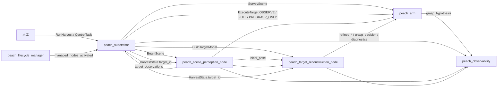
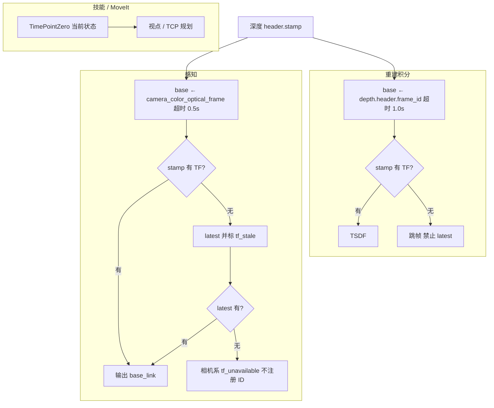
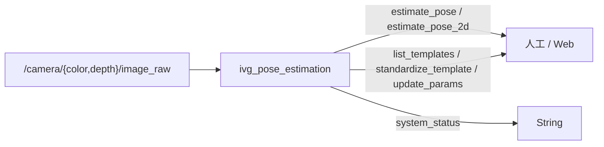
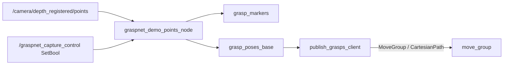

# v1 栈系统 io（活文档）

> 2026-10-10 用户裁定自仓库级 `docs/io.md` 拆写入包：**系统级契约归本包**——跨包边界（谁叫谁）、相机契约（/camera/* 前端选择）、驱动层、可选外设（serial_imu / imu_follow）与旁路栈（IVG / 演示）。各能力包话题/参数明细在其 `doc/io.md`（地图见 [doc/architecture.md](architecture.md) 包文档地图）。字段级 IDL 目录：[peach_interfaces/README.md](../../peach_interfaces/README.md)；清单核对：`python3 src/peach/peach_interfaces/scripts/check_interface_manifest.py`。**源码与本文互相更新，改接口/话题/TF 或改本文须同一轮改另一边**；如何演化以 [AGENTS.md](../../../../AGENTS.md) 为准。轮次结论随提交说明（历史在 git）。

对象是套袋桃。跨包只走 `peach_interfaces`。能力包不互发批次命令；作业目标只认调度 `~/state.target_id`。包职责见 [architecture.md](architecture.md) §3。

下表生产/消费名与清单一致。**名字之外须能看出功能含义**（这一口数据/命令干什么、谁据此做什么）。改接口先改 IDL 再改清单再改本文。运行参数部署值在各包 `config/<节点>.yaml`（nav2 式全量清单）；Python 节点 `attach(node)` 按该 yaml 声明叶子（实现单源 `peach_common.yaml_params`，W1；包内旧路径 shim），`peach_arm` 仍 GPL `arm_parameters.yaml`。下表只列改变作业行为的键。
---
## 1. 跨包边界

| 包 | 对外提供 | 对外消费 | 不提供 |
|----|----------|----------|--------|
| `peach_interfaces` | IDL + `interface_manifest.yaml` | — | 运行时节点 |
| `peach_harvester`（vision） | `BeginScene`；`/peach/perception/*`；`BuildTargetModel`；`/peach/reconstruction/*` | RGB-D、`HarvestState`、精确 stamp TF | 运动动作、`ledger.json`、选下一颗 |
| `peach_arm` | `SurveyScene`、`ExecuteTarget`、`CheckReachability`、`grasp_hypothesis`、预览/使能/ACK 服务 | 观测、`GraspDecision`、`refined_*` | `RunHarvest`、重建 Trigger 客户端、`ledger.json` |
| `peach_harvester`（supervisor） | `RunHarvest`、`ControlTask`、`HarvestState`/`events`、lifecycle | 观测（选果，仅 `target_observations`）、动作结果 | RGB-D 处理、MoveIt 规划接触、Nav2 规划 |
| `peach_bringup` | 整栈 launch / 预检 | Include 只读 `aubo_e5_bringup` | 不自动 RunHarvest |
| `peach_observability` | 8090 转发、独立 rosbag2 | 调度/技能只读话题 | 不发运动 |
| `peach_vegetation` | `/peach/vegetation/{leaf_mask,branch_mask,overlay,status}` | 彩色图 `image`（remap） | 运动、PlanningScene、octomap、选果 |
| `peach_sim` | 果园世界 `worlds/peach_orchard.sdf`、采摘工位 xacro、目标清单 GT（`peach_orchard.manifest.yaml`：袋底=entry/袋颈/轴/果心/`reachable`）、履带可驾驶仿真 + Nav2 巡园（`orchard_nav.launch.py` + `tour_node`，2026-10-08 起）、重建去草整园纯视觉查看世界 `worlds/field_no_grass.sdf`（单静态 GLB visual，无碰撞体/传感器/桥/TF，非 GT） | `config/orchard.yaml`（场景参数唯一事实源） | 不进 `harvest_system` / 不订 peach 话题；gz↔ROS 桥按 `config/orchard_bridge.yaml` 六路：`/clock`、`/joint_states`（gz `gz.msgs.Model`→`sensor_msgs/JointState`）、`/odom`、`/tf`、`/scan`、`/cmd_vel`；巡园动作=Nav2 自带 `NavigateToPose`（nav2_simple_commander），非 peach IDL |

导航预留（`peach_navigation` 已归档 `_archive/parked_2026-09/`）：曾提供 `NavigateToWorksite` 与 `/peach/navigation/target_report` / `arm_status` / `vehicle_state`；现仅在 manifest `reserved_interfaces` 区留名，无生产方。调度是批次侧**唯一**动作客户端。技能不调重建 `reset`/`finalize` Trigger。到位一步无导航动作：`_cmd_navigate` 固定座直通 `NAV_OK`。`harvest_plan` 只做收齐窗口与锁定集，不选下一颗。



**读图：** 左到右是一次开批谁叫谁。粗箭头是动作/服务（只有调度发出）。细回流是观测和许可话题：调度订 `target_observations` 选果、`grasp_decision`（闩锁许可令牌缓存，非选果输入）；`initial_pose` 只进重建。监控在最右，只收不发。`NavigateToWorksite` 预留（图上无导航节点）；`ExecuteTarget` 干跑走 `PREGRASP_ONLY`，不是图上三种同时发。

| 调用 | 服务端 | 发起方 | 何时 |
|------|--------|--------|------|
| `NavigateToWorksite` | （预留，导航包已归档） | `_cmd_navigate` | `Command.NAVIGATE`；固定座直通 `NAV_OK`，不发送动作 |
| `CheckReachability` | `peach_arm` | `_query_reachability`（SELECT 段） | 批量 TCP IK 预检（请求=感知入口 + 行程；服务端预抓取停位：后撤 + `alignFrameZ` + 滚转扫描；`require_sleeve` 时再检套入终点 IK **和**沿轴笛卡尔，失败码 `sleeve_no_ik` / `sleeve_no_cartesian`；种子=当前关节；不装配 MTC、不动臂）；不可用回退标定半径窗（FULL 另卡套入终点半径） |
| `SurveyScene` | 技能 `~/survey_scene` | `_survey_body` | `Command.SURVEY`；首巡 `NAV_OK` 后，回访 `CYCLE_DONE` / `NO_TARGET` |
| `BeginScene` | 感知 `~/begin_scene` | 调度 `_cmd_begin` | 仅首巡 `SURVEY_AT_POSE` 后一次 |
| 等锁 | （消费观测） | `_wait_lock` | `Command.WAIT_LOCK`；谓词：`scene_epoch` 对齐且 `target_set_locked` |
| `BuildTargetModel` | 重建 `~/build_target_model` | `_cmd_dispatch` | 与 OBSERVE_ONLY **并行** |
| `ExecuteTarget` OBSERVE_ONLY | 技能 `~/execute_target` | `_cmd_dispatch` | 主动视点给重建凑 `min_views` 机位 |
| `ExecuteTarget` FULL | 技能 `~/execute_target` | `_cmd_full` | 观察+模型都过门之后；仅 `execute_pregrasp_only=false` |
| `ExecuteTarget` PREGRASP_ONLY | 技能 `~/execute_target` | `_cmd_full` | 默认 `execute_pregrasp_only=true` 时替代 FULL；停预抓取等 ACK |
| （可选）`skip_reconstruction` | 调度参数 | `_cmd_dispatch` | launch `skip_reconstruction:=true` 时 **不发** Build/OBSERVE，直接 `READY_FULL`；接触几何=锁定集场景观测。brain overlay 按节点名分节写 ParameterFile（unnamed Node 上扁平 dict 与 `peach_supervisor` 单键嵌套都打不进进程内节点，2026-09-30 实测）。默认 false |
| `ControlTask` | 调度 `~/control` | 人工（监控只读不发） | PAUSE / SKIP / CANCEL… |
| `ManageLifecycleNodes` | 管理器 `~/manage_nodes` | 人工 | STARTUP/PAUSE/RESUME/RESET/SHUTDOWN；不发 RunHarvest |

---
## 2. 相机契约（全栈共享 /camera/*，前端二选一）


驱动 RGB-D（[§3 驱动层](#3-驱动层)）：

| 名字 | 含义 |
|------|------|
| `/camera/color/image_raw` | 彩色（前端二选一，话题同构） |
| `/camera/depth/image_raw` | 配准深度（uint16 或 32FC1） |
| `/camera/color/camera_info` | 彩色内参 K |
| `/camera/depth/camera_info` | 深度内参（配准后与彩色同 K；stereo 前端同发） |
| `/camera/depth_registered/points` | 配准彩色点云（percipio 默认开；stereo 同名，点云多一个 `confidence` 字段，见下） |

**相机前端（2026-09-17 起，harvest_system `camera_frontend:=percipio|stereo|replay`；**默认 stereo**，2026-09-29 用户裁定；percipio 显式传参仍可用；`replay` 不起驱动，由各栈系统测包 `frozen_camera_replay.py` 冻结 bag 重发同名 `/camera/*`；v1 另经 `brain_params_overlay` 装 `frozen_one_view.yaml`（`min_views=1`、基线 0°、`reconstruct_in_trajectory`，不用 `skip_reconstruction`），v2 经 `target_model_config` 装 `frozen_target_model.yaml`（单视 sigma 放到参数上限、`observe_max_views:=1`、测试标定 `status: calibrated` + 测试 `L_insert`），经 `scene_config` 装 `frozen_scene.yaml`（硬障碍抬成飞点），经 `perception_config` 装 `frozen_perception.yaml`（锁门 3 帧 / 0.5 s、`confirm_hits=1`、传感 QoS RELIABLE；`lock_wait_s:=20`）；v1 驱动另关 `moveit.obstacle_guard_enabled`）**：percipio=设备端 18 图案深度（~2.43 fps，额定量程 0.4–0.8 m；09-21 修复 `parameters.xml` 调参残留下发致深度大面积无效——该 XML 是无条件下发通道，实验值勿残留）；stereo=`peach_stereo` 主机单图案立体（~13.7 fps，hh4 档；话题与 percipio 同构：`color/image_raw`、`depth/image_raw`、`{color,depth}/camera_info`、`depth_registered/points`——stereo 点云比 percipio 多一个 `confidence` FLOAT32 字段（point_step 24=xyz12+pad4+rgb4+confidence4——confidence 在 rgb 槽之后，勿与 rgb@16 重叠；`temporal_k>1` 时=窗内采样占比×取值一致性、与发布深度逐像素对齐，`=1` 时恒 1.0；消费方按字段名读，octomap/RViz/PCL 兼容）；深度口径 uint16×0.25 mm；只发 raw Image + 点云，不用 image_transport；静态 TF 同名链；激光满功率点亮、停栈自动复位；与 percipio 相机连接互斥；SGBM 档 `sgbm.mode`/`sgbm.uniqueness_ratio`/`median_ksize` + 配准后滑窗时域中值 `temporal_k`（1=关/3/5 非法拒启；逐像素有效中值、每帧照常发布不除率；部署 yaml=3，09-21 live A/B：entry std z 0.41→0.21mm、袋半径 std 0.27→0.14mm、覆盖 +0.4pp、13.7gps 无回归），参数依据见该包 README 与 yaml 注释）。规格档案与实测数据见 `src/peach/peach_stereo/README.md`。感知/重建订阅零改动。

感知/重建 ApproximateTime slop **0.05 s**。驱动 QoS 字符串 `default`（RELIABLE）；订户手写 RELIABLE、depth=10。跨包轴向后撤只改 `src/peach/peach_harvester/config/grasp_standoffs.yaml` 两行（`entry_standoff_m` / `pregrasp_standoff_m`），launch 注入各节点已声明参数。

- 深度 uint16：**raw × `depth_scale_unit=0.25` = 毫米**（Percipio）。数据集真毫米设 1.0。32FC1 按米 ×1000，该参数不生效。
- 有效深度：非 0、非 65535；管线窗现行 `pipeline.min_depth_m`/`max_depth_m` **0.3–1.5 m**（`scene_perception.yaml`）。禁止网络补深度。`depth_fallback` 只出现在构造 `hybrid_dilated` 时的深度连通域标签，以及管线 `_foreground` 在「外部掩膜 ∩ 有效深度 <50 像素」时的内部降级；节点主路径 SAM 缺失走 `mask_unavailable`，不把深度带当几何。
- Percipio launch **请求** `frame_rate:=5.0`。归档现场彩色流约 **2.43 fps**，感知帧间隔中位 **0.4 s ≈ 2.5 FPS**。设计节拍用实测，不把 5.0 当已测 Hz。未授权不改 Percipio `frame_rate`。
- 重建 `capture.max_views: 24` 是帧栈上限不是节拍。停稳门打开后有效视角常 4–6。

话题三类语义（最终架构 R3/R4）：**稳定流**（confirmed-only，进 RViz）`markers`、`single_cloud`、`debug_image`；**真相流**（全量含未确认，进记录层与 L2 选果，不进 RViz）`detections`、`masks`、`observations`、`initial_pose`、`debug_image_raw`（与稳定流成对落盘供筛选前后对比）；**模型流**（几何+许可）`grasp_decision`、`refined_*`、`tsdf_cloud`。豁免话题含义见 §3.1。
---
## 3. 驱动层

给采摘核提供手臂、相机、TF。红线包只读。技能不直接写关节命令。

```
base_link → 臂链 → wrist3_Link
  → camera_link（extrinsics_publisher 标定权威）
     → camera_color_frame → camera_color_optical_frame（感知 yaml）
     → camera_depth_frame → camera_depth_optical_frame（深度 header、技能 yaml）
  → tool_axis → cutting_plane / tcp / sleeve_mouth / tool_body_link
     （按 launch tool_profile 选档案，帧名共用：shear_v1 TCP (0, 47.90, 151.07) mm Rx(−90°)（传承旧 hollow 基准）/
      bite_shear_v1 TCP (0, 30.24, 165.5) mm / adaptive_shear_v1 TCP (0, 47, 168.66) mm Rx(−90°)；
      Z=开口，XY=刀口；TCP=刀口/工作口设计基准（adaptive 与旧圆柱同基准、bite 总装测量点；shear_v1 为 CAD 推导）；tool_body_link 挂 wrist3_Link 载 CAD 网格）
```

无 `active.yaml` 时名义 TF：`wrist3_Link→camera_link` 平移 2 cm、单位四元数。现场标定约 `[0.045, 0.108, 0.002]`。驱动两光学系相对 `camera_link` 平移为 0（源码如此；未 live echo 不改名）。

不要统一成一种 TF 查询：



**读图：** 同一时刻的深度，三处用法不同。感知：优先图像时刻 TF，没有就用最新并打 `tf_stale`，再没有就不给这颗桃世界系 ID。重建积分：必须图像时刻精确 TF，失败直接丢帧，禁止用最新。技能规划：问「现在臂在哪」，用当前 TF，不拿旧深度去积分。

| 包 | 策略 |
|----|------|
| 重建积分 | 图像时刻精确 TF；失败跳帧，禁止 latest |
| 感知几何 | 优先 stamp，失败 latest 并 `tf_stale`；再失败不注册世界系 ID |
| 技能 | `tf2::TimePointZero`（规划下一视点，不是积分旧深度） |

归档接触轮 `tf_failures=0`。瓶颈不在 TF。

柜侧接口在 `aubo_msgs`，不是采摘业务类型：

| 名字 | 含义 |
|------|------|
| `/aubo_io_controller/robot_status` | 技能安全门：抱闸、`motion_possible`、急停**状态观测**（不是急停通道；急停在示教器/柜，见 AGENTS 第 2 章）；监控 Web 柜侧灯。mock bringup 不起本控制器（发布者计数 0）；`harvest_system` mock 把 `peach_arm` `execution.require_robot_status` 置 false，真机 KEEP true |
| `/aubo_io_controller/joint_status` | 监控 Web：关节电流（SDK 原单位）、温度、跟随误差。技能 ④层接触检测只读 `current[6]`（默认关，只缓存） |
| `/aubo_io_controller/set_io` | 工具闭合；仅 `tool.enabled` 且 FULL 切断阶段 |
| `/joint_states` | 重建静止门、技能规划当前关节；监控 Web 实际角/速度 |
| `/camera/depth_registered/points` | ③层场景障碍快照（0035，2026-09-29 起现行）：`peach_scene_obstacles` 节点订本话题（RELIABLE VOLATILE depth 5）→ 滤自身/滤已精化目标 → 体素化 → BOX 对象写 PlanningScene；**`sensors_3d.yaml` 保持 `sensors: []`，不用 octomap updater**（两轮翻车教训见该文件注释；详见 §4 peach_scene_obstacles 节）。mock 无点云=无快照。RViz Camera Points / 旁路 GraspNet 同名 |

采摘 IDL 在 `peach_interfaces`。
---
## 4. `serial_imu`（可选）

不在 peach 清单、采摘核不订、不进 lifecycle、不进只读 bringup。`harvest_system` 默认 `imu_enabled:=true`（mock / real 相同）：`use_rviz:=false`、`tf_parent_frame:=tcp`、`align_to_parent:=true`。无 USB 时节点每 2 s 重试串口，不挡整栈。关掉：`imu_enabled:=false`。单独看 IMU 仍可用 `ros2 launch serial_imu serial_imu.launch.py`（不要与整栈同时起）。整栈 RViz 看 Peach → **Imu**（`/imu/data`），不要找 TF 里的静止 `imu_link`。

| 名字 | 含义 |
|------|------|
| `/imu/data` | **修正** IMU（Reliable+Volatile，`frame_id=imu_link`）：`frame_rpy_deg` 默认 Rx(180°) 后静止比力 +Z，再乘可选 `align_to_parent`；默认 `gyro_available: false` → `angular_velocity_covariance[0]=-1` |
| `/imu/data_raw` | **原始** IMU：模组体轴，协议原样（含姿态）；陀螺协方差同 `data` |
| `/imu/mag` | 磁力计（特斯拉；已随修正转到 `imu_link`；未知方差全 0） |
| `/imu/temp` | 温度 |
| `/force/points` | 5 点力（`std_msgs/Float64MultiArray`，Reliable+Volatile）：**牛顿**（REP-103），顺序通道 1/2/3/5/7；2026-09-29 实测 A5 力帧与 A4 IMU 帧共用 `/dev/imu` 同口，本节点 `feed_mux` 分流 |
| `/diagnostics` | `diagnostic_updater`：串口开闭 + `imu/data` 帧率（不进采摘 observability） |
| `imu/align_to_parent` 服务 | `std_srvs/Trigger`：把当前 IMU↔parent（tcp）姿态差当误差清掉；`align_to_parent` 时提供 |

静态 TF `world`（或 `base_link` / `tcp`）→`imu_link`（单位姿态，不把融合四元数写进此帧）。不并进臂链，除非 `tf_parent_frame:=base_link` 或 `tcp`。坐标系修正与对齐在 `frame.py`（零 ROS）：倒装 Rx(180°) 与 parent 误差清零分开；贴歪/无磁 yaw 不要写进 `frame_rpy_deg`。叠 TCP 时 `align_to_parent:=true`（启动自动采，或调 `imu/align_to_parent`）。不做自适应工具偏移。手册：[src/serial_imu/README.md](../../../serial_imu/README.md)。

### `serial_force_node`（咬合末端 5 点力，只看力时的独立用法）

咬合末端盘面 5 点力传感器 IMS-C04A（量程 50g–2kg），采集板 0xA5 定长帧（17B：通道号 1/2/3/5/7 + int16 小端 kgf×100 + 累加和）100Hz 主动上报。**与 IMU 帧共用 `/dev/imu` 同一条串口（2026-09-29 实测）**：默认由 `serial_imu_node` 分流发 `/force/points`（上表）；本节点是"只看力"的独立用法，开同一条口、逐帧打印 kgf（点位标签 `channel_labels` 从 CAD 截图读出，现场按压校对）。**勿与整栈/`serial_imu` 节点并行**（抢同一口）。不进 `harvest_system` / lifecycle / peach 清单。

| 名字 | 含义 |
|------|------|
| `/force/points` | `std_msgs/Float64MultiArray`（Reliable+Volatile）：5 值 **牛顿**（REP-103），顺序同通道 1/2/3/5/7 |
| `/diagnostics` | `diagnostic_updater`：串口开闭 + `/force/points` 帧率（期望 100Hz，窗 0.6×–1.4×） |
---
## 5. 旁路视觉抓取（不进采摘）

不在 peach 清单、采摘核不订、不进 `harvest_system` / lifecycle。三包：`ivg_interfaces`（估姿 1 msg + 5 srv）、`ivg_pose_estimation`、`ivg_graspnet`（旋转数学统一 scipy，`ivg_utils` 已于 2026-09-17 精简轮删除）。与采摘共用 Percipio 图像/点云与 `extrinsics_publisher` TF；检测 launch **不**再起相机或手眼节点。

### `ivg_pose_estimation`

节点名 `ivg_pose_estimation`。Web 另进程，默认 `http://127.0.0.1:8089/`（与手眼标定网关 8088 错开）。**写端点认证**：`/exit`、`/api/save_template_pose`、`/api/standardize_template`、`/api/debug/update_params`、`/api/debug/save_thresholds` 需 `vpe_auth` SameSite=Strict cookie（同源 UI 自动携带）或 `X-Auth-Token` 头（token 见启动日志；`VPE_WEB_TOKEN` 环境变量可固定）；CORS 已收紧为同源。流水线分段（2026-09-29 前沿化轮）：Segmenter（`depth_band` 默认/`rembg_u2net`/`mobile_sam`）→ Matcher（`geometric` 默认/`dinov2_template`）→ pose 求解；配置单源 `config/pose_estimation.yaml`。软触发发 `std_msgs/String` 到 `/camera/soft_trigger`（与 `percipio_camera` 一致）；无订阅者时不阻断。`T_B_C` 优先查 `base_link` ← `camera_color_optical_frame`（按图像 stamp，失败回退 latest+WARN）。Web 上 `/api/get_robot_status`、`/api/set_robot_pose`、`/api/set_robot_io`、`/api/execute_pose_sequence` 与抓取/快换路由一律 **501**（运动走 harvest 8090 调试操作面或 `ivg_graspnet`）。



| 名字 | 含义 |
|------|------|
| `estimate_pose`（根命名空间，非私有） | 深度(+可选彩色) → 6D 与抓取/放置笛卡尔位（米）；请求/响应带 `std_msgs/Header`，响应 stamp=图像采集时刻、frame=`base_link`；响应含 `message` 状态/失败原因字段 |
| `~/estimate_pose_2d` | RGB → 像素中心与转角 |
| `~/list_templates` | 列出模板库 |
| `~/standardize_template` | 标准化某工件模板 |
| `~/update_params` | 更新算法参数段 |
| `~/system_status` | 运行日志 String |
| `/camera/color/image_raw`、`/camera/depth/image_raw` | 与采摘同一相机话题（参数可改） |
| `/camera/soft_trigger` | Percipio 软触发（`std_msgs/String`） |

模板根：launch `template_root` → 环境变量 `VPE_TEMPLATE_ROOT` → `web_ui/configs/app_config.json` → `ivg_pose_estimation/templates`。

### `ivg_graspnet`

检测节点 `graspnet_demo_points_node`；执行客户端 `publish_grasps_client`（须外部 `move_group`，规划组 `manipulator_e5`、末端 `tcp`）。**双后端**（`backend` 参数 / 注册表 `backends/`）：`graspnet_torch`（默认；前向+解码）与 `contact_graspnet`（vendored）；碰撞/NMS/topK 在模型无关的 `postprocess.py`；耦合超参随 `models/checkpoint-rs.yaml` manifest。`publish_grasps_client` 有 opt-in 使能门 `require_enable`（默认 false）与 `apply_grasp_z_flip`（对齐后端 `approach_flip_z180`；graspnet_torch=true、contact_graspnet=false 待真机核验）；MoveIt 超时自动 `cancel_goal`。采集默认待命。



| 名字 | 含义 |
|------|------|
| `/camera/depth_registered/points` | 输入点云（与 RViz Camera Points 同名） |
| `/graspnet_capture_control` | `std_srvs/SetBool`：True 开始一组采集 |
| `grasp_markers` | 相机系 MarkerArray（兜底 frame `camera_depth_optical_frame`） |
| `grasp_poses_base` | `base_link` 系 PoseArray |
| `grasp_pose_i` | 动态 TF（候选抓取） |

`publish_grasps_client` 凑满 `min_groups_before_pick` 组后会走 MoveIt 接近。未授权不得真机运动。手册：[src/ivg/ivg_graspnet/README.md](../../../ivg/ivg_graspnet/README.md)。
---
## 6. `imu_follow`（可选；仅自适应档案随整栈）

不在 peach 清单、不进 lifecycle。`harvest_system` **仅** `tool_profile:=adaptive_shear_v1` 时 Include `imu_follow_servo.launch.py`（含 moveit_servo）；非 IMU 末端不起。独立 launch 仍可用于人工调试。`motion.enabled` 默认 false 只算不发；**peach 不自动开门**。mock 下发用 `ros2 param set /imu_follow motion.enabled true`。真机换 fjt 后端（透传只有 FJT 动作口）并另行人工授权。

peach `ExecuteTarget` FULL 在自适应档案上于预抓取验证后调用下列服务（非 IMU 末端永不调用、**也不建**这些 Trigger 客户端——非 IMU 栈 `ros2 service list` 不得出现 `/imu_follow/*`）：`/imu_follow/enable` → `/imu_follow/insert_start` →（剪切）→ `/imu_follow/insert_retract` → `/imu_follow/disable`。回到预抓取才关窗，再 MTC 回 `harvest_stow`。未 enable 时 follow_node pause servo，禁止与 MTC 同时写 JTC。follow_node 另发 `~/insert_progress`（`/imu_follow/insert_progress`，Float64，on-change；插入行程进度目标积分）——peach 侧套入/撤退行程判据的回退源（批次5：主判据 FK 沿轴投影，见 §5 周期）。

| 名字 | 含义 |
|------|------|
| `/imu/data` | 输入（订，Reliable+Volatile；serial_imu 修正话题；勿与其他发布器混流，双流会被平滑成中间值） |
| `/joint_states` | 当前关节（订；新鲜度门与 fjt 种子） |
| `~/enable` | `std_srvs/Trigger`：前置全就绪才采参考开始；servo 后端自动 `switch_command_type(TWIST)` + 确保未暂停 |
| `~/disable` | `std_srvs/Trigger`：停跟随（servo 补零速刹车并 pause；fjt 取消在途 goal；disable 后在途回执不补发） |
| `~/insert_start` | `std_srvs/Trigger`：插入推进开始——锁当前工具开口方向（tip +Z，base 系），位置目标沿它按 `insert.speed_m_s`（0.01 m/s）推进、钳 `insert.max_travel_m`（0.20 m）；姿态照常跟 IMU。须先 `~/enable` |
| `~/insert_stop` | `std_srvs/Trigger`：停推进（跟随保持）；disable/断流/达行程上限亦自动停 |
| `~/insert_retract` | `std_srvs/Trigger`：沿锁定开口把行程收回 enable 参考点（跟随保持）；须先 `~/enable` |
| `~/target_pose` | `geometry_msgs/PoseStamped`（base_link）：平滑后 TCP 目标（位置=参考点或插入推进点，姿态跟 IMU） |
| `~/command_twist` | `geometry_msgs/TwistStamped`（tcp 系）：P 控制输出（dry 镜像） |
| `/moveit_servo/delta_twist_cmds` | servo 输入（**BEST_EFFORT** 发布——可靠 QoS 与其订阅不兼容收不到；开门时发） |
| `/moveit_servo/status` | servo 状态（0=No warnings） |
| `/joint_trajectory_controller/joint_trajectory` | servo 100 Hz 输出（JTC 话题流式；mock） |
| `execution.follow_joint_trajectory_action` | fjt 后端动作：mock `/joint_trajectory_controller/...`；真机 `/aubo_passthrough_trajectory_controller/...` |

跟随链：Δ(conj(q_ref)·q_now) → 符号映射 `follow.invert_*` → 死区 → 锥钳 → 平滑 → 目标姿态；servo 后端对当前 TF 求体轴误差按 `servo.orientation_gain` P 控制成角速度（钳 `execution.max_omega_rad_s`；位置小增益 `servo.position_gain` 防漂移，插入推进期间目标点随行程前移）；fjt 后端 `/compute_ik` + 单步钳制流式 FJT。IMU / 关节状态断流、连续 IK 失败自动 disable。参数全量：包内 `config/imu_follow.yaml`（节点，决策 0017 口径手写 `params.py`）与 `config/moveit_servo.yaml`（servo；此版参数名自带 `moveit_servo.` 前缀）。手册：[src/imu_follow/README.md](../../../imu_follow/README.md)。
---
## 7. IVG 演示栈（不进采摘）

四新包 `ivg_demo_services` / `latte_backend` / `tool_changer` / `aubo_ros2_web_dashboard` + `ivg_interfaces` 扩展（+10 srv +3 msg：拉花/快换/抓取/监控族）。独立 launch 栈（入口 `scripts/start_ivg_demo.sh`，默认 mock 且默认**独立 DDS 域 96**；`io_simulated:=true` 时 IO 旁路）；FK/IK/上下电走 `aubo_dashboard /aubo/*`，IO 走 `aubo_msgs/SetIO` `/aubo_io_controller/set_io`（板载 DO）。

**IVG/peach 隔离裁定（2026-09-30）**：IVG 演示资产只落 IVG 包——工具 mesh 在 `tool_changer/meshes/`、演示辅助脚本在 `ivg_demo_services/scripts/`；**不向共享包（aubo_description / aubo_e5_moveit_config / peach_*）添加任何 IVG 专有内容**；与 peach 不同域并行（peach 现役 77，演示栈 96），勿同域混跑；URDF 换装改 TF 树期间禁止 peach 预检/整栈同域启动。共享面仅限通用基础设施：bringup/moveit 控制器栈、aubo_dashboard、aubo_msgs。

| 名字 | 类型 | 提供方 → 消费方 |
|------|------|----------------|
| `/latte/run_workflow` | `ivg_interfaces/RunLatteWorkflow` | latte_backend → Web 咖啡拉花面板/CLI |
| `/set_latte_do2` `/set_latte_do4` | `std_srvs/SetBool` | latte_backend latte_io_node → 面板（转 SetIO pin2/4） |
| `/latte_di_status` | `std_msgs/String`（JSON） | latte_io_node → 面板 DI 指示灯 |
| `/run_gripper_swap` `/change_tool` `/get_current_tool` | `ivg_interfaces` 三 srv | tool_changer → Web 视觉抓取面板 |
| `/scene_attach` `/scene_detach` `/set_display_tool` | `ivg_interfaces/ChangeTool` | tool_changer scene_attach_worker → swap worker/面板 |
| `/tool_changer_status` | `ivg_interfaces/ToolChangerStatus` | gripper_swap_worker（5s 周期）→ scene_attach/面板 |
| `/execute_single_grasp` | `ivg_interfaces/ExecuteGraspPose` | ivg_demo_services grasp_trigger → 面板（视觉源 `/grasp_poses_base`） |
| `/loop_grasp_control` `/publish_grasps_worker_loop_control` | `std_srvs/SetBool` | grasp_trigger → 面板循环开关 |
| `/move_to_pose` `/debug/move_to_xyz` | `ivg_interfaces/MoveToPose` | move_service_node → 面板手动运动 |
| `/get_current_state` `/read_robot_io` `/set_robot_enable` `/set_speed_factor` | `ivg_interfaces` 四 srv | move_service_node → 面板/位姿轮询（500ms） |
| `/system/node_status` `/system/log` | `ivg_interfaces/NodeStatus/SystemLog` | system_monitor_node → 面板监控/日志 |
| 端口 **8095** | 网关（uvicorn） | aubo_ros2_web_dashboard（**8090 仍归 peach_observability**） |
| 端口 9090 / 8765 / 8089 | rosbridge / foxglove_bridge / web_video_server | 网关上游（apt `ros-jazzy-rosbridge-suite` 等，env_bootstrap 已列） |
