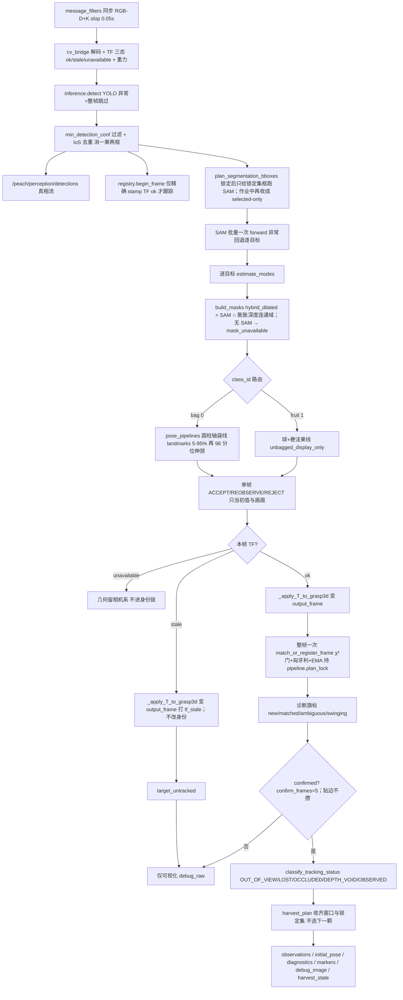
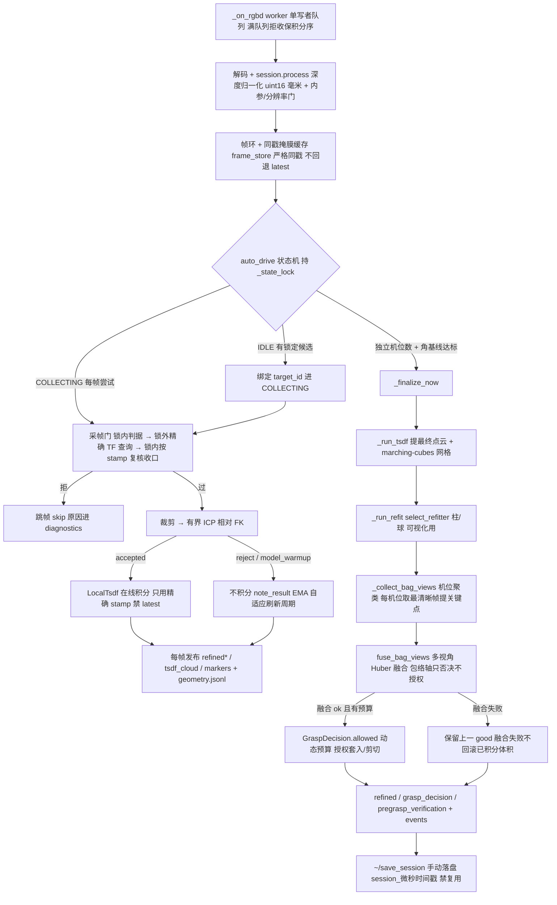
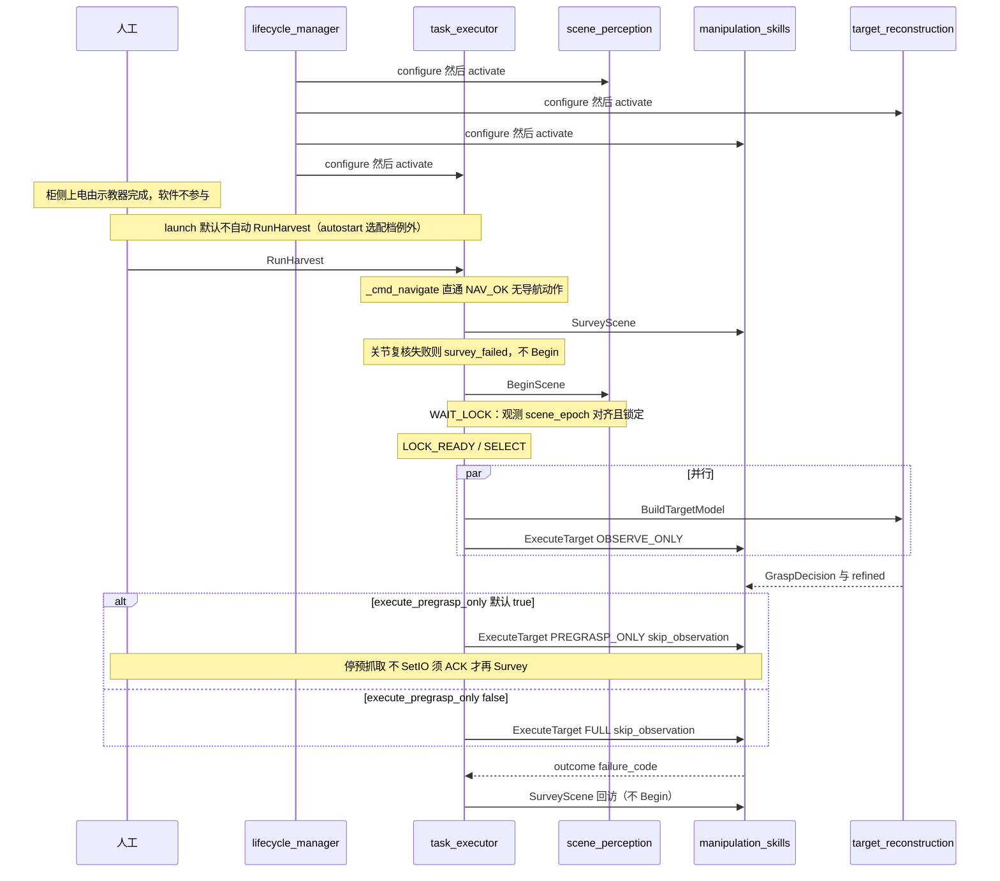
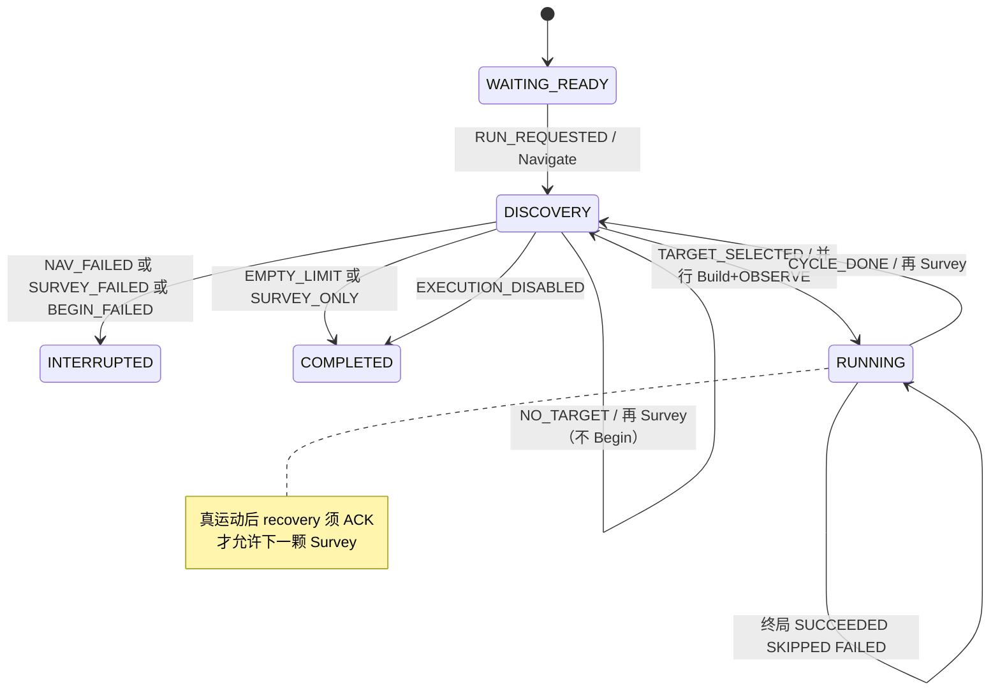

# `peach_harvester` 架构（vision + supervisor，v1 活文档）

> 2026-10-10 用户裁定自仓库级 `docs/architecture.md` 拆写入包。系统级架构（分层/整栈组合/决策表/驱动地图）在 [peach_bringup/doc/architecture.md](../../peach_bringup/doc/architecture.md)。本文是 SNAPSHOT：**源码与本文互相更新，改一边须同一轮改另一边**；如何演化以 [AGENTS.md](../../../../AGENTS.md) 为准。

---

### `peach_harvester`（vision） — 视觉算法（一包两节点）

**作用：** 回答两件事：场景里有哪些桃（稳定 `target_id`、锁定集）；当前作业目标这一颗的局部模型与抓取许可。不决定下一颗、不指挥臂。

**含什么：** `peach_scene_perception_node`、`peach_target_reconstruction_node`、无话题的 `common/`（拟合、深度单位、时钟、`HarvestDataStore` 往 `runs/<request_id>/perception_data/` 追加事件，不写调度 `ledger.json`）。两节点现为薄壳（W3/W4 瘦身）：帧级计划推进在 `plan_updater.py`、refit 编排在 `refit_orchestrator.py`、session 落盘在 `session_recorder.py`、共享状态与方法宿主在 `reconstruction_core.py`（节点经 MRO 组合），计算本体零 ROS 可单测。参数：部署事实源 `config/{scene_perception,target_reconstruction}.yaml`；节点一行 `attach(node)`（直接导入 `peach_common.yaml_params`）。`scene_perception/params.py` 只做 gravity/tool 派生；`target_reconstruction/params.py` 只做 strip。空 YOLO/SAM 路径在参数层拒绝启动。缝位：袋/果管线 + 柱/球 refitter 两处映射（映射名见 [io.md](io.md) §3.1/§3.2 参数表）；其余算法直接构造。

#### `peach_scene_perception_node`（看）

- **输入：** 配准 RGB-D（Percipio `/camera/color|depth/image_raw`）；精确或 latest TF（stamp 失败标 `tf_stale`）；调度 `HarvestState`；`BeginScene`。
- **输出：** `/peach/perception/target_observations`、`initial_pose`、`diagnostics`、`harvest_state`、`debug_image`（后两者均在清单）；另有未进清单的 `detections` / `masks` / `markers` 等可视化。
- **做什么：** 节点 decode RGB-D/TF 后调 `PerceptionPipeline.process(frame)`（检测 → 分割 → 袋位姿 → 世界系身份 → 收齐锁定）。裸果线现行关闭（`from_params(..., enable_fruit=False)`：不构造果线，`class_id=1` 在 SAM 前丢弃；改 `True` 即恢复）。恢复后裸果球只作显示与袋内果实包络先验，`unbagged_display_only` 不进执行候选。`harvest_plan` 只做锁定集，不选下一颗。单帧 `BagGraspCandidate.status` ACCEPT/REOBSERVE/REJECT 只当初值与可视化。**图像边缘门：** 贴边帧不计确认累积；锁定后贴边打 `bbox_edge`，选果侧同步过滤。
- **禁止：** 重建 TSDF、调 MoveIt、写 `ledger.json`、发明深度。

#### `peach_target_reconstruction_node`（建）

- **输入：** 同一套 RGB-D；感知观测；`HarvestState.target_id`；`BuildTargetModel`。积分**只用精确 stamp TF**，禁止 latest。
- **输出：** `/peach/reconstruction/grasp_decision`（`allowed` 是套入/剪切权威；融合几何供预抓取；`valid_until` 窗口 2026-09-20 参数化 `decision.validity_s` 默认 120s——G1：原 5s 与接近链时长错配，冻结/不续签语义不变；`model_revision` 含单调 finalize 计数——G3：同目标重 Build 不再沿用旧令牌）、`pregrasp_verification`、`refined_*`、`diagnostics`、`tsdf_cloud`；可选 `session_*` 与 `geometry.jsonl`。
- **做什么：** 节点 decode 后 `ReconstructionSession.process` 做深度归一化与内参门；采集门（锁 → 精确 TF → 重校验）→ 局部 TSDF（可视化/占用，不授权轴）→ 有界 ICP 拒帧 → 采集串扰门（邻目标锚点 <150 mm 拒帧；**小框豁免**：邻居检测框面积×`capture.neighbor_gap_area_ratio`(2.0) < 绑定框面积时不计入间距，近距双检不互相锁死）→ 多视角袋关键点 Huber 融合（方向=底→颈；口底对打的视角否决不平均）→ 体积截面质心只改侧向定位 → 轴上剪切参考（袋口 / 分割贴检测框极限；果距不足只否决 `allowed`，不把刀挪到果–颈中点）→ 沿关键点轴的 TSDF 包络主方向作一致性否决 → 动态工具预算许可。体积积分成功后才做袋融合；融合或 `geometry.jsonl` 失败**不得**回滚已积分体积、不得把该帧从采集栈弹出（否则 `/peach/reconstruction/tsdf_cloud` 空、技能有效视点仍为 0）。写三维点不得对 ndarray 用 Python `or`。固定 35° 只诊断完全错轴。包络轴向跨度小于直径或切片不足时**不**打 `keypoint_cloud_axis_conflict`（扁袋圆柱 RANSAC 不作否决）。检测轴夹角只诊断，不进接触预算。融合残差写入 RMSE/内点率，不写死 0/1。`require_robot_static`：到位静止后才积分。`BuildTargetModel` 等独立机位数达标再 finalize（`capture.min_views` 默认 1，角基线门 0，当前拍照位即可收口，不强制再移一个视点）。`captured_views` 是积分帧数；`BuildTargetModel` 反馈 / `TargetModel.view_count` 是机位数。机位覆盖看 `view_directions` / `max_baseline_deg`（同机位连帧不加机位，不把连拍当多视）。
- **禁止：** 自己跑检测、写 `ledger.json`、选下一颗、用 latest TF 积分。

**被谁调：** 只有调度发 `BeginScene` / `BuildTargetModel`。技能只订阅观测与 `GraspDecision`，不调重建 `reset`/`finalize` Trigger。

#### 图 3b — 看一帧：`scene_perception` 一帧数据流

worker 帧链（`scene_perception_node`：decode → `pipeline.process` → publish）：

**读图（图 3b）：** 自上而下是一次「看」。检测、去重先定「画面里有几个框」；分割与几何逐目标跑出单帧状态——它只配画面与初值，永不授权运动。**只有精确 stamp TF（ok）才进身份链**：整帧一次全局 1-1 分配（不是逐检测贪心），EMA 平滑位置/轴/直径，累计 `confirm_frames` 帧才转正（贴边帧不攒）。stale 仍把几何变到 `output_frame` 并打 `tf_stale`，但不 `begin_frame` / 不注册。锁定窗在 `pipeline.plan_lock` 内更新。`BeginScene` **重启收齐窗**；换场才清身份。左下分支：`tf_unavailable` 帧的几何退回相机系只进可视化，注册会污染世界系表。

#### 图 3c — 建一颗：`target_reconstruction` 采帧→finalize 流

帧 worker 与 finalize 两段（`target_reconstruction_node`，源码顺序即图序）：

---

### `peach_harvester`（supervisor） — 整栈调度（调度 + lifecycle 同包）

**作用：** 批次的唯一所有者：显式开批、选下一颗、按 FSM 调四个能力入口、写账本、有序拉起/拆除生命周期。8090 实现与静态页在 `peach_observability`；参数 yaml 在 `peach_observability/config/observability.yaml`，节点 `ObservabilityParams.attach`。自己不算视觉、不算笛卡尔接触、不算 Nav2 规划。**进程形态（3b，`peach_harvester.brain`）：** vision 两节点与 supervisor 进同一 `MultiThreadedExecutor` 一进程三节点；进程内 `BeginScene` / `BuildTargetModel` / 观测仍经 rmw/DDS 序列化（rclpy 无 intra-process 路径；合并目的是故障域统一、部署一件化），图名、话题、lifecycle 按节点名管理均不变；独立进程入口（`peach_executor.launch.py`）保留。

#### `peach_harvester`（supervisor）（批）

- **入口：** `~/run_harvest`、`~/control`（`ControlTask`，`expected_state_seq` 防乱序）；操作台服务 `~/set_enables`（SetEnables，execution→grasp→tool 依赖链校验）、`~/set_batch_policy`（SetBatchPolicy，当前批/下批默认）、`~/fire_step`（FireStep，仅 PHOTO 接线走 MoveTo；其余五档占位即拒）。
- **发布：** `~/state`（`target_id` 是感知/重建的作业绑定）、`~/events`、`~/scene_snapshot`；使能广播 `/peach/batch/enables`（latched，override 非空时 1 Hz 心跳，臂侧超时回落本地参数）。
- **客户端（仅本节点）：** `BeginScene`、`SurveyScene`、`BuildTargetModel`（与 OBSERVE_ONLY 并行）、`ExecuteTarget`、`CheckReachability`、`MoveTo`（`/peach_arm/move_to`，fast 档观察/回拍照位）、`acknowledge_recovery`（`/peach_arm/acknowledge_recovery`，ControlTask ACK 转发）。到位一步无动作：`_cmd_navigate` 固定座直通 `NAV_OK`（`NavigateToWorksite` 预留）。
- **选果：** `batch.py` 的 `next_target` 联合约束：goal 指定优先（显式指定不受窗限，但同样须过资格谓词：未确认/裸果/贴边/`tool_clearance_failed` 不可被点名，W6-B/S6），否则在已确认观测中按 **可达窗 ∩ 有效深度窗** 过滤（可达性权威是技能 `CheckReachability`（调度填感知入口 + `suggested_travel_m`；`require_sleeve` = 非 `execute_pregrasp_only`。服务端预抓取停位 IK：后撤 `mtc_approach_along_axis_m`（grasp_standoffs.yaml，现行 0.03 m）+ `alignFrameZ`（当前 TCP 滚转 + 工具 Z 对袋轴），不抄感知滚转；FULL 时再检套入终点 IK（入口沿袋轴 + clamp(travel, 0.02, 0.20) m，同姿态滚转扫描）**以及**从预抓取 IK 解沿轴笛卡尔（步长/完成比与接触 LIN 同参）。失败码 `no_ik` / `sleeve_no_ik` / `sleeve_no_cartesian`。不装配 MTC、不动臂。`setFromIK` 种子=当前关节，与 MTC 同一运动学。服务不可用回退 `selection_reach_min/max_m`（0.15/0.88；HOLD 用入口半径，FULL 另卡套入终点半径；成功 0.830–0.840 / 失败 ≥0.917）；`selection_depth_min/max_m` 默认 0.30/1.60 相机距离；超窗发 `targets_filtered` 事件留归因；次序=感知 priority 主序 + 同级**检测框面积降序**——近距双检先做大框，小框多为叶片遮挡残片/误检；裸果/`unbagged_display_only` 本轮不进执行候选。感知锁定集不代替本选择。
- **账本：** `batch.py` → `runs/<request_id>/ledger.json`（白名单落账：`failure_code` / `failure_code_n` / `completion_level` / 阶段耗时与 build 摘要；cut/retreat/harvest_confirmed 顶层镜像 W7 已删，证据单源 harvest/verification 块）；同 id 可续跑未入账目标（断点恢复 details 随账本回读，discovered 不可恢复维持 0 并在 `ledger_restored` 事件注明，W6-B/S7）。
- **FSM：** `harvest_fsm.react` 出 `Command`，节点做 ROS I/O。`execution_enabled=false` 或 `intent=SURVEY_ONLY` 则 Survey 后结算。默认 `execute_pregrasp_only=true`：FULL 槽改发 `PREGRASP_ONLY`（停预抓取，ACK 后再 Survey）。套入前改 false。臂侧 `pregraspOnlyFromGoal`：`mode=FULL` 不被默认 `profile=0` 盖成停预抓取；`PROFILE_FULL` 强制套入。运行期 `ros2 param set` 改 `execution_enabled` / `execute_pregrasp_only` 原地写入调度参数树（下次开批与 `HarvestState` 发布读到新值），不改 yaml 默认。`require_managed_stack`（整栈 launch 为 true）未收到 lifecycle 旗标则拒绝开批。DISPATCH：`BuildTargetModel` 须在 `build_start_timeout_s`（默认 2 s）内反馈 COLLECTING/READY；超时则取消并**等该动作结束**再派下一颗（重建单槽，未结束会拒下一颗 Build）。批次6 `reconstruct_in_trajectory`（默认关）：true 时 Build 进 COLLECTING 后不再阻塞 `_wait_build_after_observe` 等待段，立即派 FULL（goal 自带 `skip_observation=true`，身份 revision=`pending:*` 占位——空 revision 会被 peach_arm 以「身份元组不完整」REJECT；FULL 不装未融合 GraspDecision 令牌）——重建与接近并行；臂侧 FinalizeAndValidate 有界等精化兜底（`skip_observation` 时质量门 selected 回退 `goal.target_id`，避免感知心跳未跟上打成 `selected_target_missing`），周期收口取消并等 Build 结束（单槽约束保持）。`skip_reconstruction`（默认 false；`harvest_system skip_reconstruction:=true` 同时打开技能 `quality.allow_unrefined_geometry`）时 DISPATCH **不发** Build/补视，用锁定集场景观测当接触入口（身份 revision=`unrefined:*`；FULL 不装重建 GraspDecision 令牌）。brain 把该 launch 参数写成 `peach_supervisor` 键 ParameterFile overlay（unnamed `Node` 上嵌套 dict 打不进进程内节点）。验证路径：mock 臂 + 真相机不跟随、无法凑第二机位时走接触；真机 KEEP false。不放松 `min_views` / `max_target_drift_m`。
- **禁止：** launch 自动 `RunHarvest`；监控代发运动；直接调 MoveIt / Nav2。

#### 生命周期边界

本包不再安装生命周期管理器。整栈由 `peach_bringup` 启动 Nav2 管理器，名单及闩锁桥见 [系统架构](../../peach_bringup/doc/architecture.md)。本包仅保留各节点的 lifecycle 回调。

---

## 批次时序与 FSM（图 C）

不 include 导航（已归档）。单独 launch 某能力包时 `autostart` 默认为 true（整栈把能力包压 false）。默认 `execution_enabled=false`（调度节点参数）。**launch 默认不自动开批**（`autostart:=true` 为部署选配档：整栈客户端硬等自检绿后自动发 `RunHarvest`，默认 false）。

### 图 C — 一批 RunHarvest

**读图（时序）：** 柜侧上电由人工用示教器完成；lifecycle 只把节点配到 Active。等人发 `RunHarvest`。固定座无导航一步：到位直通 `NAV_OK`（`NavigateToWorksite` 预留）。**先 Survey 到拍照位并复核关节，再 BeginScene 重启收齐窗**，等本世代锁定后才选果。选中一颗后重建与主动观察**同时**跑。观察结束后默认去预抓取停住（不剪、不回 stow），看完方向再 ACK；只有把 `execute_pregrasp_only` 改成 false 才走套入/剪切。回访只再 Survey，禁止再 Begin。

批次纯核是 `harvest_fsm.react(batch_state, event) → Reaction`。节点禁止手写 `batch_state`。数值与 `HarvestState` / `ControlTask` IDL 由 `test/test_supervisor_idl_constants.py` 对账；`NAVIGATING=9` 预留，纯核不定义该常量。`READY_FULL` 对应命令 `EXECUTE_FULL`，节点再按 `execute_pregrasp_only` 选 `PREGRASP_ONLY` 或 `FULL`。

**读图（状态机）：** 圆是批次态，箭头上是「事件 / 接下来调度会发的命令」。发现阶段在 DISCOVERY 上转：到位 → 拍照并复核 → 开收齐窗 → 等锁 → 选果。选中后进 RUNNING；一颗结束必须回到 DISCOVERY 再拍一次（不再 Begin），不能直接派下一颗。右边注解：臂真动过之后要人工 ACK，否则停在恢复门。
