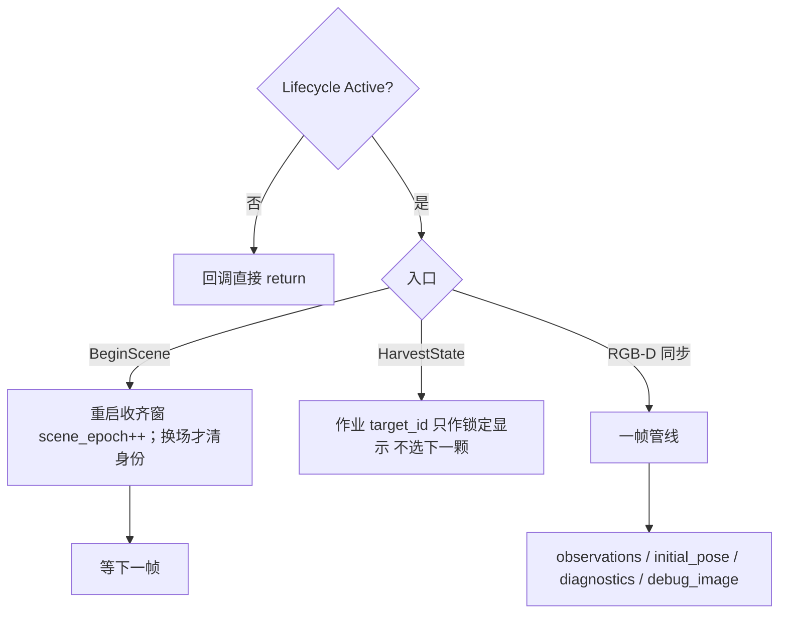
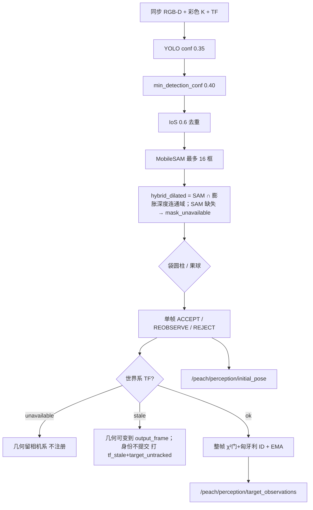
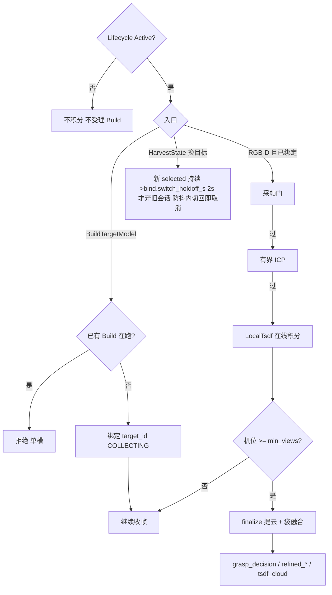
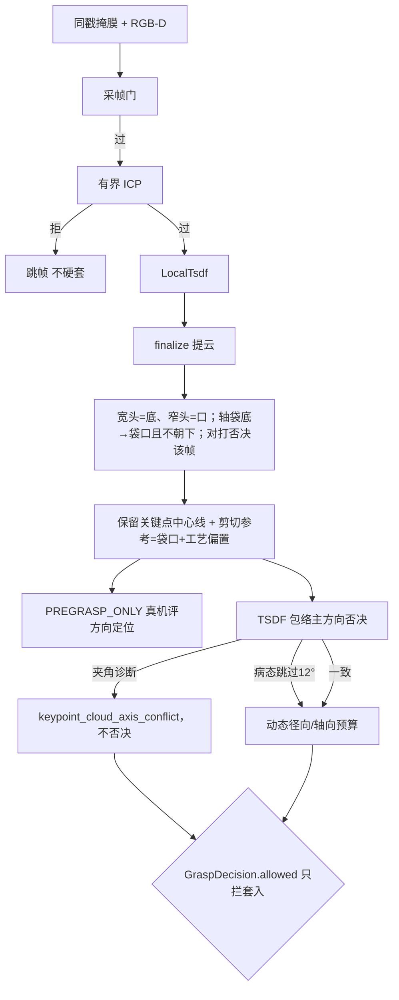
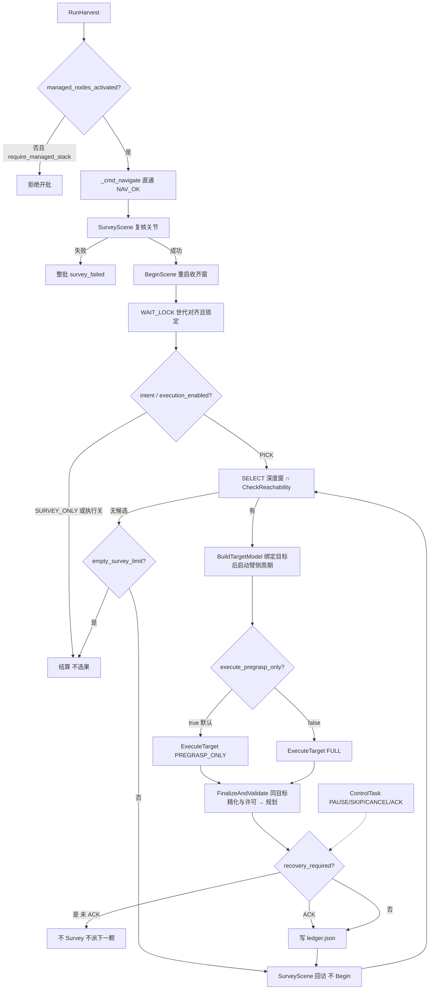

# `peach_harvester` io（活文档）

> 2026-10-10 用户裁定自仓库级 `docs/io.md` 拆写入包：本包四节点（scene_perception / target_reconstruction / supervisor / lifecycle_manager）与独立进程 `peach_scene_obstacles` 的话题、服务、动作与参数。相机契约（/camera/* 前端选择）与跨包边界在 [peach_bringup/doc/io.md](../../peach_bringup/doc/io.md)；字段级 IDL 在 [peach_interfaces/README.md](../../peach_interfaces/README.md)。**源码与本文互相更新，改接口须同一轮改另一边**。

本节描述brain中的vision两节点（看 + 建）；同包另有supervisor及独立scene_obstacles。不发运动、不选下一颗、不写 `ledger.json`（可向 `runs/<request_id>/perception_data/` 追加 `HarvestDataStore` 事件）。感知几何优先 stamp TF，失败 latest 并 `tf_stale`；重建积分必须图像时刻精确 TF，禁止 latest。

### 3.1 `peach_scene_perception_node`（看）

消费：RGB-D；`HarvestState`；精确或 latest TF。Lifecycle 非 Active：同步回调直接 return，不积分、不 `BeginScene`。

**读图：** 节点三入口。`BeginScene` 重启收齐窗；换场才清身份。`HarvestState` 只告诉「当前作业是哪颗」，不在这里选果。真正产出在 RGB-D 回调（下图）。

| 名字 | 种类 | 含义 | 生产 | 消费 |
|------|------|------|------|------|
| `/peach_scene_perception_node/begin_scene` | service | 重启收齐窗、推进 `scene_epoch`；换场才清身份 | peach_scene_perception | peach_supervisor |
| `/peach/perception/target_observations` | topic | 全量观测（锁定前 `observations[]` 空）：稳定 ID、跟踪态、掩膜、`scene_epoch`。调度选果须世代对齐且已锁定；重建对齐、技能新鲜度 | peach_scene_perception | peach_supervisor, peach_target_reconstruction, peach_arm, peach_observability |
| `/peach/perception/initial_pose` | topic | 单帧袋入口/轴初值。重建当起点；不授权运动 | peach_scene_perception | peach_target_reconstruction |
| `/peach/perception/diagnostics` | topic | 单帧拟合诊断（直径/RMSE/内点） | peach_scene_perception | peach_target_reconstruction |
| `/peach/perception/harvest_state` | topic | 感知侧计划 JSON（锁定集镜像，给监控） | peach_scene_perception | peach_observability |
| `/peach/perception/debug_image` | topic | 检/分割叠加（confirmed-only，进 RViz） | peach_scene_perception | peach_observability |

清单未列、源码仍发（可视化豁免）：

| 名字 | 含义 |
|------|------|
| `/peach/perception/detections` | 本帧检测框（真相流，不进 RViz） |
| `/peach/perception/debug_image_raw` | 筛选前叠加，与 `debug_image` 成对落盘 |
| `/peach/perception/masks` | SAM 像素掩膜 |
| `/peach/perception/single_cloud` | 检测框深度反投影，对 TF/深度，不是重建 |
| `/peach/perception/markers` | 锁定目标 3D：绿 ACCEPT、黄 REOBSERVE、红 REJECT |
| `/peach/perception/axis` | 袋轴 Vector3Stamped 可视化（RViz） |

**读图：** 一帧相机数据从左到右变成「有哪些桃」。检测框 → 分割掩膜 → 袋/果几何 → 单帧门（只给画面，不授权运动）→ **仅精确 stamp TF（ok）** 才登记世界系身份。右边两条话题：观测给调度选果和技能；初值位姿给重建当起点。

- YOLO 异常：整帧跳过，不炸 worker。无框不补假框。
- SAM 只出像素掩膜。截断超 16 框的目标常变 OCCLUDED。前景几何只用 `hybrid_dilated`；SAM 缺失或交后像素 < `min_mask_points` 给 `mask_unavailable` / REOBSERVE，**不**走深度-only 几何回退。`depth_fallback` 只出现在构造 hybrid 时的深度连通域标签。
- 单帧门（2026-09-21 第二轮起）：`status` 只看**门控类** flag（净空/行程/误差预算/有效深度/截断/2D 校验/长度一致性等）；过程类 flag（`taper_*`/`polarity_*`/`axis_from_pca`/`fruit_prior_auxiliary`/`*_from_band`/`gravity_defaulted`/`length_extended_from_2d`）只进 `diagnostic_flags` 供追溯、不再压状态——修正前生产 56/56 恒 REOBSERVE（过程 flag 全帧在场）、refine 的 ACCEPT 偏好分支死码。`valid_depth_ratio` 同轮改**目标级口径** |SAM∩valid|/|SAM|（旧 ROI 均值被窗外背景稀释一个量级，连带压垮 confidence/σ/遮挡分类）；袋长塌缩新增显式 `axis_length_inconsistent` 门（3D 长度 vs 框 2D 展程×深度/焦距粗测）。**袋长 2D+3D 融合**（09-21 第三轮）：点云只覆盖有深度的可见段，袋长以原始 SAM 剪影沿投影轴的展程为准、被检测框限幅（`raw_mask` 经 build_masks 透传），两端只延不缩——修掉活流对拍 len −29% 的系统性偏短；直径不融合（径向 P95 稳健且直接进净空安全门）。
- 身份：整帧一次全局 1-1 分配（`identity.assign_detections`：同类 + 马氏 χ² 门 9≈3σ + 歧义比 1.2）。节点不传 `covariance`，σ=`match_radius/3`×`recovery_scale`。`SpatialEmaMatcher` 欧氏两段匹配**不**走帧路径（只提供半径属性）。`tf_unavailable` 与 `tf_stale` 均不改权威身份。确认 `confirm_frames=5`；贴边帧不攒确认。摆动连续 3 帧残差 >0.03 m → `target_swinging`（不可选）。
- 跟踪 token：OUT_OF_VIEW / LOST / OCCLUDED / DEPTH_VOID / OBSERVED。
- 锁定：`CollectLockPolicy`；`tf_stale` / `tf_unavailable` / `target_untracked` / `target_swinging` / `bbox_edge` 不可选。锁定后新 ID 不入集。`observations[]` 只发锁定 ID；锁定前数组空。

作业参数（部署值 `config/scene_perception.yaml`；`ScenePerceptionParams.attach`）：

| 参数 | 含义 |
|------|------|
| `yolo_conf` / `min_detection_conf` | 检测两级置信度。过低闪框，过高逆光漏检 |
| `yolo_model_path` / `sam_model_path` | 权重路径。yaml 写 `$(find-pkg-share peach_harvester)/model/…`；空串在参数层拒绝启动；节点不回落、不在编排层判空 |
| `confirm_frames` | 累计命中才转正进锁定/候选；短暂闪现不占 ID |
| `target_memory.match_radius_m` | 同类且距离内复用同一 `target_id` |
| `harvest.min_collect_frames` / `lock_settle_frames` / `max_collect_s` | 收齐窗口：最少帧、无新 ID 稳定帧、超时兜底 |
| `pipeline.min_depth_m` / `max_depth_m` | 位姿管线有效深度窗（现行 0.3 / **1.5** m） |
| `pipeline.bag_impl` / `fruit_impl` | 袋/果线映射名（`PIPELINES_BY_IMPL`）；果线另受 `from_params(..., enable_fruit=False)`（改 `True` 才构造） |
| `depth_scale_unit` | uint16：raw × 本值 = 毫米（Percipio 0.25） |
| `sync_slop_s` | RGB-D 近似同步允差（0.05 s） |
| `tool.entry_d_tool` / `entry_d_s` | 入口相对袋底。由 `grasp_standoffs.yaml` 注入，勿只改这里 |
| `tool.D_inner` | 工具内径（径向走廊门）。整栈由 launch `tool_profile` 档案注入覆盖（`aubo_description/config/<profile>.yaml` 单一事实源；三把剪切手 bite/shear/adaptive = 0.104/0.080/0.120，基础值=adaptive_shear_v1 0.120；bite 0.104 为 2026-09-30 裁定——几何权威在 URDF/机械设计，按设计意图登记，机械定型后实测核回） |
| `tool.L_insert` / `tool.L_blade` | 最大插入深度 / 档案机械刀具长度（TCP 与剪切平面重合，感知 blade_offset_m=0）。整栈由档案注入覆盖（三把 0.030/0.030/0.090 与 0.037/0.030/0.079，基础值=adaptive 档案；2026-09-29 扩注入面） |

### 3.2 `peach_target_reconstruction_node`（建）

消费：同一套 RGB-D；感知观测；`HarvestState.target_id`；`BuildTargetModel`。

`diagnostics_debug.refined` 新增融合前 `refit_ok/status/axis/rmse/inlier_ratio`、`fused_refit_axis_angle_deg`，以及独立的 `fusion_landmark_scatter_rmse_m` / `fusion_landmark_inlier_ratio` / `fusion_consistency_available` / `fusion_pose_count` / `fusion_lateral_shift_m`。端点散布排除侧向修正量，单机位或覆盖不可用时散布字段为 null。明确错轴原因即使 finalize 退回 COLLECTING 也透传到 GraspDecision.reason。

**读图：** `BuildTargetModel` 一次只绑一颗。RGB-D 过门才积分；机位够了才 finalize 出发许可话题。换目标丢旧会话。finalize 后的几何/许可分岔见下图。

| 名字 | 种类 | 含义 | 生产 | 消费 |
|------|------|------|------|------|
| `/peach_target_reconstruction_node/build_target_model` | action | 绑 `target_id`，收满机位后 finalize 出模型 | peach_target_reconstruction | peach_supervisor |
| `/peach/reconstruction/diagnostics` | topic | 结构化心跳：绑定态、机位数、基线、TF 失败。**QoS=latched+DDS deadline 1.5 s**（A10：心跳 1 Hz，超期即 offered-deadline-missed WARN——执行器卡滞的 DDS 层补强，只记日志不改行为；请求方 deadline ≥1.5 s 或不设均兼容） | peach_target_reconstruction | peach_arm, peach_observability |
| `/peach/reconstruction/diagnostics_debug` | topic | 调试 JSON 明细（TSDF/ICP/逐机位），不进决策 | peach_target_reconstruction | peach_observability |
| `/peach/reconstruction/status` | topic | 短状态 String（MCAP 白名单用这个，不是 diagnostics） | peach_target_reconstruction | peach_observability |
| `/peach/reconstruction/grasp_decision` | topic | 融合入口/轴/预抓取/剪切 + `allowed` 汇总位（`radial_margin_m`/`axial_margin_m` 字段与臂侧 CONTACT/TOOL 分档复检见 [peach_interfaces/README.md](../../peach_interfaces/README.md) `GraspDecision` 字段表；本包侧消费=§5.1 令牌缓存） | peach_target_reconstruction | peach_arm, peach_supervisor（闩锁令牌缓存）, peach_observability |
| `/peach/reconstruction/pregrasp_verification` | topic | 重建侧残差观测；技能 VerifyPregrasp 用工具 TF，未订本话题 | peach_target_reconstruction | （观测） |
| `/peach/reconstruction/refined_pose` | topic | 融合后袋位姿（精化候选） | peach_target_reconstruction | peach_arm, peach_scene_obstacles, peach_observability |
| `/peach/scene/obstacles_refresh` | topic | Survey 快照建图触发（Empty，transient_local；Survey 成功=拍照位刚拍完，此刻点云帧即障碍快照源，0035） | peach_supervisor | peach_scene_obstacles |
| `/peach/reconstruction/refined_axis` | topic | 融合袋轴，给监控三维 | peach_target_reconstruction | peach_observability |
| `/peach/reconstruction/refined_diagnostics` | topic | 精化拟合诊断 | peach_target_reconstruction | peach_arm, peach_observability |
| `/peach/reconstruction/tsdf_cloud` | topic | 绑定目标 TSDF 表面（批次结束会复位变空） | peach_target_reconstruction | peach_observability |
| `/peach/reconstruction/local_cloud` | topic | 当前目标完整局部点云，无显示点数截断（latched；清单可视化豁免） | peach_target_reconstruction | （可视化/调试） |
| `/peach/reconstruction/preview_cloud` | topic | RViz专用有色预览：TSDF优先、否则累加云，确定性步长采样，硬上限50000点；BEST_EFFORT / TRANSIENT_LOCAL / depth1，复位发布空云 | peach_target_reconstruction | （RViz，不供算法消费） |
| `/peach/reconstruction/markers` | topic | 相机轨迹与精化示意 | peach_target_reconstruction | （可视化） |
| `/peach/reconstruction/shape_hypothesis` | topic | 形状假说（契约预留，未当批次门） | peach_target_reconstruction | （无消费方） |

重建调试 Trigger（`std_srvs/Trigger`，已进清单；Web 调试面/人工用，调度主路径不调；改状态的三口过 Active 门，query 只读无门）：

| 名字 | 含义 |
|------|------|
| `/peach_target_reconstruction_node/reset_reconstruction` | 清空帧栈与绑定目标，回 IDLE（换目标重积） |
| `/peach_target_reconstruction_node/finalize_reconstruction` | 手动提前 finalize 当前会话出模型 |
| `/peach_target_reconstruction_node/save_session` | 显式落盘会话工件（`runs/session_*/`） |
| `/peach_target_reconstruction_node/query_reconstruction_state` | 只读返回当前重建与数据关联 JSON |

重建会话有原始目标掩膜时，同帧另存 `frame_NN_target_mask.npy`；与 RGB、毫米深度、内参和曝光 TF 一起复算原始轮廓检查。最终融合的 `fused_axis_silhouette_conflict` 与 `bag_axis_unobservable` 是许可撤销原因，不允许旧模型缓存恢复接触许可。

轮廓支持按曝光 TF 复用独立机位聚类，簇内取稳健角度、跨独立机位取最坏冲突；连拍帧数不能压过另一机位。至少两个独立、可观测的机位支持后，才能授予多视图 refit 主轴权威。

采帧门（`target_reconstruction/capture.py`，自动失败=skip）：满栈 → 无帧 → 掩膜 → 同 stamp → 帧龄>2 s → 静止（按图像曝光 stamp 查 `/joint_states` 历史前后两条六轴证据——`joint_state_tolerance_s` 0.1 s、Cache 1024 条、时钟回退重建；两侧最大 `|vel|`>0.03 rad/s 或证据缺失/过旧/非有限值拒帧，不回退处理时刻速度）→ 空 frame_id → **精确 TF**。

**读图：** 重建把多机位收成「这一颗怎么套」。过采帧门才积分；ICP 拒了就丢这一帧，不硬套进模型。下面分岔：左边融合几何给预抓取评方向；右边包络轴只诊断，不授权或否决。最下菱形 `allowed` **只决定能不能套入/剪切**，关了仍可去预抓取。

**两层三态不要混：**

| 层 | 字段 | 谁消费 |
|----|------|--------|
| 感知单帧 | `BagGraspCandidate.status` ACCEPT/REOBSERVE/REJECT | 初值、可视化。不发运动 |
| 融合几何 | `GraspDecision` 入口/轴/预抓取/剪切参考（融合成功即填；后撤由 `grasp_standoffs.yaml` 注入，现行入口 0=拟合袋底、预抓取相对入口 0.03 m） | `PREGRASP_ONLY` 到预抓取停住；RViz/监控目视。方向定位对错以真机预抓取实测为准。停袋底对照轮次 1757（历史在 git，原 testing-log 已删） |
| 接触许可 | `GraspDecision.allowed` | 只授权套入/剪切；禁止降级接触 |

融合成功时 entry/axis/pregrasp/cut_pose 有效，即使 `allowed=false`。无几何时入口/轴填零，只信 `reason` / `failure_code`。`bag_d95_missing`、缺走廊仍拒绝；径向/轴向预算影子字段维持现行诊断语义。`keypoint_cloud_axis_conflict` 仅诊断单面包络轴偏差。外袋辅助球不阻断剪切，cut_reference_source 为 bag_mouth_geometry。可靠 ACCEPT refit 与融合轴超过 35°、无可靠拟合且 hint 极性相反、口底/轴无效、landmark_axis_conflict、fusion_failed 或 cut_reference_invalid 均清除预算并覆盖旧 good 缓存。预抓取仍要求有效、绑定、新鲜的重建几何；CONTACT/TOOL 才复检接触许可。软件预算不代替台架几何核对。

`allowed=true` 之后仍可能 `skipped_quality`（再确认/预抓取残差）或 `skipped_unreachable`（MTC 护栏）。心跳里大量 `not_ready` 不等于精化从未 ACCEPT；看逐目标 max，不要看收工 IDLE。

作业参数（部署值 `config/target_reconstruction.yaml`；`TargetReconstructionParams.attach`）：

| 参数 | 含义 |
|------|------|
| `capture.min_views` | finalize 所需独立机位数（默认 1，当前拍照位即可；角基线门 0，不强制再移一个视点） |
| `capture.max_views` | 帧栈上限，不是节拍 |
| `capture.require_robot_static` | 按图像曝光 stamp 查询 `/joint_states` 历史两侧完整六轴速度；最大 \|vel\| 超门则跳帧，缺失/过旧/非有限值拒帧 |
| `capture.joint_state_tolerance_s` | 前后状态各距曝光最多 0.1s；Cache 1024 条，时钟回退重建历史，不使用处理时刻速度 |
| `capture.min_neighbor_gap_m` / `neighbor_gap_area_ratio` | 邻锚过近拒帧；小框面积比豁免，近距双检不互锁 |
| `tf_timeout_sec` | 按深度 stamp 精确查 TF；失败跳帧，禁止 latest |
| `refit.entry_standoff_m` / `refit.pregrasp_standoff_m` | 入口相对袋底、预抓取相对入口。只改 `grasp_standoffs.yaml` |
| `tool.budget.cut_reference_offset_m` | 袋口到剪切参考的轴向工艺偏置；默认 0，允许 [-0.03,0.03] m；正向沿袋底到袋口，不重复计 L_blade |
| `tool.budget.d_inner` | GraspDecision 动态预算许可的工具内径。整栈由 launch `tool_profile` 档案注入覆盖（三把剪切手 bite/shear/adaptive = 0.104/0.080/0.120，基础值=adaptive 0.120；bite 0.104 为 2026-09-30 裁定值，与纯核 `ToolBudgetParams` 历史默认同级） |
| `tool.profile_id` | 档案标签（`GraspDecision`/`PregraspVerification`/`TargetModel` 的 `tool_profile_id`）。整栈由 launch `tool_profile` 档案注入 |
| `refitter.cylinder_impl` / `sphere_impl` | 柱/球精化映射名（`REFITTERS_BY_IMPL`）；其余算法直接构造 |

---

### peach_scene_obstacles（场景障碍快照，0035）

独立进程（`peach_harvester` 包 console_script，不进 lifecycle 名单、不随 brain 进程）；`harvest_system` 在 `camera_enabled:=true` 时拉起（须位于 aubo include 之前，stereo 分支参数泄漏坑同见 launch 注释）。无状态快照服务：订阅 `/camera/depth_registered/points`（**RELIABLE** VOLATILE depth 5——两前端发布端均 RELIABLE，BE 订户大帧假性丢包（09-29 勘定），缓存最近一帧）、`/peach/reconstruction/refined_pose`（latched，累积已精化目标胶囊）、`/joint_states`+`/robot_description`（自身滤除 FK/mesh）、`/peach/scene/obstacles_refresh`（触发）；经 `/apply_planning_scene` 写 BOX 对象 `peach_scene_obstacles`（首写 ADD、此后同请求 REMOVE+ADD 原子替换）。参数 `config/scene_obstacles.yaml`（0024 直读 attach：`enabled` 默认 false，不把枝叶写成碰撞方块；体素 0.12、自身余量 0.05、胶囊余量 0.10/0.10、半径 1.5、上限 3000、帧龄门 2s；**滤除在体素中心上做，阈值=余量+体素半对角**——保证方块含角点不切机器人表面，0036）。触发后处理链在工作线程单飞（Open3D 突发不占 executor）；新目标精化后同帧重写；作业期冻结。**只写 world.collision_objects，不碰 ACM**（ACM 归 peach_arm，分域防覆盖；peach_arm 激活即 3 次幂等重试应用 26 条豁免并打 INFO）。纯核 `vision/scene_obstacles/core.py`（零 ROS，pytest 19 例）。

---

## 5. `peach_harvester`（supervisor）

调度与 lifecycle 管理器同包。8090 实现在 `peach_observability`；参数 yaml 也在 `peach_observability/config/observability.yaml`（W11 起随包走），节点 `ObservabilityParams.attach`。调度是批次唯一所有者；lifecycle 不发 `RunHarvest`；监控只读。

### 5.1 `peach_harvester`（supervisor）（批）

**读图：** 调度是唯一动作客户端。开批先看 lifecycle 旗标（软件就绪，不是柜侧上电）；到位无导航动作。**先到拍照位再开收齐窗**；锁定后才选果。默认停预抓取，须 ACK 才再 Survey（回访不 Begin）。状态机细节见 [architecture.md](architecture.md) 图 C。虚线是人工 `ControlTask`，监控不发。

| 名字 | 种类 | 含义 | 生产 | 消费 |
|------|------|------|------|------|
| `/peach_supervisor/run_harvest` | action | 显式开一批；不自动发 | peach_supervisor | 人工 |
| `/peach_supervisor/control` | service | 暂停/跳过/取消/ACK；须带对的 `state_seq`（`expected_state_seq=0` 表示不校验） | peach_supervisor | 人工 |
| `/peach_supervisor/set_enables` | service（SetEnables） | 操作台运行时使能开关（execution→grasp→tool 依赖链校验，`peach_common.param_rules`） | peach_supervisor | 人工（8090 转发未接，`ros2 service call`） |
| `/peach_supervisor/set_batch_policy` | service（SetBatchPolicy） | 改当前批/下批默认策略（target_harvest_ratio / per_target_timeout_s / sector_timeout_s / view_policy） | peach_supervisor | 人工 |
| `/peach_supervisor/fire_step` | service（FireStep） | 单步：**仅 PHOTO 已接线**（MoveTo 到 `global_photo_pose`）；VIEWPOINT/BUILD/APPROACH/PREVIEW/TOOL_DEBUG 占位，调用即拒（提示走 8090 既有单步） | peach_supervisor | 人工 |
| `/peach/batch/enables` | topic | 使能广播（latched Enables；override 非空时 1 Hz 心跳重发；臂侧 `enables_heartbeat_timeout_s` 超时回落本地参数） | peach_supervisor | peach_arm |
| `/peach_supervisor/state` | topic | 批次快照：`target_id`、档位、`recovery_required`、permissions（10 Hz 限频，终局/取消/暂停 force 突破） | peach_supervisor | peach_scene_perception, peach_target_reconstruction, peach_observability |
| `/peach_supervisor/events` | topic | 可检索事件（拍照到位/锁定/派发/终局/过滤/ACK；depth 50 TRANSIENT_LOCAL） | peach_supervisor | peach_observability |
| `/peach_supervisor/scene_snapshot` | topic | WAIT_LOCK 或回访 dwell 后的锁定集快照 | peach_supervisor | peach_observability（会话 bag/MCAP 落证据） |
| `/diagnostics` | topic | diagnostic_updater 5 s 周期（感知/重建/调度/scene_obstacles/lifecycle_manager 五节点全覆盖，任务见各自小节） | 本包各节点 | peach_observability（聚合） |

客户端（仅本节点）：`BeginScene`、`SurveyScene`、`BuildTargetModel`、`ExecuteTarget`、`CheckReachability`、`MoveTo`（`/peach_arm/move_to`，显式串行 fast 档补视/回拍照位）、`acknowledge_recovery`（`/peach_arm/acknowledge_recovery`，PREGRASP_ONLY 停驻 ACK，成功才消耗 `state_seq`）。

`reconstruct_in_trajectory=true` 为默认：DISPATCH 起 Build 并确认绑定目标后，立即派配置档位的 `PREGRASP_ONLY` 或 `FULL`（`skip_observation=true`，身份 revision=`pending:*` 占位，不装尚未完成的 GraspDecision 令牌）。臂侧 `FinalizeAndValidate` 有界等同目标精化与许可，到齐并过质量门后才规划；并行指 Build 与臂侧等待，不允许用粗几何提前执行接触。默认避免 Build 已生成模型后继续串行观察消耗冻结的 `generated_at/valid_until` 有效窗，不通过心跳续签或放宽新鲜度门处理过期。周期收口取消并等 Build 结束，保留单槽约束。

显式 `reconstruct_in_trajectory=false` 保留补视流程：conservative 为 Build 与 `OBSERVE_ONLY` 并行，fast 为 supervisor 直驱 MoveTo 补视（单视优先、封顶 3 视）；这两档在观察结束后等待 Build，过期模型仍由臂侧拒绝。默认并行路径不执行这段串行补视。需要多视配置时应复核实际模型生成与动作时序，不能借重新发送同一模型伪造新鲜度。

批次策略与补采：`BatchPolicy`（target_harvest_ratio / per_target_timeout_s / sector_timeout_s / view_policy fast|conservative）随 RunHarvest goal 初值、`set_batch_policy` 运行期改；单果时限超时记 `target_timeout` 事件，`ratio_reached` 收批；补采清单落 `runs/<request_id>/rework_list.json`，账本为同目录 `ledger.json`。

`RunHarvest.Result.success`：`PICK_ALL` / `PICK_SELECTED` 必须至少一个 `summary.succeeded`（目标 `FULL` 或 `PREGRASP_ONLY` 成功）；零成功均为 false / `no_targets_succeeded`，包括空场景和全过滤导致 `attempted=0`。`SURVEY_ONLY` 正常扫场结算可为 true，零目标不算失败。正常结算的批次态 `COMPLETED` 和 action 状态 `SUCCEEDED` 不代替该字段；取消或中止保持 false 与对应原因。

---

### 5.2 生命周期管理边界

本包不提供管理服务；调度订阅 `/peach/lifecycle/managed_nodes_activated` 作为开批门。其生产方是 `peach_bringup` 的 flag bridge；管理服务使用 Nav2 类型，见 [系统 IO](../../peach_bringup/doc/io.md)。

`/peach/reconstruction/diagnostics_debug` 的 `refined` JSON 另包含实际 `model_revision`、`fruit_prior_radius_m`、`cut_to_fruit_m` 与 `cut_distance_source`。`cut_distance_source=unavailable` 时 `cut_to_fruit_m=null`；`bag_surface_sphere_auxiliary` 表示外袋表面拟合所得的辅助估计，不能解释为内部果实的独立测量。该诊断不改 ROS IDL、令牌有效期或运动权限；剪切参考位置由外袋袋口与单次工艺偏置计算。

## 模型生成时间、质量与许可

同model_revision第一次产生的generated_at冻结：GraspDecision.header.stamp与Build结果TargetModel.generated_at/header.stamp一致，共用valid_until，周期心跳不续签、不把旧模型变新。diagnostics_debug顶层model_stamp为浮点秒，供排查模型真实年龄，不采用诊断接收时间替代。独立机位成功数为1时quality最多MEDIUM，至少2时才可HIGH；同机位连帧不升级质量，不改变既有CONTACT/TOOL能力门。Snapshot READY或accepted不等于全部四能力VALID，汇总allowed、运行使能与臂侧最终授权必须独立核对。

重建场景世代由`target_observations.scene_epoch`事实及`BuildTargetModel.goal.scene_epoch`绑定，Build在启动采集前写入该身份；晚到的`HarvestState`调度镜像不得回写已绑定世代。`GraspDecision`与Build结果使用同一世代。Web镜像保留标定、配置修订和各独立能力枚举原值：`VALID=0`、`INVALID=1`、`UNKNOWN=2`；全零能力表示均有效，不是缺少判定。

换批次或同批次推进场景世代时，重建立即清空采集帧、掩膜和成对模型产物并发布无许可状态。即使`target_id`保持相同，也不得将上一世代的READY几何重贴到新模型身份；后续模型必须重新采集和生成修订。

采集内部使用进程内generation隔离异步TF查询与构云准备：reset、换世代、停用及Build取消/超时使旧token失效，提交前必须再次核对。该token不增加跨节点接口；同`target_id`重新采集也不能接纳上一轮锁外准备中的帧。

执行使能在运行时由`SetEnables`覆盖本地`execution_enabled`参数；WAIT_LOCK完成、选果入口、可达性返回后claim前以及观察/FULL派发前均读取当前有效值，不沿用开批快照。关闭后未派发目标直接经FSM结算，已选目标在派发前关闭则记录`execution_disabled`跳过；不新增运行中运动取消语义，臂侧最终命令门保持权威。

精确同戳RGB-D等待掩膜的FrameStore按曝光时间保留现有`capture.max_frame_age_s`窗口（部署2秒），同时限制64帧及RGB/深度数组合计96MiB（按`nbytes`计）。重复stamp替换并扣除旧数组计数，乱序输入按曝光时间淘汰最旧帧；单帧超预算不入缓存，reset清空引用及时间水位。该缓存窗不放宽帧新鲜度、掩膜时间容差或精确TF查询。`diagnostics_debug.frame_ring_bytes`报告当前保留数组字节数。
