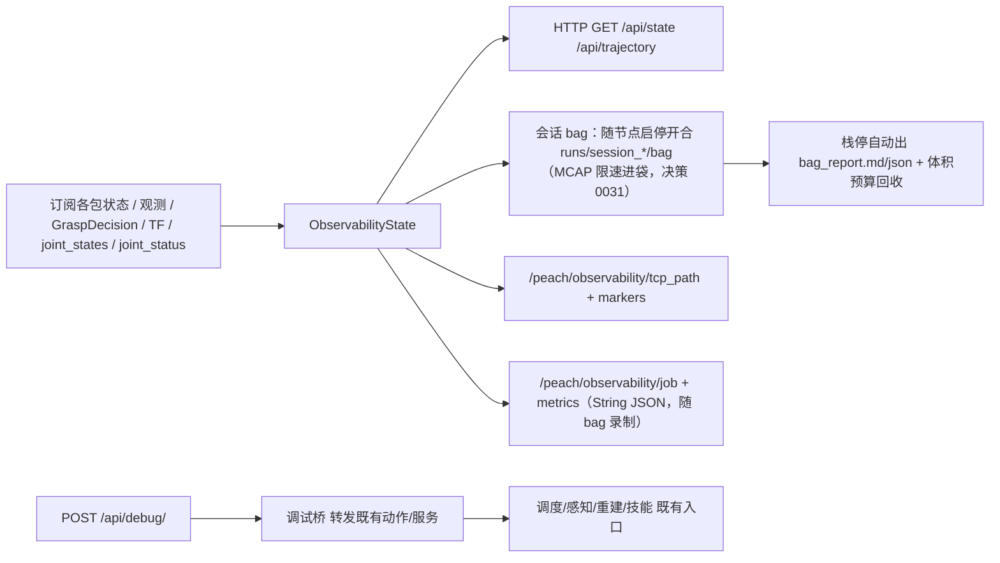

# `peach_observability` io（活文档）

> 当前接口快照。跨包边界在 [peach_bringup/doc/io.md](../../peach_bringup/doc/io.md)。**源码与本文互相更新，改接口须同一轮改另一边**。

**读图：** 状态汇进作业票和末端主平面轨迹；监控页还提供回拍照位和取消操作，调试页可写参数/发业务请求。录制绑定节点启停（决策 0019），不再按批次开合。节点 `main()` 自行 configure/activate。HTTP 调试桥（无令牌；动臂须 `debug.motion_enabled`）是**转发客户端**——目标全部是各包既有动作/服务，技能 ExecutionAuthority 等门照常生效；进入 `debug_command` 的请求（含业务门拒绝）按审计开关写入 `runs/debug_audit/<日期>.jsonl`；JSON 解析等 HTTP 层拒绝不在此审计范围。WS 直接调用 ROS 时不经过该桥或落盘审计。

| 名字 | 种类 | 含义 | 生产 | 消费 |
|------|------|------|------|------|
| `/peach/observability/tcp_path` | topic | latest TF 末端轨迹 nav_msgs/Path（RViz 默认关，避免与 Marker 双绘） | peach_observability | （RViz） |
| `/peach/observability/markers` | topic | TCP 已采样路径/当前点/预抓取→入口轴，与网页主平面同源；不画未走到的首末弦 | peach_observability | （RViz） |
| `/peach/observability/job` | topic | 作业票 String JSON（指纹变化发布） | peach_observability | 会话 bag（`peach_bag_report` 离线消费） |
| `/peach/observability/metrics` | topic | 性能采样 String JSON（1s） | peach_observability | 会话 bag（同上） |
| `/peach/observability/selfcheck_passed` | topic | **启动自检裁决闩锁**（Bool，TL d1；P0 观测性轮新增）。初次（托管栈激活+静置后）与每 30s 周期复检，或 8090 `POST /api/debug/selfcheck` 手动触发；无 FAIL 即 true。检查项全只读：生命周期/控制器/关节序/joint_states 流/TF 对档案/相机探针接收到达率（低率仅 WARN，不拦开批）/move_group/四动作服务端/robot_status（真机）/力话题存在性/磁盘/权重文件/参数一致性/vegetation 在图新鲜度（不在图 SKIP） | peach_observability | peach_bringup（autostart 硬等） |

`selfcheck.force_expected=true` 时仅检查图中 `/force/points` 名称/类型存在；它不核验 `/force/sample` 源帧的新鲜度或五通道状态。实时力门限见后文 `/api/force`。

`vegetation_status` 按 `startup_facts.vegetation_enabled` 判断部署范围：false 明确 SKIP；true 的缺帧或超过 30 s 仍 FAIL；缺省时仅发现实际发布者，订阅者不算启用。harvest_system 固定注入 false，不新增 ROS 参数或 launch 开关。

`diagnostics.nodes[hardware_id].tasks[name]` 保留原 `level/message/values` 结构，并附 `stamp`（源 ROS 秒）、`received_at`（接收 Unix 秒）、`age_s`（monotonic 接收年龄）、`stale`、`reported_level/reported_message`。超过 5 s 的任务投影 `level=3` 与陈旧提示，节点等级取任务最严重值；新帧只恢复对应任务。`diagnostics.stale_after_s=5`、`task_limit=256`、`evicted_tasks` 公开新鲜门、容量与累计淘汰数；同硬件不同任务和不同发布者跨帧合并。

空 `hardware_id` 的启动任务暂显示在 unknown 组，同任务正式硬件身份到达后移除该占位；已知正式身份后忽略同任务迟到的空身份。不同非空硬件 ID 的同名任务不合并，仍分别执行 5 s 陈旧判断。

关节自检按应用冻结顺序逐项比较 `/joint_states.name`，缺失、多余、重复或排列错误均为 FAIL；
状态展示仍按名称关联数值。mock/real 均要求 `joint_state_broadcaster` 与
`dynamic_joint_state_broadcaster` 为 active，另检查各模式原有执行控制器。
两广播器的应用配置与完整动态状态保留方式见 [系统 IO](../../peach_bringup/doc/io.md)。

监控+调试 HTTP（默认 `127.0.0.1:8090`）+ 会话 bag 录制（随栈启停开合。进袋：控制流 20 Hz，PlanningScene 1 Hz。默认 `std` 不订阅相机原流。感知图、观测和点云只在结果关键段约 3 秒、段内 1 Hz。关节、TF 与已下发轨迹全程记录，队列满时不被图像或点云挤掉。只限进袋，不影响实时流）。总览、分析与力页只读；监控页有拍照位/取消操作，调试 POST 无令牌。`debug.enabled` 默认 true（false→503）；运动类另需 `debug.motion_enabled`（默认 false→423）。健康走 `/diagnostics`（W15 双轨 + 2026-09-29 扩充：`session_recorder` 队列/丢帧、`ingest_liveness` 摄入活度、`selfcheck` 裁决；`/diagnostics` 全栈订阅聚合进 `/api/state`）。会话工件（2026-09-29 新增）：`runs/session_*/startup.json`（launch 注入的启动事实：模式/档案/相机/git 提交/域 ID——离线排障回答"当时跑的什么配置"）、`selfcheck.json` + `selfcheck_history.jsonl`（历次自检报告）。

| 参数 | 含义 |
|------|------|
| `host` / `port` | HTTP 监听；默认回环 8090。局域网须显式 `0.0.0.0` |
| `record.enabled` | 会话 bag 录制总开关（默认 true）；关闭后不建额外 bag raw 订阅，状态、图像预览和力帧订阅仍供只读显示 |
| `record.level` | 录制档：`std`=默认，只留关节/TF/已下发轨迹、调度与重建结果；感知图和点云只在结果关键段约 3 秒、段内 1 Hz。不录相机原流、控制器统计、即时检测图和单帧点云。`all`=放开发现白名单且不按感知关键段过滤，但控制流/PlanningScene 等限速与发现排除集仍生效；`core`=仅固定订阅集 |
| `record.max_total_bag_gb` | bag 二进制总量预算（按 1024³ 字节计算，默认 100 GiB；0=禁用回收）：超限按 bag 目录 mtime 从旧到新删已封口的 `session_*/bag` 与旧 `mcap_*`，报告/账本/文本永不删，逐条审计。分析完成后 `retention.purge_analyzed_sessions`（Python API，审计 reason=analyzed_purge；原 `scripts/purge_analyzed_bags.py` 已随 scripts/ 删除）删 MCAP 留 `bag_report` |
| `record.queue_depth` | bag 队列项上限（默认 512）：满时媒体丢自身，其它消息淘汰最旧数据，open/close 屏障不被淘汰；队列丢弃数进 `/api/state` 的 `record.info.drops` |
| `record.save_images` / `record.save_clouds` | 前者控制非 all 档稳定 debug_image 送袋，debug_image_raw 仅 all 送袋；all 不由 save_images 过滤。后者控制固定 TSDF 专用订阅，std/all 的发现订阅仍可能录到同名或其它点云；二者不是所有媒体的全局禁录门。std 媒体仍只留关键段 |
| `trajectory.enabled` | latest TF 采 TCP 轨迹给 Web/RViz（bag 侧由 `/tf` 离线重算，同源） |
| `joint_states_topic` / `joint_status_topic` | 硬件表：实际角/速度与柜侧电流（SDK 原单位）/温度/跟随误差；镜像只在 Web，原始话题随 bag 录制 |
| `debug.enabled` | 普通调试转发与参数写入开关，默认 true；只读 selfcheck 独立受 `selfcheck.enabled` 控制 |
| `debug.motion_enabled` | 运动类放行；默认 false→423 |
| `debug.audit_enabled` | 调试命令与已进入参数桥的写请求落盘 `runs/debug_audit/`，默认开；`debug_command` 的业务门拒绝也记，参数写入在总开关处提前返回的 503 不记 |
| `debug.endpoints.*` | 调试桥目标（19 个既有动作/服务名：15 Service + 4 Action，params.py 默认=现行契约名）。注意 `manage_nodes_service`→`/peach_lifecycle_manager/manage_nodes` 使用 `nav2_msgs/srv/ManageLifecycleNodes`；五条既有命令不变，响应只读取 `success`，不假定有 `message`；服务缺席时 503 |

参数表为改变行为的节选；全量键（`selfcheck.*` 细项、`trajectory.base_frame/tip_frame/period_s/min_step_m/max_points`、`metrics_process_patterns`、`event_buffer_size`、`log_buffer_size`、`param_poll_period_s`、`robot_status_probe_enabled` 等）见 `config/observability.yaml`。

`metrics_process_patterns` 精确匹配执行入口或合法 ROS 节点名，不再把任意 cmdline 子串作为身份。`metrics.sample.processes` 对每个配置名称保留一行；不存在/不可读时 `pid`、`cpu_percent`、`rss_mb` 均为 null，页面显示缺项。宿主多域同名仍取 RSS 最大者，不代表某一 ROS 域或某次 launch 的唯一归属。

`ledger.live` 在调度身份/终态边沿与既有轮询读取；签名为 inode+mtime+size，读失败重试并显示 error。行额外保留可选 `cycle_id`、`scene_epoch`。`job.completion` 只关联同批同目标并核对可用周期/世代身份；缺终局证据显示 pending。终局 outcome 与完成度独立：FAILED/CANCELED/SKIPPED 不标单果成功，L6 撤退不能证明切断，工具仅由 L5/L7 确认，不由当前使能或 tool 阶段耗时推断。`job.empty_batch=true` 表示终态、无目标/在途动作且已读取同批合法空账本，此时 completion 仍为空，显示“批次已结束，未执行目标”；缺文件、读失败或有 claimed 未终局均不算空批次。

HTTP `/api/state` 区段：`perception` / `reconstruction` / `refined` / `manipulation` / `task_executor`（含 `state_seq`/`scene_epoch` 镜像）/ `robot`（含 `tcp` 摘要与 `joints` 六轴）/ `metrics` / `record` / `params` / **`pipeline`**（全流程阶段时序：调度 FSM 与技能周期各一条服务器侧时间线，每次状态转移记一条、段时长=到下一转移的间隔，页面刷新不丢）/ **`ledger`**（批次账本直播：`runs/<request_id>/ledger.json` 按 mtime 增量重读，per-target 结果/原因/失败码/耗时/阶段耗时与总计；`run_id` 即账本目录名）/ **`job`**（当前果实作业票：过程线状态、档位、`why`、感知入口/重建中心/预抓取/抓取进入点，`base_link` 米）/ **`startup`**（启动事实镜像，2026-09-29 起）/ **`selfcheck`**（最近一次自检报告：逐项 pass/warn/fail/skip + 汇总）/ **`diagnostics`**（`/diagnostics` 聚合：按 hardware_id 归组的任务级状态，2026-09-29 起）/ **`logs`**（`/rosout` 有界环，默认 `log_buffer_size` 200 条：`stamp` / `level` / `name` / `msg`，消息截断 400 字；级别数值同 `rcl_interfaces/msg/Log`）/ **`debug`**（`enabled` / `motion_enabled` + 最近操作环形缓冲）。**页面（2026-09-30 web 升级轮）**：事件时间线逐条带 severity 徽标（信息/警告/错误/审计）与事件码中文标签（`begin_scene_failed`→开场景失败等全词表）；`blockers` 红显且中文（`mode_paused`→批次已暂停等五词表）；账本失败码数值映射常量名（0-35，含 TIMEOUT、重建超时与 CUT_FRUIT_CLEARANCE）；SELFCHECK 面板头部附启动事实摘要行（模式/末端/相机/git 短哈希/域）。`reconstruction.grasp_decision` 镜像含 `valid_until`/`model_revision`/`failure_code`（许可有效期倒计时，心跳不续签）。`GET /api/trajectory` 给主平面页（按点列跨度最大两轴投影，不固定俯视）：TCP 点列、起止弦、路标、Marker 字典（绕行比、Δz）。过程页首屏按作业票展示；抓取档关闭时靠近/工具为 gated，不是已完成；其后为阶段时序（FSM/技能两列）、批次账本表（阶段耗时可展开）、感知节拍（fps/检测/分割/几何耗时、掉锚/陈旧锚）与重建进度（机位/拒帧/TF 失败/基线/许可倒计时）、系统负载、参数镜像、自检与诊断（默认展开）。节点日志表读 `logs`：时间、级别、节点、消息；级别是该级及以上（默认 INFO），节点名是包含过滤；滚动条离开底部时不抢滚动。阶段时序按服务器缓冲全量在面板内滚动。机械臂硬件表订 `/joint_states`（角/速度）与 `/aubo_io_controller/joint_status`（电流 SDK 原单位/温度/跟随误差），镜像只在 Web、原始话题随 bag 录制。`POST /api/debug/<action>`：`enabled=false→503`、运动类未放行→`423`、未知端点→`404`、未知 mode/intent/command→`400`。无令牌、无 401。运动类 = RunHarvest 全部档位（含 `SURVEY_ONLY`——会 Survey 移到拍照位，09-18 收紧）、Survey、Execute 非 `PREVIEW`（`OBSERVE_ONLY` 算运动）、`go_to_photo_pose`、arm、ControlTask 的 `RESUME`/`EXIT_MAINTENANCE`。页面只暴露本管线按钮：批次 ControlTask 含 PAUSE/RESUME/SKIP_TARGET/ACK 恢复/CANCEL_NOW（PAUSE 与 CANCEL_NOW 带 `expected_state_seq=0` 不做过期拦截，其余带最新镜像 `state_seq`，过期由调度拒）；ExecuteTarget 组含 `set_execution_armed` 武装/解除（属运动类，照常 423 门）与「取消 Survey/Build/Execute/批次」四键（`POST /api/debug/cancel`，body `{"target": "<动作键>"}`，取消在途动作：无在途 404、等待超时 504）；后端端点清单见 `config/observability.yaml` 的 `debug.endpoints.*`。

| 产物 | 路径 |
|------|------|
| 账本 | `runs/<request_id>/ledger.json` |
| 会话 bag | `runs/session_<YYYYMMDD>_<HHMMSS>/bag/`（`bag_0.mcap` + `metadata.yaml`；节点启动开、关闭收尾，非正常退出可 `ros2 bag reindex` 恢复） |
| 五点力记录 | 当前完整 `/force/sample` 写入会话 bag，core/std/all 均保留；8090 力页只读，不生成接触段。历史 `force/episode_*.csv` + json 及 `index.jsonl` 仅由分析侧兼容读取，不是当前启动必产物 |
| 抓取周期 | 同一会话目录 `cycles/<终局时间>_<target_id>_<身份散列>.json`（调度在账本落盘后写入）：`start/end_unix_ns`、`start/end_ros_ns`、`cycle_id`、`session_id`、阶段时长、`request_id`；旧数据回退时标 `estimated_ledger_mtime`。一次开栈从启动到结束都在这个 `session_<时间>/` 里，分析页不再把其中的 `web_*` / `grasp_*` 账本目录另列一条 |
| 会话报告 | `runs/session_*/bag_report.md` + `bag_report.json`（bag封口后子进程生成；写盘原子tmp+rename。退出默认等30秒，再terminate/kill并回收；超时保留完整bag并明确报错，`ros2 run peach_observability peach_bag_report <bag>`可复跑。子进程继承本轮launch进程组，不遗留后台分析。按request_id还原outcome/阶段耗时/验收门/TCP轨迹；DDS action生成类型从msg命名空间回退action解析，未知类型仅记时间戳） |
| 回收审计 | `runs/retention_audit.jsonl`（逐条记录删除目录/字节数/预算） |
| 重建 session | 同根；含 `geometry.jsonl`（袋底/颈/轴/剪切点/D95/预算/单帧 flags；复算脚本已归档 `_archive/offline_2026-09/`，写入保留）。三维点按 `list[float]` 写，缺失用 `is None` 回退，不得对 ndarray 用 Python `or`（真值歧义会把已积分体积回滚，RViz TSDF Cloud 变空） |

根：工作区 `runs/`（`peach_vision_core.runtime.default_runs_root`）。历史 `_archive/runs/`，不要删。录制生命周期绑定节点启停（决策 0019）：`on_configure` 开会话 bag、`on_shutdown`/`destroy_node` 收尾并自动出报告 + 按预算回收；批次边界由消息自带 `request_id` 还原，不再由记录器开合目录。归档里若有 `approach.jsonl`，那是旧技能状态文件名；`runs/run_*`（9 路 jsonl）是 2026-09-15 前的旧格式，历史数据不迁移。

会话 bag 录制话题（固定订阅集，2026-09-20 起 `record.bag_topics` 键已删、档位由 `record.level` 门控）：`events`、`state`、`scene_snapshot`、`target_observations`（含 mask，只在感知结果关键段）、`harvest_state`、`recon_status`、`recon_diagnostics`、`recon_debug`、`grasp_decision`、`refined_pose`、`refined_axis`、`refined_diagnostics`、`manipulation_status`、`grasp_hypothesis`、`tf`、`tf_static`、`joint_states`、`robot_status`、`joint_status`、`job`、`metrics`、`debug_image`、`debug_image_raw`（后两者受 `record.save_images`，且 `std` 只在关键段）、`tsdf_cloud`（受 `record.save_clouds`，且 `std` 只在关键段）、`rosout`（受 `record.rosout`，默认开）；`scene_snapshot` 落盘订阅用 transient_local（M13：单发闩锁话题，VOLATILE 会在记录节点晚启时永久丢快照）；别名→话题/类型注册表（报告读取侧）见 `observability/bag_reader.py`。`std`/`all` 档另加通配发现订阅域内其余话题，但 `std` 不订阅 `/camera/` 原流，点云话题同样只在关键段进袋。关节、TF 与已下发轨迹不按这段窗口丢弃。报告侧离线重算：作业票/许可合并体照 `observability_node` 镜像逻辑重放，TCP 轨迹由 `/tf`+`/tf_static` 树合成（3mm 静止门槛，同在线采样器）。

## Web 客户端状态（2026-10-12）

静态页面由`peach_web` 提供，入口与 ROS API 不变。另有独立页 `/analysis.html`：从 `runs/` 选择已有测试目录后解析账本、几何和图片，不写入、不改过程监控与单步调试。选中 `session_*` 时连同时间窗内同一次启动的批次目录，显示运动周期完成率、不可达、质量跳过、失败、采摘确认（完成度 7，须切断证据和撤离证据）、单果中位、周期构成和重建拒帧。同一次感知到抓取合成一张表，按轮次分组，每一行是一颗：批次、目标、终局、用时和阶段、完成度、袋径、径向/轴向余量、袋心、袋底、袋口、剪切参考，先显示这一次的掩膜和检测调试图，再是终局和几何。袋心是袋底与袋口中点在 base_link 的 x、y（米）。周期构成从派发该目标画到撤离；阶段条下面用同一条时间轴画五点力，红色是合力上升到峰值，蓝色是峰值之后下降到回到空载，竖线对齐阶段分界。优先读 `cycles/*.json` 与力 sidecar 的真实 unix_ns/ROS ns；同会话且双方源 ROS 时钟完整时按源时刻对齐。旧 `wall_start`/mtime 回退仍可读，但标 `estimated`，不冒充精确测量。多周期重叠有歧义时不强行选最近目标。上升止于五点合力最大的那一帧，下降止于仍不低于 0.08 N 的最后一帧，不含其后的归零等待。多颗共用一份账本、又没有 `cycles/` 时，不把一段力画到平均条上。已有记录没有单独的精化段，再确认之前的差额标为精化等待，不是开批检测。之后的记录保留臂侧非零的观察段和精化段。彩色原图只留在记录目录的 `colors/`，不进分析页。首屏显示自检/诊断/使能摘要与当前作业；作业票内用条形对照沿袋轴的长度和入口/剪切点离原点的距离（`job.analysis`）。顶栏固定当前阶段（批次态、目标阶段、技能周期、目标 id）。硬件与系统/自检/诊断默认展开。节点日志只读，不增加 SetIO 或运动按钮。状态/轨迹请求各自单在途、有限等待；5 s 无新状态或失联时呈现最后快照并暂停普通操作，取消独立。确认框返回后发送前再次核对新鲜度；后退恢复页面会恢复轮询。

单步调试页 `/debug.html` 包含本轮开关、单轮点选、几轮和参数表。单轮点击队列绑定scene_epoch，换场清空旧选择；多轮按当前锁定目标数循环顺序号或PICK_ALL，不跨场景复用已勾选ID。本轮写入、单轮和多轮启动共用五项业务开关装配，逐参数检查accepted并读回；任一207/拒绝/不一致均不发使能。SetEnables检查内层accepted并等待运行期使能反馈。结果失败、取消、恢复等待立即停后续，202/网络未知保留请求身份且不重发；自动ACK与高速成功预设已移除，恢复只能人工确认并带当前state_seq。`debug.enabled`热关闭同样阻断已创建桥的普通POST。参数API沿用标准ROS服务与白名单，页面不增加SetIO，不替代臂侧门。

测试档仅填前端草稿，说明观察、L2预抓取、L6干跑的不同验收口径；证据卡只关联当前请求账本。参数编辑提供搜索、差异、类型与范围；不可用参数只读。参数桥对double额外拒绝NaN与正负Infinity，再校验上下界；仍不暴露白名单之外的参数或新命令通道。

分析页「成功率」读 `GET /api/analysis/success`：一次抓取一条，终局成功且完成度至少 6 算套入完成，完成度至少 7 另计采摘确认。会话 `cycles/*.json` 优先，同一 `request_id` 的账本不重复计。

2026-10-21 记录聚合：runner 输出目录把本轮 `session_*`/`harvest_*`/`round_*` 收进 `output/records/`，分析页只列 `runs/` 顶层的 run report（`report.json`），不再把同一次运行的 session 和 round 分成第二、第三个选项。`/api/analysis` 用 run report 的 `request_id` 关联 `records/` 下的 round 账本（`_related_roots`）；有 run report 的 session 去重；无 `startup.json` 的独立 observability 自会话不列；目录名支持 HHMM（如 `..._20261021_1813`）。所以一跑一条记录，选中后 outcomes/rates/geometry 是整跑聚合；顶层的旧 `round_*` 若已被某个 run report 点名也不再单列。

操作反馈按实际响应区分：`accepted=true` 不等于操作成功，`result.success=false` 显示失败；后端动作 HTTP 202（`result.goal_handle_kept=true`）显示仍在执行，并呈现 `result.message` 中的查询/取消提示；HTTP 504/502/500 或网络异常显示结果未知。POST不自动重发，浏览器等待超时/退出不代表 ROS goal 已取消；在途终态须通过现行状态与取消流程核对。授权仍由后端和臂侧强制，未增加网页授权/SetIO入口。前端测试与浏览器验收方法见 [peach_web README](../../peach_web/README.md)。

## 只读图像与工具三帧（2026-10-13）

`GET /api/images/perception.jpg` 与 `/api/images/raw.jpg` 分别来自现有
`debug_image_topic` / `debug_image_raw_topic`。订阅为 RELIABLE，每流一条，
预览独立于 `record.enabled` / `record.save_images`；同一回调按原记录配置送 bag，
`std` / `all` 通配发现排除这两个共享话题，避免重复订阅与重复落盘。
HTTP 只取缓存 JPEG（最长边 960 px、质量 80），响应为 `image/jpeg`、`no-store`，
`X-Frame-Stamp-Ns` 为原 ROS header 的整数纳秒字符串，`X-Frame-Id` 为原图像帧名，`X-Frame-Age-S` 为响应时按 ROS 时钟计算的帧龄。
无帧、转换失败或 `clock_mismatch` 返回 JSON 404，`error` 明确原因；坏帧会清掉旧 JPEG。

`/api/state.images` 固定含 `perception` / `raw` 两项，每项字段为
`available`、`stamp_sec`、`stamp_ns`（字符串）、`frame_id`、编码后 `width` / `height`、
`error`、`age_s`。无帧时间/年龄为 null；编码失败为 `encode_failed:<原因>`。
年龄使用节点 ROS 时钟与消息 stamp 同一时间域。ROS 时钟回退使帧时间领先 ≥0.1 s 时，
图像与工具 TF 元数据为 `available=false,error=clock_mismatch`，`age_s` 保留负值。超过 1 s 为
`available=false,error=stale`；陈帧 JPEG 仍可读取，页面保留最近帧并标记陈旧。

`/api/trajectory.tool_frames` 固定含 `tool_axis` / `sleeve_mouth` / `cutting_plane`。
后台 TCP 采样器按 tf2 `lookup_transform('base_link', <工具帧>, Time())` 读取 URDF 工具帧，
HTTP 不查询 TF。各项字段为 `available`、`position:[x,y,z]`、
`orientation:[x,y,z,w]`、`stamp_sec`、`frame_id:'base_link'`、`age_s`、`error`。
TF 缺失为 `tf_unavailable:<原因>`，零时间为 `unknown_stamp`，超过 1 s 为 `stale`。
这是 latest TF 的只读新鲜度诊断，不改变重建精确 stamp 积分或运动授权门。

重建参数镜像补充 `capture.require_robot_static`、`capture.static_joint_vel_thresh`、
`capture.joint_state_tolerance_s`、`capture.max_frame_age_s` 与 `refit.max_axis_angle_deg`。
静态脚本与样式按安装目录中的页面文件提供，含 `/vendor/peach-three.js`、`/viz3d.js`、
`/visualization.js`、`/visualization.css`。通用工作台不进 8090。
CSP 维持同源脚本与 `object-src 'none'`，仅图像增加 `blob:` 以显示本地 JPEG 响应。

`grasp_decision` 镜像保留消息的 `frame_id`、`corridor_clear` 以及四项
`geometry_capability/pregrasp_capability/sleeve_capability/cut_capability`；
枚举沿用 TargetModel（0 VALID、1 INVALID、2 UNKNOWN），不从汇总 allowed 推导。
`check_reachability_service` 的 `result` 同时透出并行 `reachable` 与 `error_codes`，
供前端区分预抓取 IK、套入终点 IK 与笛卡尔路径失败；不增加运动端点。
位姿四元数 `w=0` 原值透传，是合法的半圈旋转，不能替换成默认 1。

重建诊断 `diagnostics.refined_context` 是只读来源注记：原始 JSON 的
`target_id` / `harvest_run_id` 存在，且在原始消息到达时与感知 `targets` 批次一致、
目标属于 `observations`、`scene_epoch` 为正整数，才绑定
`{target_id,harvest_run_id,scene_epoch}`。类型化心跳覆盖当前诊断身份时仍保留
原始 refined 的来源身份；感知世代或批次变化后撤去注记，不追溯把新世代贴给旧 JSON。
身份缺失为 unknown，不解析 opaque revision。该注记仅用于 raw refined 诊断显示，
不为旧 pose candidate、模型接受、抓取许可或运动授权提供依据。
图像编码为两流合计全局至多 5 Hz，单工作线程按最近处理次序公平消费每流最新槽。
监控页用独立 200 ms 定时器核对 `stamp_ns`；帧戳未变时不重复下载 JPEG，只更新帧龄文字。
状态与轨迹更新不额外发起 JPEG 请求。首次图像在下一次定时刷新读取；切换来源、恢复图像、
切回相机页或恢复页面可立即读取。暂停、页面隐藏、窄屏切到三维页和销毁时停止拉取。

## 投影单源与前端模块

`perception.targets.observations[].candidate/fitting` 只有非空目标身份且与外层
`target_id` 一致时才投影为对象，否则为 JSON `null`；数组形式的候选/拟合则排除
空身份项。ROS 默认嵌套消息的 `status=0` 不代表已经取得 ACCEPT 证据。
有身份的 `ACCEPT=0`、零点数和零有效深度比例保留原值；BagFitting 中约定的
负值无效标量及非有限值转为 `null`。`anchor_from_memory` 仍保留历史关键点，
但其未测的置信度、相机距离、袋径和行程为 `null`，Web 标注“记忆锚点 · 无本帧拟合”，
三维按诊断几何绘制；不将新观测消息的时间戳当成历史锚点的测量时间。
这些投影只解释已有身份和诊断标记，不影响 ROS 原消息或许可门。

原始精化来源绑定及 typed/raw/decision 合并由 pipeline.py 完成，ROS 回调仅接线。身份未知、旧模型及模型年龄不能因新诊断心跳而更新成可执行。静态模块（如 `/ui-common.js`、`/monitor-renderers.js`、`/trajectory-renderers.js`）从 peach_web 安装目录按扩展名提供。Snapshot READY、页面 allowed 与臂侧授权不能相互替代。

`reconstruction.grasp_decision`镜像保留生产消息的完整模型身份（含`scene_epoch`、`calibration_revision`和`config_revision`）及独立能力原值。能力枚举`0=VALID`、`1=INVALID`、`2=UNKNOWN`；不得将零解释为未发布或以汇总`allowed`伪造各能力。

## 原子力帧与记录收尾（2026-10-23）

`/force/sample` 为 `peach_interfaces/ForceSample`：完整5通道数值/状态、源UUID、序号及主机ROS接收/解码时刻。core/std/all全部录此流；旧四force话题在std/all兼容录入。`/force/`显式排除感知媒体分类，数值array/固定数组在离线读取时保留。固定订阅、job/metrics与通配发现分配唯一写袋所有权，避免CanonicalEvent等重复写入。

`GET /api/force` 的 `age_s` 取接收帧龄与源 `header.stamp` 帧龄的较大值；超过 1.5 s 返回 `available=false, error=stale`，无帧返回 `error=no_frame`。接收或源时间超前当前 ROS 时间至少 0.1 s 时返回 `available=false, error=clock_mismatch`，不把未来帧钳成零龄。HTTP 在线不表示力源在线。五点力页断线/陈旧时清除当前读数与 CoP；投影停流时按 1.5 s 门限清除，不等待请求超时，切换视场不恢复旧帧；总览同步标记力数据陈旧。

Recorder 以 session.json 声明 active/closing/sealed/error 及写者 PID/启动身份；close 先关闭接收门，open/close 控制项不可被数据淘汰。只有写者成功 close 且线程退出才返回报告目录；超时或错误不自动分析仍在写的 bag。会话状态不是机器人授权通道。当前力页只读最新原子力帧，不创建接触段、partial journal 或手动记录；分析页继续兼容已有 sidecar，不从 bag 自动生成这些文件。

Recorder 的状态快照包含 `open_failed`、`write_errors`、`close_error`；`session_recorder` 诊断按这些错误报告 ERROR，队列 `drops>0` 或尚未打开 bag 报告 WARN。`retention_audit.jsonl` 每次删除使用同一 `operation_id` 关联 `phase=intent` 与 `phase=deleted/delete_failed`；只有意图成功刷盘才允许删除，意图写入失败会保留原 bag。完成记录写入失败时告警，已有 intent 仍可追溯，不能把单独 intent 当成删除成功。

`record.info.written` 为成功返回的 bag 写入数，`dropped` 为已接受录制但未写入的消息数（队列淘汰 + 写失败/未打开），既有 `drops` 仍只计队列淘汰。主动限速与媒体过滤不计入这些丢弃数。最终 `session.json` 持久化这些计数以及 `write_errors/open_failed/close_error/sealed`；关闭失败为 error，等待超时而线程未完成时保留 closing，随后由写线程刷新最终结果。存在会话目录的打开失败也保留 error 工件；无法创建目录的失败仍以日志和诊断报告。

录制的类型名保留生成消息的真实命名空间：普通消息为 `pkg/msg/Type`，动作反馈为 `pkg/action/Action_FeedbackMessage`，服务生成消息为 `pkg/srv/Service_Event` 等。旧 bag 的动作反馈 `pkg/msg/Action_FeedbackMessage` 继续兼容读取。Jazzy rosbag2_cpp 0.26.11 对动作反馈及 GoalStatusArray 仍可能记录空 schema 并告警；正确类型的 CDR 需在已安装相同接口的环境中标准读回，不能据写入计数声称 bag 可独立于接口定义解析。

`robot.tcp` 摘要按实际保留的点集缓存几何，未收新点的重复读取不重算整条路径；TF 可用性/失败数和返回值隔离不受缓存影响。新点、截头、换目标或换批清空后重新计算；同位置但时间或阶段变化而被保留的点也更新末点时间与姿态。

HTTP 与 ROS Web 状态快照中的 `record.info` 每次读取当前记录器状态，`topic_age_s['record.info']=0` 表示本次读取取得的快照，不能代替 `sealed` 或错误字段判断录制完整性。计数读取不触发逐帧状态更新或增加状态 revision。关闭后保留最终快照及单一读取器，覆盖迟后封口；新会话 configure 时替换读取器。

参数白名单提供 `peach_supervisor.action_timeout_s`（1–180秒），与 Build 启动等待、臂单段轨迹执行等待分开显示。它是实际动作等待节点参数；RunHarvest 的 `per_target_timeout_s` 是请求字段，不能作为同名节点 YAML 覆盖替代。超时取消后仍按 action/账本终态判定，L6+CANCELED 不计成功。

`peach_arm.moveit.approach_clearance_m` 是仅机械臂轨迹使用的额外后退距离，单位米，范围 0–0.20。转移终点相对视觉/模型预抓取沿套入反方向后退；它不修改视觉预抓取、共享 `grasp_standoffs.yaml` 或重建输出。参数标记 `motion=true`，沿用 `debug.motion_enabled` 写入门与臂运行中拒改机制；空闲时读回实际生效值。0 表示不额外后退，原预抓取基准仍存在。

Web 不再单独编辑臂侧 `mtc_approach_along_axis_m`，避免让共享视觉预抓取基准与臂计算分离；轨迹偏移只调 `approach_clearance_m`。速度面板区分接近转移的 `velocity_scaling` 和套入/撤退的 `approach_near_velocity_scaling`。删除走廊后不再使用的 `acceleration_scaling` 仅保留 ROS 配置兼容，不列入 Web 写入白名单；当前 MTC 加速度随对应速度因子按 `min(1,2v)` 计算。自由空间转移另用仍有效的 `transit_acceleration_scaling`。

观测节点 cleanup 不撤销已声明参数；同一 Node 再次 configure 复用原 listener 与实时快照，回调数量不随重配增长。未配置期间的合法参数更新会在下次 configure 使用；涉及端口、话题或定时器的参数仍按资源创建时机生效。

`~/web_state`（1 Hz）、`~/web_force` 和 `~/web_trajectory`（4 Hz）在有订阅者时发布 std_msgs/msg/String JSON，分别复用 snapshot、force 和 trajectory。QoS 为 reliable、volatile、depth1。三个投影不重复录包。`GET /api/transport` 返回 default、url、groups、endpoints 和 topics。整栈启用桥时 default 为 rosbridge，关闭桥或独立运行 observability 时为 http。显式 `?transport=http` 走 HTTP。WS 操作由目标节点和臂侧命令门校验，HTTP 调试门和审计覆盖 HTTP 请求。

8090 的 `/vendor/ros2-web-link.js`、`/vendor/ros2-web-link-LICENSE.txt` 和 `/vendor/THIRD_PARTY_NOTICES.txt` 读取已安装依赖的 SDK 和许可。缺少已构建的 SDK 时脚本 URL 返回 503，HTTP 页面仍可读取。

`POST /api/params` 在每项写入前核对调试门，运动类另读当前 `debug.motion_enabled`。本批关闭总开关后，剩余项标为 `outcome=not_sent`。远端写入超时或无法取得单项结果时返回 504，保留已确认的 `accepted_count` 和各行结果，当前项标为 `unknown`，后续项为 `not_sent`。确认状态须重新读参。

`POST /api/debug/arm_service` 的 `data` 和 `set_enables_service` 的 `execution/grasp/tool` 只接受 JSON 布尔值，省略时为 false。字符串、数字或 null 被拒绝。三项使能仍按 execution → grasp → tool 的依赖关系校验。

预算回收与分析后清理只处理记录根内已封口的 bag。当会话带 `session.json` 时须为 sealed，旧格式由 rosbag2 的 `metadata.yaml` 确认已关闭。自动报告保护自身输入和调用方指定的保留目录。

### 目标、批次与读取边界（2026-11-05 补审）

作业票已经选定 `target_id` 时，只使用该目标的感知观测；当前帧缺少它就保留目标身份并将感知坐标留空，不借用另一颗的 selected/首项观测。没有任何选定 ID 的旧输入仍可从 selected/首项建立作业票。每帧的多个淘汰目标使用不同的 Marker `(ns, id)`，选中目标既有的键保持；帧首 `DELETEALL` 清除上一帧显示。

bag 报告的全局 outcome 表和 succeeded 验收计数按 `(request_id, target_id)` 分组，避免新批次重用 `target_1` 时覆盖上一批结果或跨批计算耗时。每行保留 `request_id`；旧事件缺少该字段时归入空 request 的旧格式范围，不能凭目标名还原不存在的批次身份。离线 TF 保留合法四元数 `w=0`，仅缺少 w 字段时默认 1；仍采用报告既有的 latest 边镜像，不声称曝光时刻插值或标定精度。

`report.json` 的 `rounds[].request_id` 仅作为同级记录目录名，先去除首尾空白，再拒绝路径分隔符、`.`/`..`；解析后的符号链接目标必须留在记录根内，且不能指向记录根本身。越界或根别名引用忽略，不读取其账本/几何，避免一次 round 引用扩展成整根聚合。已有 `output/records/` 的递归聚合保持。逐果几何只按同一 `(batch, target_id)` 关联；缺少本批几何时显示缺项，不回填另一批同名目标。两侧都没有 batch 的旧记录仍可彼此匹配。

调试桥保留每个动作端点最近的目标句柄。旧请求终态返回时，仅当注册表仍指向它自己的句柄才移除；较新请求的取消入口不会被旧成功/取消终态误删。结果异常仍由既有 HTTP 错误处理呈现，结果等待超时仍保留句柄；本地等待结束不代表远端已停止。

空批次的 `empty_batch` 仅表示未执行目标，不抹掉批次终局：COMPLETED 显示“批次已结束，未执行目标”；INTERRUPTED 保留原失败/取消原因和失败状态，只将未执行的靠近、工具、撤离标为 skipped。
