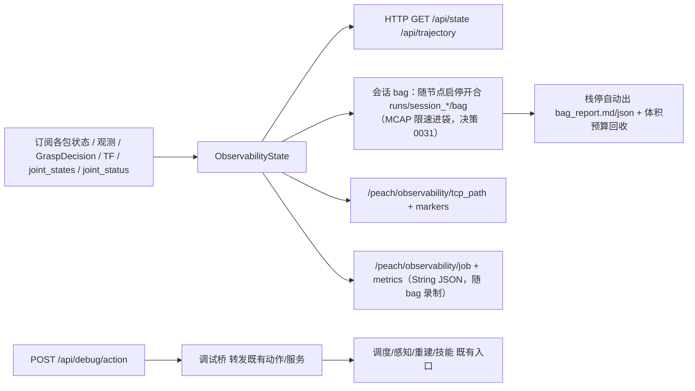

# `peach_observability` io（v1 活文档）

> 2026-10-10 用户裁定自仓库级 `docs/io.md` 拆写入包。跨包边界在 [peach_bringup/doc/io.md](../../peach_bringup/doc/io.md)。**源码与本文互相更新，改接口须同一轮改另一边**。

**读图：** 过程页只收不发。状态汇进作业票和末端主平面轨迹；录制绑定节点启停（决策 0019），不再按批次开合。节点 `main()` 自行 configure/activate。调试 POST（无令牌；动臂须 `debug.motion_enabled`）是**纯转发客户端**——目标全部是各包既有动作/服务，技能 ExecutionAuthority 等门照常生效；每次操作（含被拒）审计落 `runs/debug_audit/<日期>.jsonl`。

| 名字 | 种类 | 含义 | 生产 | 消费 |
|------|------|------|------|------|
| `/peach/observability/tcp_path` | topic | latest TF 末端轨迹 nav_msgs/Path（RViz 默认关，避免与 Marker 双绘） | peach_observability | （RViz） |
| `/peach/observability/markers` | topic | TCP 已采样路径/当前点/预抓取→入口轴，与网页主平面同源；不画未走到的首末弦 | peach_observability | （RViz） |
| `/peach/observability/job` | topic | 作业票 String JSON（指纹变化发布） | peach_observability | 会话 bag（`peach_bag_report` 离线消费） |
| `/peach/observability/metrics` | topic | 性能采样 String JSON（1s） | peach_observability | 会话 bag（同上） |
| `/peach/observability/selfcheck_passed` | topic | **启动自检裁决闩锁**（Bool，TL d1；P0 观测性轮新增）。初次（托管栈激活+静置后）与每 30s 周期复检，或 8090 `POST /api/debug/selfcheck` 手动触发；无 FAIL 即 true。检查项全只读：生命周期/控制器/关节序/joint_states 流/TF 对档案/相机探针接收到达率（低率仅 WARN，不拦开批）/move_group/四动作服务端/robot_status（真机）/IMU/磁盘/权重文件/参数一致性/vegetation 在图新鲜度（不在图 SKIP） | peach_observability | peach_bringup（autostart 硬等） |

监控+调试 HTTP（默认 `127.0.0.1:8090`）+ 会话 bag 录制（随栈启停开合；2026-09-24 起进袋限速三族：控制流 20 Hz／PlanningScene 1 Hz／感知派生 2 Hz，决策 0031，只限进袋不影响实时流）。过程页只订不发；调试 POST 无令牌。`debug.enabled` 默认 true（false→503）；运动类另需 `debug.motion_enabled`（默认 false→423）。健康走 `/diagnostics`（W15 双轨 + 2026-09-29 扩充：`session_recorder` 队列/丢帧、`ingest_liveness` 摄入活度、`selfcheck` 裁决；`/diagnostics` 全栈订阅聚合进 `/api/state`）。会话工件（2026-09-29 新增）：`runs/session_*/startup.json`（launch 注入的启动事实：模式/档案/相机/git 提交/域 ID——离线排障回答"当时跑的什么配置"）、`selfcheck.json` + `selfcheck_history.jsonl`（历次自检报告）。

| 参数 | 含义 |
|------|------|
| `host` / `port` | HTTP 监听；默认回环 8090。局域网须显式 `0.0.0.0` |
| `record.enabled` | 会话 bag 录制总开关（默认 true；关则不建录制订阅） |
| `record.level` | 录制档：`std`=通配发现全话题+相机 raw 限 1Hz（默认）；`all`=相机 raw 不限速（限速族仍生效，决策 0031）；`core`=仅固定订阅集（镜像订阅+派生 job/metrics） |
| `record.max_total_bag_gb` | bag 二进制总量预算（GB，默认 100；0=禁用回收）：超限从最旧删 `session_*/bag` 与旧 `mcap_*`，报告/账本/文本永不删，逐条审计。分析完成后 `retention.purge_analyzed_sessions`（Python API，审计 reason=analyzed_purge；原 `scripts/purge_analyzed_bags.py` 已随 scripts/ 删除）删 MCAP 留 `bag_report` |
| `record.queue_depth` | bag 写队列深度上限（默认 512）：盘速掉队时丢最旧保最新，丢帧计数进 `/api/state` 的 `record.info.drops` |
| `record.save_images` / `record.save_clouds` | 调试图/TSDF 点云进 bag 的门控（键名沿用，语义已从「落 jpg/ply 文件」改为「进 bag」） |
| `trajectory.enabled` | latest TF 采 TCP 轨迹给 Web/RViz（bag 侧由 `/tf` 离线重算，同源） |
| `joint_states_topic` / `joint_status_topic` | 硬件表：实际角/速度与柜侧电流（SDK 原单位）/温度/跟随误差；镜像只在 Web，原始话题随 bag 录制 |
| `debug.enabled` | 调试 POST 总开关；默认 true |
| `debug.motion_enabled` | 运动类放行；默认 false→423 |
| `debug.audit_enabled` | 审计落盘 `runs/debug_audit/`；默认开（含被拒，含 `enabled=false` 的 503） |
| `debug.endpoints.*` | 调试桥目标（18 个既有动作/服务名，params.py 默认=现行契约名）。注意 `manage_nodes_service`→`/peach_lifecycle_manager/manage_nodes` 使用 `nav2_msgs/srv/ManageLifecycleNodes`；五条既有命令不变，响应只读取 `success`，不假定有 `message`；服务缺席时 503 |
| `record_bag`（launch 参数） | observability.launch 另有旁路录制通道：`record_bag:=true` 时 include `record_bag.launch.py` 起独立 `ros2 bag record -s mcap` 进程，只录 `/peach_supervisor/state`+`/peach_supervisor/events`，输出 `runs/session_bag`（与体积预算的旧 `mcap_*` 回收衔接） |

参数表为改变行为的节选；全量键（`selfcheck.*` 细项、`trajectory.base_frame/tip_frame/period_s/min_step_m/max_points`、`metrics_process_patterns`、`event_buffer_size`、`log_buffer_size`、`param_poll_period_s`、`robot_status_probe_enabled` 等）见 `config/observability.yaml`。

HTTP `/api/state` 区段：`perception` / `reconstruction` / `refined` / `manipulation` / `task_executor`（含 `state_seq`/`scene_epoch` 镜像）/ `robot`（含 `tcp` 摘要与 `joints` 六轴）/ `metrics` / `record` / `params` / **`pipeline`**（全流程阶段时序：调度 FSM 与技能周期各一条服务器侧时间线，每次状态转移记一条、段时长=到下一转移的间隔，页面刷新不丢）/ **`ledger`**（批次账本直播：`runs/<request_id>/ledger.json` 按 mtime 增量重读，per-target 结果/原因/失败码/耗时/阶段耗时与总计；`run_id` 即账本目录名）/ **`job`**（当前果实作业票：过程线状态、档位、`why`、感知入口/重建中心/预抓取/抓取进入点，`base_link` 米）/ **`startup`**（启动事实镜像，2026-09-29 起）/ **`selfcheck`**（最近一次自检报告：逐项 pass/warn/fail/skip + 汇总）/ **`diagnostics`**（`/diagnostics` 聚合：按 hardware_id 归组的任务级状态，2026-09-29 起）/ **`logs`**（`/rosout` 有界环，默认 `log_buffer_size` 200 条：`stamp` / `level` / `name` / `msg`，消息截断 400 字；级别数值同 `rcl_interfaces/msg/Log`）/ **`debug`**（`enabled` / `motion_enabled` + 最近操作环形缓冲）。**页面（2026-09-30 web 升级轮）**：事件时间线逐条带 severity 徽标（信息/警告/错误/审计）与事件码中文标签（`begin_scene_failed`→开场景失败等全词表）；`blockers` 红显且中文（`mode_paused`→批次已暂停等五词表）；账本失败码数值映射常量名（0-23，含 21 TRANSIT_FAILED/22 START_NOT_READY/23 CANCELED）；SELFCHECK 面板头部附启动事实摘要行（模式/末端/相机/git 短哈希/域）。`reconstruction.grasp_decision` 镜像含 `valid_until`/`model_revision`/`failure_code`（许可有效期倒计时，心跳不续签）。`GET /api/trajectory` 给主平面页（按点列跨度最大两轴投影，不固定俯视）：TCP 点列、起止弦、路标、Marker 字典（绕行比、Δz）。过程页首屏按作业票展示；抓取档关闭时靠近/工具为 gated，不是已完成；其后为阶段时序（FSM/技能两列）、批次账本表（阶段耗时可展开）、感知节拍（fps/检测/分割/几何耗时、掉锚/陈旧锚）与重建进度（机位/拒帧/TF 失败/基线/许可倒计时）、系统负载、参数镜像、自检与诊断（默认展开）。节点日志表读 `logs`：时间、级别、节点、消息；级别是该级及以上（默认 INFO），节点名是包含过滤；滚动条离开底部时不抢滚动。阶段时序按服务器缓冲全量在面板内滚动。机械臂硬件表订 `/joint_states`（角/速度）与 `/aubo_io_controller/joint_status`（电流 SDK 原单位/温度/跟随误差），镜像只在 Web、原始话题随 bag 录制。`POST /api/debug/<action>`：`enabled=false→503`、运动类未放行→`423`、未知端点→`404`、未知 mode/intent/command→`400`。无令牌、无 401。运动类 = RunHarvest 全部档位（含 `SURVEY_ONLY`——会 Survey 移到拍照位，09-18 收紧）、Survey、Execute 非 `PREVIEW`（`OBSERVE_ONLY` 算运动）、`go_to_photo_pose`、arm、ControlTask 的 `RESUME`/`EXIT_MAINTENANCE`。页面只暴露本管线按钮：批次 ControlTask 含 PAUSE/RESUME/SKIP_TARGET/ACK 恢复/CANCEL_NOW（PAUSE 与 CANCEL_NOW 带 `expected_state_seq=0` 不做过期拦截，其余带最新镜像 `state_seq`，过期由调度拒）；ExecuteTarget 组含 `set_execution_armed` 武装/解除（属运动类，照常 423 门）与「取消 Survey/Build/Execute/批次」四键（`POST /api/debug/cancel`，body `{"target": "<动作键>"}`，取消在途动作：无在途 404、等待超时 504）；后端端点清单见 `config/observability.yaml` 的 `debug.endpoints.*`。

| 产物 | 路径 |
|------|------|
| 账本 | `runs/<request_id>/ledger.json` |
| 会话 bag | `runs/session_<YYYYMMDD>_<HHMMSS>/bag/`（`bag_0.mcap` + `metadata.yaml`；节点启动开、关闭收尾，非正常退出可 `ros2 bag reindex` 恢复） |
| 会话报告 | `runs/session_*/bag_report.md` + `bag_report.json`（停栈自动生成；写盘原子 tmp+rename，停栈窗内未完成则留「无新报告」而非半份，`ros2 run peach_observability peach_bag_report <bag>` 可复跑；observability 进程 SIGTERM 窗放宽至 60s 对齐报告线程；按 request_id 分批还原 outcome/阶段耗时/验收门对照/TCP 轨迹；回读对 DDS 侧按 msg 命名空间登记的 action 生成类型（如 `msg/RunHarvest_FeedbackMessage`）回退 action 命名空间解析，仍未知类型折叠为仅时间戳，不断整份报告） |
| 回收审计 | `runs/retention_audit.jsonl`（逐条记录删除目录/字节数/预算） |
| 重建 session | 同根；含 `geometry.jsonl`（袋底/颈/轴/剪切点/D95/预算/单帧 flags；复算脚本已归档 `_archive/offline_2026-09/`，写入保留）。三维点按 `list[float]` 写，缺失用 `is None` 回退，不得对 ndarray 用 Python `or`（真值歧义会把已积分体积回滚，RViz TSDF Cloud 变空） |

根：工作区 `runs/`（`peach_harvester.vision.common.runtime.default_runs_root`）。历史 `_archive/runs/`，不要删。录制生命周期绑定节点启停（决策 0019）：`on_configure` 开会话 bag、`on_shutdown`/`destroy_node` 收尾并自动出报告 + 按预算回收；批次边界由消息自带 `request_id` 还原，不再由记录器开合目录。归档里若有 `approach.jsonl`，那是旧技能状态文件名；`runs/run_*`（9 路 jsonl）是 2026-09-15 前的旧格式，历史数据不迁移。

会话 bag 录制话题（固定订阅集，2026-09-20 起 `record.bag_topics` 键已删、档位由 `record.level` 门控）：`events`、`state`、`scene_snapshot`、`target_observations`（含 mask）、`harvest_state`、`recon_status`、`recon_diagnostics`、`recon_debug`、`grasp_decision`、`refined_pose`、`refined_axis`、`refined_diagnostics`、`manipulation_status`、`grasp_hypothesis`、`tf`、`tf_static`、`joint_states`、`robot_status`、`joint_status`、`job`、`metrics`、`debug_image`、`debug_image_raw`（后两者受 `record.save_images`）、`tsdf_cloud`（受 `record.save_clouds`）、`rosout`（受 `record.rosout`，默认开）；`scene_snapshot` 落盘订阅用 transient_local（M13：单发闩锁话题，VOLATILE 会在记录节点晚启时永久丢快照）；别名→话题/类型注册表（报告读取侧）见 `observability/bag_reader.py`。`std`/`all` 档另加通配发现订阅域内其余话题。报告侧离线重算：作业票/许可合并体照 `observability_node` 镜像逻辑重放，TCP 轨迹由 `/tf`+`/tf_static` 树合成（3mm 静止门槛，同在线采样器）。

## Web 客户端状态（2026-10-12）

静态页面由顶层 `peach_web` 提供，入口与 ROS API 不变。首屏显示自检/诊断/使能摘要与当前作业；顶栏固定当前阶段（批次态、目标阶段、技能周期、目标 id）。硬件与系统/自检/诊断默认展开。节点日志只读，不增加 SetIO 或运动按钮。状态/轨迹请求各自单在途、有限等待；5 s 无新状态或失联时呈现最后快照并暂停普通操作，取消独立。确认框返回后发送前再次核对新鲜度；后退恢复页面会恢复轮询。

操作反馈按实际响应区分：`accepted=true` 不等于操作成功，`result.success=false` 显示失败；后端动作 HTTP 202（`result.goal_handle_kept=true`）显示仍在执行，并呈现 `result.message` 中的查询/取消提示；HTTP 504/502/500 或网络异常显示结果未知。POST不自动重发，浏览器等待超时/退出不代表 ROS goal 已取消；在途终态须通过现行状态与取消流程核对。授权仍由后端和臂侧强制，未增加网页授权/SetIO入口。前端测试与浏览器验收方法见 [peach_web README](../../../peach_web/README.md)。
