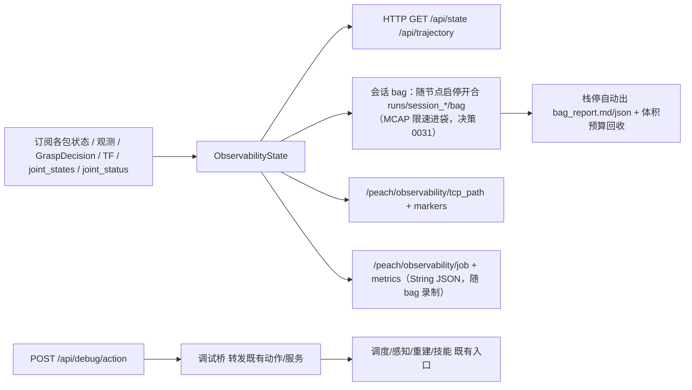

# `peach_observability` io（活文档）

> 当前接口快照。跨包边界在 [peach_bringup/doc/io.md](../../peach_bringup/doc/io.md)。**源码与本文互相更新，改接口须同一轮改另一边**。

**读图：** 过程页只收不发。状态汇进作业票和末端主平面轨迹；录制绑定节点启停（决策 0019），不再按批次开合。节点 `main()` 自行 configure/activate。调试 POST（无令牌；动臂须 `debug.motion_enabled`）是**纯转发客户端**——目标全部是各包既有动作/服务，技能 ExecutionAuthority 等门照常生效；每次操作（含被拒）审计落 `runs/debug_audit/<日期>.jsonl`。

| 名字 | 种类 | 含义 | 生产 | 消费 |
|------|------|------|------|------|
| `/peach/observability/tcp_path` | topic | latest TF 末端轨迹 nav_msgs/Path（RViz 默认关，避免与 Marker 双绘） | peach_observability | （RViz） |
| `/peach/observability/markers` | topic | TCP 已采样路径/当前点/预抓取→入口轴，与网页主平面同源；不画未走到的首末弦 | peach_observability | （RViz） |
| `/peach/observability/job` | topic | 作业票 String JSON（指纹变化发布） | peach_observability | 会话 bag（`peach_bag_report` 离线消费） |
| `/peach/observability/metrics` | topic | 性能采样 String JSON（1s） | peach_observability | 会话 bag（同上） |
| `/peach/observability/selfcheck_passed` | topic | **启动自检裁决闩锁**（Bool，TL d1；P0 观测性轮新增）。初次（托管栈激活+静置后）与每 30s 周期复检，或 8090 `POST /api/debug/selfcheck` 手动触发；无 FAIL 即 true。检查项全只读：生命周期/控制器/关节序/joint_states 流/TF 对档案/相机探针接收到达率（低率仅 WARN，不拦开批）/move_group/四动作服务端/robot_status（真机）/IMU/磁盘/权重文件/参数一致性/vegetation 在图新鲜度（不在图 SKIP） | peach_observability | peach_bringup（autostart 硬等） |

监控+调试 HTTP（默认 `127.0.0.1:8090`）+ 会话 bag 录制（随栈启停开合。进袋：控制流 20 Hz，PlanningScene 1 Hz。默认 `std` 不订阅相机原流。感知图、观测和点云只在结果关键段约 3 秒、段内 1 Hz。关节、TF 与已下发轨迹全程记录，队列满时不被图像或点云挤掉。只限进袋，不影响实时流）。过程页只订不发；调试 POST 无令牌。`debug.enabled` 默认 true（false→503）；运动类另需 `debug.motion_enabled`（默认 false→423）。健康走 `/diagnostics`（W15 双轨 + 2026-09-29 扩充：`session_recorder` 队列/丢帧、`ingest_liveness` 摄入活度、`selfcheck` 裁决；`/diagnostics` 全栈订阅聚合进 `/api/state`）。会话工件（2026-09-29 新增）：`runs/session_*/startup.json`（launch 注入的启动事实：模式/档案/相机/git 提交/域 ID——离线排障回答"当时跑的什么配置"）、`selfcheck.json` + `selfcheck_history.jsonl`（历次自检报告）。

| 参数 | 含义 |
|------|------|
| `host` / `port` | HTTP 监听；默认回环 8090。局域网须显式 `0.0.0.0` |
| `record.enabled` | 会话 bag 录制总开关（默认 true；关则不建录制订阅） |
| `record.level` | 录制档：`std`=默认，只留关节/TF/已下发轨迹、调度与重建结果；感知图和点云只在结果关键段约 3 秒、段内 1 Hz。不录相机原流、控制器统计、即时检测图和单帧点云。`all`=全部话题且不按关键段丢弃；`core`=仅固定订阅集 |
| `record.max_total_bag_gb` | bag 二进制总量预算（GB，默认 100；0=禁用回收）：超限从最旧删 `session_*/bag` 与旧 `mcap_*`，报告/账本/文本永不删，逐条审计。分析完成后 `retention.purge_analyzed_sessions`（Python API，审计 reason=analyzed_purge；原 `scripts/purge_analyzed_bags.py` 已随 scripts/ 删除）删 MCAP 留 `bag_report` |
| `record.queue_depth` | bag 写队列深度上限（默认 512）：盘速掉队时丢最旧保最新，丢帧计数进 `/api/state` 的 `record.info.drops` |
| `record.save_images` / `record.save_clouds` | 感知图与 TSDF 点云允许进 bag。`std` 下仍只在感知结果关键段留样，不把整段图像或点云写入 |
| `trajectory.enabled` | latest TF 采 TCP 轨迹给 Web/RViz（bag 侧由 `/tf` 离线重算，同源） |
| `joint_states_topic` / `joint_status_topic` | 硬件表：实际角/速度与柜侧电流（SDK 原单位）/温度/跟随误差；镜像只在 Web，原始话题随 bag 录制 |
| `debug.enabled` | 调试 POST 总开关；默认 true |
| `debug.motion_enabled` | 运动类放行；默认 false→423 |
| `debug.audit_enabled` | 审计落盘 `runs/debug_audit/`；默认开（含被拒，含 `enabled=false` 的 503） |
| `debug.endpoints.*` | 调试桥目标（18 个既有动作/服务名，params.py 默认=现行契约名）。注意 `manage_nodes_service`→`/peach_lifecycle_manager/manage_nodes` 使用 `nav2_msgs/srv/ManageLifecycleNodes`；五条既有命令不变，响应只读取 `success`，不假定有 `message`；服务缺席时 503 |
| `record_bag`（launch 参数） | observability.launch 另有旁路录制通道：`record_bag:=true` 时 include `record_bag.launch.py` 起独立 `ros2 bag record -s mcap` 进程，只录 `/peach_supervisor/state`+`/peach_supervisor/events`，输出 `runs/session_bag`（与体积预算的旧 `mcap_*` 回收衔接） |

参数表为改变行为的节选；全量键（`selfcheck.*` 细项、`trajectory.base_frame/tip_frame/period_s/min_step_m/max_points`、`metrics_process_patterns`、`event_buffer_size`、`log_buffer_size`、`param_poll_period_s`、`robot_status_probe_enabled` 等）见 `config/observability.yaml`。

HTTP `/api/state` 区段：`perception` / `reconstruction` / `refined` / `manipulation` / `task_executor`（含 `state_seq`/`scene_epoch` 镜像）/ `robot`（含 `tcp` 摘要与 `joints` 六轴）/ `metrics` / `record` / `params` / **`pipeline`**（全流程阶段时序：调度 FSM 与技能周期各一条服务器侧时间线，每次状态转移记一条、段时长=到下一转移的间隔，页面刷新不丢）/ **`ledger`**（批次账本直播：`runs/<request_id>/ledger.json` 按 mtime 增量重读，per-target 结果/原因/失败码/耗时/阶段耗时与总计；`run_id` 即账本目录名）/ **`job`**（当前果实作业票：过程线状态、档位、`why`、感知入口/重建中心/预抓取/抓取进入点，`base_link` 米）/ **`startup`**（启动事实镜像，2026-09-29 起）/ **`selfcheck`**（最近一次自检报告：逐项 pass/warn/fail/skip + 汇总）/ **`diagnostics`**（`/diagnostics` 聚合：按 hardware_id 归组的任务级状态，2026-09-29 起）/ **`logs`**（`/rosout` 有界环，默认 `log_buffer_size` 200 条：`stamp` / `level` / `name` / `msg`，消息截断 400 字；级别数值同 `rcl_interfaces/msg/Log`）/ **`debug`**（`enabled` / `motion_enabled` + 最近操作环形缓冲）。**页面（2026-09-30 web 升级轮）**：事件时间线逐条带 severity 徽标（信息/警告/错误/审计）与事件码中文标签（`begin_scene_failed`→开场景失败等全词表）；`blockers` 红显且中文（`mode_paused`→批次已暂停等五词表）；账本失败码数值映射常量名（0-23，含 21 TRANSIT_FAILED/22 START_NOT_READY/23 CANCELED）；SELFCHECK 面板头部附启动事实摘要行（模式/末端/相机/git 短哈希/域）。`reconstruction.grasp_decision` 镜像含 `valid_until`/`model_revision`/`failure_code`（许可有效期倒计时，心跳不续签）。`GET /api/trajectory` 给主平面页（按点列跨度最大两轴投影，不固定俯视）：TCP 点列、起止弦、路标、Marker 字典（绕行比、Δz）。过程页首屏按作业票展示；抓取档关闭时靠近/工具为 gated，不是已完成；其后为阶段时序（FSM/技能两列）、批次账本表（阶段耗时可展开）、感知节拍（fps/检测/分割/几何耗时、掉锚/陈旧锚）与重建进度（机位/拒帧/TF 失败/基线/许可倒计时）、系统负载、参数镜像、自检与诊断（默认展开）。节点日志表读 `logs`：时间、级别、节点、消息；级别是该级及以上（默认 INFO），节点名是包含过滤；滚动条离开底部时不抢滚动。阶段时序按服务器缓冲全量在面板内滚动。机械臂硬件表订 `/joint_states`（角/速度）与 `/aubo_io_controller/joint_status`（电流 SDK 原单位/温度/跟随误差），镜像只在 Web、原始话题随 bag 录制。`POST /api/debug/<action>`：`enabled=false→503`、运动类未放行→`423`、未知端点→`404`、未知 mode/intent/command→`400`。无令牌、无 401。运动类 = RunHarvest 全部档位（含 `SURVEY_ONLY`——会 Survey 移到拍照位，09-18 收紧）、Survey、Execute 非 `PREVIEW`（`OBSERVE_ONLY` 算运动）、`go_to_photo_pose`、arm、ControlTask 的 `RESUME`/`EXIT_MAINTENANCE`。页面只暴露本管线按钮：批次 ControlTask 含 PAUSE/RESUME/SKIP_TARGET/ACK 恢复/CANCEL_NOW（PAUSE 与 CANCEL_NOW 带 `expected_state_seq=0` 不做过期拦截，其余带最新镜像 `state_seq`，过期由调度拒）；ExecuteTarget 组含 `set_execution_armed` 武装/解除（属运动类，照常 423 门）与「取消 Survey/Build/Execute/批次」四键（`POST /api/debug/cancel`，body `{"target": "<动作键>"}`，取消在途动作：无在途 404、等待超时 504）；后端端点清单见 `config/observability.yaml` 的 `debug.endpoints.*`。

| 产物 | 路径 |
|------|------|
| 账本 | `runs/<request_id>/ledger.json` |
| 会话 bag | `runs/session_<YYYYMMDD>_<HHMMSS>/bag/`（`bag_0.mcap` + `metadata.yaml`；节点启动开、关闭收尾，非正常退出可 `ros2 bag reindex` 恢复） |
| 五点力接触段 | 同一会话目录 `force/`（`force_web` 写工件，完整 `/force/sample` 同时进 bag）：`episode_NNN.csv` + json，`index.jsonl` 的 `contact_s` 是离开空载到归零前的时长；手动 20 s 记录同目录。起段绑定存活写者声明的唯一 active `session.json`，无会话不归属 |
| 抓取周期 | 同一会话目录 `cycles/<终局时间>_<target_id>_<身份散列>.json`（调度在账本落盘后写入）：`start/end_unix_ns`、`start/end_ros_ns`、`cycle_id`、`session_id`、阶段时长、`request_id`；旧数据回退时标 `estimated_ledger_mtime`。一次开栈从启动到结束都在这个 `session_<时间>/` 里，分析页不再把其中的 `web_*` / `grasp_*` 账本目录另列一条 |
| 会话报告 | `runs/session_*/bag_report.md` + `bag_report.json`（bag封口后子进程生成；写盘原子tmp+rename。退出默认等30秒，再terminate/kill并回收；超时保留完整bag并明确报错，`ros2 run peach_observability peach_bag_report <bag>`可复跑。子进程继承本轮launch进程组，不遗留后台分析。按request_id还原outcome/阶段耗时/验收门/TCP轨迹；DDS action生成类型从msg命名空间回退action解析，未知类型仅记时间戳） |
| 回收审计 | `runs/retention_audit.jsonl`（逐条记录删除目录/字节数/预算） |
| 重建 session | 同根；含 `geometry.jsonl`（袋底/颈/轴/剪切点/D95/预算/单帧 flags；复算脚本已归档 `_archive/offline_2026-09/`，写入保留）。三维点按 `list[float]` 写，缺失用 `is None` 回退，不得对 ndarray 用 Python `or`（真值歧义会把已积分体积回滚，RViz TSDF Cloud 变空） |

根：工作区 `runs/`（`peach_harvester.vision.common.runtime.default_runs_root`）。历史 `_archive/runs/`，不要删。录制生命周期绑定节点启停（决策 0019）：`on_configure` 开会话 bag、`on_shutdown`/`destroy_node` 收尾并自动出报告 + 按预算回收；批次边界由消息自带 `request_id` 还原，不再由记录器开合目录。归档里若有 `approach.jsonl`，那是旧技能状态文件名；`runs/run_*`（9 路 jsonl）是 2026-09-15 前的旧格式，历史数据不迁移。

会话 bag 录制话题（固定订阅集，2026-09-20 起 `record.bag_topics` 键已删、档位由 `record.level` 门控）：`events`、`state`、`scene_snapshot`、`target_observations`（含 mask，只在感知结果关键段）、`harvest_state`、`recon_status`、`recon_diagnostics`、`recon_debug`、`grasp_decision`、`refined_pose`、`refined_axis`、`refined_diagnostics`、`manipulation_status`、`grasp_hypothesis`、`tf`、`tf_static`、`joint_states`、`robot_status`、`joint_status`、`job`、`metrics`、`debug_image`、`debug_image_raw`（后两者受 `record.save_images`，且 `std` 只在关键段）、`tsdf_cloud`（受 `record.save_clouds`，且 `std` 只在关键段）、`rosout`（受 `record.rosout`，默认开）；`scene_snapshot` 落盘订阅用 transient_local（M13：单发闩锁话题，VOLATILE 会在记录节点晚启时永久丢快照）；别名→话题/类型注册表（报告读取侧）见 `observability/bag_reader.py`。`std`/`all` 档另加通配发现订阅域内其余话题，但 `std` 不订阅 `/camera/` 原流，点云话题同样只在关键段进袋。关节、TF 与已下发轨迹不按这段窗口丢弃。报告侧离线重算：作业票/许可合并体照 `observability_node` 镜像逻辑重放，TCP 轨迹由 `/tf`+`/tf_static` 树合成（3mm 静止门槛，同在线采样器）。

## Web 客户端状态（2026-10-12）

静态页面由顶层 `peach_web` 提供，入口与 ROS API 不变。另有独立页 `/analysis.html`：从 `runs/` 选择已有测试目录后解析账本、几何和图片，不写入、不改过程监控与单步调试。选中 `session_*` 时连同时间窗内同一次启动的批次目录，显示运动周期完成率、不可达、质量跳过、失败、采摘确认（完成度 7，须切断证据和撤离证据）、单果中位、周期构成和重建拒帧。同一次感知到抓取合成一张表，按轮次分组，每一行是一颗：批次、目标、终局、用时和阶段、完成度、袋径、径向/轴向余量、袋心、袋底、袋口、剪切参考，先显示这一次的掩膜和检测调试图，再是终局和几何。袋心是袋底与袋口中点在 base_link 的 x、y（米）。周期构成从派发该目标画到撤离；阶段条下面用同一条时间轴画五点力，红色是合力上升到峰值，蓝色是峰值之后下降到回到空载，竖线对齐阶段分界。优先读 `cycles/*.json` 与力 sidecar 的真实 unix_ns/ROS ns；同会话且双方源 ROS 时钟完整时按源时刻对齐。旧 `wall_start`/mtime 回退仍可读，但标 `estimated`，不冒充精确测量。多周期重叠有歧义时不强行选最近目标。上升止于五点合力最大的那一帧，下降止于仍不低于 0.08 N 的最后一帧，不含其后的归零等待。多颗共用一份账本、又没有 `cycles/` 时，不把一段力画到平均条上。已有记录没有单独的精化段，再确认之前的差额标为精化等待，不是开批检测。之后的记录保留臂侧非零的观察段和精化段。彩色原图只留在记录目录的 `colors/`，不进分析页。首屏显示自检/诊断/使能摘要与当前作业；作业票内用条形对照沿袋轴的长度和入口/剪切点离原点的距离（`job.analysis`）。顶栏固定当前阶段（批次态、目标阶段、技能周期、目标 id）。硬件与系统/自检/诊断默认展开。节点日志只读，不增加 SetIO 或运动按钮。状态/轨迹请求各自单在途、有限等待；5 s 无新状态或失联时呈现最后快照并暂停普通操作，取消独立。确认框返回后发送前再次核对新鲜度；后退恢复页面会恢复轮询。

单步调试页 `/debug.html` 包含本轮开关、单轮点选、几轮和参数表。单轮点击队列绑定scene_epoch，换场清空旧选择；多轮按当前锁定目标数循环顺序号或PICK_ALL，不跨场景复用已勾选ID。本轮写入、单轮和多轮启动共用五项业务开关装配，逐参数检查accepted并读回；任一207/拒绝/不一致均不发使能。SetEnables检查内层accepted并等待运行期使能反馈。结果失败、取消、恢复等待立即停后续，202/网络未知保留请求身份且不重发；自动ACK与高速成功预设已移除，恢复只能人工确认并带当前state_seq。`debug.enabled`热关闭同样阻断已创建桥的普通POST。参数API沿用标准ROS服务与白名单，页面不增加SetIO，不替代臂侧门。

分析页「成功率」读 `GET /api/analysis/success`：一次抓取一条，终局成功且完成度至少 6 算套入完成，完成度至少 7 另计采摘确认。会话 `cycles/*.json` 优先，同一 `request_id` 的账本不重复计。

2026-10-21 记录聚合：runner 输出目录把本轮 `session_*`/`harvest_*`/`round_*` 收进 `output/records/`，分析页只列 `runs/` 顶层的 run report（`report.json`），不再把同一次运行的 session 和 round 分成第二、第三个选项。`/api/analysis` 用 run report 的 `request_id` 关联 `records/` 下的 round 账本（`_related_roots`）；有 run report 的 session 去重；无 `startup.json` 的独立 observability 自会话不列；目录名支持 HHMM（如 `..._20261021_1813`）。所以一跑一条记录，选中后 outcomes/rates/geometry 是整跑聚合；顶层的旧 `round_*` 若已被某个 run report 点名也不再单列。

操作反馈按实际响应区分：`accepted=true` 不等于操作成功，`result.success=false` 显示失败；后端动作 HTTP 202（`result.goal_handle_kept=true`）显示仍在执行，并呈现 `result.message` 中的查询/取消提示；HTTP 504/502/500 或网络异常显示结果未知。POST不自动重发，浏览器等待超时/退出不代表 ROS goal 已取消；在途终态须通过现行状态与取消流程核对。授权仍由后端和臂侧强制，未增加网页授权/SetIO入口。前端测试与浏览器验收方法见 [peach_web README](../../../peach_web/README.md)。

## 只读图像与工具三帧（2026-10-13）

`GET /api/images/perception.jpg` 与 `/api/images/raw.jpg` 分别来自现有
`debug_image_topic` / `debug_image_raw_topic`。订阅为 RELIABLE，每流一条，
预览独立于 `record.enabled` / `record.save_images`；同一回调按原记录配置送 bag，
`std` / `all` 通配发现排除这两个共享话题，避免重复订阅与重复落盘。
HTTP 只取缓存 JPEG（最长边 960 px、质量 80），响应为 `image/jpeg`、`no-store`，
`X-Frame-Stamp-Ns` 为原 ROS header 的整数纳秒字符串，`X-Frame-Id` 为原图像帧名，`X-Frame-Age-S` 为响应时按 ROS 时钟计算的帧龄。
无帧、转换失败或 `clock_mismatch` 返回 JSON 404，`error` 明确原因；坏帧会清掉旧 JPEG。

`/api/state.images` 固定含 `perception` / `raw` 两项，每项字段为
`available`、`stamp_sec`、`stamp_ns`（字符串）、`frame_id`、编码后 `width` / `height`、
`error`、`age_s`。无帧时间/年龄为 null；编码失败为 `encode_failed:<原因>`。
年龄使用节点 ROS 时钟与消息 stamp 同一时间域。ROS 时钟回退使帧时间领先 ≥0.1 s 时，
图像与工具 TF 元数据为 `available=false,error=clock_mismatch`，`age_s` 保留负值。超过 1 s 为
`available=false,error=stale`；陈帧 JPEG 仍可读取，页面保留最近帧并标记陈旧。

`/api/trajectory.tool_frames` 固定含 `tool_axis` / `sleeve_mouth` / `cutting_plane`。
后台 TCP 采样器按 tf2 `lookup_transform('base_link', <工具帧>, Time())` 读取 URDF 工具帧，
HTTP 不查询 TF。各项字段为 `available`、`position:[x,y,z]`、
`orientation:[x,y,z,w]`、`stamp_sec`、`frame_id:'base_link'`、`age_s`、`error`。
TF 缺失为 `tf_unavailable:<原因>`，零时间为 `unknown_stamp`，超过 1 s 为 `stale`。
这是 latest TF 的只读新鲜度诊断，不改变重建精确 stamp 积分或运动授权门。

重建参数镜像补充 `capture.require_robot_static`、`capture.static_joint_vel_thresh`、
`capture.joint_state_tolerance_s`、`capture.max_frame_age_s` 与 `refit.max_axis_angle_deg`。
静态资源仅开放固定白名单：原 index/app 加 `/vendor/peach-three.js`、`/viz3d.js`、
`/visualization.js`、`/visualization.css`、`/workbench.js`、`/workbench.css`。
CSP 维持同源脚本与 `object-src 'none'`，仅图像增加 `blob:` 以显示本地 JPEG 响应。

`grasp_decision` 镜像保留消息的 `frame_id`、`corridor_clear` 以及四项
`geometry_capability/pregrasp_capability/sleeve_capability/cut_capability`；
枚举沿用 TargetModel（0 VALID、1 INVALID、2 UNKNOWN），不从汇总 allowed 推导。
`check_reachability_service` 的 `result` 同时透出并行 `reachable` 与 `error_codes`，
供前端区分预抓取 IK、套入终点 IK 与笛卡尔路径失败；不增加运动端点。
位姿四元数 `w=0` 原值透传，是合法的半圈旋转，不能替换成默认 1。

重建诊断 `diagnostics.refined_context` 是只读来源注记：原始 JSON 的
`target_id` / `harvest_run_id` 存在，且在原始消息到达时与感知 `targets` 批次一致、
目标属于 `observations`、`scene_epoch` 为正整数，才绑定
`{target_id,harvest_run_id,scene_epoch}`。类型化心跳覆盖当前诊断身份时仍保留
原始 refined 的来源身份；感知世代或批次变化后撤去注记，不追溯把新世代贴给旧 JSON。
身份缺失为 unknown，不解析 opaque revision。该注记仅用于 raw refined 诊断显示，
不为旧 pose candidate、模型接受、抓取许可或运动授权提供依据。
图像编码为两流合计全局至多 5 Hz，单工作线程按最近处理次序公平消费每流最新槽。

## 投影单源与前端模块

`perception.targets.observations[].candidate/fitting` 只有非空目标身份且与外层
`target_id` 一致时才投影为对象，否则为 JSON `null`；数组形式的候选/拟合则排除
空身份项。ROS 默认嵌套消息的 `status=0` 不代表已经取得 ACCEPT 证据。
有身份的 `ACCEPT=0`、零点数和零有效深度比例保留原值；BagFitting 中约定的
负值无效标量及非有限值转为 `null`。`anchor_from_memory` 仍保留历史关键点，
但其未测的置信度、相机距离、袋径和行程为 `null`，Web 标注“记忆锚点 · 无本帧拟合”，
三维按诊断几何绘制；不将新观测消息的时间戳当成历史锚点的测量时间。
这些投影只解释已有身份和诊断标记，不影响 ROS 原消息或许可门。

原始精化来源绑定及typed/raw/decision合并由pipeline.py完成，ROS回调仅接线。身份未知、旧模型及模型年龄不能因新诊断心跳而更新成可执行。静态白名单新增`/ui-common.js`、`/monitor-renderers.js`、`/trajectory-renderers.js`、`/request-runtime.js`，均为同源静态资源，CSP及ROS授权边界不变。Snapshot READY、页面allowed与臂侧授权是不同证据，不能相互替代。

`reconstruction.grasp_decision`镜像保留生产消息的完整模型身份（含`scene_epoch`、`calibration_revision`和`config_revision`）及独立能力原值。能力枚举`0=VALID`、`1=INVALID`、`2=UNKNOWN`；不得将零解释为未发布或以汇总`allowed`伪造各能力。

## 原子力帧与记录收尾（2026-10-23）

`/force/sample` 为 `peach_interfaces/ForceSample`：完整5通道数值/状态、源UUID、序号及主机ROS接收/解码时刻。core/std/all全部录此流；旧四force话题在std/all兼容录入。`/force/`显式排除感知媒体分类，数值array/固定数组在离线读取时保留。固定订阅、job/metrics与通配发现分配唯一写袋所有权，避免CanonicalEvent等重复写入。

Recorder以session.json声明active/closing/sealed/error及写者PID/启动身份；close先关闭接收门，open/close控制项不可被数据淘汰。只有写者成功close且线程退出才返回报告目录；超时或错误不自动分析仍在写的bag。会话状态不是机器人授权或功能安全通道。force_web起段即绑定目录，断流/会话关闭/源变化/退出封口，逐帧partial journal可在下次恢复至原目录；多个活会话存在歧义时拒绝归属。
