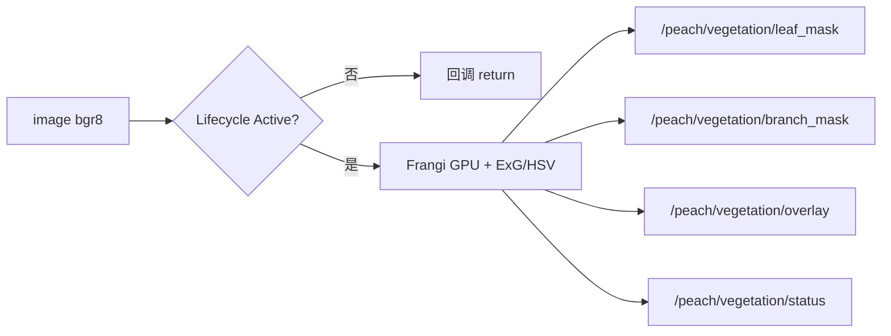

# `peach_vegetation` io（活文档）

> 当前接口快照。跨包边界在 [peach_bringup/doc/io.md](../../peach_bringup/doc/io.md)。**源码与本文互相更新，改接口须同一轮改另一边**。

独立 Lifecycle 节点，**不进** `harvest_system` / lifecycle 名单。只做二维分割，不写 PlanningScene、不删 octomap 叶、不发运动。输入相对名 `image`（launch remap 到 `/camera/color/image_raw`，禁止话题名参数）；订阅 QoS 为传感档 BEST_EFFORT+VOLATILE（`peach_common.qos.sensor`，W12 起对齐 AGENTS 传感默认；与 RELIABLE 发布端兼容）；四个发布端 RELIABLE+VOLATILE+KEEP_LAST(10)。首版直接构造 Frangi（torch Hessian，`device: auto` 有 CUDA 用 `cuda:0`）+ Excess Green/HSV 叶；GPU 推理跑在专用互斥回调组（双线程执行器，长帧推理不饿死 diagnostics）。同卡时不要和场景感知对打。生命周期转换恒由节点 `main()` `ensure_active()` 自激活（2026-09-29 修复：launch 不再发转换事件——旧写法对已 active 节点发 activate 会打死进程；launch `autostart` 参数为无操作兼容位）。健康走 `/diagnostics`（任务 `vegetation_split`：device/dropped/leaf_frac/branch_frac/last_frame_age_s，每帧 force_update）。**运维注意：忙锁非阻塞丢帧（`dropped` 计数进 status 与 /diagnostics）；相机重启后订阅会楔死（末帧 >30s 诊断报 STALE「须重启本节点」）。**

| 名字 | 种类 | 含义 | 生产 | 消费 |
|------|------|------|------|------|
| `/peach/vegetation/leaf_mask` | topic | 叶掩膜 mono8（255=叶） | peach_vegetation | （核内无订） |
| `/peach/vegetation/branch_mask` | topic | 木质脊掩膜 mono8（细枝为主，非直径分类） | peach_vegetation | （核内无订） |
| `/peach/vegetation/overlay` | topic | 绿叶红枝叠加 bgr8 | peach_vegetation | （核内无订） |
| `/peach/vegetation/status` | topic | JSON：infer_ms / device / leaf_frac / branch_frac / dropped / stamp / frame_id | peach_vegetation | peach_observability（自检新鲜度探针，2026-09-29 起，latched 订阅；在图才查） |

作业参数（部署值 `peach_vegetation/config/vegetation.yaml`；`peach_vegetation.attach`）：

| 参数 | 含义 |
|------|------|
| `device` | `auto` / `cpu` / `cuda` / `cuda:0`。显式 CUDA 无卡则 configure 失败 |
| `leaf.exg_min` / `leaf.h_*` / `leaf.s_min` / `leaf.v_min` | 叶：Excess Green 下限 ∪ HSV 绿窗 |
| `branch.sigmas` / `beta` / `gamma` / `percentile` / `dilate_px` / `dark_max` | Frangi 尺度与暗脊门 |
| `branch.exclude_leaf` | 枝掩膜减去叶（无 param_rules 规则校验） |
| `publish_overlay` | 关则零序列化 overlay（无 param_rules 规则校验；其余 12 键有规则表） |

参数校验表 `_RULES` 覆盖除上两键外的全部部署键（HSV 跨字段 `h_min<h_max` 整批拒绝）。

