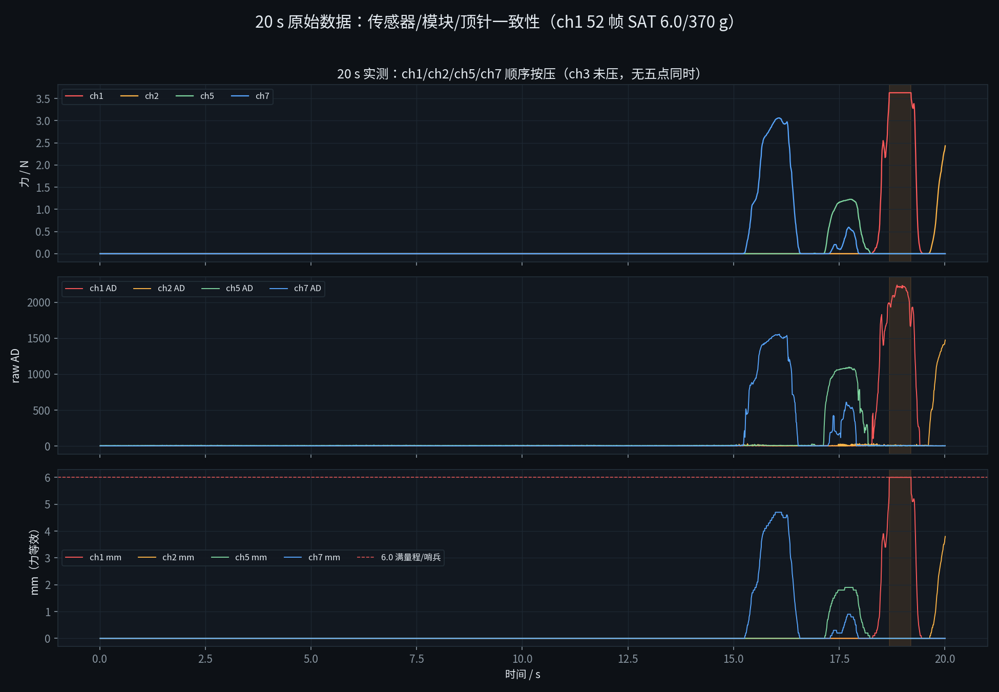

# 20 s 实测：传感器 / 转换模块 / 顶针的测量一致性

2026-10-21 10:28。数据：`runs/force_20s_20261021_102812/force.csv`
（1997 帧，20.0 s，99.8 Hz；Web 的“20 s 记录”按钮/`/record/start` 生成）。
代码：`serial_force` 已改为 6.0 mm 不再判无效、发布 `/force/status`、保留 raw AD。

## 0. 这 20 s 实际发生了什么

- 前 15.26 s 空载（1522 帧）；
- 之后 **ch7 → ch5 → ch1 → ch2 顺序按压**，ch3 始终没压；
- ch1 在 18.5–19.6 s 到 **370 g / 6.0 mm**，`status=1 (SAT)`，共 **52 帧**；
- 没有三路以上同时受力，**没有五点同时**；
- 没有 OPEN（AD 最大 2238 < 3000）。

| 通道 | 最大力 / N | 时刻 / s | 该帧 raw AD | mm | status |
|---|---|---|---|---|---|
| 1 | **3.628** | 18.68 | 1991 | **6.0** | **SAT**（52 帧；AD 最大 2238） |
| 2 | 2.432 | 20.01 | 1474 | 3.8 | OK |
| 3 | 0 | — | — | — | OK |
| 5 | 1.226 | 17.74 | 1097 | 1.9 | OK |
| 7 | 3.060 | 16.05 | 1551 | 4.7 | OK |

空载 AD（15.26 s 前）：ch1 3.5±1.2、ch2 4.1±1.3、ch3 3.6±1.3、ch5 8.4±1.4、
ch7 3.7±4.9（有一次 181 的瞬态，力仍为 0，可能是轻触/干扰）。5 g 名义 AD≈189，
空载噪声远低于 5 g。

## 1. 传感器 ↔ 转换模块：一致

用 STM32 的每通道标定（S/Q、ch5 折线）对 **8 点滤波后的 AD** 复算，再与记录的力比较：

| 通道 | 有效帧 | 力残差平均 | 力残差最大 |
|---|---|---|---|
| 1 | 116 | **0.16 g** | 0.9 g |
| 2 | 38 | **0.26 g** | 0.7 g |
| 5 | 108 | **0.24 g** | 0.6 g |
| 7 | 200 | **0.27 g** | 0.6 g |

结论：

- **“传感器 + 模块”这一级是自洽的**：记录的力就是 raw AD 经 8 点平均、再经每通道
  AD→R→F/标定得到的结果；残差 <1 g；
- raw AD 是**滤波前**的，力和 mm 是**滤波后**的；快压时 raw 领先 g/mm，这是设计，
  不是 AD 错；
- 20 s 里 ch1 的 370 g 饱和、ch5 的 1.2 N、ch7 的 3.06 N、ch2 的 2.43 N 都符合
  各自的 AD/标定；没有出现“AD 变了、力不变”或“力变了、AD 不变”的通道。

## 2. 转换模块 ↔ 顶针：代数一致，但 mm 不是独立测量

- `mm = 力/66`；ch2/ch5/ch7 的 mm 与 `力/66` 差 **0.02–0.03 mm**（0.1 mm 量化）；
- ch1 的 mm 与 `力/66` 差 **0.19 mm（最大 0.39 mm）**，原因不是算错，而是
  `力 ≥ 369.5 g` 时代码把 mm 强制成 **6.0**，而 `370/66 = 5.6`：最后 0.4 mm 被
  折叠成饱和哨兵（设计如此）；
- 所以 **mm 与力是同一个测量的两种刻度**，不是“力传感器 + 行程传感器”两路独立数据；
  20 s 数据无法证明顶针弹簧的真实 66 gf/mm、1.2 mm 预压、350 g 额定是否正确；
- 由 `力/66` 反推：ch7 312 g→4.7 mm、ch2 248 g→3.8 mm、ch5 125 g→1.9 mm；
  ch1 370 g→6.0（实际 5.6）——和弹簧 66 gf/mm 的名义关系一致，但**独立位移/砝码
  仍是缺的**。

**1.2 mm 预压**：空载 F=0、AD≈2–11，说明预压没有落在 FSR 上；若预压由顶针/壳体
承担，`mm=力/66` 是“从组装位起的附加压缩”，5 mm 对应 330 g；若预压落在 FSR 上，
5 mm 应对应 409 g，会碰 370 g 上限。20 s 数据无法区分，需台架压 1/2/5 mm 的已知
高度确认。

## 3. 五点一致性：这次没有测到

- 四路是**顺序**按压，ch3 未压；
- 两路以上同时 >20 g 只有 **66 帧**，没有三路以上；
- 总力最大 3.628 N，出现在只有 ch1 受力的时刻；用该帧算 CoP 没有意义（其余为 0）；
- 因此这 20 s 只能验证**单通道的传感器/模块/弹簧一致性**，**不能**验证五点 CoP、
  五点力均衡、以及“5 点几乎一致”的目标。

要测五点一致性，需要下一轮：**五点同时按住**（或球/桃压住），保持 3–5 s，录 20 s；
Web 的“20 s 记录”按钮已经可用。

## 4. 修复后的状态验证

- ch1 370 g/6.0 mm 的 52 帧：`/force/points` 仍是 **3.628 N**、`/force/ad` 仍是
  **1991–2238**、`/force/status=1 (SAT)`，不再 NaN，网页显示“饱和 370 g / 6.0 mm”，
  不再是 `-- N`；
- 没有 OPEN；若 AD≥3000 会显示“断线/悬空”，与饱和区分；
- `/record/start?seconds=20` 生成 1997 行 CSV，字段：`t_s, f*, tr*, ad*, st*, frames, hz`；
- 协议/状态测试 14 项通过（含 6.0 不再 invalid、SAT/OPEN 分类）。

## 5. 结论

1. **传感器 ↔ 模块**：一致。力 = raw AD（8 点平均）经每通道标定；残差 <1 g；
   raw 是原始值，g/mm 是滤波后的值。
2. **模块 ↔ 顶针**：`mm=力/66` 代数一致；ch2/ch5/ch7 差 0.02–0.03 mm；ch1 的
   6.0 是饱和折叠（370/66=5.6→6.0）。**mm 不是独立行程**，20 s 数据不能验证
   1.2 mm 预压/350 g/66 gf/mm 的真实性。
3. **五点一致性**：本轮没有五点同时受力，不能下结论；需要下一轮五点同时按压。
4. **数据链修复有效**：6.0 mm 不再被误判为断线，raw AD 保留，状态/记录可用。

## 6. 下一轮（建议）

1. 在 Web 上点“20 s 记录”，**五点同时按住**（或球/桃压住），保持 3–5 s；
2. 如果可能，同时记录**机械臂 Z 位移**或**标准砝码/测力计**读数；
3. 用这轮数据算：五点力/CoP、每通道 `力-AD`、`mm-力/66`、饱和/断线；
4. 台架压 1/2/5 mm 已知高度，确认 1.2 mm 预压和 5 mm 力（330 或 409 g）；
5. 完成后再进 `peach_force_align` 的五点 CoP/旋转控制。
