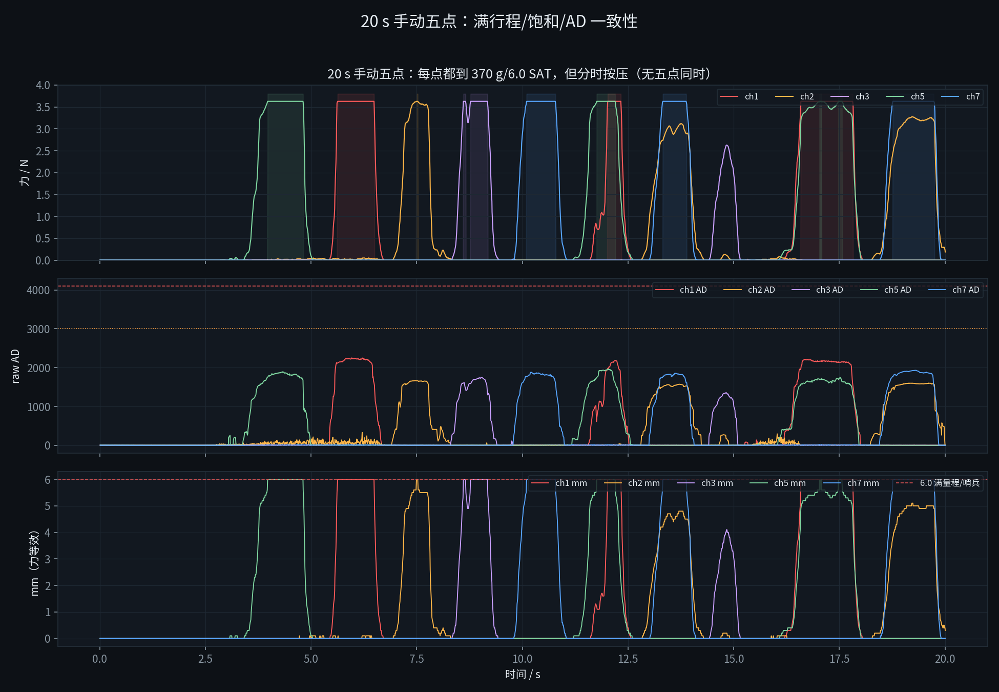

# 20 s 手动五点实测：满行程 / 传感器 / 转换模块 / 顶针

2026-10-21 10:31 手动点击“20 s 记录”。数据：`runs/force_20s_manual/force.csv`
（1997 帧，20.0 s，99.8 Hz）。用户操作：**五个点都逐个压到了满行程**，
但**不是五点同时**。

## 0. 结论先行

- **五个点每个都到了 370 g / 6.0 mm / SAT**，重复多次；
- 但**没有一帧是五点同时受力**：全 5 路同时 >10 g 为 **0 帧**；最多 3 路
  （29 帧，且合计很小），>50 g 时最多 2 路；
- 因此这次能验证：**单点满行程、每通道满行程 AD、饱和/状态、传感器↔模块一致性**；
  **不能**验证：五点 CoP、五点力均衡、“5 点几乎一致”；
- **满行程 AD 每通道不同**：ch1 2250、ch5 1967、ch7 1931、ch3 1750、ch2 1665
  （相差 585 AD，约 35%）；这是片间 ±15% + 安装差异 + 每通道 S/Q 标定的结果；
- 力残差（对 8 点滤波 AD 复算）0.10–0.28 g，最大 <1 g：**传感器 + 模块这一级自洽**；
- mm = 力/66 在 ch2/ch3/ch5/ch7 上误差 0.02–0.03 mm；ch1 的 6.0 是 370 g 饱和折叠
  （370/66=5.6→6.0），不是独立行程。

## 1. 五个点的满行程

| 通道 | 满行程时刻 / s | 最大力 / N | 满行程 AD（峰值） | SAT 起始 AD（最小） | SAT 帧数 | mm |
|---|---|---|---|---|---|---|
| 1 | 5.63 | 3.628 | **2250** | 1586 | 242 | 6.0 |
| 2 | 7.49 | 3.628 | **1665** | 1660 | 4 | 6.0 |
| 3 | 8.60 | 3.628 | **1750** | 1339 | 47 | 6.0 |
| 5 | 3.97 | 3.628 | **1967** | 1606 | 141 | 6.0 |
| 7 | 10.10 | 3.628 | **1931** | 1553 | 223 | 6.0 |

- 五个点都出现 **3.628 N / 6.0 mm / status=1 (SAT)**，说明每路都能到 370 g 上限；
- **满行程 AD 峰值** ch1 2250 最高、ch2 1665 最低；ch3 1750、ch5 1967、ch7 1931；
- **SAT 起始 AD**（力刚到 370 g 钳位时的 AD）ch3 1339 最低、ch2 1660 最高；
  这个差异主要来自每通道的力标定（S/Q、ch5 折线）和安装预紧，不是 ADC 线性度；
- 20 s 里每个点都重复压了多次（曲线多峰），所以上述 AD 也有重复性信息：
  ch2 只有 4 帧 SAT（很窄），ch1 242 帧、ch7 223 帧（压得较久）。

**注意**：满行程 AD 不是同一个值。若用“固定 AD 阈值”判满行程，会误判；
必须用“每通道 力/AD 标定 + 370 g 钳位”。

## 2. 传感器 ↔ 转换模块

用 STM32 的每通道标定对 **8 点滤波后的 AD** 复算，再与记录的力比较：

| 通道 | 有效帧 | 力残差平均 | 力残差最大 |
|---|---|---|---|
| 1 | 409 | **0.10 g** | 0.7 g |
| 2 | 772 | **0.28 g** | 0.9 g |
| 3 | 189 | **0.20 g** | 0.7 g |
| 5 | 516 | **0.21 g** | 0.9 g |
| 7 | 381 | **0.11 g** | 0.7 g |

- 记录的力就是 raw AD（8 点平均）经每通道 AD→R→F/标定得到的值，残差 <1 g；
- raw AD 是**滤波前**的；力和 mm 是**滤波后**的；快压时 raw 领先 g/mm，这是设计；
- 五个通道的满行程、SAT、370 g 都符合各自 AD/标定，没有“AD 变、力不变”的通道；
- 空载 AD 2–9（ch2 有一次 44、ch5 有一次 218 的瞬态，力仍 0），5 g 名义 AD≈189，
  噪声远低于 5 g。

## 3. 模块 ↔ 顶针

- `mm = 力/66`；ch2/ch3/ch5/ch7 的 mm 与 `力/66` 差 **0.02–0.03 mm**；
- ch1 的 mm 与 `力/66` 差 **0.19 mm（最大 0.39 mm）**：370 g 时 `力/66=5.6`，
  代码强制 **6.0**，最后 0.4 mm 折叠成饱和哨兵；
- 所以 **mm 与力是同一个测量的两种刻度**，不是“力 + 独立行程”两路；
- 满行程 370 g / 6.0 mm 说明 **66 gf/mm、5 mm/6 mm 的量纲关系成立**，但
  **1.2 mm 预压是否落在 FSR 上**、**350 g 额定对应哪个压缩量**，20 s 数据仍不能
  独立证明；需要台架压 1/2/5 mm 已知高度 + 砝码/测力计。

## 4. 五点一致性：没有测到

- 全 5 路同时 >10 g：**0 帧**；
- >10 g 时最多 3 路：29 帧；>50 g 时最多 2 路：540 帧；
- 总力最大 7.257 N，只出现在 ch1+ch5 同时受力（12.02 s），不是五点；
- 3 路同时的最好帧在 16.49 s：ch1 2.118 N、ch2 0.02 N、ch5 1.324 N，
  其余为 0，CoP=(-9.55, +9.00) mm，只能算部分 CoP；
- 因此 **五点 CoP、五点力均衡、5 点几乎一致** 仍未验证。

## 5. 修复后的状态

- ch1 等通道的 370 g/6.0 mm 帧：`/force/points` 仍为 **3.628 N**、
  `/force/ad` 仍为 **1339–2250**、`/force/status=1 (SAT)`，不再 NaN；
- 网页显示“饱和 370 g / 6.0 mm”，不再是 `-- N`；
- 没有 OPEN（AD 最大 2250 < 3000）；
- `/record/start?seconds=20` 手动录到 1997 行 CSV；
- 协议/状态测试 14 项通过。

## 6. 下一步

1. **五点同时压**：用平板/球/桃同时压住五个点，保持 3–5 s，录 20 s；
2. 同时记录**机械臂 Z 位移**或**标准砝码/测力计**；
3. 用这轮数据算五点 CoP、总力、各点一致性；用已知位移确认 1.2 mm/5 mm/350 g；
4. 再进 `peach_force_align` 的五点 CoP/旋转控制。
