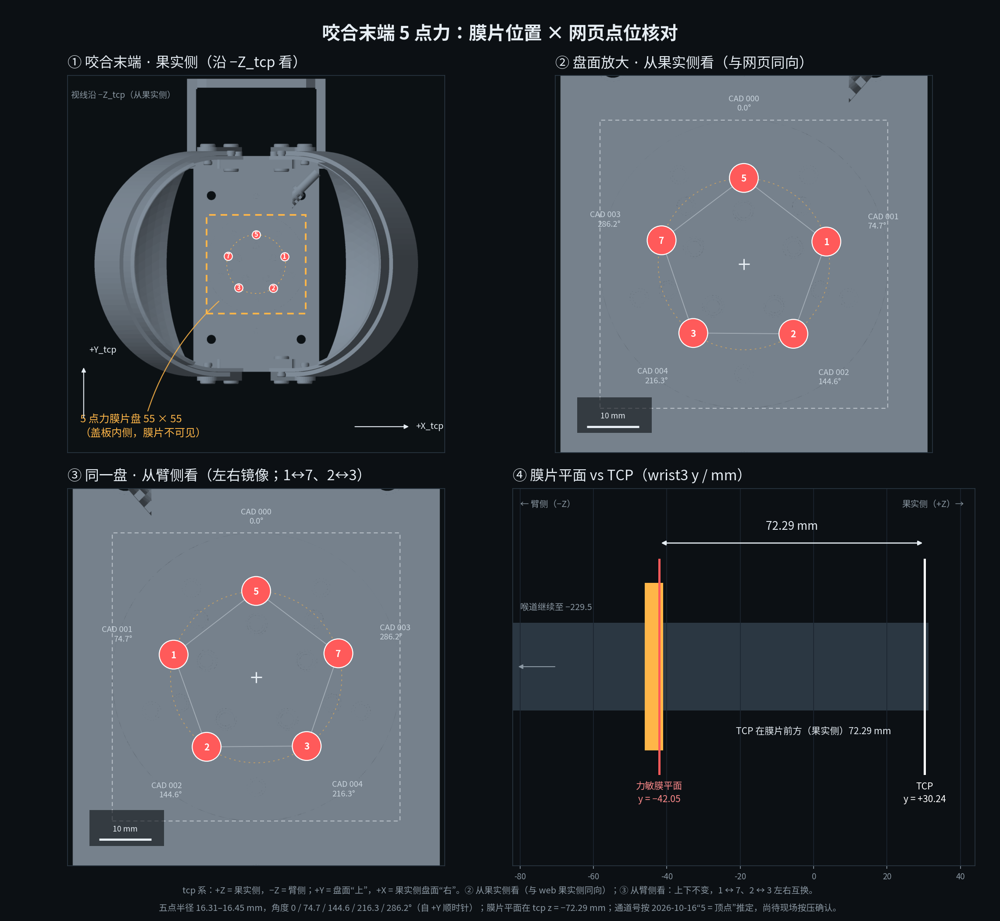

# 5 点力膜片：位置分析、URDF 对应与 Web 实现记录

2026-10-19。对象：`bite_shear_v1` 咬合式剪切手上的 IMS-C04A ×5 薄膜压力传感器（`/force/points`，通道 1/2/3/5/7）。

**状态**：几何位置已按 CAD 总装复核；**通道 ↔ 焊盘绑定仍是按 2026-10-16“5 = 顶点”推定**，待现场逐点按压确认。



## 1. 结论

- 5 片膜共面，平面在 **`tcp z = −72.29 mm`**，法线为 **`+Z_tcp`**（果实侧；`−Z` 为臂侧）。
- 五点构成正五边形，中心在工具轴（`tcp x = y = 0`），**半径 16.31–16.45 mm**（均值 16.35）。
- **顶点在 `+Y_tcp`**，自 `+Y_tcp` 顺时针：0 / 74.7 / 144.6 / 216.3 / 286.2°。
- `tcp` 原点在膜片前方（果实侧）72.29 mm；正视图沿 `−Z_tcp` 看时二者投影重合，深度关系看侧视条。

| 通道（果实侧，2026-10-21 确认） | CAD 零件（总装名） | `tcp` 坐标 / mm | `wrist3_Link` 坐标 / mm | 自 `+Y_tcp` 顺时针 | 半径 / mm |
|---|---|---|---|---|---|
| 5（上，顶点） | `电阻式薄膜压力传感器 力敏电阻` | (0.00, +16.45, −72.29) | (0.00, −42.05, 149.05) | 0.0° | 16.45 |
| 1（右上） | `…力敏电阻001` | (+15.75, +4.30, −72.29) | (+15.75, −42.05, 161.20) | 74.7° | 16.33 |
| 2（右下） | `…力敏电阻002` | (+9.45, −13.30, −72.29) | (+9.45, −42.05, 178.80) | 144.6° | 16.32 |
| 3（左下） | `…力敏电阻004` | (−9.65, −13.15, −72.29) | (−9.65, −42.05, 178.65) | 216.3° | 16.31 |
| 7（左上） | `…力敏电阻003` | (−15.70, +4.55, −72.29) | (−15.70, −42.05, 160.95) | 286.2° | 16.35 |

2026-10-21 用户确认果实侧映射：**1=右上(CAD 001)、7=左上(CAD 003)、2=右下(CAD 002)、3=左下(CAD 004)、5=上(CAD 000)**；臂侧是镜像（1↔7、2↔3）。

五边形质心 `tcp = (−0.03, +0.23) mm`（相对轴心可忽略）。膜片盖板外廓 55 × 55 mm，正面圆形凸台约 Ø55，中心 `wrist3 z = 165.5 mm`。

## 2. 数据链与坐标约定

```
外部 STEP（微信收到的总装，未入仓）
  └─ src/aubo_description/scripts/step_extract_tool.py（FreeCAD 无头）
       → stdout 末行 REPORT_JSON{...}：flange_measure / tool_bbox_m / per_part_bbox_m（米，CAD 全局系）
  └─ src/aubo_description/scripts/decimate_export.py（Blender 4.5 无头）
       → meshes/visual/tools/bite_shear_v1.stl（5.5 万 tri）/ collision（4.5k tri）
```

- `step_extract_tool.py` 已把 **法兰帧 = CAD 全局系** 数值校验过（i5-末端法兰圆柱/平面），所以 CAD 总装坐标可直接当 `wrist3_Link` 用。
- URDF：`tcp_bite_shear_v1.xacro` → `tcp_xyz="0 0.03024 0.1655"`、`tcp_rpy="-1.5708 0 0"`；`tcp.xacro` 里 `tool_axis / cutting_plane / tcp / sleeve_mouth` 同点，`tool_body_link` 与 `wrist3_Link` identity（网格就在法兰系）。
- 因此 **CAD 坐标 = `wrist3_Link` 坐标**；到 `tcp` 系只做一次 `Rx(−90°)` + 平移：

```
p_tcp = (x_w, 0.1655 − z_w, y_w − 0.03024)      # 单位 m
p_w   = (x_t, 0.03024 + z_t, 0.1655 − y_t)
```

- 本次用的提取报告：`_tools/shear_pipeline/bite2/extract_report.json`（本地副本，`_tools/` 被 `.gitignore` 忽略；`tool_triangles=389568`、75 个末端叶子零件）。
- 网格一致性：`src/aubo_description/meshes/visual/tools/bite_shear_v1.stl` 与报告同批 `visual.stl` **sha256 相同**（`b331fd22…`）；collision 同为 `1cd43f73…`。

## 3. 分析过程（怎么从零找到这五个点）

1. **先找“5 点力”在仓里的落点**：`grep -rn '5点|五点|force|五边形' src`。结果只有 `serial_force`（原 `serial_imu`）的协议/配置/Web 和 README；**URDF 里没有任何力敏帧或标记**。
2. **回到 CAD 总装**：在提取报告的 `per_part_bbox_m` 里按名字找到 5 个 `电阻式薄膜压力传感器 力敏电阻[000..004]`。五个 bbox 的 `y` 都是 `−42.05 mm`、厚度 0.5 mm → 共面。
3. **取 bbox 中心**（矩形件绕自身中心旋转，bbox 中心即几何中心），按第 2 节的 `p_tcp` 变换到 `tcp` 系。
4. **拟合五边形**：以 `(0,0)` 为圆心，半径 16.31–16.45 mm；角度与理想 0/72/144/216/288° 的最大残差 **2.7°**（焊盘是矩形且略有装配偏置，残差可接受）。顶点方向恰好是 `+Y_tcp`。
5. **核对网格**：把 5 个中心拿去查 visual STL 顶点，最近面片还有 **3.3 mm**——因为 0.5 mm 的膜片夹在 `传感器放置`（y −46…−41）和 `传感器外壳`（y −41…−35）之间，布尔并合/减面后膜片本身不在网格里。所以**网页/图上的五点只能按 CAD 位置叠加，不能从网格里“看出来”**。
6. **确定“上”**：五边形有顶点在 `+Y_tcp`、对边在 `−Y_tcp`。2026-10-16 裁定“5 在正上方顶点”只有在“上 = `+Y_tcp`”时自洽；若按装配世界 `+Z_wrist3` 竖直看，整幅会上下翻 180°（顶点落到下方）。

## 4. 实现

### 4.1 静态核对图

`src/serial_force/scripts/render_force_pads.py` → `doc/force_pads_on_tool.png`：

- 读 URDF 同一份 visual STL，自己写了一个 numpy z-buffer 正交渲染（无需 OpenGL/GUI；54k tri 约几秒）。
- 四个面板：① 整机·果实侧（沿 `−Z_tcp`，五点直接叠在末端上）；② 盘面放大·果实侧（带 CAD 件号/角度）；③ 臂侧镜像；④ 膜片平面 vs TCP 的 72.29 mm 轴向关系。
- 深度约定：`depth = −(v·fwd)`，取最大值；早期写成 `depth = v·fwd` 会把远面当近面（已修）。

### 4.2 实时 Web

`src/serial_force/scripts/force_web.py`（HTTP + SSE，只订 `/force/points`，不碰串口）+ `force_web.html`：

- 两张底图由同一渲染器出：`face_full.png`（220 mm 视场，整机）与 `face_fruit.png`（72 mm，盘面），盘心居中、1:1；Web 用 `R_MM / FACE_MM` 算百分比坐标，因此叠加与底图严格同尺度。
- 默认 **整机 220 mm**，一眼看到五个点在末端上的位置；切 **盘面 72 mm** 看 N/kgf/峰值大标签。
- **视角**：果实侧 / 臂侧；臂侧是同一视图的 CSS 镜像（`scaleX(-1)`），X 轴在屏幕左边，Z 用 ⊗ 表示入屏；果实侧是直接视图，X 右、Z ⊙。通道值不变。
- **坐标系**：图心画 `tcp` 三轴（X 红 / Y 绿 / Z 蓝），果实侧 Z 为 ⊙ 出屏、臂侧为 ⊗ 入屏；面板列出 `tcp / tool_axis / cutting_plane / sleeve_mouth` 同点、`tool_body_link = wrist3_Link`、膜片 `tcp z = −72.29 mm`。整机视图隐藏轴字母（会压住通道点），图心 = TCP 写在脸栏；盘面视图保留 `X / Y / Z / TCP`。
- **侧视条**：`wrist3` 原点刻线、`TCP +30.24`、`膜片平面 −42.05`、`果实侧 = +Z_tcp →（臂侧 −Z_tcp ←）`。
- 条形按单点 0–400 g 满量程（五点合计 2 kg）做固定渐变，用 `clip-path` 裁剪（早期改 `width` 会把渐变压缩到短条上，颜色会误读）。
- 2026-10-21 v3 帧起，每条下方显示**行程**（0.1 mm/LSB）与**原始 AD**；断线/超量程哨兵显示 `--`。
- 2026-10-22 起显示 **5 点力 CoP**：同一组 CAD 点位按 `Σ fᵢ·pᵢ / Σ fᵢ` 加权（tcp 系 mm），红点叠加在盘面/整机视图，面板显示 `(x, y)` 与 `|CoP|`；断线/无效通道不参与。
- 只改显示、不改通道：切换只重算 `left/top` 与左右文案。

### 4.3 验证

- 网格 sha256 与 CAD 提取同批；五点表与 `README §2`、`config/*.yaml` 的 `channel_labels` 一致。
- 四状态（整机/盘面 × 果实侧/臂侧）用 **headless Chrome + CDP** 真等页面加载后截图核对；`node --check` 校验页面 JS；`curl` 验 `/`、`/face.png`、`/face_full.png`、`/stream`（SSE 100 Hz）。
- 发现并修正：节点代码里遗留的旧时钟标签默认值（`左中(9点)…`）→ 统一为果实侧映射（见 §1 表）；渲染 z 符号错误；臂侧相机 `fwd` 写错导致全黑；Chrome `--virtual-time-budget` 遇 SSE 不退出（改用 CDP 实时等待）。

## 5. 工具

| 用途 | 工具/文件 |
|---|---|
| STEP 总装 → 法兰系网格 + 逐零件 bbox | FreeCAD 无头 + `src/aubo_description/scripts/step_extract_tool.py` |
| 网格减面（visual/collision） | Blender 4.5 无头 + `src/aubo_description/scripts/decimate_export.py` |
| 五点坐标变换/五边形拟合 | Python 3.12 + numpy（一次性分析；结论已固化进脚本与文档） |
| 正交渲染（z-buffer） | numpy（自写，无 GUI 依赖） |
| 图/底图合成 | matplotlib、Pillow（量化 PNG） |
| 网页截图/交互验证 | Google Chrome headless + CDP（Node 22 WebSocket） |
| 页面 JS 语法 | `node --check` |
| 接口/SSE 验证 | `curl`、`ss` |

## 6. 复现

```bash
# 1) 五核对图（输出 src/serial_force/doc/force_pads_on_tool.png）
python3 src/serial_force/scripts/render_force_pads.py

# 2) Web 两张底图（输出 src/serial_force/scripts/face_{full,fruit}.png）
python3 src/serial_force/scripts/make_web_face.py

# 3) 起实时页（先 source Jazzy）
source /opt/ros/jazzy/setup.bash
python3 src/serial_force/scripts/force_web.py            # http://127.0.0.1:8099
```

如需从 STEP 重新提取（STEP 在仓外，路径按现场）：

```bash
STEP_PATH=/path/audo-i5机器人总装-咬合式剪切手.STEP \
TOOL_STL=/tmp/bite/tool_raw.stl REF_STL=/tmp/bite/wrist_ref.stl \
EE_LABEL=咬合式末端执行器 \
  freecad.cmd src/aubo_description/scripts/step_extract_tool.py | tee /tmp/bite/report.txt
# 取末行 REPORT_JSON:{...} 的花括号部分存为 extract_report.json

env INPUT_STL=/tmp/bite/tool_raw.stl \
    VIS_STL=src/aubo_description/meshes/visual/tools/bite_shear_v1.stl \
    COL_STL=src/aubo_description/meshes/collision/tools/bite_shear_v1.stl \
  _tools/blender-4.5.14-linux-x64/blender -b -P src/aubo_description/scripts/decimate_export.py
```

## 7. 限制与待确认

1. **通道 ↔ 焊盘**：2026-10-21 用户确认果实侧映射为 5/1/2/3/7（1↔7、2↔3）；若后续现场再改，只改 `force_web.html` 的 `CH` 表与 `config/*.yaml` 的 `channel_labels`。
2. **“上/右”的定义**：本文所有“上/右”按**果实侧**取 `+Y_tcp / +X_tcp`；**臂侧左右互换**（1↔7、2↔3），上下不变。若现场以世界竖直为准，再整体旋转 180°。
3. **臂侧是镜像**，不是工具背板实拍；它只用于左右约定核对（1↔7、2↔3）。
4. **膜片不可见**：0.5 mm 膜片夹在盖板之间，减面网格里没有；网页/图上的点是 CAD 位置叠加，不是渲染出的实体。
5. 五边形角度残差 ≤ 2.7°，来自矩形焊盘的 bbox 中心与装配偏置；不影响 1/7、2/3 的左右判定，但不宜当精密标定值用。
6. **URDF 里仍没有这五个点的固定帧**（本次只做 Web/图）。若要让 RViz/TF 直接消费，可在 `tcp_bite_shear_v1.xacro` 加 5 个 `tcp` 下的 fixed link（坐标用上表），再让 Web 从同一张表生成。

## 8. 本次变更文件

- `src/serial_force/scripts/force_web.html`：整机/盘面 + 果实侧/臂侧、tcp 三轴、坐标系清单、侧视条、五点叠加。
- `src/serial_force/scripts/force_web.py`：新增 `/face.png`、`/face_full.png` 路由与 `no-store`。
- `src/serial_force/scripts/face_full.png`、`face_fruit.png`：同一 STL 的 220 / 72 mm **+Z（果实侧）**渲染；web 臂侧用其 CSS 镜像。
- `src/serial_force/scripts/render_force_pads.py`、`make_web_face.py`：可复现的渲染工具（从 `_tools/` 移入包内，随仓）。
- `src/serial_force/doc/force_pads_on_tool.png`、本文件。
- `src/serial_force/README.md` §2：点位表、Web 说明、链接。
- `wiki/07-末端工具与标定.md`：新增“咬合式 5 点力膜片”小节；`wiki/03-接口契约.md`：`/force/points` 补调试页与本文链接。
- `src/serial_force/serial_force/force_node.py`：`channel_labels` 默认值改为与 config 一致。
