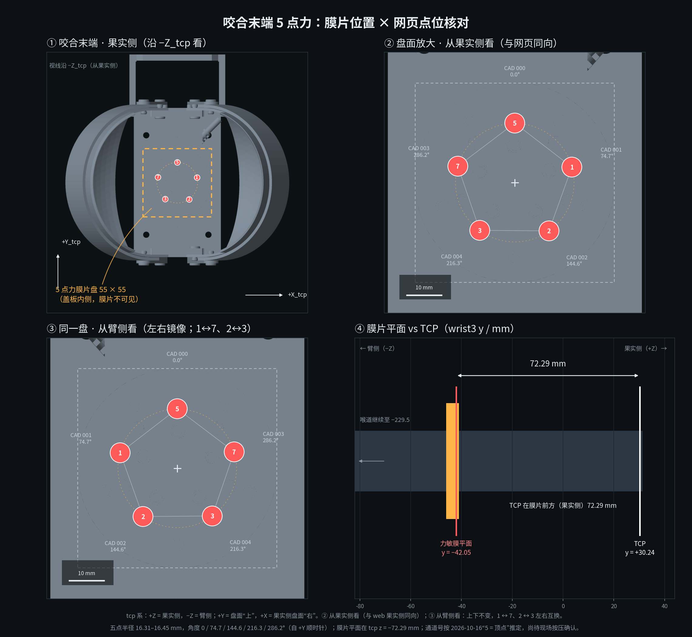

# 五点力膜片几何与 CoP



## 1. 点位

对象：`bite_shear_v1` 咬合式剪切手上的 IMS-C04A ×5。五片膜共面，
平面在 **`tcp z = −72.29 mm`**，法线 `+Z_tcp`（果实侧）；五点构成正五边形，
半径 16.31–16.45 mm，顶点在 `+Y_tcp`。

| 通道（果实侧） | CAD 零件 | `tcp` / mm | `wrist3_Link` / mm | 自 `+Y_tcp` 顺时针 | 半径 / mm |
|---|---|---|---:|---:|---:|
| 5（上，顶点） | `力敏电阻000` | (0.00, +16.45, −72.29) | (0.00, −42.05, 149.05) | 0.0° | 16.45 |
| 1（右上） | `力敏电阻001` | (+15.75, +4.30, −72.29) | (+15.75, −42.05, 161.20) | 74.7° | 16.33 |
| 2（右下） | `力敏电阻002` | (+9.45, −13.30, −72.29) | (+9.45, −42.05, 178.80) | 144.6° | 16.32 |
| 3（左下） | `力敏电阻004` | (−9.65, −13.15, −72.29) | (−9.65, −42.05, 178.65) | 216.3° | 16.31 |
| 7（左上） | `力敏电阻003` | (−15.70, +4.55, −72.29) | (−15.70, −42.05, 160.95) | 286.2° | 16.35 |

2026-10-21 用户确认果实侧映射 **1=右上、7=左上、2=右下、3=左下、5=上**；
臂侧是镜像（1↔7、2↔3），上下不变。通道号由采集板输入 0/1/2/4/7 重编号为
1/2/3/5/7，顺序固定。

## 2. 坐标变换

`tool_body_link` 与 `wrist3_Link` identity，故 CAD 总装坐标可直接当
`wrist3_Link`。到 `tcp` 只做一次 `Rx(−90°)` + 平移：

```text
p_tcp = (x_w, 0.1655 − z_w, y_w − 0.03024)   # 单位 m
p_w   = (x_t, 0.03024 + z_t, 0.1655 − y_t)
```

五点质心 `tcp = (−0.03, +0.23) mm`，相对轴心可忽略。五边形角度与理想
0/72/144/216/288° 的最大残差 2.7°，来自矩形焊盘 bbox 中心与装配偏置；
可用于 Web/CoP，不宜当精密标定值。

## 3. CoP

```text
F = Σ f_i
CoP = Σ f_i · (x_i, y_i) / F        # tcp 系，mm
```

- 只用 `status ∈ {OK, SATURATED}` 的通道；OPEN/INVALID 不参与；
- 合力 < 0.05 N 时 CoP 无意义，显示 `--`；
- `peach_web /force.html` 默认整机 220 mm、可切盘面 72 mm；CoP 标记的
  title 给 `(x, y)`。当前页面没有旧版臂侧 CSS 镜像切换。

## 4. 工具与复现

```bash
# 五点核对图 -> doc/force_pads_on_tool.png
python3 tools/render_force_pads.py

# Web 底图 -> web/face_fruit.png（72 mm）、web/face_full.png（220 mm）
python3 tools/make_web_face.py
```

两个工具只在开发/换工具时跑，不随节点安装；依赖 numpy/Pillow/matplotlib，
不进入运行期依赖。

## 5. 限制

1. 膜片 0.5 mm 夹在盖板之间，减面网格里没有膜片实体；Web/图上的点是 CAD
   位置叠加，不是渲染出来的传感器。
2. URDF 里仍没有五个固定 frame；若要让 RViz/TF 直接消费，可在
   `tcp_bite_shear_v1.xacro` 加 5 个 fixed link，坐标用上表。
3. 驱动 `channel_labels`、`serial_force/force_sim_common.py::PADS` 与
   `peach_web/web/force.js::PADS` 须按通道号保持一致；当前没有自动同步这些点位。
   页面运行底图是 `peach_web/web/force_face_{fruit,full}.png`，本包生成器不会自动覆盖它们。
4. 绝对力未做砝码标定；CoP 是相对 5 点量，不是计量级压力中心。
