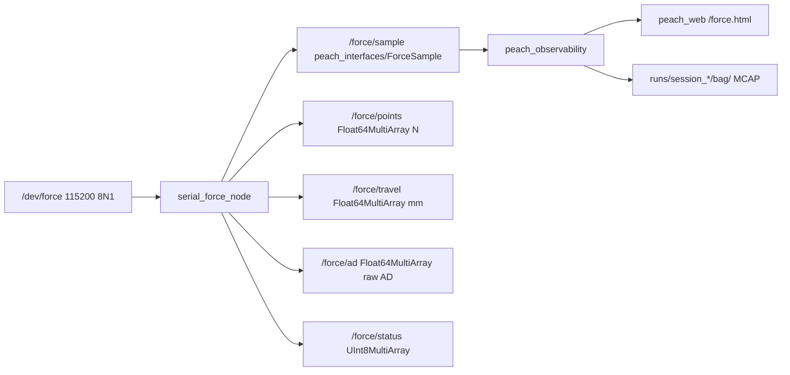

# serial_force io（活文档）

> 当前接口快照。跨包边界见 [peach_bringup/doc/io.md](../../peach/peach_bringup/doc/io.md)。
> 源码与本文互相更新；改话题/QoS/帧语义须同一轮改另一边。



## 话题

| 名字 | 类型 | QoS | 含义 |
|---|---|---|---|
| `/force/sample` | `peach_interfaces/msg/ForceSample` | RELIABLE / VOLATILE / depth 100 | 一次解码的原子 5 通道帧：`channel_ids`、`force_n`、`travel_mm`、`ad`、`status`、`source_uuid`、`sequence`；`header.frame_id=tcp`，`header.stamp` 为主机 ROS 接收/解码时刻（固件无采样时间） |
| `/force/points` | `std_msgs/msg/Float64MultiArray` | RELIABLE / VOLATILE / depth 10 | 5 值，SI 牛顿，顺序 1/2/3/5/7 |
| `/force/travel` | 同上 | 同上 | 5 值，力等效毫米（0.1 mm/LSB），不是独立位移 |
| `/force/ad` | 同上 | 同上 | 5 值，uint16 原始 AD 转 float |
| `/force/status` | `std_msgs/msg/UInt8MultiArray` | 同上 | 5 值：0 OK、1 SATURATED、2 OPEN、3 INVALID |

**6.0 mm 语义（重要）**：`0x3C` 同时是 370 g 满量程和断线/超量程哨兵。
`/force/travel` 保留 6.0，`/force/ad` 保留原始 AD，**不置 NaN**；状态由
AD 与行程联合判断：

- `ad >= open_ad_threshold`（默认 3000）→ OPEN（断线/悬空）；
- 否则 `travel >= full_travel_mm`（默认 5.95）→ SATURATED（合法 370 g）；
- 非有限值 → INVALID；其余 OK。

## 0xA5 v3 帧

```text
A5 | ch | gL gH | mm | aL aH | ... ×5 ... | sum
```

总长 32 B = 1 + 5×6 + 1；`ch` 固定 `01/02/03/05/07`；`g` uint16 小端（克）；
`mm` uint8 ×0.1 mm；`ad` uint16 小端（STM32 转发前原始 AD）；
`sum = sum(frame[0:31]) & 0xFF`。解析器找 `A5` → 32 B 窗口校验通道号 + 累加和 →
解码；假帧头跳 1 字节重扫。

现场样帧（2026-10-21）：

```text
A5 01 F3 00 25 B0 06 02 18 01 2A D2 05 03 BE 00 1D 19 05
   05 36 01 2F DC 05 07 09 01 28 2C 06 43
```

| 通道 | 力 / g | 力 / N | 行程 / mm | 原始 AD |
|---|---:|---:|---:|---:|
| 1 | 243 | 2.383 | 3.7 | 1712 |
| 2 | 280 | 2.746 | 4.2 | 1490 |
| 3 | 190 | 1.863 | 2.9 | 1305 |
| 5 | 310 | 3.040 | 4.7 | 1500 |
| 7 | 265 | 2.599 | 4.0 | 1580 |

校验：前 31 B 和 1603（低 8 位 `0x43`）。v1/v2 帧长/步长/校验不同，不会被误认；
升级固件必须同步升级本包。

## 参数

根键 = 节点名 `serial_force`，见 `config/serial_force.yaml`。

| 参数 | 默认 | 作用 |
|---|---|---|
| `port` | `/dev/force` | 首选串口 |
| `port_fallbacks` | `/dev/ttyUSB0`、`/dev/ttyACM0` | 打不开时依次试 |
| `baudrate` | 115200 | 8N1 |
| `read_period_s` | 0.005 | 串口轮询周期，200 Hz；固件约 100 Hz 上报 |
| `expected_rate_hz` | 100.0 | `/diagnostics` 频率窗 0.6–1.4× |
| `open_ad_threshold` | 3000.0 | AD ≥ 此值判断线/悬空 |
| `full_travel_mm` | 5.95 | 行程 ≥ 此值判 SATURATED |
| `print_data` | true | 逐帧打印 N/mm/AD/status |
| `print_decimate` | 1 | 每 N 帧打印一条；1 ≈ 100 Hz |
| `channel_labels` | 右上/右下/左下/上/左上 | 通道 1/2/3/5/7 的果实侧点位标签 |

8090 力页由 observability 托管；本包不再有命令行 Web 参数。旧 `--port` 说明已删除。

## 诊断

- `serial`：串口打开/关闭；
- `/force/points` 频率：期望 `expected_rate_hz`，窗 0.6–1.4×；
- 状态计数：`OPEN` 警告 1 s 节流；`SATURATED` 正常，不告警。

## 仿真源差异

`serial_force.launch.py source:=sim` 选择 `force_sim_node`，仍用节点名 `serial_force`。参数为 `tilt_deg=3.0`、`tilt_yaw_deg=0.0`、`preload_mm=0.30`、`k_n_per_mm=0.8`；串口参数不控制仿真模型。100 Hz timer 只有在 `base_link→tcp` 可读时才发布。

仿真 `/force/sample` 与兼容 array 均为 RELIABLE/VOLATILE/depth 10；真实串口原子帧 depth 100。仿真 UUID 带 `sim-`，sequence 从 0 开始，header 为生成时刻；AD/travel/status 是演示派生量，不是固件原始测量，不能用于证明真实串口/断线分类通过。

## 调试页与记录

当前页面是 `peach_web /force.html`，服务端是 observability 的 `GET /api/force`；ROSbridge 模式消费对应 `web_force` 聚合帧。它只读显示五点、通道状态及 CoP，没有 `/record/start`、`/stream` 或 `/episodes` 端点。

observability 将 `/force/sample` 原样写入同一会话的 `runs/session_*/bag/`，不通过相机媒体节流。`ForceSample` 的主机时间与接收时间须按各自语义使用，不能当固件采样时间。分析模块只读兼容既有 `force/episode_*.csv/json`；当前运行不自动生成 episode、index 或手动 20 秒 CSV。

独立 `force_cop_trials` / `force_cop_analyze` 的 JSONL/CSV/统计/图默认写到 `$ROS_HOME/serial_force/`，可用其 CLI 参数改输出位置。它们不与采摘 bag 共用写者。

## 边界

本包不定义采摘 FSM、SetIO 或运动许可；独立 CoP 工具的 IK/JTC 实验不属于主链。硬件急停在柜/示教器，不经 ROS；力/CoP 显示和实验结果不是功能安全或计量标定。
