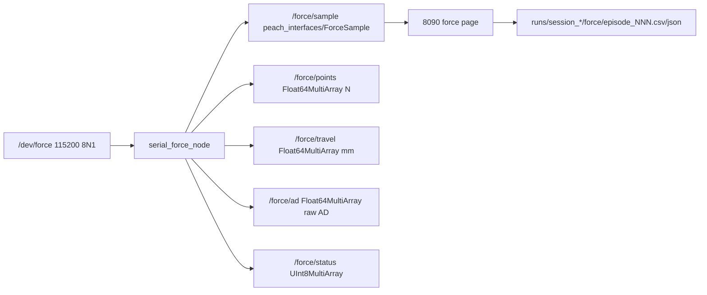

# serial_force io（活文档）

> 当前接口快照。跨包边界见 [peach_bringup/doc/io.md](../../peach/peach_bringup/doc/io.md)。
> 源码与本文互相更新；改话题/QoS/帧语义须同一轮改另一边。



## 话题

| 名字 | 类型 | QoS | 含义 |
|---|---|---|---|
| `/force/sample` | `peach_interfaces/msg/ForceSample` | RELIABLE / VOLATILE / depth 100 | 一次解码的原子 5 通道帧：`channel_ids`、`force_n`、`travel_mm`、`ad`、`status`、`source_uuid`、`sequence`；`header.frame_id=tcp`，`header.stamp` 为主机 ROS 接收/解码时刻（固件无采样时间） |
| `/force/points` | `std_msgs/msg/Float64MultiArray` | RELIABLE / VOLATILE / depth 10 | 5 值，SI 牛顿，顺序 1/2/3/5/7 |
| `/force/travel` | 同上 | 同上 | 5 值，力等效毫米（0.1 mm/LSB），不是独立位移 |
| `/force/ad` | 同上 | 同上 | 5 值，uint16 原始 AD 转 float |
| `/force/status` | `std_msgs/msg/UInt8MultiArray` | 同上 | 5 值：0 OK、1 SATURATED、2 OPEN、3 INVALID |

**6.0 mm 语义（重要）**：`0x3C` 同时是 370 g 满量程和断线/超量程哨兵。
`/force/travel` 保留 6.0，`/force/ad` 保留原始 AD，**不置 NaN**；状态由
AD 与行程联合判断：

- `ad >= open_ad_threshold`（默认 3000）→ OPEN（断线/悬空）；
- 否则 `travel >= full_travel_mm`（默认 5.95）→ SATURATED（合法 370 g）；
- 非有限值 → INVALID；其余 OK。

## 0xA5 v3 帧

```text
A5 | ch | gL gH | mm | aL aH | ... ×5 ... | sum
```

总长 32 B = 1 + 5×6 + 1；`ch` 固定 `01/02/03/05/07`；`g` uint16 小端（克）；
`mm` uint8 ×0.1 mm；`ad` uint16 小端（STM32 转发前原始 AD）；
`sum = sum(frame[0:31]) & 0xFF`。解析器找 `A5` → 32 B 窗口校验通道号 + 累加和 →
解码；假帧头跳 1 字节重扫。

现场样帧（2026-10-21）：

```text
A5 01 F3 00 25 B0 06 02 18 01 2A D2 05 03 BE 00 1D 19 05
   05 36 01 2F DC 05 07 09 01 28 2C 06 43
```

| 通道 | 力 / g | 力 / N | 行程 / mm | 原始 AD |
|---|---:|---:|---:|---:|
| 1 | 243 | 2.383 | 3.7 | 1712 |
| 2 | 280 | 2.746 | 4.2 | 1490 |
| 3 | 190 | 1.863 | 2.9 | 1305 |
| 5 | 310 | 3.040 | 4.7 | 1500 |
| 7 | 265 | 2.599 | 4.0 | 1580 |

校验：前 31 B 和 1603（低 8 位 `0x43`）。v1/v2 帧长/步长/校验不同，不会被误认；
升级固件必须同步升级本包。

## 参数

根键 = 节点名 `serial_force`，见 `config/serial_force.yaml`。

| 参数 | 默认 | 作用 |
|---|---|---|
| `port` | `/dev/force` | 首选串口 |
| `port_fallbacks` | `/dev/ttyUSB0`、`/dev/ttyACM0` | 打不开时依次试 |
| `baudrate` | 115200 | 8N1 |
| `read_period_s` | 0.005 | 读串口定时器周期（100 Hz） |
| `expected_rate_hz` | 100.0 | `/diagnostics` 频率窗 0.6–1.4× |
| `open_ad_threshold` | 3000.0 | AD ≥ 此值判断线/悬空 |
| `full_travel_mm` | 5.95 | 行程 ≥ 此值判 SATURATED |
| `print_data` | true | 逐帧打印 N/mm/AD/status |
| `print_decimate` | 1 | 每 N 帧打印一条；1 ≈ 100 Hz |
| `channel_labels` | 右上/右下/左下/上/左上 | 通道 1/2/3/5/7 的果实侧点位标签 |

8090 力页由 observability 托管；本包不再有命令行 Web 参数。旧 `--port` 说明已删除。

## 诊断

- `serial`：串口打开/关闭；
- `/force/points` 频率：期望 `expected_rate_hz`，窗 0.6–1.4×；
- 状态计数：`OPEN` 警告 1 s 节流；`SATURATED` 正常，不告警。

## 调试页与记录

8090 力页由 observability 托管：

| 端点 | 作用 |
|---|---|
| `GET /` | 页面 |
| `GET /stream` | SSE 快照：5 点、CoP、总力、Hz、age、接触段状态 |
| `GET /record/start?seconds=20` | 手动记录（须有唯一 active 会话） |
| `GET /record/status` / `/record/download` | 记录状态/下载 |
| `GET /episodes` / `/episodes/data?session=&name=` | 已写接触段目录/回放 |

产物（同一采摘会话）：

- `force/episode_NNN.csv`：列 `t_s,f1..f7,tr1..tr7,ad1..ad7,st1..st7,frames,hz,stamp_ns,receive_unix_ns,source_uuid,sequence`；
- `force/episode_NNN.json`：`reason`、`duration_s`、`contact_s`、`samples`、`peak_n[5]`、起止 ns、`wall_start/end`；
- `force/index.jsonl`：上述 sidecar 的追加索引；
- `force/force_20s_<stamp>_<id>.csv`：手动段。

`diagnostics` 与记录写入失败不阻塞驱动；驱动只负责发布。

## 不负责

采摘调度、MoveIt、底盘、IMU、力闭环、功能安全。`8090 force page` 是调试页，
不是第二控制面；没有 SetIO/使能/运动入口。
