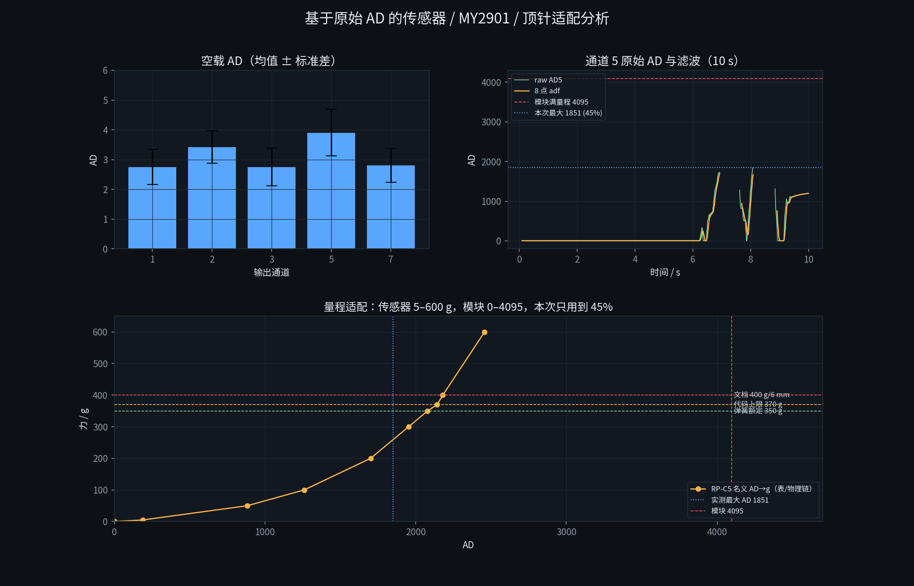

# 基于原始 AD 的传感器 / MY2901 / 顶针适配分析

2026-10-21。数据：`runs/force_10s_20261021_095244/force.csv`（997 帧，9.9 s，100.6 Hz，
只有 ch5 受压）；现场 32 B `0xA5` 帧；手册与顶针参数见
[`my2901_stm32_analysis.md`](my2901_stm32_analysis.md)。

## 0. 原始数据概况

- 空载段 0–6 s：5 路 AD 都在 2–11 个码，力 0；
- 受压段只有 ch5：最大 **3.619 N**，此时 raw AD 峰值 **1851**、mm 5.6；
- 两次到 6.0 mm（0x3C）被 ROS 节点判无效，raw AD 在 CSV 里变成 NaN（节点丢的，
  不是 STM32 没有）；
- 模块 0–4095，本次实际只用到 **1851 / 4095 = 45%**；
- 现场 32 B 帧的 5 路都受压（ch1 243 g/AD1712、ch2 280/1490、ch3 190/1305、
  ch5 310/1500、ch7 265/1580），但那一帧是动态按压，g/mm 用的是 8 点滤波后的 AD。

## 1. 传感器 RP-C5（从 raw AD 看）

### 1.1 空载/噪声/零点

| 通道 | AD 均值 | AD 标准差 | AD 最小–最大 | 力 |
|---|---|---|---|---|
| 1 | 2.75 | 0.59 | 2–5 | 0 |
| 2 | 3.42 | 0.54 | 2–5 | 0 |
| 3 | 2.75 | 0.63 | 2–9 | 0 |
| 5 | 3.91 | 0.77 | 2–11 | 0 |
| 7 | 2.81 | 0.57 | 2–5 | 0 |

- 零点 2–4 个码（ch5 稍高），噪声 **<1 AD**；
- 5 g 对应约 **AD 189**（名义表），信号/噪声约 200:1；
- 1 AD 在 5 g 处约 **0.026 g**，在 370 g 处约 **0.17 g**；
- 50 g 处 1 AD≈0.057 g；低力段分辨率足够，5 g 可测，50 g 很稳。

### 1.2 量程/分辨率（名义 AD→g 表）

| 力 / g | 名义 AD | AD/g（1 g 多少码） | 1 码 / g |
|---|---|---|---|
| 5 | 189 | 37.8 | 0.026 |
| 50 | 882 | 17.6 | 0.057 |
| 100 | 1260 | 12.6 | 0.079 |
| 200 | 1701 | 8.5 | 0.118 |
| 300 | 1953 | 6.5 | 0.154 |
| 350 | 2079 | 5.9 | 0.169 |
| 370 | 2142 | 5.8 | 0.173 |
| 400 | 2180 | 5.4 | 0.185 |
| 600 | 2457 | 4.1 | 0.244 |

- 传感器量程 5–600 g，代码/顶针只用到 **350–370 g**，传感器是**过量程配置**；
- 模块 12 位，370 g 只用 45% 码值，600 g 也只用到 60%，**分辨率仍然够**；
- 代价是**低力段非线性**：5 g 处 37.8 AD/g，370 g 处 5.8 AD/g，差 6.5 倍；
  不能用一个线性增益，必须查表/物理链 + 每通道标定。

### 1.3 动态/滤波

- 10 s 里 ch5 从 0 到 369 g，raw AD 1730–1851，8 点 `adf` 滞后 raw 约
  0.1–0.2 s；同一帧 raw 与 g 最多差 **211.8 g**；
- 传感器本身响应 <10 µs，瓶颈是 **MY2901 100 Hz + STM32 8 点平均（80 ms）**；
- 力对准/接触检测要用 raw AD 或短滤波，不能直接用 8 点后的 g 做“当前力”。

### 1.4 精度/重复性

- RP-C5 手册：同片 ±5%、**片间 ±15%**、迟滞 +10%、漂移 <10%/24 h；
- 因此 5 个点**必须逐通道标定**；当前 ch1/ch2/ch3/ch7 的 S/Q 是经验值，
  ch3 没有新实测点，ch5 的 6 mm 是人为锚点；
- 10 s 只压了 ch5，**没有五点同时受力、没有静态砝码、没有迟滞/重复性数据**；
  这是下一步台架要补的。

## 2. MY2901 转换模块（从 raw AD 看）

| 维度 | 实测/手册 | 适配判断 |
|---|---|---|
| AD | 12 位 0…4095，raw 0–1851（45%） | 分辨率足够；量程有余 |
| 采样 | 100 Hz | 力对准够，8 点滤波 80 ms 偏大 |
| 上传 | 手册默认 1 s；实测 100 Hz | 源码 `task_film` 未发 `0x82`，需确认模块实际配置 |
| 帧 | 20 B：FF + cmd + 8×2B AD + 校验；校验 Byte2–19 取反+1 | 源码实现正确 |
| 编码 | 默认 BCD；`0x83 0x00` 切 HEX；歧义时源码回退 HEX | 若模块仍 BCD 且命令未生效，低 AD 会解错；需确认 `enc=HEX` |
| 通道 | 8 路，实际用 0/1/2/4/7 → 输出 1/2/3/5/7 | 5 路够；3 路悬空 |
| 原始值 | 0xA5 帧 AD = 滤波前 `data.ad` | 真原始；g/mm 用 `adf` |
| 6.0 哨兵 | 370 g 与断线都输出 370 g/6.0 mm | mm 无法区分；raw AD 可区分（有效 1700–2200，断线 3900–4095） |

**模块与传感器匹配**：

- 传感器 5–600 g，模块 12 位；370 g 用 45%，1 码≈0.17 g，噪声 <1 码；
  **模拟链分辨率是够的**；
- 模块 100 Hz 对静态/准静态 5 点对齐够；对快速接触/力控，80 ms 滤波偏大，
  但 raw AD 可绕开；
- 模块的 1 s 默认上传与实测 100 Hz 不一致，是**配置/源码问题**，不是模拟链问题；
- BCD/HEX 与 12 位是**数据格式问题**，可在 host 侧确认/兜底。

## 3. 顶针/弹簧（66 gf/mm、1.2 mm 预压、350 g）

- 66 gf/mm 与传感器“400 g/6 mm = 66.7 gf/mm”几乎完全一致，**弹簧与传感器量纲匹配**；
- 350 g / 66 = **5.30 mm** 压缩量；5 mm 对应 330 g（若预压不计入 FSR）或 409 g
  （若预压计入）；
- 代码 `MY2901_GAP_MM = 0`，只用 66；**1.2 mm 预压没有进代码**；
- 10 s 空载 F=0、AD≈2–11，说明预压**没有落在 FSR 上**（否则空载应有 ~79 g）；
  所以更可能是“预压由顶针/壳体承担，FSR 只测附加力”，此时 `mm=F/66` 表示
  **从组装位起的附加压缩**，5 mm → 330 g；但这需要台架确认；
- 代码 370 g 上限 / 6.0 mm 哨兵，与厂家 350 g、文档 400 g/6 mm 是三个口径：
  - 350 g：弹簧额定；
  - 370 g：代码输出上限；
  - 400 g/6 mm：名义弹簧曲线（66.7×6=400）；
  - 5 mm：330 g（代码）或 409 g（预压计入）。

**适配判断**：

- 弹簧刚度、5 mm 行程、传感器量程**基本匹配**；
- 真正的问题不是“力不够”，而是**1.2 mm 预压、350/370/400 口径、5 mm 与 6 mm
  哨兵、mm 是力反算**这四件事没有统一；
- 5 点对齐应使用**力**（raw AD/校准力）和**机械臂位移**，不要用 mm 当位移。

## 4. 适配矩阵

| 维度 | 传感器 RP-C5 | 模块 MY2901 | 顶针/弹簧 | 结论 |
|---|---|---|---|---|
| 量程 | 5–600 g | 0–4095 | 350 g/5.3 mm | 传感器/模块过量程；370 g 只用 45%，够用但浪费 |
| 分辨率 | 5 g 下限 | 12 位，0.026–0.17 g/码 | 66 gf/mm | 低力段够；5 g 可测；50 g 稳 |
| 带宽 | <10 µs | 100 Hz + 80 ms 滤波 | 5 mm 机械 | 静态够；力控/接触偏慢，用 raw |
| 精度 | 片间 ±15% | 12 位，噪声 <1 码 | 350 g 额定 | 必须逐通道标定；ch3/ch5 数据不足 |
| 机械 | 0.2 mm 薄膜 | — | 66 gf/mm、1.2 预压 | 刚度匹配；预压/5 mm 未定 |
| 数据 | raw 可用 | 6.0 哨兵、1 s/BCD | — | 6.0 与满量程冲突；host 需修；raw 是可信源 |

## 5. 结论

1. **模拟链是匹配的**：RP-C5 5–600 g + MY2901 12 位 + 66 gf/mm 弹簧，量程、
   分辨率、5 g 下限、370 g 工作点都够；噪声 <1 AD，1 码≈0.17 g @370 g。
2. **数据问题主要不是模拟链，而是语义/实现**：
   - 6.0 mm 同时是满量程和断线，ROS 节点把 370 g 满量程也判成 NaN；
   - mm 是 `力/66` 的反算，不是行程；
   - 1.2 mm 预压未进代码，350/370/400/5 mm 口径不统一；
   - 8 点滤波 80 ms 滞后；模块 1 s 默认上传与 100 Hz 不一致；BCD/HEX 需确认；
   - ch3 无实测点、ch5 6 mm 是人为锚点，5 点标定还不完整。
3. **raw AD 是可信的**：32 B 帧的 AD 是滤波前原始值；只要修掉 host 对 0x3C 的
   无效化，就能用 raw AD 重做力/5 点/对齐。
4. **还缺的原始数据**：静态砝码/测力计的逐点力、1/2/5 mm 已知位移、5 点同时受力、
   迟滞/重复性、断线 AD。这些是下一步台架要补的，不是再分析能得到的。

## 6. 传感器部分的下一步（建议顺序）

1. **修数据链**：`0x3C` 不直接 invalid；保留 370 g/6.0 mm + `saturated`；
   `AD>=3000` 才判断线；`/force/ad` 在 6.0 时仍发 raw；加 `/force/status`。
2. **冻结数据契约**：raw AD、校准力、状态（ok/sat/open）、时间戳、通道顺序；
   `mm` 改名/注明“力等效”，不要当行程。
3. **host 侧标定**：用 raw AD 走 `AD→R→F`（表 + 每通道 S/Q + ch5 折线），
   以台架砝码为准拟合每通道表；1.2 mm 预压/350 g 用已知位移确认；
   5 mm 目标用“机械臂位移 + 力”双条件。
4. **台架验收**：5 点单点按压（0/50/100/200/300/350/370 g）、5 点同时压
   （球/桃）、1/2/5 mm 位移、迟滞/重复性、断线 AD；
   验收标准：无静默 NaN、5 点力可复现、6.0 不被误判、5 mm 力在 370 g 内。
5. **再进 `peach_force_align`**：用校准后的力 + 机械臂位置做 5 点 CoP/旋转；
   力对准不用 mm；5 mm 用位移；6.0 当饱和边界。

在完成 1–4 之前，不建议把 STM32 的 g/mm 直接接到力对准控制器上。
