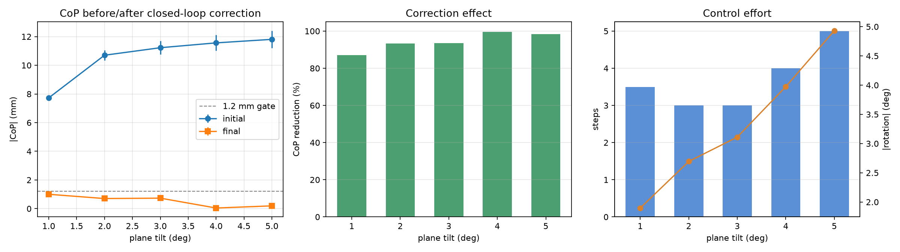

# 5 点力 CoP 闭环对齐仿真

独立仿真包 **`serial_force_sim`**，与真机驱动 `serial_force` 分开。定位是 **mock 仿真与离线分析工具**：不接串口、不进 `harvest_system`、不改真机话题契约；它用同一份 `/force/points`（顺序 1/2/3/5/7，SI 牛顿）把「5 点力 → CoP → 机械臂姿态校正」整条链路跑通，并给出可复现的多场景统计。

- 结论与图：[force_align_sim_stats.md](force_align_sim_stats.md)、[force_align_sim.png](force_align_sim.png)
- 逐组明细：[force_align_sim_trials.csv](force_align_sim_trials.csv)
- 原始逐步记录：[force_align_sim_trials.jsonl](force_align_sim_trials.jsonl)
- 工具：[../serial_force_sim/](../serial_force_sim/)
- 点位唯一来源：[../../serial_force/doc/force_pad_positions.md](../../serial_force/doc/force_pad_positions.md)（CAD 复核，tcp 系）

## 1. 这套东西在回答什么问题

真机上 5 片膜片压在果实表面时，如果 5 个力值不等，说明压头没有和表面贴合。把 5 点力
合成一个 **CoP（Center of Pressure，压力中心）**，就得到一个二维偏差；用这个偏差驱动
末端做很小的姿态旋转，直到 5 点受力均匀。仿真回答三件事：

1. 控制律在多大的初始偏差内能收敛；
2. 要转多少度、几步、多久；
3. 收敛后 5 点力是否真的均匀。

它不验证真实接触力学，也不替代真机。真机仍是接触、摩擦、果实损伤的最终权威。

## 2. 几何与物理模型

### 2.1 点位

5 个压点在 `tcp` 系共面，平面 `tcp z = −72.29 mm`，法线 `+Z_tcp`（果实侧）。
坐标与 [serial_force 包 force_pad_positions.md](../../serial_force/doc/force_pad_positions.md) 一致，代码里集中在 `common.py` 的 `PADS`：

| 通道 | tcp x / mm | tcp y / mm |
|---|---:|---:|
| 1（右上） | +15.75 | +4.30 |
| 2（右下） | +9.45 | −13.30 |
| 3（左下） | −9.65 | −13.15 |
| 5（上，顶点） | 0.00 | +16.45 |
| 7（左上） | −15.70 | +4.55 |

### 2.2 虚拟平面

`fake_force` 在**启动后的第一帧**用当时的 tcp 位姿冻结一张虚拟平面：

- 平面过点 `plane_p = p_tcp + R·(0, 0, Z0)`；
- 平面法线 `plane_n` 由压头法线 `R·(0,0,1)` 绕一条水平轴旋转 `tilt_deg` 得到，
  旋转轴方位由 `tilt_yaw_deg` 决定（0° = 绕 base_link 的 +X，90° = 绕 +Y）；
- 之后机械臂怎么动，平面都不动。倾角代表「果实表面相对压头没贴平」的角度。

### 2.3 5 点力

```text
p_i = p_tcp + R · (x_i, y_i, Z0)          # 第 i 个压点，base_link，m
s_i = (p_i − plane_p) · plane_n           # 压点相对平面的有符号距离，mm
f_i = k · max(0, preload − s_i)           # 线性弹簧，N
CoP = Σ f_i · (x_i, y_i) / Σ f_i          # mm（tcp 平面内）
```

`s_i` 为负表示压点已经压进平面；`preload` 是装配预压量。倾角越大，各压点的 `s_i`
差得越多，力就越不均，CoP 越偏。

| 参数 | 默认 | 含义 |
|---|---:|---|
| `tilt_deg` | 3.0 | 虚拟平面相对压头法线的倾角，deg |
| `tilt_yaw_deg` | 0.0 | 倾角方位（绕压头法线），deg |
| `preload_mm` | 0.30 | 五点同时接触时的预压量，mm |
| `k_n_per_mm` | 0.8 | 单点等效刚度，N/mm（真机膜片约 66.7 g/mm ≈ 0.65 N/mm，同量级） |

**饱和**：当 `s_i > preload` 时该点已经离面，`f_i = 0`。所以大倾角时不是 5 点一起
变化，而是先有几个点掉到 0，CoP 偏移随倾角增大而变缓（见 §6）。这正是真机上
「偏到一定程度只剩两三个点受力」的定性行为。

## 3. 节点、话题与依赖

| 程序 | 节点名 | 作用 |
|---|---|---|
| `fake_force.py` | `fake_force_sim` | 用 tcp TF + 虚拟平面算 5 点力，发布 `/force/points` 等 |
| `cop_web.py` | `cop_web_sim` | 订阅力，SSE 推 5 点 / CoP 网页（默认 8100） |
| `cop_control.py` | `force_align_cop_control` | 单次闭环：CoP → IK → JTC 旋转 TCP |
| `trial_runner.py` | `cop_trial_runner` | 批量：复位 → 起场景 → 闭环 → 记录 JSONL |
| `analysis.py` | 无（离线） | JSONL → CSV / 统计表 / 三联图 |

| 接口 | 类型 | 说明 |
|---|---|---|
| `/force/points` | `std_msgs/Float64MultiArray` | 5 值，顺序 1/2/3/5/7，N；与真机驱动同名同契约 |
| `/force/status` | `std_msgs/UInt8MultiArray` | 5 值 0/1；仿真按 3.63 N 阈值给，仅演示 |
| `/force/travel`、`/force/ad` | `Float64MultiArray` | 仿真给的伪行程/伪 AD，只为让现有 Web 有数可显 |
| `/joint_states` | `sensor_msgs/JointState` | 机械臂关节角（IK 种子、复位判据） |
| `/compute_ik` | `moveit_msgs/srv/GetPositionIK` | 姿态微调的逆解 |
| `/joint_trajectory_controller/follow_joint_trajectory` | `control_msgs/action/FollowJointTrajectory` | 执行单点关节目标 |
| `base_link → tcp` | TF | 当前 TCP 位姿；仿真与 RViz 都用它 |

依赖：`rclpy`、`tf2_ros`、`std_msgs`、`sensor_msgs`、`geometry_msgs`、
`moveit_msgs`、`control_msgs`、`trajectory_msgs`；分析脚本另需 `numpy`、`matplotlib`。
这些只用于仿真/分析，真机驱动本身仍只依赖串口与 `std_msgs`/`diagnostic_msgs`。

## 4. 控制律

```text
if |CoP| < center_mm:                      停止（居中）
α = sign · clip(0.0035·|CoP|, 0.006, 0.02)  # rad，单步
axis = normalize(−CoP_y, CoP_x, 0)          # base_link，水平且垂直 CoP 方向
R_new = R · R_axis(α)                       # 只改姿态，位置不动
q_new = IK(R_new, seed=q_now)               # 以当前关节为种子
JTC(q_new, 1 s)                             # 执行
```

- **为什么要转**：压头绕「CoP 垂线」转，会把压头平面朝虚拟平面压下去，CoP 往中心走。
- **步长**：偏差越大步长越大（0.34°–1.15°），小幅逼近，避免一次转过头。
- **符号**：初始 `sign = −1`；如果这一步让 `|CoP|` 比上一步大 5% 以上，就翻转符号。
  这是一个简单的爬山法，不依赖虚拟平面真值。
- **停止**：`|CoP| < 1.2 mm`、累计旋转到 5°、或 12 步用完。
- **为什么不用 MoveGroup 规划**：位置约束球 0.8 mm + 姿态容差 3% 时 OMPL 常返回
  `error_code = -1`（不可行）；IK + JTC 稳定且每步 < 1 s。MoveIt 只用来提供
  `/compute_ik` 和 RViz。

`sign` 与轴的选择使旋转方向由 CoP 自己决定，因此同一个控制律对 0°/90°/任意方位的
初始偏差都适用；不需要事先知道 tilt 是多少。

## 5. 试验协议与数据格式

`trial_runner.py` 对每个（倾角, 方位, 重复）执行：

1. JTC 复位到 `HOME`（`common.py`，与 bringup 默认 mock 初值一致），等 0.4 s；
2. 以 `tilt_deg` / `tilt_yaw_deg` 启动一个新的 `fake_force.py`（每场景重新冻结平面）；
3. 等到收到 >20 帧且总力 >0.05 N，静置 0.6 s；
4. 采 0.6 s 平均作为 **初始** CoP / 5 点力；
5. 跑 §4 闭环；
6. 再静置 0.6 s，采 0.6 s 平均作为 **最终** CoP / 5 点力；
7. 关闭该场景的 `fake_force`，追加一行 JSON。

每组记录字段：

| 字段 | 含义 |
|---|---|
| `tilt_deg`、`tilt_yaw_deg`、`repeat` | 场景与重复号 |
| `initial`、`final` | `cop`（x,y mm）、`cop_norm`（模长 mm）、`total`（N）、`forces`（5 点 N） |
| `reduction_pct` | `1 − 最终模长/初始模长`，% |
| `success` | 最终模长 < `center_mm` |
| `reason` | `centered` / `rotation_limit` / `max_steps` / `no_contact` / `ik_fail` / `jtc_fail` / `tf_fail` |
| `n_steps`、`rotation_deg`、`duration_s` | 闭环实际步数、累计旋转、耗时 |
| `steps[]` | 每步的 `cop_before`、`total_before`、`angle_deg`、`jtc_ok` |

仿真是**确定性**的：同一场景重复两次，初始/最终 CoP 完全一致。统计里的方差来自
不同倾角/方位，不是噪声。

## 6. 指标与结果

指标定义：

- **CoP 模长**：`hypot(cop_x, cop_y)`，mm；越小越贴合。
- **降幅**：`(1 − final/initial) × 100%`。
- **成功率**：最终模长 < 1.2 mm 的组数 / 总组数。
- **接触点数**：5 点力中 > 0.05 N 的点数，衡量是否所有膜片都受压。
- **力 CV**：5 点力的标准差/均值，衡量受力均匀性。

2026-10-21 这批：**5 倾角 × 2 方位 × 2 重复 = 20 组**。

| 倾角 ° | n | 初始 CoP 模长 mm | 最终 mm | 降幅 % | 步数 | 旋转 ° | 成功 |
|---:|---:|---:|---:|---:|---:|---:|---:|
| 1 | 4 | 7.72 ± 0.20 | 1.00 ± 0.07 | 87.1 | 3.5 | 1.90 | 4/4 |
| 2 | 4 | 10.70 ± 0.40 | 0.70 ± 0.04 | 93.4 | 3.0 | 2.69 | 4/4 |
| 3 | 4 | 11.23 ± 0.55 | 0.73 ± 0.02 | 93.5 | 3.0 | 3.11 | 4/4 |
| 4 | 4 | 11.56 ± 0.63 | 0.04 ± 0.00 | 99.6 | 4.0 | 3.97 | 4/4 |
| 5 | 4 | 11.81 ± 0.70 | 0.19 ± 0.15 | 98.4 | 5.0 | 4.93 | 4/4 |

整体：成功率 **20/20 = 100%**；最终 CoP **0.53 ± 0.37 mm**；降幅 **94.4 ± 4.6%**；
平均 **3.7 步 / 3.32° / 6.4 s**。接触点 **3.2/5 → 5/5**；力 CV **0.95 → 0.051**。



读法：

1. **1–5° 全部收敛**，说明这套「CoP 垂线 + 小步爬山」的控制律在这个范围有效。
2. **初始偏差 7.7 → 11.8 mm 后饱和**：倾角到 2° 以上时，已经有压点离面（力=0），
   再倾斜只是让剩余点更集中，CoP 不会线性增大。
3. **校正旋转近似 1° 倾角对应 1° 旋转**（1.9/2.69/3.11/3.97/4.93），到 5° 场景
   已用掉 4.93°/5° 上限——**5° 是这套控制律的能力边界**，再大需要先平移或换策略。
4. **1° 小偏差反而步数多**：最小步长 0.34°，接近门限时会来回微调（3.5 步、σ 2.9）；
   2–3° 反而 3 步就到位。可改自适应步长/阻尼改善。
5. **收敛后 5 点全部有载、力 CV 降到 0.05**：不是把 CoP 算成 0，而是真的五点均匀。

完整逐组表见 [force_align_sim_stats.md](force_align_sim_stats.md)，原始数据见
[force_align_sim_trials.jsonl](force_align_sim_trials.jsonl)。

## 7. 怎么跑

本包独立构建安装；真机驱动 `serial_force` 不依赖它。

```bash
source /opt/ros/jazzy/setup.bash
colcon build --packages-select serial_force_sim
source install/setup.bash
export ROS_DOMAIN_ID=42
```

前置：mock 机械臂 + MoveIt：

```bash
ros2 launch aubo_e5_bringup bringup.launch.py \
  hardware_mode:=mock moveit_enabled:=true \
  camera_enabled:=false extrinsics_enabled:=false \
  tool_profile:=bite_shear_v1
```

### 7.1 看实时 CoP

```bash
ros2 run serial_force_sim fake_force --ros-args \
  -p tilt_deg:=4.0 -p tilt_yaw_deg:=0.0
ros2 run serial_force_sim cop_web --port 8100
# 浏览器打开 http://127.0.0.1:8100
```

### 7.2 单次闭环

```bash
ros2 run serial_force_sim cop_control \
  --center-mm 1.2 --max-rot-deg 5 --max-steps 12
```

### 7.3 批量 + 统计

```bash
ros2 run serial_force_sim cop_trials \
  --tilt 1,2,3,4,5 --yaw 0,90 --repeats 2
# 默认写 $ROS_HOME/serial_force_sim/force_align_sim_trials.jsonl

ros2 run serial_force_sim cop_analyze \
  $ROS_HOME/serial_force_sim/force_align_sim_trials.jsonl
# CSV / 统计表 / 图默认写回 $ROS_HOME/serial_force_sim/
```

重生成包内基线数据：

```bash
ros2 run serial_force_sim cop_trials \
  --out src/serial_force_sim/doc/force_align_sim_trials.jsonl \
  --log-dir /tmp/force_sim_logs \
  --tilt 1,2,3,4,5 --yaw 0,90 --repeats 2
ros2 run serial_force_sim cop_analyze --out-dir src/serial_force_sim/doc \
  src/serial_force_sim/doc/force_align_sim_trials.jsonl
```

### 7.4 已知环境问题

- 在无硬件 GL 的沙箱/远程桌面里 `rviz2` 可能报 `Failed to create an OpenGL context`；
  用 Mesa 软件渲染可绕过：
  `__GLX_VENDOR_LIBRARY_NAME=mesa LIBGL_ALWAYS_SOFTWARE=1 GALLIUM_DRIVER=llvmpipe rviz2 ...`。
  自己终端正常启动则不需要。
- 手工起 RViz 时必须带 launch 生成的 `--params-file`（含 `robot_description_semantic`），
  否则 MotionPlanning 面板显示 **No Planning Scene Loaded**；正常 `ros2 launch` 会自动带。

## 8. 文件与关系

| 文件 | 说明 |
|---|---|
| `serial_force_sim/common.py` | 点位、关节名、HOME、CoP/旋转工具（唯一代码源） |
| `serial_force_sim/fake_force.py` | 仿真力源（替代串口驱动） |
| `serial_force_sim/cop_web.py` | 实时 CoP 网页 |
| `serial_force_sim/cop_control.py` | 单次闭环 |
| `serial_force_sim/trial_runner.py` | 多场景批量试验 |
| `serial_force_sim/analysis.py` | 统计与图 |
| `README.md` | 包说明与快速开始 |
| `doc/force_align_sim_stats.md` | 自动统计表（可重生成） |
| `doc/force_align_sim_trials.csv` | 逐组明细（可重生成） |
| `doc/force_align_sim_trials.jsonl` | 原始逐步数据 |
| `doc/force_align_sim.png` | 三联图 |

与真机的关系：

- **分离**：仿真代码、数据、文档全部在本包；`serial_force` 只有串口驱动与 `force_web.py`，
  不 import 本包，两者只靠 `/force/points` 契约衔接。
- **共用**：话题名、5 值顺序、单位、CoP 定义、控制律都可以直接换到真机。
- **不共用**：`fake_force.py` 只是替身；真机跑 `serial_force_node`，把 `cop_control.py`
  的 `/force/points` 换成真实数据即可（不要同时起 fake_force，会抢同一话题）。
- **不改**：串口协议、`/dev/force` udev、`harvest_system` 生命周期、真机 launch。

## 9. 局限与后续

1. **静力线性弹簧**：没有摩擦、迟滞、膜片蠕变、果实柔性、臂动力学；数值只能看趋势。
2. **平面冻结**：虚拟平面在 `fake_force` 启动时固定，运行中不随果实表面变化；
   重新起场景才会更新。
3. **确定性**：没有噪声，同场景重复 σ=0；真实重复性需要真机数据。
4. **只控姿态**：不修正位置偏差，也不做力闭环；超过 5° 的偏差需要平移/重定位。
5. **真机验证建议**：先用小倾角（1–2°）、低速度、单步确认方向；把 `center_mm` 放大到
   2–3 mm 观察趋势，再收紧。

后续可做：自适应步长/阻尼（改善 1° 过冲）、加入噪声与迟滞做蒙特卡洛、把 5 点固定帧
写进 URDF（见 `../../serial_force/doc/force_pad_positions.md` §7）、真机跑同一套 `cop_analyze`。

## 10. 变更记录

- 2026-10-21：从 `_tools/force_align_sim/` 先迁入 `serial_force`，同日按「模拟与真实分开」
  拆成独立包 `serial_force_sim`；`fake_force` 参数化（倾角/方位/预载/刚度），
  新增批量 runner 与统计脚本；20 组试验数据、统计图与本文档随包。
